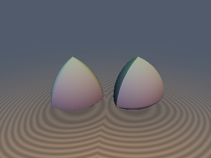
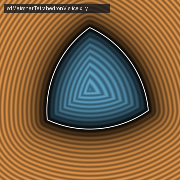
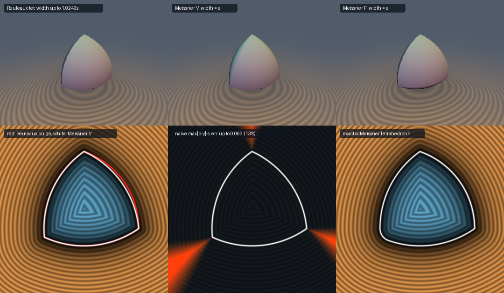

# `sdMeissnerTetrahedron` — Exact SDFs of Both Meissner Tetrahedra (3D Bodies of Constant Width)

<p align="center">
  
  
</p>

<p align="center">
  
</p>

- **Category**: `primitives3d`
- **GLSL File**: [`glsl/primitives3d/sdMeissnerTetrahedron.glsl`](../../glsl/primitives3d/sdMeissnerTetrahedron.glsl)
- **Attribution**: Discovered and derived using Claude Opus 5.5 (`sdf-gems`, 2026)
- **Exactness**: **Exact Euclidean SDF & analytical unit gradient**, inside and outside (`2.84e-7` max error in FP32 on the GPU against an FP64 brute-force ground truth over 23,500 points per body; 0 trig; interior 1–2 `sqrt`, exterior 3–7 SFU ops)

API (`s` = constant width = tetrahedron edge length; C3v axis $(1,1,1)$, apex $\mathbf v_0 = (1,1,1)\,s/(2\sqrt2)$):

| Function | Body |
| :--- | :--- |
| `float sdMeissnerTetrahedronV(vec3 p, float s)` / `vec4 sdgMeissnerTetrahedronV` | Type **V**: the three smoothed edges meet at the apex $\mathbf v_0$ (sharp base triangle $\mathbf v_1\mathbf v_2\mathbf v_3$) |
| `float sdMeissnerTetrahedronF(vec3 p, float s)` / `vec4 sdgMeissnerTetrahedronF` | Type **F**: the three sharp edges meet at the apex $\mathbf v_0$ (smoothed base triangle) |

---

## Overview & Motivation

The **Reuleaux tetrahedron** (intersection of four balls of radius $s$ centred on the vertices of a regular tetrahedron with edge $s$) is *not* a body of constant width: across the midpoints of opposite edges it is $\approx 1.0249\,s$ wide. In 1911 Ernst Meissner showed that smoothing **three** of its six circular edges — either the three meeting at one vertex, or the three bounding one face — by spindle-torus patches produces genuine bodies of constant width $s$. The two **Meissner tetrahedra** are the classic candidates for the constant-width body of minimal volume (Bonnesen–Fenchel conjecture), and they roll between parallel planes like a sphere.

Shader code on the web models them as a plain intersection of four spheres (the Reuleaux tetrahedron — the wrong shape), or a CSG of spheres and tori that is neither exact nor easy to get right at the seams between the patches. This file gives the **first exact SDF of both Meissner tetrahedra** that we could find, from a short duality argument.

---

## Mathematical Derivation

### 1. Constant-Width Farthest-Point Duality

**Lemma.** For *any* convex body $M$ of constant width $s$:
$$\operatorname{SDF}_M(\mathbf p) \;=\; \max_{\mathbf o\in M}\|\mathbf p-\mathbf o\| \;-\; s \qquad\text{(exact, inside and outside).}$$

*Exterior.* Let $\mathbf q$ be the nearest point, $d = \|\mathbf p-\mathbf q\|$, $\mathbf n = (\mathbf p-\mathbf q)/d$. In a body of constant width every boundary normal is a double normal, so the opposite point $\mathbf o=\mathbf q-s\mathbf n$ lies in $M$ and $\|\mathbf p-\mathbf o\| = d+s$. For any other $\mathbf o'\in M$, $\|\mathbf p-\mathbf o'\|\le \|\mathbf p-\mathbf q\|+\|\mathbf q-\mathbf o'\|\le d+\operatorname{diam}M = d+s$.

*Interior.* Let $R=\max_{\mathbf o\in M}\|\mathbf p-\mathbf o\|$. Constant-width bodies are diametrically complete, $M=\bigcap_{\mathbf x\in M}B(\mathbf x,s)$, and $\|\mathbf p-\mathbf x\|\le R$ for all $\mathbf x\in M$ gives $B(\mathbf p,s-R)\subset M$, i.e. $\operatorname{dist}(\mathbf p,\partial M)\ge s-R$. Conversely the opposite point of the nearest boundary point $\mathbf q$ is at distance exactly $s-\operatorname{dist}(\mathbf p,\partial M)$ from $\mathbf p$. $\square$

### 2. Meissner Bodies as Ball Intersections over Their Sharp Set

Let $\mathbf v_0=(1,1,1)k$, $\mathbf v_1=(1,-1,-1)k$, $\mathbf v_2=(-1,1,-1)k$, $\mathbf v_3=(-1,-1,1)k$ with $k=s/(2\sqrt2)$ (edge length $s$). The Reuleaux edge arc between $\mathbf v_a,\mathbf v_b$ is the short $70.53^\circ$ arc of the circle $S(\mathbf v_c,s)\cap S(\mathbf v_d,s)$ (centre $(\mathbf v_c+\mathbf v_d)/2$, radius $\tfrac{\sqrt3}{2}s$). With $Y$ = the 4 vertices $\cup$ the 3 **sharp** arcs,
$$M \;=\; \bigcap_{\mathbf y\in Y} B(\mathbf y, s),\qquad G(\mathbf p) := \max_{\mathbf y\in Y}\|\mathbf p-\mathbf y\|,\qquad M=\{G\le s\}.$$
Each smoothed edge is exactly the envelope of the balls centred on its opposite sharp arc (the spindle torus), and each spherical face is the ball around its opposite vertex. Numerically verified (FP64, 1.5 M ray-cast boundary samples + local refinement of the support function in 2,000 random directions):

| Body | min width | max width | Volume (ray-integrated) |
| :--- | :---: | :---: | :---: |
| Meissner **V** ($\{G\le s\}$) | 0.9999996 s | 1.0000000 s | 0.419860 s³ |
| Meissner **F** ($\{G\le s\}$) | 0.9999998 s | 1.0000000 s | 0.419860 s³ |
| Reuleaux tetrahedron | 1.0000000 s | **1.0248112 s** | 0.422158 s³ |

(The known Meissner volume is $\pi\bigl(\tfrac23-\tfrac{\sqrt3}{4}\arccos\tfrac13\bigr)s^3 = 0.419860\,s^3$.)

### 3. Exact SDF from One Farthest-Point Query (+ One Sharp-Feature Test)

The farthest point of $M$ from $\mathbf p$ is the opposite point of the nearest point $\mathbf q$. Smooth patches (sphere around a vertex, torus around a sharp arc) have their opposite points **in $Y$**; so $\max_M\|\mathbf p-\mathbf o\| = G(\mathbf p)$ — and $d=G-s$ — everywhere in the interior and wherever the nearest point is smooth. Only when the nearest point is itself a sharp point (vertex or sharp-arc point) does $G-s$ underestimate (up to $16\%$, see the comparison). Then the nearest point is the nearest sharp point $\mathbf y^\*$, and we have the exact certificate
$$\mathbf o = \mathbf y^\* - s\,\frac{\mathbf p-\mathbf y^\*}{\|\mathbf p-\mathbf y^\*\|} \in M \;\Longleftrightarrow\; d = \|\mathbf p-\mathbf y^\*\|,$$
because $\mathbf o\in M$ gives $\max_M\|\mathbf p-\cdot\|\ge \|\mathbf p-\mathbf y^\*\|+s$, while $\mathbf y^\*\in M$ gives $d\le\|\mathbf p-\mathbf y^\*\|$. So:
$$d(\mathbf p)=\begin{cases} G(\mathbf p)-s & G(\mathbf p)\le s \text{ or } G(\mathbf o)>s\\ \|\mathbf p-\mathbf y^\*\| & \text{otherwise.}\end{cases}$$
The test $G(\mathbf o)^2\le s^2(1+10^{-4})$ uses a generous FP32 tolerance: a false *accept* only costs a second-order error (the two branches agree to first order at the normal-cone boundary), while a false reject would be first order.

### 4. C3v Folding: Sorting the Coordinates

Both bodies are invariant under all permutations of $x,y,z$ (the C3v symmetry about $(1,1,1)$), so sorting $x\ge y\ge z$ (3 compare-swaps) folds $\mathbb R^3$ into one chamber. For a reflection group, the farthest orbit point lies in the *opposite* chamber $z\ge y\ge x$ and the nearest one in the *same* chamber, giving at most three candidates each:

| | Farthest point (for $G$) | Nearest sharp point ($\mathbf y^\*$) |
| :--- | :--- | :--- |
| **V** | $\mathbf v_0$, $\mathbf v_3$, half-arc $\mathbf v_2\mathbf v_3$ (centre $(k,0,0)$, plane $y+z=0$) | $\mathbf v_0$, half-arc $\mathbf v_1\mathbf v_2$ (centre $(0,0,k)$, plane $x+y=0$) → $\mathbf v_1$ |
| **F** | $\mathbf v_0$, $\mathbf v_3$, arc $\mathbf v_0\mathbf v_3$ (centre $(0,0,-k)$, plane $x=y$) | arc $\mathbf v_0\mathbf v_1$ (centre $(-k,0,0)$, plane $y=z$) → $\mathbf v_0$/$\mathbf v_1$ |

Because the arcs subtend $2\arcsin(1/\sqrt3)$ and $\cos(35.26^\circ)=\sqrt{2/3}$, every "antipode / projection lies inside the arc" test collapses to a linear comparison, e.g. for type V the antipode of $\mathbf q$ on the circle of arc $\mathbf v_2\mathbf v_3$ is on the arc iff $x-k\ge y-z$, and then
$$\|\mathbf q-\mathbf o^\*\|^2 = \tfrac12(y+z)^2 + \Bigl(\sqrt{(x-k)^2+\tfrac12(y-z)^2}+\tfrac{\sqrt3}{2}s\Bigr)^2 .$$
The gradient is $(\mathbf p-\mathbf o^\*)/G$ on the $G-s$ branch and $(\mathbf p-\mathbf y^\*)/\|\mathbf p-\mathbf y^\*\|$ on the sharp branch, un-permuted by the recorded swaps.

---

## GLSL Implementation (core)

```glsl
float sdMeissnerTetrahedronImpl( vec3 p, float s, bool faceType )
{
    float k = 0.35355339 * s, rho = 0.86602540 * s;
    vec3  q = sdMeissnerSort(p);
    float G = sqrt(sdMeissnerFar(q, k, rho, faceType).w);
    if( G <= s ) return G - s;                         // whole interior: exact
    vec3  y  = sdMeissnerNear(q, k, rho, faceType);
    vec3  v  = q - y;
    float dy = length(v);
    vec3  o  = y - (s / max(dy, 1e-30)) * v;           // opposite point of y
    float Go = sdMeissnerFar(sdMeissnerSort(o), k, rho, faceType).w;
    return (Go <= s * s * (1.0 + SDF_GEMS_MEISSNER_TOL)) ? dy : G - s;
}
```
See the [GLSL file](../../glsl/primitives3d/sdMeissnerTetrahedron.glsl) for `sdMeissnerFar` (farthest point of $Y$, 1–2 `sqrt`), `sdMeissnerNear` (nearest sharp point) and the `sdg*` gradient versions.

---

## Verification

All numbers measured on the **literal `.glsl`** compiled on the GPU (OpenGL 4.1, FP32), $s=1$.

| Check | `sdMeissnerTetrahedronV` | `sdMeissnerTetrahedronF` |
| :--- | :---: | :---: |
| Max $\lvert d-d_{\text{gt}}\rvert$, 23,500 pts (10k uniform in $[-1,1]^3$, 8k near-surface, 5.5k near vertices/sharp arcs) | `2.84e-7` | `2.38e-7` |
| … near vertices / sharp arcs only | `1.71e-7` | `1.53e-7` |
| Interior $\lvert d-(G_{\text{FP64}}-s)\rvert$, 200k pts | `1.41e-7` | `1.41e-7` |
| NaN/Inf (origin, axes, $x{=}y{=}z$, symmetry planes, vertices; $s\in\{1,0,10^{-6},10^3\}$) | 0 | 0 |
| $C^0$: $\max\lvert d(\mathbf p+\epsilon\mathbf u)-d(\mathbf p-\epsilon\mathbf u)\rvert$, $\epsilon=10^{-5}$ | `2.03e-5` | `2.03e-5` |
| Lipschitz ratio over 200k random close pairs | `1.000028` | `1.000024` |
| FD eikonal $\lvert\lVert\nabla d\rVert-1\rvert$: median / 99th pct (FP32, $h=10^{-3}$) | `2.9e-5` / `1.3e-4` | `3.0e-5` / `1.3e-4` |
| `sdg`: $\lvert$`dg.x`$-d\rvert$ / $\lvert\lVert$`dg.yzw`$\rVert-1\rvert$ | `3.6e-7` / `3.2e-7` | `3.6e-7` / `3.1e-7` |
| `sdg`: cosine vs. FD gradient $>0.999$ | 99.989 % (min `0.99998` off seams) | 99.987 % (min `0.999998` off seams) |
| Branch mix in $[-s,s]^3$: interior / exterior smooth / exterior sharp | 5.3 % / 75.5 % / 19.2 % | 5.3 % / 75.6 % / 19.1 % |

**Ground truth.** FP64 boundary cloud from 4 M ray-cast directions (bisection on $G$), KD-tree seed, then per-point compass-search refinement on the boundary plus exact golden-section distances to the three sharp arcs and the four vertices; the sign comes from $G\le s$. (Three points where the compass search stalled at a crease were re-checked with a dense multi-scale local grid, which confirmed the shader value.) $G$ itself (analytic farthest arc point) matches dense 20,001-sample arcs to `2.4e-10`.

### Before / After

| Method | Shape | Max error vs. exact Meissner SDF ($s=1$, $[-1,1]^3$) |
| :--- | :--- | :---: |
| Naive `max` of 4 spheres (Reuleaux tetrahedron) | **wrong**: width up to $1.0249\,s$ | shape bulges by up to $\approx 0.025\,s$ at the smoothed edges |
| Naive bound $\max_{\mathbf y\in Y}\lVert\mathbf p-\mathbf y\rVert - s$ | correct zero set | `0.069` (V) / `0.096` (F) underestimate (12.8 % / 16.0 %) outside vertices & sharp arcs |
| **`sdMeissnerTetrahedronV/F`** | correct | **`2.84e-7`** (FP32) |

Both naive variants are `max()`es of exact distance functions, so their eikonal norm is 1 almost everywhere — their defects are a wrong *shape* (Reuleaux, red contour in the comparison) and wrong *values* in the normal cones of the sharp features (naive bound, orange wedges), not visible in an eikonal map.

---

## Prior Art & Novelty

- Meissner bodies (Meissner 1911; Meissner & Schilling 1912) and their description by spindle-torus patches are classical; see Kawohl & Weber, *Meissner's Mysterious Bodies* (Math. Intelligencer, 2011). The characterisation of constant-width bodies as diametrically complete sets ($M=\bigcap_{x\in M}B(x,s)$) is standard convex geometry.
- Web searches (Shadertoy, iq's articles, hg_sdf, GitHub, general web) found only Reuleaux-tetrahedron SDFs (4-sphere CSG, or this repository's exact `sdReuleauxTetrahedron`) and suggestions to approximate Meissner bodies with CSG/smooth-min; **no exact Meissner SDF** was found.
- New here: (i) the farthest-point duality used as an SDF construction for constant-width bodies, (ii) the reduction of the Meissner exterior to "$G-s$ unless the nearest sharp point certifies itself via its opposite point" with a single extra $G$ evaluation, and (iii) the C3v sorting fold that reduces each query to two vertices plus one arc with polynomial arc-membership tests.
