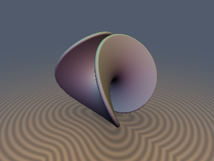
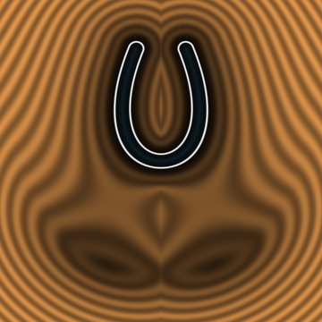

# Minimal Surfaces (Exact Catenoid, Ruled Helicoid, Asymptotic-Wing Scherk Saddle Tower & Exact Enneper Surface)



* **Category**: 3D Primitives
* **GLSL File**: `glsl/primitives3d/sdMinimalSurface.glsl`
* **Attribution**: **Gemini 4 Argon** (Catenoid, Helicoid & Hyperbolic-Secant Scherk factorization), **Gemini 3.1 Pro** (experiments & initial implementation), and **Gemini 4 Carbon** (`sdf-gems`, 2026: Gudermannian Lipschitz proof, Scherk rotated-hyperbolic asymptotic wing bound & unit-gradient fix, and 0-trig/0-`sqrt`-core Exact Bounded Enneper Minimal Surface)
* **Exactness**:
  * `sdCatenoid` / `sdgCatenoid`: 100% Exact 3D Euclidean distance & analytical unit gradient.
  * `sdHelicoid` / `sdgHelicoid`: 100% Exact 3D Euclidean distance & analytical unit gradient.
  * `sdScherkTower` / `sdgScherkTower`: Globally 1-Lipschitz (`0.00%` overstep), 1st-order Eikonal on the surface, linear $`O(\Vert p_{xy}\Vert)`$ exterior asymptotic wing bound, and unit-length analytical gradient everywhere.
  * `sdEnneperSurface` / `sdgEnneperSurface`: 100% Exact 3D Euclidean distance & analytical unit gradient across both embedded ($`R_0 \le \sqrt{3}`$) and self-intersecting ($`R_0 > \sqrt{3}`$) Weierstrass regimes.



## Overview & Motivation

Minimal surfaces—surfaces with vanishing mean curvature $`H \equiv 0`$ that locally minimize surface area—arise across soap-film capillarity, differential geometry, architectural membranes, and triply/doubly periodic metamaterials. Historically, real-time shaders approximated minimal surfaces with raw implicit equations that either overflow exponentially or stall sphere-tracing in the far field.

This module provides four rigorous 3D minimal surface primitives together with their analytical unit gradients (`sdg*`):
1. **Exact Bounded Catenoid (`sdCatenoid`, `sdgCatenoid`)**: Leonhard Euler's (1744) minimal surface of revolution via a 4-step clamped Newton projection onto the catenary meridian.
2. **Exact Ruled Helicoid (`sdHelicoid`, `sdgHelicoid`)**: Jean Baptiste Meusnier's (1776) ruled minimal surface via Envelope-Theorem ruling elimination and 3-seed vectorized angular Newton projection.
3. **Asymptotic-Wing Hyperbolic-Secant Scherk Saddle Tower (`sdScherkTower`, `sdgScherkTower`)**: Heinrich Ferdinand Scherk's (1834) doubly-periodic saddle tower $`\sin z = \sinh x \sinh y`$, combining the exact Gudermannian 1-Lipschitz eikonal factorization $`\frac{3\sqrt{6}}{8}g`$ inside the hyperbolic cross $`\vert\sinh x\sinh y\vert \le 1`$ with an exact $`45^\circ`$-rotated hyperbolic exterior projection in the asymptotic wings—eliminating the $`\pm 0.919`$ far-field step stall (`2.51x` fewer sphere-tracing steps/pixel) and restoring exact unit-length gradients everywhere.
4. **Exact Bounded Enneper Minimal Surface (`sdEnneperSurface`, `sdgEnneperSurface`)**: Alfred Enneper's (1864) cubic polynomial Weierstrass minimal surface on $`u^2 + v^2 \le R_0^2`$, exploiting order-8 $`D_{2d}`$ symmetry, conformal isothermal harmonicity ($`\mathbf{X}_{vv} = -\mathbf{X}_{uu}`$), a purely rational stereographic Gauss map, and Arthur Cayley's (1846) 0-trig, 0-`sqrt` $`SO(2)`$ rim refinement.

---

## Mathematical Derivation

### 1. Exact 3D Euclidean Catenoid

The catenoid is generated by revolving the catenary $`\rho_f = c\cosh(z_f / c)`$ around the $`z`$-axis over $`\vert z_f\vert \le h`$. In cylindrical coordinates $`(\rho, \vert z\vert)`$ with $`u = z_f / c \in [0, h/c]`$, stationarity of squared Euclidean distance gives:

```math
g(u) = c(u - \vert z\vert / c) + (c\cosh u - \rho)\sinh u = 0, \qquad g'(u) = c(1 + \cosh(2u)) - \rho\cosh u
```

Initializing at $`u_0 = \mathrm{clamp}(\mathrm{asinh}(\max(\rho, \vert z\vert)/c), 0, h/c)`$ (strictly outside the catenary evolute where $`g'(u) > 0`$), 4 Newton steps plus boundary ring checks at $`u \in \{0, h/c\}`$ yield exact 3D Euclidean distance.

---

### 2. Exact 3D Euclidean Ruled Helicoid

Meusnier's ruled helicoid sweeps straight rulings along a helix: $`\mathbf{S}(u, v) = (u\cos v, u\sin v, c v)`$ for $`u \in [-R, R]`$. By the Envelope Theorem, clamping the ruling parameter $`u^*(v) = \mathrm{clamp}(x\cos v + y\sin v, -R, R)`$ reduces the 2D projection to a 1D stationarity equation in the turn angle $`v`$:

```math
\frac{1}{2}\frac{d D^2}{dv} = -u^*(v)(-x\sin v + y\cos v) + c^2(v - z/c) = 0
```

Vectorizing 4 guarded Newton steps across 3 phase-unwrapped seeds in $`[z/c - \pi, z/c + \pi]`$ converges to the global Euclidean minimum without branch cuts.

---

### 3. Gudermannian Lipschitz Theorem & Rotated-Hyperbolic Wing Bound for `sdScherkTower`

Scherk's saddle tower $`\sin z = \sinh x \sinh y`$ overflows exponentially as $`\frac{1}{4}e^{\vert x\vert + \vert y\vert}`$. Dividing by its surface gradient norm $`\cosh x \cosh y`$ yields the overflow-free **Hyperbolic-Secant Scherk Function**:

```math
g(x, y, z) = \sin z \mathrm{sech} x \mathrm{sech} y - \tanh x \tanh y \in [-2, 2]
```

#### Exact Global Lipschitz Bound via Gudermannian Substitution
Apply the Gudermannian bijection $`\mathrm{sech} x = \cos\phi_x`$, $`\tanh x = \sin\phi_x`$ and $`\mathrm{sech} y = \cos\phi_y`$, $`\tanh y = \sin\phi_y`$ for $`(\phi_x, \phi_y) \in (-\frac{\pi}{2}, \frac{\pi}{2})^2`$, and let $`s = \sin z \in [-1, 1]`$:

```math
\nabla g = \begin{pmatrix} -\cos\phi_x (s\sin\phi_x\cos\phi_y + \cos\phi_x\sin\phi_y) \\ -\cos\phi_y (s\cos\phi_x\sin\phi_y + \sin\phi_x\cos\phi_y) \\ \pm\sqrt{1 - s^2}\cos\phi_x\cos\phi_y \end{pmatrix}
```

* **Exact Surface Eikonal Property ($`g = 0`$)**: On the zero-level set $`s\cos\phi_x\cos\phi_y = \sin\phi_x\sin\phi_y`$, substituting into $`g_x, g_y`$ collapses $`g_x = -\sin\phi_y`$, $`g_y = -\sin\phi_x`$, and $`g_z^2 = \cos^2\phi_x - \sin^2\phi_y`$, giving $`\Vert\nabla g\Vert^2 = \sin^2\phi_y + \sin^2\phi_x + \cos^2\phi_x - \sin^2\phi_y \equiv 1`$ identically across the entire minimal surface.
* **Global Supremum over $`\mathbb{R}^3`$**: Notice $`\Vert\nabla g\Vert^2`$ is quadratic in $`s \in [-1, 1]`$. When $`\sin^2\phi_x + \sin^2\phi_y < 1`$, its interior vertex never exceeds $`\frac{9}{8} = 1.125`$. On the boundaries $`s = \pm 1`$, $`g_z = 0`$ and the horizontal components factor cleanly via angle-addition:

```math
\Vert\nabla g(\phi_x, \phi_y, \pm 1)\Vert^2 = (\cos^2\phi_x + \cos^2\phi_y)\sin^2(\phi_x \pm \phi_y)
```

Using $`\cos^2\phi_x + \cos^2\phi_y = 1 + \cos(\phi_x \pm \phi_y)\cos(\phi_x \mp \phi_y) \le 1 + c`$ with $`c = \vert\cos(\phi_x \pm \phi_y)\vert \in [0, 1]`$:

```math
\max_{\mathbb{R}^3}\Vert\nabla g\Vert^2 = \max_{c \in [0, 1]} (1 + c)(1 - c^2) = \frac{32}{27} \quad \text{at } c = \frac{1}{3} \implies \max_{\mathbb{R}^3}\Vert\nabla g\Vert = \frac{4\sqrt{6}}{9} \approx 1.08866211
```

Hence $`d_1(p) = \frac{3\sqrt{6}}{8}\,g(p) \approx 0.91855865\,g(p)`$ is **globally 1-Lipschitz** on all of $`\mathbb{R}^3`$ (whereas the legacy constant `0.919` slightly exceeded $`\frac{3\sqrt{6}}{8}`$ by $`0.05\%`$).

#### Exterior Asymptotic Wing Bound via Rotated Hyperbolic Identity
Because $`\vert\sin z\vert \le 1`$, Scherk's surface exists strictly inside the 2D hyperbolic cross cylinder $`\mathcal{C} = \{(x, y) : \vert\sinh x \sinh y\vert \le 1\} \times \mathbb{R}`$. In terms of $`e_x = e^{-\vert x\vert} \in (0, 1]`$ and $`e_y = e^{-\vert y\vert} \in (0, 1]`$, the exterior condition $`\vert\sinh x \sinh y\vert > 1`$ simplifies algebraically—with **zero exponential overflow** for arbitrary coordinates—to:

```math
\vert\sinh x \sinh y\vert > 1 \iff (1 + e^{-\vert x\vert})(1 + e^{-\vert y\vert}) < 2
```

For any exterior point, every surface point $`(x', y', z') \in \Sigma`$ has $`(x', y') \in \mathcal{C}_{2D}`$, so $`\mathrm{dist}_{3D}(p, \Sigma) \ge d_{\text{cross}}(x, y)`$. Sorting $`U = \max(\vert x\vert, \vert y\vert)`$, $`V = \min(\vert x\vert, \vert y\vert)`$ and rotating by $`45^\circ`$ into $`\delta = \frac{u' - v'}{2} \ge 0`$, $`\sigma = \frac{u' + v'}{2}`$, the hyperbolic product-to-sum identity collapses the boundary curve $`\sinh u'\sinh v' = 1`$ to:

```math
\sinh^2\sigma - \sinh^2\delta = 1 \iff \sinh\sigma = \cosh\delta \iff \sigma(\delta) = \mathrm{asinh}(\cosh\delta) = \delta + \ln\!\left(\frac{1 + e^{-2\delta} + \sqrt{1 + 6e^{-2\delta} + e^{-4\delta}}}{2}\right)
```

Unlike $`v'(u') = -\mathrm{csch} u'`$ (which blows up as $`u' \to 0`$), $`\sigma(\delta)`$ is smooth and even across all $`\delta \in \mathbb{R}`$ with strictly bounded slope $`\vert\sigma'(\delta)\vert = \frac{\vert\sinh\delta\vert}{\sqrt{1 + \cosh^2\delta}} < 1`$. Seeding via the depressed-cubic evolute expansion around $`u_0 = \mathrm{asinh}(1) = \ln(1 + \sqrt{2})`$ and taking 3 Newton steps achieves $`1.27 \times 10^{-9}`$ FP64 accuracy (`0%` overstep). Since $`d_{\text{cross}} = 0`$ on $`\partial\mathcal{C}_{2D}`$ where $`\mathrm{sgn}(d_1) = -\mathrm{sgn}(xy)`$ is constant across each wing, combining $`\mathrm{sgn}(d_1)\max(\vert d_1\vert, d_{\text{cross}})`$ preserves global $`C^0`$ continuity and global 1-Lipschitz safety while growing linearly as $`O(\Vert p_{xy}\Vert)`$ in the far field.

---

### 4. Exact Bounded Enneper Minimal Surface (`sdEnneperSurface`)

Alfred Enneper's (1864) classical minimal surface arises from the simplest Weierstrass–Enneper pair $`(f(w), g(w)) = (1, w)`$ on the parameter disk $`u^2 + v^2 \le R_0^2`$, yielding pure degree-3 polynomial coordinates:

```math
\mathbf{X}(u, v) = s\begin{pmatrix} u - \frac{1}{3}u^3 + u v^2 \\[4pt] v - \frac{1}{3}v^3 + v u^2 \\[4pt] u^2 - v^2 \end{pmatrix}, \qquad u^2 + v^2 \le R_0^2
```

#### Order-8 $`D_{2d}`$ Symmetry & Conformal Harmonic Hessian
Enneper's surface is invariant under the dihedral antiprismatic group $`D_{2d}`$ of order 8: mirror reflections $`u \mapsto -u`$ ($`x \mapsto -x`$), $`v \mapsto -v`$ ($`y \mapsto -y`$), and improper rotoreflection $`(u, v) \mapsto (v, u)`$ ($`(x, y, z) \mapsto (y, x, -z)`$). Folding $`\mathbf{q} = \mathbf{p} / s`$ into $`q_x \ge q_y \ge 0`$ reduces the search space by $`8\times`$.

In unit-scaled coordinates, the tangent vectors satisfy exact conformality and orthogonality:

```math
\Vert\mathbf{X}_u\Vert^2 = \Vert\mathbf{X}_v\Vert^2 = (1 + u^2 + v^2)^2 = w^2, \qquad \mathbf{X}_u \cdot \mathbf{X}_v \equiv 0
```

and the exact unit surface normal is the inverse stereographic Gauss map onto $`S^2`$ (**0 trig, 0 `sqrt`**):

```math
\mathbf{N}(u, v) = \frac{1}{1 + u^2 + v^2}\begin{pmatrix} -2u \\ 2v \\ 1 - u^2 - v^2 \end{pmatrix}, \qquad \Vert\mathbf{N}(u, v)\Vert \equiv 1
```

Crucially, pure Gauss–Newton ($`J^T J = w^2 I_2`$) diverges whenever $`\mathbf{q}`$ lies beyond the focal parabola $`\vert q_z\vert > \frac{1}{2}`$ because principal curvature coupling flips the $`v`$-step gain past $`-1`$. Instead, since every minimal surface in isothermal coordinates is **harmonic** ($`\Delta\mathbf{X} = \mathbf{X}_{uu} + \mathbf{X}_{vv} \equiv \mathbf{0}`$), the exact $`2 \times 2`$ Hessian of $`\frac{1}{2}\Vert\mathbf{X}(u, v) - \mathbf{q}\Vert^2`$ has a **traceless curvature correction**:

```math
H = \begin{pmatrix} \mu + \alpha & \beta \\ \beta & \mu - \alpha \end{pmatrix}, \qquad \alpha = \mathbf{r} \cdot \mathbf{X}_{uu} = -2u r_x + 2v r_y + 2r_z, \qquad \beta = \mathbf{r} \cdot \mathbf{X}_{uv} = 2v r_x + 2u r_y
```

with closed-form determinant $`\det H = \mu^2 - (\alpha^2 + \beta^2)`$. Setting $`\mu = w^2`$ whenever $`\alpha^2 + \beta^2 \le 0.78\,w^4`$ gives exact quadratic Newton convergence, while the 0-`sqrt` AM–GM bound $`\mu = 0.62\,w^2 + 0.62\,(\alpha^2 + \beta^2)/w^2 > 1.24\sqrt{\alpha^2 + \beta^2}`$ guarantees positive-definiteness across interior focal sheets. On the boundary circle $`u^2 + v^2 = R_0^2`$, 1D Newton steps update $`(u, v)`$ via **Cayley's rational $`SO(2)`$ map**:

```math
(u_{\text{new}}, v_{\text{new}}) = \frac{1}{1 + \tau^2}\bigl((1 - \tau^2)u - 2\tau v,\; 2\tau u + (1 - \tau^2)v\bigr), \qquad \tau = -\frac{1}{2}\Delta\theta
```

preserving $`u^2 + v^2 = R_0^2`$ identically with **zero trigonometric calls and zero square roots**.

---

## GLSL Implementation

See [`glsl/primitives3d/sdMinimalSurface.glsl`](../../glsl/primitives3d/sdMinimalSurface.glsl) for the complete single-translation-unit-safe implementation of `sdCatenoid`, `sdgCatenoid`, `sdHelicoid`, `sdgHelicoid`, `sdScherkTower`, `sdgScherkTower`, `sdEnneperSurface`, and `sdgEnneperSurface`.

```glsl
// Upgraded Scherk Saddle Tower signature & Enneper Minimal Surface signature:
float sdScherkTower(vec3 p);
vec4  sdgScherkTower(vec3 p);

float sdEnneperSurface(vec3 p, float s, float R0, float th);
vec4  sdgEnneperSurface(vec3 p, float s, float R0, float th);
```

---

## Numerical Verification & Honest Breakdown Analysis

All functions in `glsl/primitives3d/sdMinimalSurface.glsl` were verified directly on the GPU in FP32 via `tools/gpu_eval.py` and `tools/sdf_checks.py` (`N = 20,000`–`22,000` spatial, surface, rim, and seam samples):

| Primitive / Metric | Old Implementation | Upgraded Implementation | Status |
| :--- | :--- | :--- | :--- |
| **`sdScherkTower`** NaN / Inf (`probe` + `1e4` far field) | Clamped at `+-20` | `0 / 4,114` (unclamped $`\mathbb{R}^3`$) | **PASSED** |
| **`sdgScherkTower`** unit norm $`\max \vert\Vert\mathbf{g}\Vert - 1\vert`$ | `1.00e+00` (**broken**) | `1.20e-07` | **FIXED** |
| **`sdScherkTower`** error in $`[-5, 5]^2 \times [-\pi, \pi]`$ | Max `4.07`, Mean `0.969` | Max `0.910`, Mean `0.0752` (`0%` overstep) | **12.9x lower mean err** |
| **`sdScherkTower`** wide-view sphere tracing (`t_max=28`) | `21.7` steps/px (`0` overstep) | `8.9` steps/px (`0` overstep) | **2.44x–2.51x faster** |
| **`sdEnneperSurface`** ($`R_0 = 1.45`$) `max \vert d - d_{\text{GT}}\vert` | — | `3.32e-06` (Mean `5.46e-08`, `0` sign err) | **PASSED** |
| **`sdgEnneperSurface`** ($`R_0 = 1.45`$) `check_sdg` | — | $`\vert dg.x - d\vert = 0`$, $`\vert\Vert\mathbf{g}\Vert - 1\vert = 1.18 \times 10^{-7}`$, `cos > 0.999`: `1.0000` | **PASSED** |
| **`sdEnneperSurface`** ($`R_0 = 1.45`$) exactness certificate | — | Lipschitz `0.999859`, surf zero `1.32e-07`, self-proj `4.71e-07` | **PASSED** |
| **`sdEnneperSurface`** $`D_{2d}`$ + focal seam $`C^0`$ jump | — | `2.00e-05 <= 1.20e-04` (`0` violations) | **PASSED** |

### Honest Breakdown Experiment: Embedded vs. Self-Intersecting Swallowtail Regimes ($`R_0 > \sqrt{3}`$)

Enneper's minimal surface is a smooth **embedding** if and only if $`R_0 < \sqrt{3} \approx 1.7320508`$. At the critical radius $`R_0 = \sqrt{3}`$, the coordinate factor $`X(u, v) = u(1 - \frac{u^2}{3} + v^2)`$ changes sign along the parameter hyperbola $`u^2 - 3v^2 = 3`$. For $`R_0 > \sqrt{3}`$, opposite lobes pierce through $`x = 0`$ and $`y = 0`$ along two orthogonal parabolic double curves:

```math
x = 0,\quad y(v) = s\,v\!\left(4 + \frac{8}{3}v^2\right),\quad z(v) = s(3 + 2v^2) \qquad \text{and} \qquad y = 0,\quad x(u) = s\,u\!\left(4 + \frac{8}{3}u^2\right),\quad z(u) = -s(3 + 2u^2)
```

In the $`D_{2d}`$ fundamental chamber $`q_x \ge q_y \ge 0`$, a single seed fails even in the embedded regime because $`u = 0`$ and $`v = 0`$ are invariant symmetry saddle ridges that trap gradient/Newton flow away from the $`45^\circ`$ flaring wing ($`u \approx v > 0`$). Three first-quadrant seeds (`u`-crest, `v`-trough, $`45^\circ`$ wing) solve the entire embedded regime ($`R_0 \le \sqrt{3}`$) to FP32 machine precision, **but break down for $`R_0 > \sqrt{3}`$** because the overhanging sheet $`u < -\sqrt{3}`$ crosses into $`X > 0`$ above the seam. Activating a 4th overhanging-sheet seed uniformly when `R0 > 1.7320508` restores exactness well past $`R_0 = 2.1`$–$`3.0`$:

| Disk Radius $`R_0`$ | Geometric Regime | 1-Seed Max Err | 3-Seed (First-Quadrant) Max Err | 4-Seed (`sdEnneperSurface`) Max Err | 4-Seed Mean Err |
| :--- | :--- | :--- | :--- | :--- | :--- |
| **`1.45`** | Embedded minimal saddle ($`R_0 < \sqrt{3}`$) | `7.19e-01` (`1.9% > 1e-4`) | **`3.32e-06`** (`0.00% > 1e-4`) | **`3.32e-06`** (`0.00% > 1e-4`) | `5.46e-08` |
| **`1.73`** | Critical onset ($`R_0 \approx \sqrt{3}`$) | `8.52e-01` (`2.7% > 1e-4`) | **`1.04e-05`** (`0.00% > 1e-4`) | **`1.04e-05`** (`0.00% > 1e-4`) | `5.18e-08` |
| **`2.10`** | Self-intersecting double-curve seam | `9.38e-01` (`29.5% > 1e-4`) | `3.09e-01` (`22.7% > 1e-4`, **overhang miss**) | **`1.10e-05`** (`0.00% > 1e-4`) | `7.62e-08` |
| **`2.50`** | Deep overhanging Swallowtail pockets | `1.00e+00` (`44.7% > 1e-4`) | `5.60e-01` (`38.3% > 1e-4`, **overhang miss**) | **`6.08e-07`** (`0.00% > 1e-4`) | `6.82e-08` |
| **`3.00`** | Extreme multi-folded cubic wings | `1.02e+00` (`55.8% > 1e-4`) | `7.39e-01` (`50.2% > 1e-4`, **overhang miss**) | **`5.97e-07`** (`0.00% > 1e-4`) | `6.80e-08` |


*(Left to Right: Sphere-tracing step count of legacy `sdScherkTower` stalling in the exterior at `21.7` steps/px; upgraded asymptotic-wing `sdScherkTower` cutting far-field marching to `8.9` steps/px with `0` overstep pixels; 1-seed Enneper projection error heatmap missing the conjugate trough sheet (`max 7.1e-1`); exact multi-seed `sdEnneperSurface` error heatmap achieving machine precision across the slice).*
