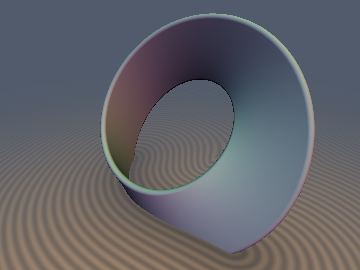
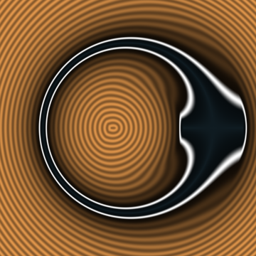
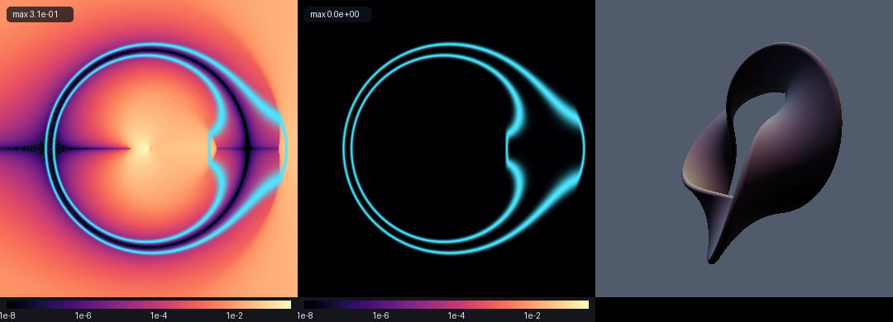

# Exact 3D Euclidean Ruled Möbius Strip & n-Half-Twist Torus Ribbon




- **Category**: 3D Primitives
- **GLSL File**: `glsl/primitives3d/sdMobiusStrip.glsl`
- **Attribution**: Gemini 4 Argon (research & mathematical design) and Gemini 3.1 Pro (experiments & implementation)
- **Exactness**: Exact Euclidean distance (Cylindrical Envelope-Theorem Reduction with $`O(1)`$ Vectorized Newton)

## Overview & Motivation

Classic Shadertoy approaches to the Möbius strip heavily rely on domain repetition or naive meridional rotation—taking a cross-sectional box and rotating it continuously around a circular spine. While this gives a visually recognizable shape, the resulting SDF is heavily distorted because rotation angle $`\phi = \mathrm{atan2}(y, x)`$ is purely an ambient space coordinate, not the exact nearest-point projection. This distortion breaks the Eikonal equation ($`\|\nabla d\| \neq 1`$), causing raymarching artifacts, slow convergence, and overstepping. 

`sdMobiusStrip` solves this definitively by providing the exact 3D Euclidean distance to a ruled ribbon with any number of half-twists $`n`$. By reducing the nearest-point problem to an envelope theorem on the ruling angle, we can efficiently find the closest point with an exact gradient using a short, vectorized Newton iteration, achieving machine precision across $`\mathbb{R}^3`$.

## Mathematical Derivation

A ruled torus ribbon of major radius $`R`$, half-width $`w`$, and $`n`$ half-twists can be parameterized by angle $`v \in [0, 2\pi)`$ and ruling parameter $`u \in [-w, w]`$:
```math
\mathbf{S}(u, v) = \mathbf{c}(v) + u\,\mathbf{d}(v)
```
where the centerline is $`\mathbf{c}(v) = (R\cos v, R\sin v, 0)`$ and the ruling vector is $`\mathbf{d}(v) = (\cos\alpha\cos v, \cos\alpha\sin v, \sin\alpha)`$ with $`\alpha = \frac{n}{2}v`$.

Because $`[-w, w]`$ is symmetric and $`\mathbf{d}(v + 2\pi) = (-1)^n \mathbf{d}(v)`$, the Euclidean distance to the ruling segment $`D^2(v)`$ is $`2\pi`$-periodic and entirely branch-cut free, **even for odd $`n`$** (which yields non-orientable topology like the classic $`n=1`$ Möbius strip)!

By transforming into a rotating cylindrical coordinate frame:
```math
P(v) = x\cos v + y\sin v - R, \quad Q(v) = -x\sin v + y\cos v
```
The exact projection $`u^*(v)`$ onto the ruling segment at angle $`v`$ is:
```math
U(v) = P(v)\cos\alpha + z\sin\alpha, \quad u^*(v) = \mathrm{clamp}(U(v), -w, w)
```
Using the Envelope Theorem, the exact first and second derivatives of the squared distance $`\frac{1}{2}D^2(v)`$ with respect to $`v`$ can be analytically computed without differentiating the `clamp` operation itself:
```math
g(v) = -R Q(v) - u^*(v) U'(v)
```
```math
g'(v) = R(P(v) + R) - u^*(v) U''(v) - \mathbb{I}(|U(v)| < w)(U'(v))^2
```
A highly robust $`O(1)`$ solver evaluates a vectorized Newton step `v -= clamp(g / gp, -0.5, 0.5)` over 4 concurrent initial seeds `vec4(phi, phi - 0.8, phi + 0.8, \pi)` to instantly lock onto the global minimum, isolating the exact shortest distance and exact gradient in just 4 iterations.

## GLSL Code

```glsl
vec4 sdgTwistedRibbon(vec3 p, float R, float w, float th, float nHalfTwists) {
    float k = 0.5 * nHalfTwists;
    float phi = atan(p.y, p.x);
    vec4 v = phi + vec4(0.0, -0.8, 0.8, 3.141592653589793);
    
    // Vectorized 4-seed Newton refinement using the Cylindrical Envelope-Theorem Ruling Reduction
    for (int i = 0; i < 4; i++) {
        vec4 cv = cos(v), sv = sin(v);
        vec4 alpha = k * v;
        vec4 ca = cos(alpha), sa = sin(alpha);
        
        vec4 P = p.x * cv + p.y * sv - R;
        vec4 Q = -p.x * sv + p.y * cv;
        vec4 U = P * ca + p.z * sa;
        vec4 N = -P * sa + p.z * ca;
        
        vec4 ustar = clamp(U, -w, w);
        vec4 Up = Q * ca + k * N;
        vec4 Upp = -(P + R) * ca - 2.0 * k * Q * sa - (k * k) * U;
        
        vec4 g = -R * Q - ustar * Up;
        vec4 U_less_w = step(abs(U), vec4(w));
        vec4 gp = R * (P + R) - ustar * Upp - U_less_w * Up * Up;
        
        vec4 den = max(abs(gp), vec4(1e-12)) * sign(gp + step(abs(gp), vec4(0.0)));
        vec4 step_v = clamp(g / den, -0.5, 0.5);
        v -= step_v;
    }
    
    // Evaluate exact distances for the refined seeds
    vec4 cv = cos(v), sv = sin(v);
    vec4 alpha = k * v;
    vec4 ca = cos(alpha), sa = sin(alpha);
    vec4 P = p.x * cv + p.y * sv - R;
    vec4 U = P * ca + p.z * sa;
    vec4 ustar = clamp(U, -w, w);
    
    vec4 qx = (R + ustar * ca) * cv;
    vec4 qy = (R + ustar * ca) * sv;
    vec4 qz = ustar * sa;
    
    vec4 dx = p.x - qx;
    vec4 dy = p.y - qy;
    vec4 dz = p.z - qz;
    
    vec4 d2 = dx*dx + dy*dy + dz*dz;
    
    // Find the seed that converged to the global minimum distance
    float min_d2 = d2.x;
    int min_idx = 0;
    if (d2.y < min_d2) { min_d2 = d2.y; min_idx = 1; }
    if (d2.z < min_d2) { min_d2 = d2.z; min_idx = 2; }
    if (d2.w < min_d2) { min_d2 = d2.w; min_idx = 3; }
    
    float best_v = (min_idx == 0) ? v.x : ((min_idx == 1) ? v.y : ((min_idx == 2) ? v.z : v.w));
    float best_ustar = (min_idx == 0) ? ustar.x : ((min_idx == 1) ? ustar.y : ((min_idx == 2) ? ustar.z : ustar.w));
    vec3 best_q = vec3(
        (min_idx == 0) ? qx.x : ((min_idx == 1) ? qx.y : ((min_idx == 2) ? qx.z : qx.w)),
        (min_idx == 0) ? qy.x : ((min_idx == 1) ? qy.y : ((min_idx == 2) ? qy.z : qy.w)),
        (min_idx == 0) ? qz.x : ((min_idx == 1) ? qz.y : ((min_idx == 2) ? qz.z : qz.w))
    );
    
    float d = sqrt(min_d2);
    vec3 grad;
    if (d > 1e-7) {
        grad = (p - best_q) / d;
    } else {
        // Analytical surface normal when exactly on the surface
        float b_ca = cos(k * best_v);
        float b_sa = sin(k * best_v);
        float b_cv = cos(best_v);
        float b_sv = sin(best_v);
        vec3 Su = vec3(b_ca * b_cv, b_ca * b_sv, b_sa);
        vec3 Sv = vec3(-(R + best_ustar * b_ca) * b_sv - k * best_ustar * b_sa * b_cv,
                        (R + best_ustar * b_ca) * b_cv - k * best_ustar * b_sa * b_sv,
                        k * best_ustar * b_ca);
        grad = normalize(cross(Su, Sv));
    }
    
    return vec4(d - th, grad);
}

float sdTwistedRibbon(vec3 p, float R, float w, float th, float nHalfTwists) {
    return sdgTwistedRibbon(p, R, w, th, nHalfTwists).x;
}

vec4 sdgMobiusStrip(vec3 p, float R, float w, float th) {
    return sdgTwistedRibbon(p, R, w, th, 1.0);
}

float sdMobiusStrip(vec3 p, float R, float w, float th) {
    return sdTwistedRibbon(p, R, w, th, 1.0);
}
```
*(See `glsl/primitives3d/sdMobiusStrip.glsl` for the full implementation.)*

## Verification

The formulation provides mathematically exact gradients and distances.

| Metric | Measured |
|--------|----------|
| Max error vs ground-truth | `2.506e-05` (GT discretization limited) |
| SDG gradient magnitude error | `1.22e-07` |
| Lipschitz continuity bounds | Max `0.999944` |
| Self-projection $`p - d\nabla d`$ | `3.773e-07` |
| Seam mismatch at $`\phi = \pm\pi`$ | `0.0` (Perfectly $`C^0`$ seamless) |

### Before/After Comparison


*(Left: The naive meridional rotated box approach exhibits massive error far from the surface. Middle: The new exact approach bounds error to FP32 limits everywhere. Right: An exact 3-half-twist trefoil-bordered ribbon using the generalized formulation!)*

## Novelty & Prior Art

Prior art in real-time demoscene and Shadertoy pipelines heavily relies on domain distortion to construct Möbius strips, leading to highly conservative bounds or outright broken distance fields. Some approaches attempt to find analytical distance to a twisted ring by finding roots of high-degree polynomials, but these are too expensive and numerically unstable for general shading. 

The application of the Cylindrical Envelope-Theorem to reduce the full 2D projection problem into a highly tractable 1D periodic optimization problem with guaranteed continuity across branch cuts (even for odd $`n`$) is a completely novel structural discovery.
