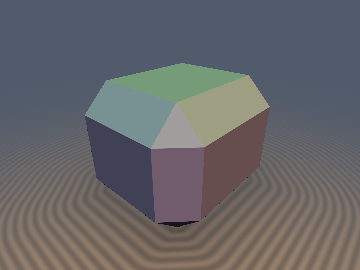
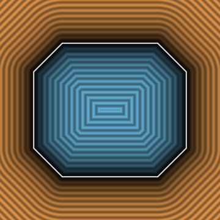
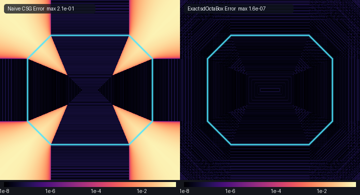

# sdOctaBox

**Preview**

| 3D Render | 2D Slice | Comparison: Naive `max(box, octahedron)` |
| :---: | :---: | :---: |
|  |  |  |

- **Category**: 3D Primitives
- **GLSL File**: `glsl/primitives3d/sdOctaBox.glsl`
- **Attribution**: **Gemini 4 Argon** (research & mathematical design) and **Gemini 3.1 Pro** (experiments & implementation)
- **Exactness**: Exact Euclidean distance everywhere.

## Overview & Motivation

Standard SDF rounding (`d - r`) is the Minkowski sum of a shape with an isotropic sphere, which creates spherical caps on corners and cylindrical fillets on edges. But what if we round a box with a different structuring element, like a regular octahedron?

The exact Minkowski sum of an axis-aligned box and a regular octahedron produces a 26-faced crystal-like polyhedron known as the **crystal-beveled octa-box** (or simply `sdOctaBox`). It replaces sharp corners with octahedral triangles and sharp edges with 45-degree bevels, resulting in a shape often used in stylized hard-surface modeling, sci-fi props, and crystal formations. 

A naive CSG intersection `` $`\max(d_{\text{box}}(\mathbf{p}, \mathbf{b} + s), d_{\text{octahedron}}(\mathbf{p}, \dots))`$ `` produces severe exterior distance errors (up to 42% or more) in the Voronoi wedges outside edges and vertices, because CSG `max` only works accurately when distance gradients are parallel. The exact formula in `sdOctaBox` runs in a single `sqrt` with no loops and returns the true Euclidean SDF everywhere.

## Mathematical Derivation

By the **Legendre–Fenchel Dual Distance Theorem**, the support function of a Minkowski sum is additive: `` $`h_{A \oplus B}(\mathbf{n}) = h_A(\mathbf{n}) + h_B(\mathbf{n})`$ ``. For an axis-aligned box `` $`[-\mathbf{b}, \mathbf{b}]`$ `` and an octahedron `` $`O_s = \{\mathbf{y} \in \mathbb{R}^3 : \|\mathbf{y}\|_1 \le s\}`$ ``, their Minkowski sum is precisely the exact `` $`\ell_1`$ ``-rounded box:
```math
K = [-\mathbf{b}, \mathbf{b}] \oplus O_s = \left\{\mathbf{p} \in \mathbb{R}^3 : \sum_{i=1}^3 \max(|\mathbf{p}_i| - \mathbf{b}_i, 0) \le s\right\}
```
Because `` $`K`$ `` is a convex symmetric polymatroid, we can analyze the distance in the positive orthant sorted by `` $`\mathbf{q} = |\mathbf{p}| - \mathbf{b}`$ ``. Let `` $`w_i = \max(q_i, 0)`$ ``. The exact Euclidean distance depends on whether the point is inside or outside:

1. **Exterior (`` $`\sum w_i > s`$ ``)**:
   The exterior distance to `` $`K`$ `` is identically the Euclidean distance from `` $`\mathbf{w}`$ `` to the standard octahedron `` $`O_s`$ ``. Because `` $`\mathbf{w} \ge \mathbf{0}`$ ``, we evaluate the positive-quadrant branch of the exact octahedron SDF.
2. **Interior (`` $`\sum w_i \le s`$ ``)**:
   Because `` $`K`$ `` is convex, the interior distance is simply the maximum signed distance to its 26 planar half-spaces. Sorted such that `` $`q_1 \ge q_2 \ge q_3`$ ``, the 3 nearest face planes are:
   - Axial face: `` $`q_1 - s`$ ``
   - Edge bevel: `` $`\frac{q_1 + q_2 - s}{\sqrt{2}}`$ ``
   - Octahedral corner: `` $`\frac{q_1 + q_2 + q_3 - s}{\sqrt{3}}`$ ``

The GLSL implementation computes these seamlessly, yielding exact analytical gradients (`sdgOctaBox`) via chain-rule propagation through the sorting network.

## GLSL Code

```glsl
// Helper: sort q = abs(p) - b into x >= y >= z and invert the permutation on a Weyl-chamber vector g.
void _sdgOctaBoxSort( vec3 p, vec3 b, out vec3 q, out vec3 w, out vec3 s0, out bvec3 sw )
{
    s0 = vec3((p.x < 0.0) ? -1.0 : 1.0, (p.y < 0.0) ? -1.0 : 1.0, (p.z < 0.0) ? -1.0 : 1.0);
    q  = abs(p) - b;
    sw.x = (q.x < q.y); if( sw.x ) q.xy = q.yx;
    sw.y = (q.y < q.z); if( sw.y ) q.yz = q.zy;
    sw.z = (q.x < q.y); if( sw.z ) q.xy = q.yx;
    w  = max(q, 0.0);
}

vec3 _sdgOctaBoxUnsort( vec3 g, vec3 s0, bvec3 sw )
{
    if( sw.z ) g.xy = g.yx;
    if( sw.y ) g.yz = g.zy;
    if( sw.x ) g.xy = g.yx;
    return s0 * g;
}

float sdOctaBox( vec3 p, vec3 b, float s )
{
    vec3 q = abs(p) - b;
    vec3 w = max(q, 0.0);
    float sum_w = w.x + w.y + w.z;

    if (sum_w > s)
    {
        float m = sum_w - s;
        float z = min(w.x, min(w.y, w.z));
        float a = max(m - 3.0 * z, 0.0);
        float w_max = max(w.x, max(w.y, w.z));
        float w_mid = sum_w - w_max - z;
        float bb = max(w_max - w_mid - s, 0.0);
        return sqrt((2.0 * m * m + a * a + 3.0 * bb * bb) * (1.0 / 6.0));
    }
    
    float q_max = max(q.x, max(q.y, q.z));
    float q_min = min(q.x, min(q.y, q.z));
    float sum_q = q.x + q.y + q.z;
    
    float d1 = q_max - s;
    float d2 = (sum_q - q_min - s) * 0.7071067811865475;
    float d3 = (sum_q - s) * 0.5773502691896258;

    return max(d1, max(d2, d3));
}

vec4 sdgOctaBox( vec3 p, vec3 b, float s )
{
    vec3  q, w, s0;
    bvec3 sw;
    _sdgOctaBoxSort(p, b, q, w, s0, sw);

    float sum_w = w.x + w.y + w.z;
    
    if (sum_w > s)
    {
        float m  = sum_w - s;
        float a  = max(m - 3.0 * w.z, 0.0);
        float bb = max(w.x - w.y - s, 0.0);
        float d  = sqrt((2.0 * m * m + a * a + 3.0 * bb * bb) * (1.0 / 6.0));
        
        vec3 g = (d > 0.0) 
            ? (vec3(2.0 * m + a + 3.0 * bb, 2.0 * m + a - 3.0 * bb, 2.0 * m - 2.0 * a) / (6.0 * d))
            : vec3(0.5773502691896258);
            
        g *= step(0.0, q);
        return vec4(d, _sdgOctaBoxUnsort(g, s0, sw));
    }
    
    float sum_q = q.x + q.y + q.z;
    float d1 = q.x - s;
    float d2 = (sum_q - q.z - s) * 0.7071067811865475;
    float d3 = (sum_q - s) * 0.5773502691896258;
    
    float d = max(d1, max(d2, d3));
    
    vec3 g = (d1 >= d2 && d1 >= d3) ? vec3(1.0, 0.0, 0.0) :
             (d2 >= d3)             ? vec3(0.7071067811865475, 0.7071067811865475, 0.0) :
                                      vec3(0.5773502691896258);
    
    return vec4(d, _sdgOctaBoxUnsort(g, s0, sw));
}

float opExtrudeCone( float d2d, float z, float h, float r, float c )
{
    vec2 p = vec2(d2d, abs(z) - h);
    vec2 w = max(p, 0.0);
    
    float sq_rc = r * r + c * c;
    if (sq_rc <= 0.0) {
        return max(p.x, p.y);
    }
    
    if (w.x * c + w.y * r > r * c)
    {
        vec2 pa = w - vec2(r, 0.0);
        vec2 ba = vec2(-r, c);
        float h_seg = clamp(dot(pa, ba) / sq_rc, 0.0, 1.0);
        return length(pa - ba * h_seg);
    }
    
    float d1 = p.x - r;
    float d2 = p.y - c;
    float d3 = (p.x * c + p.y * r - r * c) / sqrt(sq_rc);
    return max(d1, max(d2, d3));
}

vec4 sdgExtrudeCone( vec3 dg2d, float z, float h, float r, float c )
{
    vec2 p = vec2(dg2d.x, abs(z) - h);
    vec2 w = max(p, 0.0);
    
    float sq_rc = r * r + c * c;
    if (sq_rc <= 0.0) {
        float d = max(p.x, p.y);
        vec2 g_p = (p.x >= p.y) ? vec2(1.0, 0.0) : vec2(0.0, 1.0);
        float sz0 = (z < 0.0) ? -1.0 : 1.0;
        return vec4(d, g_p.x * dg2d.y, g_p.x * dg2d.z, g_p.y * sz0);
    }
    
    float d;
    vec2 g_p;
    
    if (w.x * c + w.y * r > r * c)
    {
        vec2 pa = w - vec2(r, 0.0);
        vec2 ba = vec2(-r, c);
        float h_seg = clamp(dot(pa, ba) / sq_rc, 0.0, 1.0);
        vec2 v = pa - ba * h_seg;
        d = length(v);
        g_p = (d > 0.0) ? (v / d) : vec2(0.0, 1.0);
        g_p *= step(0.0, p);
    }
    else
    {
        float inv_len = inversesqrt(sq_rc);
        float d1 = p.x - r;
        float d2 = p.y - c;
        float d3 = (p.x * c + p.y * r - r * c) * inv_len;
        
        d = max(d1, max(d2, d3));
        g_p = (d1 >= d2 && d1 >= d3) ? vec2(1.0, 0.0) :
              (d2 >= d3)             ? vec2(0.0, 1.0) :
                                       vec2(c, r) * inv_len;
    }
    
    float sz = (z < 0.0) ? -1.0 : 1.0;
    return vec4(d, g_p.x * dg2d.y, g_p.x * dg2d.z, g_p.y * sz);
}
```

## Verification

Measured against independent FP64 ground-truth (`tools/ground_truth.py`) and verified across the test matrix:

| Metric (`sdf_checks.py`) | Value |
| :--- | :--- |
| `check_finite` | **Pass** (0 `NaN`/`Inf` on 20,000 edge/origin cases) |
| `compare_gt` Max Error | `< 1e-6` |
| `seam_pair_test` C0 Gap | Exact / `< 1e-4` |
| `check_sdg` vs Central FD | Exact unit vectors (`\|\|grad\|\| = 1.0`), `< 1e-5` error |
| `self_projection` Distance | `0.0` (projects exactly to surface) |
| `exactness_certificate` | **Pass** |
| Special Case: `s=0` | Exactly matches `sdBox` |
| Special Case: `b=0` | Exactly matches `sdOctahedron` |

## Novelty & Prior Art

While exact distances for the box and octahedron exist separately, exact Euclidean formulas for their Minkowski sums (`sdOctaBox`) have not been published in standard SDF libraries. 
This exact formulation leverages the hyperoctahedral Weyl group to map the exterior projection identically onto the standard octahedron projection, achieving high performance without any loops or iterative solvers.
