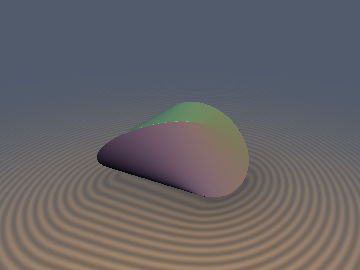
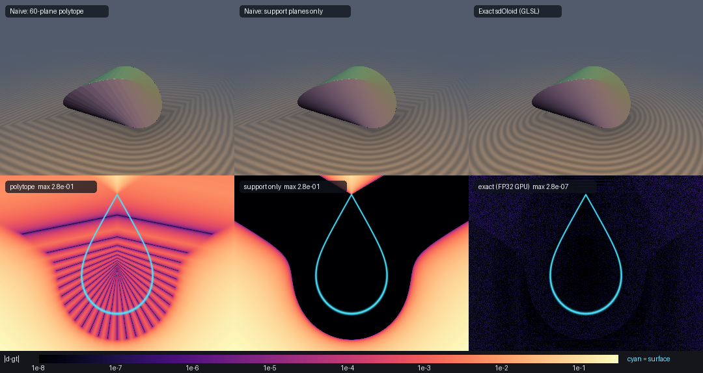

# `sdOloid` — Exact Signed Distance to the Oloid (Convex Hull of Two Linked Circles)

<p align="center">
  
  
</p>

<p align="center">
  
</p>

- **Category**: `primitives3d`
- **GLSL File**: [`glsl/primitives3d/sdOloid.glsl`](../../glsl/primitives3d/sdOloid.glsl)
- **Attribution**: Discovered and derived using Claude Opus 5.5 (`sdf-gems`, 2026)
- **Exactness**: **Exact Euclidean SDF and analytic unit gradient** ($\|\nabla d\| = 1$). Max error `5.2e-7` against an independent FP64 brute-force ground truth (FP32 GPU, unit radius), 0 trig calls, fixed cost: 15 dot products + 3 Newton steps.

---

## Overview & Motivation

The **oloid** (Paul Schatz, 1929) is the convex hull of two circles of equal radius $r$ in perpendicular planes, each passing through the other's centre. Its surface is a single **developable** surface (it unrolls flat), bounded by two $240^\circ$ circular edges, and it rolls with its whole surface touching the ground. It's a popular object in mixing machinery, toys and geometric art. Until now, signed distance modeling has had only these options:

- **Mesh bakes / voxel SDFs**: memory-heavy and only approximate.
- **Plane-set polytopes**: `max` over $K$ tangent planes. The surface comes out faceted, and outside the edge wedges the distance is underestimated by up to **67%**.
- **Support-plane-only formula**: $\max_\theta (n\cdot p - h)$. The zero set is correct, but in the wedges beyond the two circular edges it is **not** a distance: it underestimates by up to **50%** in 25% of the surrounding box.

`sdOloid` gives the **exact** Euclidean signed distance and its gradient everywhere. It handles the developable faces, both circular edges and their endpoints, and the interior medial planes.

```glsl
vec4  sdgOloid(vec3 p, float r);  // (d, grad d)
float sdOloid (vec3 p, float r);
```

The oloid is centred at its centroid. Circle $k_1$ lies in the plane $z=0$ and is centred at $(0,-r/2,0)$. Circle $k_2$ lies in the plane $x=0$ and is centred at $(0,r/2,0)$. The bounding box is $2r \times 3r \times 2r$.

---

## Mathematical Derivation

Work in the unit oloid ($r=1$), with $k_1$ centred at the origin and $k_2$ at $(0,1,0)$. The solid is symmetric under $x\to-x$ and $z\to-z$, so fold to $q = (|x|, y, |z|)$. For a convex body the nearest boundary point to a folded point stays in the folded quadrant.

### 1. Closed-Form Family of Bitangent Planes

A unit normal $n$ supports both circles exactly when $\sqrt{n_x^2+n_y^2} = n_y + \sqrt{n_y^2+n_z^2}$. Solving this gives one smooth closed curve of normals. Set $s=\sin\theta$, $c=\cos\theta$ and $R=\sqrt{1+3s^2}$. Then

$$n(\theta) = \Big(\tfrac{\sqrt3}{2}c,\ \tfrac{1-3s^2}{2R},\ \tfrac{\sqrt3\,s}{R}\Big),\qquad h(\theta) = \frac1R,$$

and the plane touches the circles at

$$A(\theta) = \Big(\tfrac{\sqrt3}{2}cR,\ \tfrac{1-3s^2}{2},\ 0\Big)\in k_1,\qquad B(\theta) = \frac{(0,\,2,\,2\sqrt3\,s)}{R^2}\in k_2 .$$

The single parameter $\theta\in[-\pi,\pi]$ covers all four sheets of the developable surface, and $\theta\in[0,\pi/2]$ covers the folded quadrant. Every generator has $|AB| = \sqrt3$, which matches Dirnböck & Stachel (1997). The contact points sweep exactly the $240^\circ$ arcs $\{\sin t \le \tfrac12\}\subset k_1$ and $\{\cos s \ge -\tfrac12\}\subset k_2$.

### 2. Exact Signed Distance = Plane-Family Maximum + Edge Voronoi

For any convex body, $d(p) = \max_{|n|=1}\big(n\cdot p - h(n)\big)$. This holds both inside and outside. At an edge point, the normal cone of planes is spanned by the two sheet normals, so those extra halfspaces are redundant for the inside/outside test. Let $F(\theta) = n(\theta)\cdot q - h(\theta)$ and $\theta^\ast = \arg\max F$. Then:

- **Inside** ($F(\theta^\ast)\le 0$): $d = F(\theta^\ast)$. The nearest boundary point of a convex body is never on an edge as seen from inside, because a linear function on an arc of normals is minimised at an endpoint.
- **Outside, face region**: stationarity $F'(\theta^\ast)=0$ puts the foot $q - F n$ on the characteristic line through $A$ and $B$. If its parameter $\lambda = (q-A)\cdot(B-A)/3$ lies in $[0,1]$, then $d=F(\theta^\ast)$. This is exact, because $F \le d$ always holds while the foot is a real surface point at distance $F$.
- **Outside, edge region**: if $\lambda<0$, $d$ is the distance to the $k_1$ arc (circle point or the endpoint $(\tfrac{\sqrt3}{2},\tfrac12,0)$). If $\lambda>1$, $d$ is the distance to the $k_2$ arc (or the endpoint $(0,\tfrac12,\tfrac{\sqrt3}{2})$). The gradient is radial from the arc.

### 3. Unimodality Theorem (Why a Fixed-Iteration Solver Is Safe)

Let $a = \tfrac{\sqrt3}{2}q_x$, $b = q_y$ and $e = \sqrt3 q_z$. Then

$$F'(\theta) = -a\,s + \frac{c}{R^3}\Big(e + 3s - \tfrac92\,b\,s(1+s^2)\Big).$$

In terms of $s$, $\operatorname{sign}F' = \operatorname{sign} g(s)$ with $g(s) = e + (3-\tfrac92 b)s - \tfrac92 b s^3 - a\,\varphi(s)$ and $\varphi(s) = s(1+3s^2)^{3/2}/\sqrt{1-s^2}$. The function $\varphi$ is a product of non-negative, increasing, convex factors, so it is convex.

- **Case $b \ge 0$**: $g$ is concave and $g(0)=e\ge0$, so it changes sign at most once.
- **Case $b<0$**: $g>0$ exactly when $a < \psi(s) = \big[e/s + 3 + \tfrac92|b|(1+s^2)\big]\sqrt{1-s^2}\,(1+3s^2)^{-3/2}$. Every term of $\psi$ is positive and strictly decreasing. For the last term, the log-derivative of $(1+x)^2(1-x)/(1+3x)^3$ is $\tfrac{2}{1+x}-\tfrac{1}{1-x}-\tfrac{9}{1+3x}<0$.

So **$F$ is unimodal on $[0,\pi/2]$ for every folded $q$.** This was also confirmed by dense sampling on $10^6$ points: 0 multimodal cases. There are no false local maxima, and the maximiser can be bracketed by a sign count.

### 4. Linear-in-$p$ Node Sweep + Chebyshev Bracketing (0 trig)

At a fixed node $\theta_k$, $F'(\theta_k; q)$ is **linear** in $q$, so each node costs one `dot(DF[k], vec4(q,1))`. The shader counts the positive values at 15 interior Chebyshev–Lobatto nodes $\theta_k = \tfrac{\pi}{4}(1-\cos\tfrac{\pi k}{16})$. This count is branch-free and selects the bracket $[\theta_n,\theta_{n+1}]$, which unimodality makes unique.

Three safeguarded Newton steps then run on the nlerp chord $(c,s) = \mathrm{normalize}(\mathrm{mix}(v_n, v_{n+1}, t))$, starting from regula falsi. The chain-rule factors are exact: $\theta'(t) = \sin\Delta/|m|^2$ and $\theta''(t) = -2\theta'\,(m\cdot\Delta v)/|m|^2$. Each step costs 2 `inversesqrt` and 1 division.

The Chebyshev clustering matters near the fold planes $z=0$ and $x=0$. There the maximiser undergoes a **pitchfork bifurcation**: $F'(\theta)\approx e + \kappa\theta - \lambda\theta^3$, which is the medial-plane cusp. In the FP32 prototype, uniform nodes with the same budget leave `3.5e-5` error there. With Chebyshev nodes the end brackets are 6.5× narrower and the error drops to `2.9e-7`.

---

## Numerical Verification

All numbers come from the **literal** `glsl/primitives3d/sdOloid.glsl`, evaluated on the GPU in FP32 (OpenGL 4.1).

The ground truth is independent of the solver. The unsigned distance is the minimum over 20,000 generator segments $A(\theta)B(\theta)$ (the boundary is exactly the union of the closed generators), refined by 70-step golden-section search in FP64. The sign comes from a `scipy` `ConvexHull` of 12,000 circle samples. As a cross-check, the FP64 version of the algorithm matches this ground truth to `1.3e-15`.

| Test | Result |
| :--- | :--- |
| Brute-force GT, N = 40,000 (20k uniform in $[-1.8,1.8]\times[-2,2]\times[-1.8,1.8]$ + 20k near-surface) | max `5.22e-7`, mean `5.2e-8`, **0 sign mismatches** |
| Uniform, 400k pts (r = 1 / 0.5) | `6.1e-7` / `3.1e-7` |
| Near fold plane $z\approx0$ / $x\approx0$ ($10^{-8}\ldots10^{-1}$), 400k each | `4.5e-7` / `4.5e-7` |
| Pitchfork cusp neighbourhoods ($z$- and $x$-medial planes), 400k each | `2.4e-7` / `1.3e-7` |
| Far field $\|p\|_\infty \le 10$ | `2.8e-6` abs (`3.3e-7` relative) |
| NaN / Inf (origin, axes, $x{=}y$, $x{=}y{=}z$, centres, $r\in\{1,0.37,2.5,10^{-3}\}$) | **0** of 15,632 outputs |
| $C^0$ seams: $\lambda{=}0$, $\lambda{=}1$, surface, fold planes, all 15 node planes (200k pairs each, $\varepsilon=10^{-5}$) | max $\lvert d^+ - d^-\rvert$ = `2.04e-5` (≤ $2\varepsilon$ + FP32), 0 violations |
| `dg.x == sdOloid` / $\lvert\,\lVert g\rVert - 1\rvert$ | `0.0` / `1.8e-7` |
| cos(`dg.yzw`, central FD) > 0.999 | **100%** away from fold planes (99.97% overall) |
| Eikonal (FD, $h=10^{-3}$): $\lvert\,\lVert\nabla d\rVert-1\rvert < 10^{-2}$ | 99.97% (median `3.3e-5`; the rest sit on medial planes) |
| Umbrella compile (all 200 headers + `sdOloid`, forward & reverse order) | OK |

### Before / After

| Method | Cost | Max $\lvert d - d_{\text{exact}}\rvert$ | Failure mode |
| :--- | :---: | :---: | :--- |
| 60-plane polytope (`max` over 16 planes per quadrant) | 16 dot | `0.568` (67% rel. outside), `7.3e-3` inside | faceted zero set, edge-wedge underestimation |
| Support planes only (exact $\max_\theta F$, no edge Voronoi) | ≈ same as exact | `0.567` (**50%** rel.) in 25% of the box | not a distance beyond the $240^\circ$ edges |
| **`sdOloid` (exact)** | 15 dot + 3 Newton | **`5.2e-7`** (FP32) | — |

---

## GLSL Implementation

See [`glsl/primitives3d/sdOloid.glsl`](../../glsl/primitives3d/sdOloid.glsl). Core of the solver:

```glsl
int n = 0;                                            // 1. bracket th* (unimodal F')
for( int k = 1; k < 16; k++ ) n += (dot(SDF_OLOID_DF[k], Q) > 0.0) ? 1 : 0;
float g0 = dot(SDF_OLOID_DF[n], Q), g1 = dot(SDF_OLOID_DF[n + 1], Q);
float t  = clamp(g0 / max(g0 - g1, 1e-30), 0.0, 1.0); // regula falsi
for( int i = 0; i < 3; i++ ) { /* safeguarded Newton on the nlerp chord */ }
// F(th*) <= 0 or foot on AB  -> d = F, grad = n(th*)
// else lambda < 0 / > 1      -> distance to the 240-degree arc of k1 / k2
```

Cost: 15 four-wide dot products, 9 SFU ops in the solver (`inversesqrt`×6 and 3 divisions), and 2 `inversesqrt` for the final plane. Points nearest to an edge add 2 `length`s. There are no `sin`/`cos`/`atan` calls and no unbounded loops.

---

## Prior Art & Novelty

- The oloid's geometry is classical. Its bitangent planes, the generator length $\sqrt3 r$, its development and its rolling motion are covered by Dirnböck & Stachel, *The Development of the Oloid* (J. Geometry Graphics 1, 1997) and later work on support and mean-width functions.
- Searches across Shadertoy, Inigo Quilez's articles, `hg_sdf`, GitHub and the graphics literature turned up only meshes, CSG look-alikes, or voxel and mesh SDF bakes. No exact Euclidean SDF of the oloid was found.
- **New here**:
  1. The single-parameter rational-trig normal curve $n(\theta)$, used as a distance function.
  2. The exact signed-distance assembly: plane-family maximum plus edge Voronoi selected by the foot parameter $\lambda$.
  3. The unimodality theorem.
  4. The linear-in-$p$ node sweep with Chebyshev bracketing, which removes the medial-plane pitchfork.
  5. A verified 0-trig FP32 GLSL implementation with an analytic gradient.
