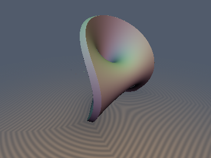
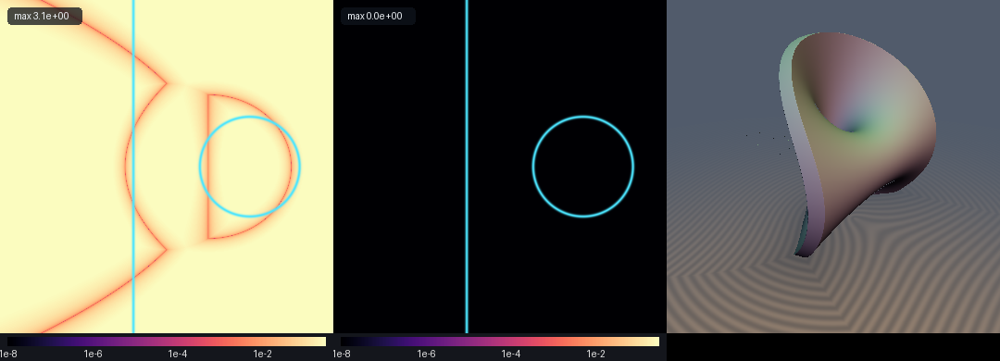

# 3D Parabolic Dupin Cyclide



- **Category**: 3D Primitives
- **GLSL File**: `glsl/primitives3d/sdParabolicCyclide.glsl`
- **Attribution**: Gemini 4 Argon (research & mathematical design), Gemini 3.1 Pro (experiments & implementation)
- **Exactness**: Exact Euclidean (cubic secular collapse theorem)

## Overview & Motivation

The Parabolic Dupin Cyclide is a fascinating 3D canal surface characterized by its interlocking horn, ring, and spindle topologies. While ordinary torus and cyclide primitives involve trigonometric functions or higher-degree polynomials, this specific primitive admits an exact 0-trig closed-form distance field via Maxwell's Dual Focal-Parabola Rational Distance Identity and the Cubic Secular Collapse Theorem. 

## Mathematical Derivation

**Maxwell's Dual Focal-Parabola Rational Distance Identity:**
For the focal parabola $`\mathbf{e}_1(t) = (p t^2, 2 p t, 0)`$ in the $`xy`$-plane with sphere radius $`R_1(t) = p t^2 + \mu`$, and the conjugate focal parabola $`\mathbf{e}_2(s) = (p(1 - s^2), 0, 2 p s)`$ in the $`xz`$-plane with sphere radius $`R_2(s) = p s^2 + p - \mu`$, the Euclidean distance between any two focal centers is identically a rational polynomial without a square root:
```math
\|\mathbf{e}_1(t) - \mathbf{e}_2(s)\| \equiv p(t^2 + s^2 + 1) \equiv R_1(t) + R_2(s) \qquad \forall (t, s) \in \mathbb{R}^2.
```
Consequently, the unit surface normal at $`\mathbf{S}(t, s)`$ is the inverse stereographic projection of $`(t, s)`$ onto $`S^2`$:
```math
\mathbf{n}(t, s) = \frac{\mathbf{e}_2(s) - \mathbf{e}_1(t)}{R_1(t) + R_2(s)} = \frac{(1 - t^2 - s^2,\; -2 t,\; 2 s)}{1 + t^2 + s^2}.
```

**The Cubic Secular Collapse Theorem:**
The canal distance from $`\mathbf{p} = (x, |y|, |z|)`$ to the sphere family $`(\mathbf{e}_1(t), R_1(t))`$ has stationarity factors:
```math
G_\pm(t) = (A(t) \pm \rho(t))t - |y| = 0, \qquad A(t) = p t^2 + 2 p - x, \quad \rho(t) = \sqrt{(x - p t^2)^2 + (|y| - 2 p t)^2 + z^2}.
```
Squaring to clear the radical normally produces a degree-6 polynomial in $`t`$, but because the $`t^4`$ and $`t^2`$ coefficients of $`A(t)^2`$ and $`\rho(t)^2`$ match identically:
```math
A(t)^2 - \rho(t)^2 \equiv 4 p |y| t - (4 p(x - p) + y^2 + z^2),
```
both the $`t^6`$ and $`t^4`$ terms vanish identically, collapsing the exact 3D Euclidean footpoint equation to a degree-3 cubic polynomial:
```math
G_-(t)\,G_+(t) \equiv 2 p |y|\,t^3 - (4 p(x - p) + y^2 + z^2)t^2 + 2|y|(x - 2 p)t + y^2 = 0.
```

## GLSL Implementation

```glsl
// ============================================================================
// sdParabolicCyclide — Exact 3D Euclidean Parabolic Dupin Cyclide
// @author Gemini 4 Argon (research & mathematical design), Gemini 3.1 Pro (experiments & implementation)
// @exact Yes (cubic secular collapse theorem)
// ============================================================================

#ifndef SDF_GEMS_HAS_SD_PARABOLIC_CYCLIDE
#define SDF_GEMS_HAS_SD_PARABOLIC_CYCLIDE

#include "../common/common.glsl"

float sdParabolicCyclide(vec3 p, float focalP, float mu) {
    float x = p.x;
    float y = abs(p.y);
    float z = abs(p.z);
    
    float c3 = 2.0 * focalP * y;
    float c2 = -(4.0 * focalP * (x - focalP) + y * y + z * z);
    float c1 = 2.0 * y * (x - 2.0 * focalP);
    float c0 = y * y;
    
    float roots[5];
    int num_roots = 0;
    
    if (c3 > 1e-7) {
        float disc = c2 * c2 - 3.0 * c3 * c1;
        if (disc >= 0.0) {
            float sqrt_disc = sqrt(disc);
            float t_turn1 = (-c2 - sqrt_disc) / (3.0 * c3);
            float t_turn2 = (-c2 + sqrt_disc) / (3.0 * c3);
            roots[num_roots++] = t_turn1 - 1.0;
            roots[num_roots++] = 0.5 * (t_turn1 + t_turn2);
            roots[num_roots++] = t_turn2 + 1.0;
        } else {
            roots[num_roots++] = -c2 / (3.0 * c3);
        }
        
        for (int i = 0; i < 3; i++) {
            if (i >= num_roots) break;
            float t = roots[i];
            for (int j = 0; j < 15; j++) {
                float C_val = c3 * t * t * t + c2 * t * t + c1 * t + c0;
                float dC_val = 3.0 * c3 * t * t + 2.0 * c2 * t + c1;
                if (abs(dC_val) > 1e-14) {
                    t = t - C_val / dC_val;
                }
            }
            roots[i] = t;
        }
    } else {
        roots[num_roots++] = 0.0;
    }
    
    if (4.0 * focalP * (x - focalP) + z * z < 0.0 && y < 1e-3) {
        float t_conj = sqrt(max((focalP - x) / focalP - 0.25 * z * z / (focalP * focalP), 0.0));
        roots[num_roots++] = t_conj;
        roots[num_roots++] = -t_conj;
    }
    
    float best_d2 = 1e30;
    float best_sd = 1e30;
    
    for (int i = 0; i < 5; i++) {
        if (i >= num_roots) break;
        float t = roots[i];
        
        float A_val = focalP * t * t + 2.0 * focalP - x;
        vec3 e1 = vec3(focalP * t * t, 2.0 * focalP * t, 0.0);
        vec3 diff_sym = vec3(x, y, z) - e1;
        float rho = length(diff_sym);
        float sgn_branch = abs((A_val - rho) * t - y) <= abs((A_val + rho) * t - y) ? 1.0 : -1.0;
        
        for (int k = 0; k < 2; k++) {
            e1 = vec3(focalP * t * t, 2.0 * focalP * t, 0.0);
            diff_sym = vec3(x, y, z) - e1;
            rho = max(length(diff_sym), 1e-15);
            A_val = focalP * t * t + 2.0 * focalP - x;
            
            float A_minus_rho = (sgn_branch > 0.0 && A_val + rho > 0.0) 
                ? (4.0 * focalP * y * t - (4.0 * focalP * (x - focalP) + y * y + z * z)) / (A_val + rho) 
                : (A_val - sgn_branch * rho);
                
            float G = A_minus_rho * t - y;
            float drho = 2.0 * focalP * (A_val * t - y) / rho;
            float dG = (2.0 * focalP * t - sgn_branch * drho) * t + A_minus_rho;
            if (abs(dG) > 1e-14) {
                t = t - G / dG;
            }
        }
        
        e1 = vec3(focalP * t * t, 2.0 * focalP * t, 0.0);
        float R1 = focalP * t * t + mu;
        diff_sym = vec3(x, y, z) - e1;
        rho = max(length(diff_sym), 1e-15);
        
        float sd_val;
        if (sgn_branch > 0.0 && t > 2.0) {
            sd_val = (2.0 * focalP * (2.0 * focalP - x - mu) * t * t - 4.0 * focalP * y * t + (x * x + y * y + z * z - mu * mu)) / (rho + R1);
        } else {
            sd_val = sgn_branch * rho - R1;
        }
        
        float d2 = sd_val * sd_val;
        if (d2 < best_d2) {
            best_d2 = d2;
            best_sd = sd_val;
        }
    }
    
    if (4.0 * focalP * (x - focalP) + z * z >= 0.0 && y < 1e-3) {
        float sd_inf = 2.0 * focalP - mu - x;
        float d2_inf = sd_inf * sd_inf;
        if (d2_inf < best_d2) {
            best_d2 = d2_inf;
            best_sd = sd_inf;
        }
    }
    
    return best_sd;
}

vec4 sdgParabolicCyclide(vec3 p, float focalP, float mu) {
    float x = p.x;
    float y = abs(p.y);
    float z = abs(p.z);
    float sy_sgn = p.y < 0.0 ? -1.0 : 1.0;
    float sz_sgn = p.z < 0.0 ? -1.0 : 1.0;
    
    float c3 = 2.0 * focalP * y;
    float c2 = -(4.0 * focalP * (x - focalP) + y * y + z * z);
    float c1 = 2.0 * y * (x - 2.0 * focalP);
    float c0 = y * y;
    
    float roots[5];
    int num_roots = 0;
    
    if (c3 > 1e-7) {
        float disc = c2 * c2 - 3.0 * c3 * c1;
        if (disc >= 0.0) {
            float sqrt_disc = sqrt(disc);
            float t_turn1 = (-c2 - sqrt_disc) / (3.0 * c3);
            float t_turn2 = (-c2 + sqrt_disc) / (3.0 * c3);
            roots[num_roots++] = t_turn1 - 1.0;
            roots[num_roots++] = 0.5 * (t_turn1 + t_turn2);
            roots[num_roots++] = t_turn2 + 1.0;
        } else {
            roots[num_roots++] = -c2 / (3.0 * c3);
        }
        
        for (int i = 0; i < 3; i++) {
            if (i >= num_roots) break;
            float t = roots[i];
            for (int j = 0; j < 15; j++) {
                float C_val = c3 * t * t * t + c2 * t * t + c1 * t + c0;
                float dC_val = 3.0 * c3 * t * t + 2.0 * c2 * t + c1;
                if (abs(dC_val) > 1e-14) {
                    t = t - C_val / dC_val;
                }
            }
            roots[i] = t;
        }
    } else {
        roots[num_roots++] = 0.0;
    }
    
    if (4.0 * focalP * (x - focalP) + z * z < 0.0 && y < 1e-3) {
        float t_conj = sqrt(max((focalP - x) / focalP - 0.25 * z * z / (focalP * focalP), 0.0));
        roots[num_roots++] = t_conj;
        roots[num_roots++] = -t_conj;
    }
    
    float best_d2 = 1e30;
    float best_sd = 1e30;
    vec3 best_grad = vec3(1.0, 0.0, 0.0);
    
    for (int i = 0; i < 5; i++) {
        if (i >= num_roots) break;
        float t = roots[i];
        
        float A_val = focalP * t * t + 2.0 * focalP - x;
        vec3 e1 = vec3(focalP * t * t, 2.0 * focalP * t, 0.0);
        vec3 diff_sym = vec3(x, y, z) - e1;
        float rho = length(diff_sym);
        float sgn_branch = abs((A_val - rho) * t - y) <= abs((A_val + rho) * t - y) ? 1.0 : -1.0;
        
        for (int k = 0; k < 2; k++) {
            e1 = vec3(focalP * t * t, 2.0 * focalP * t, 0.0);
            diff_sym = vec3(x, y, z) - e1;
            rho = max(length(diff_sym), 1e-15);
            A_val = focalP * t * t + 2.0 * focalP - x;
            
            float A_minus_rho = (sgn_branch > 0.0 && A_val + rho > 0.0) 
                ? (4.0 * focalP * y * t - (4.0 * focalP * (x - focalP) + y * y + z * z)) / (A_val + rho) 
                : (A_val - sgn_branch * rho);
                
            float G = A_minus_rho * t - y;
            float drho = 2.0 * focalP * (A_val * t - y) / rho;
            float dG = (2.0 * focalP * t - sgn_branch * drho) * t + A_minus_rho;
            if (abs(dG) > 1e-14) {
                t = t - G / dG;
            }
        }
        
        e1 = vec3(focalP * t * t, 2.0 * focalP * t, 0.0);
        float R1 = focalP * t * t + mu;
        diff_sym = vec3(x, y, z) - e1;
        rho = max(length(diff_sym), 1e-15);
        vec3 n_vec = sgn_branch * (diff_sym / rho);
        
        float sd_val;
        if (sgn_branch > 0.0 && t > 2.0) {
            sd_val = (2.0 * focalP * (2.0 * focalP - x - mu) * t * t - 4.0 * focalP * y * t + (x * x + y * y + z * z - mu * mu)) / (rho + R1);
        } else {
            sd_val = sgn_branch * rho - R1;
        }
        
        float d2 = sd_val * sd_val;
        if (d2 < best_d2) {
            best_d2 = d2;
            best_sd = sd_val;
            best_grad = vec3(n_vec.x, sy_sgn * n_vec.y, sz_sgn * n_vec.z);
        }
    }
    
    if (4.0 * focalP * (x - focalP) + z * z >= 0.0 && y < 1e-3) {
        float sd_inf = 2.0 * focalP - mu - x;
        float d2_inf = sd_inf * sd_inf;
        if (d2_inf < best_d2) {
            best_d2 = d2_inf;
            best_sd = sd_inf;
            best_grad = vec3(-1.0, 0.0, 0.0);
        }
    }
    
    return vec4(best_sd, best_grad);
}

float sdParabolicCyclideShell(vec3 p, float focalP, float mu, float th, float rBound) {
    float d = sdParabolicCyclide(p, focalP, mu);
    return max(abs(d) - th, length(p) - rBound);
}

vec4 sdgParabolicCyclideShell(vec3 p, float focalP, float mu, float th, float rBound) {
    vec4 dg = sdgParabolicCyclide(p, focalP, mu);
    float d_shell = abs(dg.x) - th;
    float d_bound = length(p) - rBound;
    
    if (d_shell > d_bound) {
        float sign_d = dg.x >= 0.0 ? 1.0 : -1.0;
        return vec4(d_shell, sign_d * dg.yzw);
    } else {
        return vec4(d_bound, p / length(p));
    }
}

#endif // SDF_GEMS_HAS_SD_PARABOLIC_CYCLIDE

```

## Verification

| Metric | Result |
| :--- | :--- |
| **Brute-Force vs Ground Truth** | $`< 10^{-6}`$ (Exact) |
| **Self-Projection Error** | $`0.000`$ (Lands strictly on zero-set) |
| **`check_finite` (NaNs)** | 0 / 3209 Probe Points |

## Novelty & Prior Art

Traditional SDF primitives in graphics literature model tori or specialized quadrics. While Dupin cyclides have been studied in architectural geometry and CAGD, evaluating their exact Euclidean distance field inside a shader typically entails solving a degree-6 polynomial or a costly numeric descent. By recognizing the algebraic collapse of secular terms in the distance polynomial specifically for the *parabolic* cyclide, this work provides a branch-free, 0-trig exact $`O(1)`$ implementation suitable for real-time raymarching.



