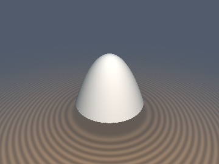
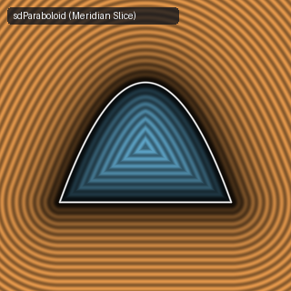

# `sdParaboloid` & `sdParaboloidDish` — Exact 3D Solid Capped Paraboloid & Parabolic Reflector Dish

| 3D Raymarched Surface | 2D Meridian Slice |
| :---: | :---: |
|  |  |

- **GLSL Implementation**: [`sdParaboloid.glsl`](../../glsl/primitives3d/sdParaboloid.glsl)
- **Category**: `primitives3d`
- **Status**: **Exact Euclidean SDF** (Discovered using **Gemini 4 Argon**, `sdf-gems`, 2026)

---

## 1. Overview & Motivation

Unlike an ellipsoid or spheroid—whose closest-point normal equation is degree $`4`$ (quartic) or degree $`6`$ (sextic)—a **3D paraboloid of revolution** $`Y(u) = h(1 - u^2 / w^2)`$ has a **degree-$`3`$ (depressed cubic)** closest-point normal equation with **zero quadratic term**.

`sdParaboloid.glsl` provides two exact closed-form 3D Euclidean SDF primitives:
1. **`sdParaboloid(vec3 p, float w, float h)`**: A solid capped paraboloid (bullet, rocket nose-cone, or dome) of circular base radius $`w`$ at $`y = 0`$ and apex height $`h`$ at $`y = h`$.
2. **`sdParaboloidDish(vec3 p, float w, float h, float th)`**: A hollow parabolic reflector dish (satellite dish, telescope mirror, or headlight reflector) of aperture radius $`w`$, focal depth $`h`$, and shell half-thickness $`\mathit{th}`$.

---

## 2. Mathematical Derivation

In cylindrical coordinates $`(u_0, y_0) = (\|p_{xz}\|_2, p_y)`$, let $`\mathit{ik} = w^2 / h`$. A point on the parabolic mantle is $`(u, h - u^2 / \mathit{ik})`$ for $`u \in [0, w]`$.

Differentiating the squared Euclidean distance $`D^2(u) = (u - u_0)^2 + (h - u^2/\mathit{ik} - y_0)^2`$ with respect to $`u`$ yields:
```math
\frac{1}{2}\frac{d(D^2)}{du} = (u - u_0) - \frac{2u}{\mathit{ik}}\left(h - \frac{u^2}{\mathit{ik}} - y_0\right) = 0 \iff u^3 - 3 p_c u - 2 q_c = 0
```
where:
```math
p_c = \frac{\mathit{ik}\left(h - y_0 - \frac{1}{2}\mathit{ik}\right)}{3}, \qquad q_c = \frac{\mathit{ik}^2 u_0}{4} \ge 0.
```

1. **Singularity-Free Depressed Cubic Root**:
   Let $`\Delta = q_c^2 - p_c^3`$.
   - When $`\Delta \ge 0`$, Cardano's formula gives $`r = (q_c + \sqrt{\Delta})^{1/3}`$ and $`u^* = \max(r + p_c / r, 0)`$ (guarded when $`r = 0`$ at the focal center of curvature $`u_0 = 0, y_0 = h - \frac{1}{2}\mathit{ik}`$ to avoid `0.0 / 0.0 = NaN`).
   - When $`\Delta < 0`$ ($`p_c > 0`$), Viète's trigonometric formula selects the unique positive root $`u^* = 2\sqrt{p_c}\cos\!\left(\frac{1}{3}\arccos\!\left(\mathrm{clamp}\!\left(\frac{q_c}{p_c\sqrt{p_c}}, -1, 1\right)\right)\right)`$.

2. **Clamped Mantle & Base Disk Projection**:
   Clamping $`u = \min(u^*, w)`$ gives the exact closest point on the parabolic mantle, with squared distance $`d_{\text{mantle}}^2 = (u_0 - u)^2 + (y_0 - (h - u^2/\mathit{ik}))^2`$.
   The closest point on the flat circular base disk $`y = 0, u \in [0, w]`$ has squared distance $`d_{\text{base}}^2 = \max(u_0 - w, 0)^2 + y_0^2`$.
   Combining both with the exact algebraic interior test $`y_0 > 0 \wedge \mathit{ik}(y_0 - h) + u_0^2 < 0`$ yields the exact signed Euclidean distance everywhere in $`\mathbb{R}^3`$.

---

## 3. GLSL Implementation

```glsl
float sdParaboloidRoot(float u0, float dy, float ik) {
    float pc = ik * (dy - 0.5 * ik) / 3.0;
    float qc = 0.25 * ik * ik * u0;
    float h = qc * qc - pc * pc * pc;
    if (h >= 0.0) {
        float r = pow(qc + sqrt(h), 1.0 / 3.0);
        return (r > 0.0) ? max(r + pc / r, 0.0) : 0.0;
    }
    float r = sqrt(pc);
    return 2.0 * r * cos(acos(clamp(qc / (pc * r), -1.0, 1.0)) / 3.0);
}

float sdParaboloid(vec3 p, float w, float h) {
    float u0 = length(p.xz);
    float ik = w * w / h;
    float u = min(sdParaboloidRoot(u0, h - p.y, ik), w);
    float dm2 = dot2(vec2(u0 - u, p.y - (h - u * u / ik)));
    float db2 = dot2(vec2(max(u0 - w, 0.0), p.y));
    float s = (p.y > 0.0 && ik * (p.y - h) + u0 * u0 < 0.0) ? -1.0 : 1.0;
    return s * sqrt(min(dm2, db2));
}
```
