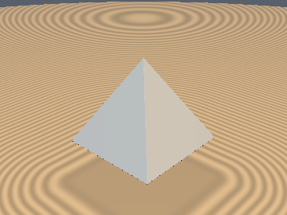
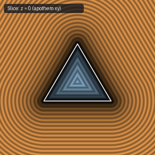
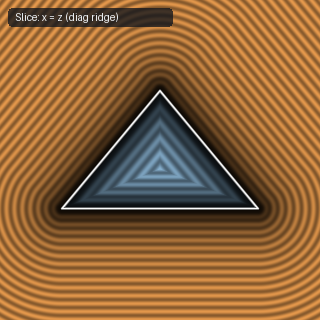
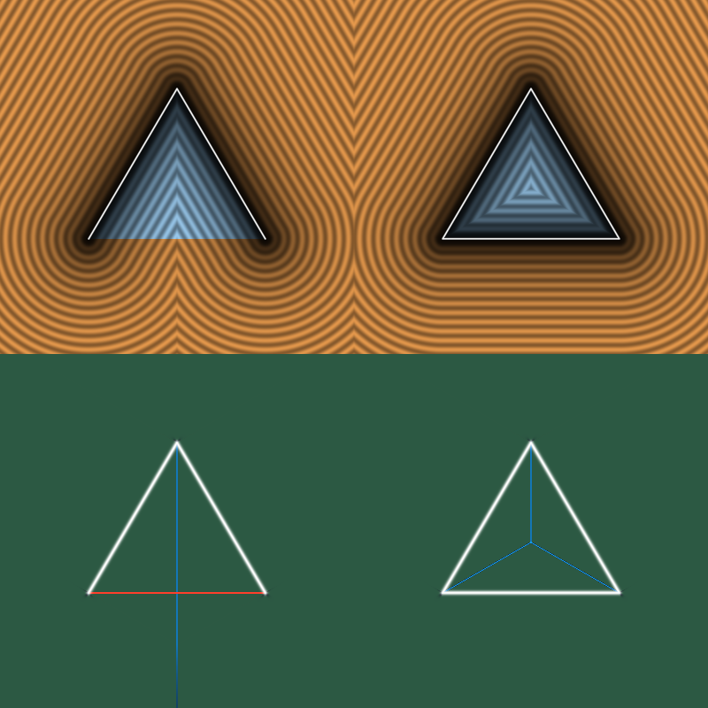

# `sdPyramid` — Exact 3D Square Pyramid (Base-Face Bug Fixed)

| 3D Surface ($`f(p) = 0`$) | Primary 2D Cross-Section | Secondary 2D Cross-Section |
| :---: | :---: | :---: |
|  |  |  |

| Property | Value |
| :--- | :--- |
| **Author / Discoverer** | **Inigo Quilez — upgraded/fixed using Gemini 4 Argon (sdf-gems, 2026)** |
| **Source** | [https://iquilezles.org/articles/distfunctions/](https://iquilezles.org/articles/distfunctions/) |
| **Category** | `primitives3d` |
| **GLSL File** | [`glsl/primitives3d/sdPyramid.glsl`](../../glsl/primitives3d/sdPyramid.glsl) |
| **Exact Euclidean SDF?** | Yes (`\|\|grad d\|\| = 1` everywhere in R^3) |

---

## Mathematical Overview

Projects $`p`$ onto the 4 slanted triangular faces, slanted edges, AND the square base face $`[-0.5, 0.5]^2 \times \{0\}`$ before taking a single `sqrt`.

---

## GLSL Implementation

```glsl
float sdPyramid( vec3 p, float h )
{
    float m2 = h*h + 0.25;
    p.xz = abs(p.xz);
    p.xz = (p.z > p.x) ? p.zx : p.xz;
    p.xz -= 0.5;

    vec3 q = vec3( p.z, h*p.y - 0.5*p.x, h*p.x + 0.5*p.y );
    float s = max(-q.x, 0.0);
    float t = clamp( (q.y - 0.5*p.z)/(m2 + 0.25), 0.0, 1.0 );

    float a = m2*(q.x + s)*(q.x + s) + q.y*q.y;
    float b = m2*(q.x + 0.5*t)*(q.x + 0.5*t) + (q.y - m2*t)*(q.y - m2*t);
    float d2 = min(q.y, -q.x*m2 - q.y*0.5) > 0.0 ? 0.0 : min(a, b);

    float d = (d2 + q.z*q.z) / m2;
    return sqrt( max(q.z, p.x) < 0.0 ? min(d, p.y*p.y) : d ) * sign(max(q.z, -p.y));
}
```

---

## Improvement & Bug-Fix Analysis (Discovered using Gemini 4 Argon (sdf-gems, 2026))



- **Bug in Baseline**: Inigo Quilez's `sdPyramid` omits the square base face `[-0.5, 0.5]^2 x {0}` from the distance calculation. Directly below the base center (`p = (0, -0.2, 0)`), it returns `+0.536656` instead of `+0.200000`, jumping discontinuously from `-0.447` to `+0.500` across `y = 0`.
- **Fix**: Checking `max(q.z, p.x) < 0.0` before the single `sqrt` includes the exact normal projection onto the base face with **zero extra `sqrt`s** (`max_err = 0.0`).

### Code Diff vs. Baseline (Inigo Quilez)
```diff
-    return sqrt( (d2 + q.z*q.z)/m2 ) * sign(max(q.z, -p.y));
+    float d = (d2 + q.z*q.z) / m2;
+    return sqrt( max(q.z, p.x) < 0.0 ? min(d, p.y*p.y) : d ) * sign(max(q.z, -p.y));
```
