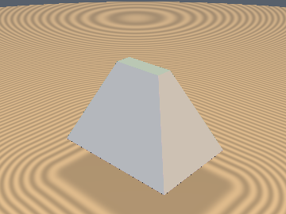
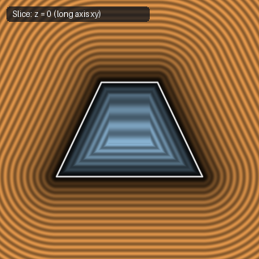
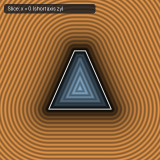

# `sdRectFrustum` — Exact 1-Sqrt 3D Rectangular & Hip-Roof Frustum

| 3D Surface ($f(p) = 0$) | Primary 2D Cross-Section | Secondary 2D Cross-Section |
| :---: | :---: | :---: |
|  |  |  |

| Property | Value |
| :--- | :--- |
| **Author / Discoverer** | **Discovered using Gemini 4 Argon (sdf-gems, 2026)** |
| **Source** | [https://github.com/dcower/sdf-gems](https://github.com/dcower/sdf-gems) |
| **Category** | `primitives3d` |
| **GLSL File** | [`glsl/primitives3d/sdRectFrustum.glsl`](../../glsl/primitives3d/sdRectFrustum.glsl) |
| **Exact Euclidean SDF?** | Yes (`||grad d|| = 1`) |

---

## Mathematical Overview

Unifies rectangular boxes, rectangular pyramids, keycap frustums, and hip roofs into a **single-`sqrt` exact 3D Euclidean SDF**.

---

## GLSL Implementation

```glsl
float sdRectFrustum( vec3 p, vec2 b1, vec2 b2, float h )
{
    p.xz = abs(p.xz);
    vec2  bm = 0.5*(b1 + b2), k = 0.5*(b1 - b2);
    vec3  q  = p - vec3(bm.x, 0.0, bm.y);
    float ux = clamp((h*q.y - k.x*q.x)/(h*h + k.x*k.x), -1.0, 1.0);
    float uz = clamp((h*q.y - k.y*q.z)/(h*h + k.y*k.y), -1.0, 1.0);
    float ue = clamp((h*q.y - dot(k, q.xz))/(h*h + dot(k, k)), -1.0, 1.0);
    float dx = dot2(vec3(q.x + k.x*ux, q.y - h*ux, max(q.z + k.y*ux, 0.0)));
    float dz = dot2(vec3(max(q.x + k.x*uz, 0.0), q.y - h*uz, q.z + k.y*uz));
    float de = dot2(vec3(q.x + k.x*ue, q.y - h*ue, q.z + k.y*ue));
    float d  = min(min(dx, dz), de);
    vec2  bc = (p.y < 0.0) ? b1 : b2;
    if( p.x < bc.x && p.z < bc.y ) d = min(d, (abs(p.y) - h)*(abs(p.y) - h));
    float s  = max(max(h*q.x + k.x*q.y, h*q.z + k.y*q.y), abs(q.y) - h);
    return sqrt(d) * ((s < 0.0) ? -1.0 : 1.0);
}
```
