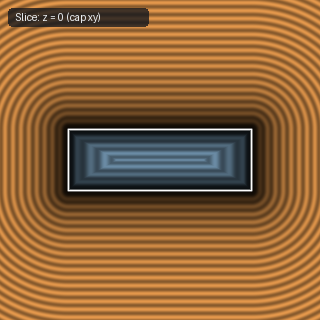

# `sdRhombus` — 3D Extruded Rounded Rhombus

| 3D Surface ($f(p) = 0$) | Primary 2D Cross-Section | Secondary 2D Cross-Section |
| :---: | :---: | :---: |
|  |  |  |

| Property | Value |
| :--- | :--- |
| **Author / Discoverer** | **Inigo Quilez** |
| **Source** | [https://iquilezles.org/articles/distfunctions/](https://iquilezles.org/articles/distfunctions/) |
| **Category** | `primitives3d` |
| **GLSL File** | [`glsl/primitives3d/sdRhombus.glsl`](../../glsl/primitives3d/sdRhombus.glsl) |
| **Exact Euclidean SDF?** | Partial |

---

## Mathematical Overview

Extrudes a 2D rhombus of semi-diagonals $(l_a, l_b)$ and corner radius $r_a$ to half-height $h$.

---

## GLSL Implementation

```glsl
float sdRhombus( vec3 p, float la, float lb, float h, float ra )
{
    p = abs(p);
    vec2 b = vec2(la, lb);
    float f = clamp( (ndot(b, b - 2.0*p.xz))/dot(b,b), -1.0, 1.0 );
    vec2 w = p.xz - 0.5*b*vec2(1.0 - f, 1.0 + f);
    vec2 q = vec2( length(w)*sign(w.x) - ra, p.y - h );
    return min(max(q.x, q.y), 0.0) + length(max(q, 0.0));
}
```
