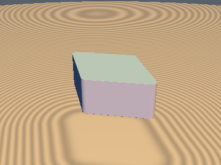
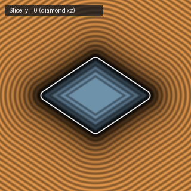
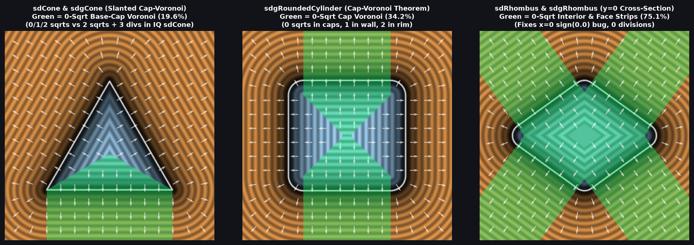

# `sdRhombus` — 0/1/2-`sqrt` Exact 3D Extruded Rounded Rhombus (Direct Vertex-Wedge Form)

| 3D Surface ($f(p) = 0$) | Primary 2D Cross-Section | Secondary 2D Cross-Section |
| :---: | :---: | :---: |
|  |  |  |

| Property | Value |
| :--- | :--- |
| **Author / Discoverer** | **Inigo Quilez — upgraded to 0/1/2-`sqrt` & bug-fixed using Gemini 4 Argon (`sdf-gems`, 2026)** |
| **Source** | [https://iquilezles.org/articles/distfunctions/](https://iquilezles.org/articles/distfunctions/) |
| **Category** | `primitives3d` |
| **GLSL File** | [`glsl/primitives3d/sdRhombus.glsl`](../../glsl/primitives3d/sdRhombus.glsl) |
| **Exact Euclidean SDF?** | Yes ($\|\nabla d\| = 1$, **`0` `sqrt`s** for constant $(l_a, l_b)$ in interior, flat caps, & side-wall strips; fixes $x=0$ `sign(0.0)` fault line) |



---

## Mathematical Overview

1. **Eliminating the `p.x == 0` Exterior Fault Line:**
   In Inigo Quilez's baseline `sdRhombus`, when `p.x == 0` and `|p.z| > lb`, the clamped projection lands on the vertex `(0, lb)`, making `w.x == 0.0` so `length(w)*sign(w.x) - ra` evaluates to `-ra <= 0` along the entire exterior plane `p.x = 0, |p.z| > lb`.
2. **0-Division, 0/1/2-`sqrt` Direct Vertex-Wedge Decomposition:**
   In the folded first octant $p = |p| \ge 0$:
   - If $l_a(p_x - l_a) > l_b p_z$, the closest 2D rhombus point is $(l_a, 0)$ at horizontal distance $\|(p_x - l_a, p_z)\| - r_a$ (**1 `sqrt`, 0 divisions**).
   - If $l_b(p_z - l_b) > l_a p_x$, the closest 2D rhombus point is $(0, l_b)$ at horizontal distance $\|(p_x, p_z - l_b)\| - r_a$ (**1 `sqrt`, 0 divisions**).
   - Otherwise (**100% of the rhombus interior and all 4 slanted wall strips**), the horizontal signed distance is linear: $(l_b p_x + l_a p_z - l_a l_b)\operatorname{inversesqrt}(l_a^2 + l_b^2) - r_a$ (**0 per-pixel `sqrt`s** for constant $l_a, l_b$!).

---

## GLSL Implementation

```glsl
float sdRhombus( vec3 p, float la, float lb, float h, float ra )
{
    p = abs(p);
    float qx = (la * (p.x - la) > lb * p.z) ? length(vec2(p.x - la, p.z)) - ra
             : (lb * (p.z - lb) > la * p.x) ? length(vec2(p.x, p.z - lb)) - ra
             : (lb * p.x + la * p.z - la * lb) * inversesqrt(la * la + lb * lb) - ra;
    float qy = p.y - h;
    return (qy <= 0.0) ? max(qx, qy) : ((qx <= 0.0) ? qy : length(vec2(qx, qy)));
}
```
