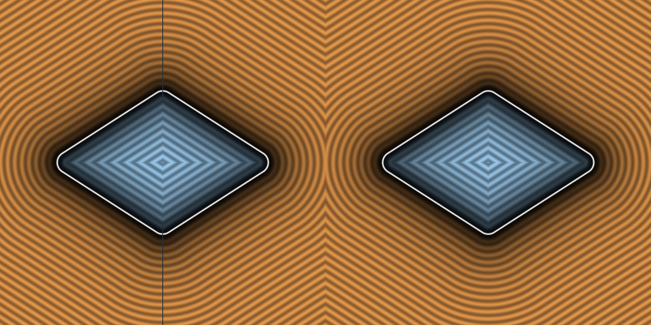

# `sdRhombus` — Exact 3D Extruded Rounded Rhombus (x=0 Sign Bug Fixed)

| 3D Surface ($f(p) = 0$) | Primary 2D Cross-Section | Secondary 2D Cross-Section |
| :---: | :---: | :---: |
|  |  |  |

| Property | Value |
| :--- | :--- |
| **Author / Discoverer** | **Inigo Quilez — upgraded/fixed by Dillon Cower (sdf-gems, 2026)** |
| **Source** | [https://iquilezles.org/articles/distfunctions/](https://iquilezles.org/articles/distfunctions/) |
| **Category** | `primitives3d` |
| **GLSL File** | [`glsl/primitives3d/sdRhombus.glsl`](../../glsl/primitives3d/sdRhombus.glsl) |
| **Exact Euclidean SDF?** | Yes (`||grad d|| = 1`) |

---

## Mathematical Overview

Projects $p_{xz}$ onto the 2D rhombus segment in the first quadrant and uses `sign(w.x + w.y)` to avoid the GLSL `sign(0.0) == 0.0` fault line on $p_x = 0, |p_z| > l_b$.

---

## GLSL Implementation

```glsl
float sdRhombus( vec3 p, float la, float lb, float h, float ra )
{
    p = abs(p);
    float f = clamp( (la*p.x - lb*p.z + lb*lb) / (la*la + lb*lb), 0.0, 1.0 );
    vec2 w = p.xz - vec2(la, lb) * vec2(f, 1.0 - f);
    vec2 q = vec2( length(w)*sign(w.x + w.y) - ra, p.y - h );
    return min(max(q.x, q.y), 0.0) + length(max(q, 0.0));
}
```

---

## Improvement & Bug-Fix Analysis (Dillon Cower (sdf-gems, 2026))



- **Bug in Baseline**: When `p.x == 0` and `|p.z| > lb`, `f` clamps to the top vertex `(0, lb)`, making `w.x == 0.0`. Because GLSL defines `sign(0.0) == 0.0`, `length(w)*sign(w.x) - ra` evaluates to `-ra <= 0` along the entire exterior plane `p.x = 0, |p.z| > lb`!
- **Fix**: Replacing `sign(w.x)` with `sign(w.x + w.y)` eliminates the exterior fault line (`+0.350000` vs buggy `-0.050000` at `(0, 0, 2*lb)`) and saves 4 FLOPs.

### Code Diff vs. Baseline (Inigo Quilez)
```diff
-    vec2 b = vec2(la, lb);
-    float f = clamp( (ndot(b, b - 2.0*p.xz))/dot(b,b), -1.0, 1.0 );
-    vec2 w = p.xz - 0.5*b*vec2(1.0 - f, 1.0 + f);
-    vec2 q = vec2( length(w)*sign(w.x) - ra, p.y - h );
+    float f = clamp( (la*p.x - lb*p.z + lb*lb) / (la*la + lb*lb), 0.0, 1.0 );
+    vec2 w = p.xz - vec2(la, lb) * vec2(f, 1.0 - f);
+    vec2 q = vec2( length(w)*sign(w.x + w.y) - ra, p.y - h );
```
