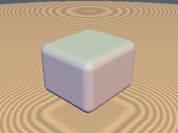
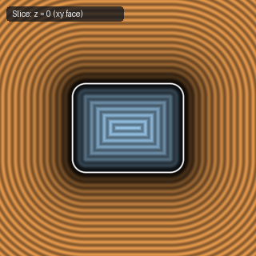
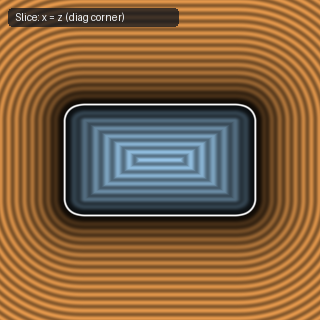

# `sdRoundBox` — Exact 0/1-`sqrt` 3D Rounded Box (0-`sqrt` Interior & 6 Face Prisms)

| 3D Surface ($f(p) = 0$) | Primary 2D Cross-Section | Secondary 2D Cross-Section |
| :---: | :---: | :---: |
|  |  |  |

| Property | Value |
| :--- | :--- |
| **Author / Discoverer** | **Inigo Quilez** — upgraded to 0-`sqrt` median face-prism check using **Gemini 4 Argon** (`sdf-gems`, 2026) |
| **Source** | [https://iquilezles.org/articles/distfunctions/](https://iquilezles.org/articles/distfunctions/) |
| **Category** | `primitives3d` |
| **GLSL File** | [`glsl/primitives3d/sdRoundBox.glsl`](../../glsl/primitives3d/sdRoundBox.glsl) |
| **Exact Euclidean SDF?** | **Yes** ($\|\nabla d\| = 1$, `0` `sqrt`s in interior + all 6 exterior face prisms, `1` in bevels) |

---

## Mathematical Overview

Offsets an inner box of half-extents $\mathbf{b} - r$ by rounding radius $r$ via the 0-`sqrt` median face-prism check $q_{\text{med}} \le 0$.

---

## GLSL Implementation

```glsl
float sdRoundBox( vec3 p, vec3 b, float r )
{
    vec3 q = abs(p) - b + r;
    if( max(min(q.x, q.y), min(max(q.x, q.y), q.z)) <= 0.0 )
        return max(q.x, max(q.y, q.z)) - r;
    return length(max(q, 0.0)) - r;
}
```
