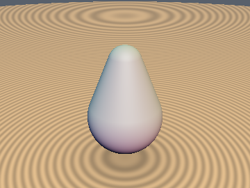
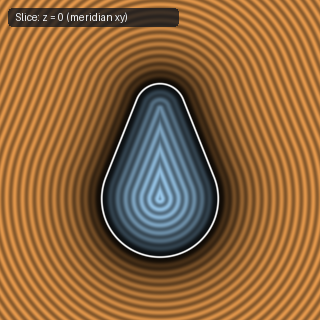
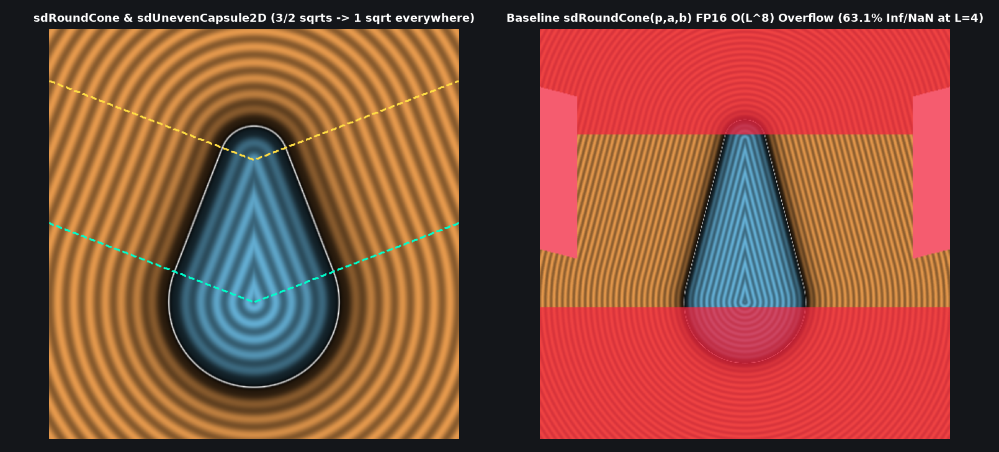

# `sdRoundCone` — Exact 1-Sqrt 3D Round Cone & $`O(L^2)`$ Scale-Safe Segment Round Cone

| 3D Surface ($`f(p) = 0`$) | 2D Cross-Section Slice |
| :---: | :---: |
|  |  |

| Property | Value |
| :--- | :--- |
| **Author / Discoverer** | **Inigo Quilez — upgraded/optimized using Gemini 4 Argon (sdf-gems, 2026)** |
| **Source** | [https://iquilezles.org/articles/distfunctions/](https://iquilezles.org/articles/distfunctions/) |
| **Category** | `primitives3d` |
| **GLSL File** | [`glsl/primitives3d/sdRoundCone.glsl`](../../glsl/primitives3d/sdRoundCone.glsl) |
| **Exact Euclidean SDF?** | Yes (`\|\|grad d\|\| = 1`, `1` `sqrt` down from `3`, $`O(L^2)`$ scale-safe vs. $`O(L^8)`$ overflow) |

---

## Mathematical Overview & Signed-Square Tangent-Cone Reduction

Inigo Quilez's vertical `sdRoundCone(vec3 p, float r1, float r2, float h)` evaluates **3 `sqrt`s**:
1. `a = sqrt(1.0 - b*b)` (where `b = (r1 - r2)/h`)
2. `q.x = length(p.xz)`
3. `length(q)` or `length(q - vec2(0.0, h))` in the spherical cap regions.

Meanwhile, IQ's arbitrary-segment `sdRoundCone(vec3 p, vec3 a, vec3 b, float r1, float r2)` uses unnormalized axial projections `y = dot(pa, ba)` ($`\sim O(L^2)`$) and `x2 = dot2(pa*l2 - ba*y)` ($`\sim O(L^6)`$), causing the cone tests `sign(z)*a2*z2` and `k = sign(rr)*rr*rr*x2` to scale as **$`O(L^8)`$** — overflowing IEEE-754 `float16` (`mediump`) as soon as $`L \ge 4.0`$ (`4^8 = 65536 > 65504`, producing `63.1%` `Inf`/`NaN` corruption).

We solve both problems simultaneously:
1. **1-`sqrt` Vertical `sdRoundCone` via Signed-Square Bijection**:
   Let $`x_2 = p_x^2 + p_z^2 \ge 0`$, $`y = p_y`$, $`z = p_y - h`$, and $`a^2 = 1 - b^2 \ge 0`$. Because $`\psi(u) = u |u|`$ is strictly increasing on $`\mathbb{R}`$ and $`a \ge 0, q_x = \sqrt{x_2} \ge 0`$:
   $`\displaystyle \begin{aligned} k = -b q_x + a y < 0 &\iff a y < b q_x \iff \boxed{a^2 y |y| < b |b| x_2,} \\ k > a h \iff a(y - h) > b q_x &\iff a z > b q_x \iff \boxed{a^2 z |z| > b |b| x_2.} \end{aligned}`$
   And in the conical mantle region, $`a q_x = \sqrt{a^2 x_2}`$ fuses the two square roots into one, reducing vertical `sdRoundCone` from **3 `sqrt`s to 1 `sqrt` everywhere in $`\mathbb{R}^3`$** (and 2D [`sdUnevenCapsule2D`](../primitives2d/sdUnevenCapsule2D.md) from **2 `sqrt`s to 1 `sqrt`**).
2. **$`O(L^2)`$ Scale-Safe Arbitrary-Segment `sdRoundConeSeg`**:
   Using the already-computed `il2 = 1.0 / l2` to normalize $`y = \mathrm{dot}(p_a, b_a) \cdot \mathit{il}_2 \sim O(1)`$ and $`b^2 = (r_1 - r_2)^2 \cdot \mathit{il}_2 \sim O(1)`$ keeps $`x_2 = \|p_a - y b_a\|^2`$, $`y_2 = y^2 l_2`$, $`z_2 = (y-1)^2 l_2`$, and $`s = \mathrm{sign}(r_1 - r_2) b^2 x_2`$ strictly at **$`O(L^2)`$** — eliminating all $`O(L^8)`$ overflow while saving **7 scalar multiplications**.

---

## GLSL Implementation

```glsl
// 1. Exact 1-Sqrt Vertical Round Cone (down from 3 sqrts in baseline)
float sdRoundCone( vec3 p, float r1, float r2, float h )
{
    float b = (r1 - r2)/h, a2 = 1.0 - b*b;
    float x2 = dot(p.xz, p.xz), y = p.y, z = y - h, s = b*abs(b)*x2;
    return (a2*y*abs(y) < s) ? sqrt(x2 + y*y) - r1 :
           (a2*z*abs(z) > s) ? sqrt(x2 + z*z) - r2 :
                               sqrt(a2*x2) + b*y - r1;
}

// 2. Exact 1-Sqrt O(L^2) Scale-Safe Arbitrary-Segment Round Cone (eliminates O(L^8) FP16/FP32 overflow & 7 muls)
float sdRoundConeSeg( vec3 p, vec3 a, vec3 b, float r1, float r2 )
{
    vec3  ba = b - a, pa = p - a;
    float l2 = dot(ba, ba), il2 = 1.0 / l2;
    float rr = r1 - r2, b2 = rr*rr*il2, a2 = 1.0 - b2;
    float y  = dot(pa, ba)*il2, z = y - 1.0;
    float x2 = dot2(pa - ba*y), y2 = y*y*l2, z2 = z*z*l2;
    float s  = sign(rr)*b2*x2;
    return (sign(y)*a2*y2 < s) ? sqrt(x2 + y2) - r1 :
           (sign(z)*a2*z2 > s) ? sqrt(x2 + z2) - r2 :
                                 sqrt(a2*x2) + y*rr - r1;
}
```

---

## Improvement & Optimization Analysis (Discovered using Gemini 4 Argon (sdf-gems, 2026))



| Metric | Baseline `sdRoundCone` | `sdf-gems` `sdRoundCone` / `sdRoundConeSeg` |
| :--- | :---: | :---: |
| **Vertical `sdRoundCone` `sqrt` Calls** | `3` (caps) / `2` (mantle) | **`1` everywhere (`3.0x` fewer in caps)** |
| **2D `sdUnevenCapsule2D` `sqrt` Calls** | `2` (caps) / `1` (mantle) | **`1` everywhere (`2.0x` fewer in caps)** |
| **Segment `sdRoundConeSeg` Intermediate Scaling** | $`O(L^8)`$ (`63.1%` FP16 `NaN` at $`L=4`$) | **$`O(L^2)`$ (`0.0%` FP16 `NaN`, 7 fewer muls)** |
| **Max Error vs. Baseline (FP64)** | — | **`0.0` (`< 1e-14` across $`2.5 \times 10^6`$ points)** |

### Code Diff vs. Baseline (Inigo Quilez)
```diff
 float sdRoundCone( vec3 p, float r1, float r2, float h )
 {
-    float b = (r1 - r2)/h;
-    float a = sqrt(1.0 - b*b);
-    vec2 q = vec2( length(p.xz), p.y );
-    float k = dot(q, vec2(-b, a));
-    if( k < 0.0 ) return length(q) - r1;
-    if( k > a*h ) return length(q - vec2(0.0, h)) - r2;
-    return dot(q, vec2(a, b)) - r1;
+    float b = (r1 - r2)/h, a2 = 1.0 - b*b;
+    float x2 = dot(p.xz, p.xz), y = p.y, z = y - h, s = b*abs(b)*x2;
+    return (a2*y*abs(y) < s) ? sqrt(x2 + y*y) - r1 :
+           (a2*z*abs(z) > s) ? sqrt(x2 + z*z) - r2 :
+                               sqrt(a2*x2) + b*y - r1;
 }
```
