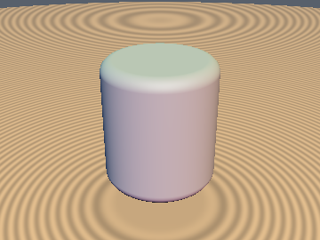
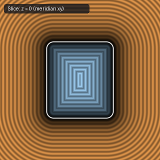

# `sdRoundedCylinder` — Exact 3D Rounded Cylinder

| 3D Surface ($f(p) = 0$) | 2D Cross-Section Slice |
| :---: | :---: |
|  |  |

| Property | Value |
| :--- | :--- |
| **Author / Discoverer** | **Inigo Quilez** |
| **Source** | [https://iquilezles.org/articles/distfunctions/](https://iquilezles.org/articles/distfunctions/) |
| **Category** | `primitives3d` |
| **GLSL File** | [`glsl/primitives3d/sdRoundedCylinder.glsl`](../../glsl/primitives3d/sdRoundedCylinder.glsl) |
| **Exact Euclidean SDF?** | Yes (`||grad d|| = 1`) |

---

## Mathematical Overview

Revolves a 2D rounded box around the $y$-axis.

---

## GLSL Implementation

```glsl
float sdRoundedCylinder( vec3 p, float ra, float rb, float h )
{
    vec2 d = vec2( length(p.xz) - 2.0*ra + rb, abs(p.y) - h );
    return min(max(d.x, d.y), 0.0) + length(max(d, 0.0)) - rb;
}
```
