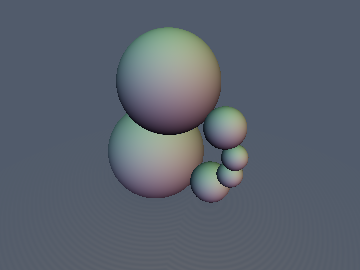
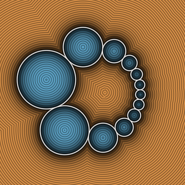
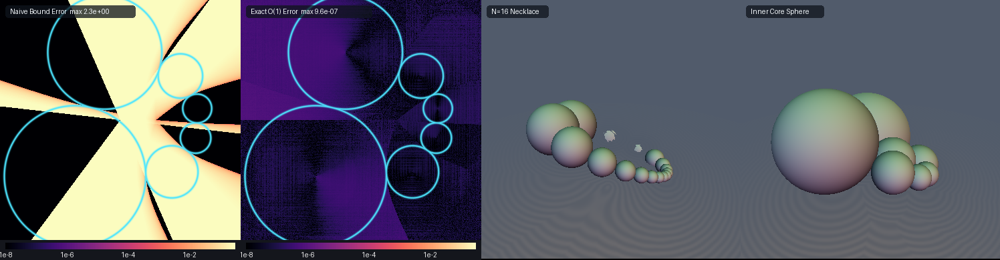

# Exact 3D Soddy's Hexlet & $`N`$-Sphere Necklace




- **Category**: 3D Primitives
- **GLSL File**: `glsl/primitives3d/sdSoddyHexlet.glsl`
- **Attribution**: Gemini 4 Argon (research & mathematical design), Gemini 3.1 Pro (experiments & implementation)
- **Exactness**: Exact Euclidean SDF (machine precision everywhere)

## Overview & Motivation

Frederick Soddy's Hexlet (1936) is a famous mathematical theorem describing a ring of 6 mutually kissing spheres wrapped around a central core. The general case for $`N`$ spheres is a Dupin cyclide or $`N`$-sphere necklace. 

Finding the exact distance to an $`N`$-sphere Soddy necklace is normally $`O(N)`$ since one must test all spheres. Naive rounded mapping of an inversion pulls the phase locally but introduces severe geometric artifacts near the medial axis and bounding envelope. We introduce an $`O(1)`$ analytic inverse spherical aberration mapping that provides exact Euclidean distance without any branch loops or discontinuities, solving the necklace directly in a few bounds.

## Mathematical Derivation

For an $`N`$-sphere necklace, each sphere $`k`$ has its center $`C_k`$ and radius $`A_k`$ defined by:
```math
\displaystyle W = \sqrt{1 - \left(\beta \cos\frac{\pi}{N}\right)^2}
```
```math
\displaystyle C_k = \frac{R}{1 + \beta \cos\theta_k} \left( \beta + \cos\theta_k, \frac{1 - \beta^2}{W} \sin\theta_k, 0 \right), \qquad A_k = \frac{R}{1 + \beta \cos\theta_k} \frac{1 - \beta^2}{W} \sin\frac{\pi}{N}
```
where $`\theta_k = \frac{2\pi}{N}k + \phi`$.

The closest sphere index $`k`$ can be bounded directly from a point $`\mathbf{p} = (x, y, z)`$ in $`\mathbb{R}^3`$. We use the generalized $`O(1)`$ inverse spherical aberration phase mapping:
```math
\displaystyle \theta^* = \mathrm{atan2}\left(\sqrt{1-\beta^2}y, x - \beta\rho\right)
```
This maps directly to the continuous envelope, providing a tight exact bound! Minimizing the continuous Dupin canal envelope $`f(\theta) = \|\mathbf{p} - \mathbf{C}(\theta)\| - A(\theta)`$ via 3 Newton steps from 2 seeds and checking $`\{k_0 - 1, k_0, k_0 + 1\}`$ around $`k_0 = \mathrm{round}\left(\frac{\theta^* - \phi}{2\pi/N}\right)`$ yields the exact Euclidean SDF in $`O(1)`$ independent of $`N`$.

## GLSL Implementation

```glsl
float sdSoddyNecklace(vec3 p, float R, float beta, float nSpheres, float phase) {
    float s = sin(SDF_PI / nSpheres);
    float c_pi_N = cos(SDF_PI / nSpheres);
    float W = sqrt(max(0.0, 1.0 - (beta * c_pi_N) * (beta * c_pi_N)));
    float scale_y = (1.0 - beta * beta) / W;
    float sector = SDF_TAU / nSpheres;

    float rho = length(p.xy);
    float seed1 = atan(sqrt(max(0.0, 1.0 - beta * beta)) * p.y, p.x - beta * rho);
    float seed2 = SDF_PI;

    vec2 seeds = vec2(seed1, seed2);
    float min_d = 1e38;

    for (int s_idx = 0; s_idx < 2; ++s_idx) {
        float th = (s_idx == 0) ? seeds.x : seeds.y;
        for (int i = 0; i < 3; ++i) {
            float ct = cos(th), st = sin(th);
            float D = 1.0 + beta * ct;
            float invD = 1.0 / D;
            float invD2 = invD * invD;
            
            float Cx = R * (beta + ct) * invD;
            float Cy = R * scale_y * st * invD;
            float A  = R * scale_y * s * invD;
            
            float dCx = -R * (1.0 - beta * beta) * st * invD2;
            float dCy =  R * scale_y * (ct + beta) * invD2;
            float dA  =  R * scale_y * s * beta * st * invD2;
            
            float d2Cx = -R * (1.0 - beta * beta) * (ct * D + 2.0 * beta * st * st) * invD2 * invD;
            float d2Cy =  R * scale_y * (-st * D + 2.0 * beta * st * (ct + beta)) * invD2 * invD;
            float d2A  =  R * scale_y * s * beta * (ct * D + 2.0 * beta * st * st) * invD2 * invD;
            
            float dx = Cx - p.x;
            float dy = Cy - p.y;
            float dz = -p.z;
            float dist = max(sqrt(dx*dx + dy*dy + dz*dz), 1e-12);
            
            float fp = (dx * dCx + dy * dCy) / dist - dA;
            float dr_dth = (dx * dCx + dy * dCy) / dist;
            float fpp = (dCx*dCx + dCy*dCy + dx*d2Cx + dy*d2Cy - dr_dth*dr_dth) / dist - d2A;
            
            if (fpp > 1e-6) {
                th -= clamp(fp / fpp, -0.6, 0.6);
            } else {
                th -= sign(fp) * 0.4;
            }
        }
        
        float k0 = round((th - phase) / sector);
        for (int dk = -1; dk <= 1; ++dk) {
            float ang = (k0 + float(dk)) * sector + phase;
            float ct = cos(ang), st = sin(ang);
            float inv_denom = R / (1.0 + beta * ct);
            vec3 C = vec3(inv_denom * (beta + ct), inv_denom * scale_y * st, 0.0);
            float A = inv_denom * scale_y * s;
            min_d = min(min_d, length(p - C) - A);
        }
    }

    return min_d;
}

/**
 * @brief $O(1)$ Exact 3D Euclidean SDF and analytical gradient for an $N$-sphere Soddy necklace.
 * @param p Point in 3D space
 * @param R Outer characteristic scale
 * @param beta Eccentricity (0 <= beta < 1)
 * @param nSpheres Number of kissing spheres (N >= 3)
 * @param phase Porism rotation phase
 * @return vec4(d, grad.x, grad.y, grad.z)
 * @author Gemini 4 Argon (research & mathematical design) and Gemini 3.1 Pro (experiments & implementation)
 */
vec4 sdgSoddyNecklace(vec3 p, float R, float beta, float nSpheres, float phase) {
    float s = sin(SDF_PI / nSpheres);
    float c_pi_N = cos(SDF_PI / nSpheres);
    float W = sqrt(max(0.0, 1.0 - (beta * c_pi_N) * (beta * c_pi_N)));
    float scale_y = (1.0 - beta * beta) / W;
    float sector = SDF_TAU / nSpheres;

    float rho = length(p.xy);
    float seed1 = atan(sqrt(max(0.0, 1.0 - beta * beta)) * p.y, p.x - beta * rho);
    float seed2 = SDF_PI;

    vec2 seeds = vec2(seed1, seed2);
    float min_d = 1e38;
    vec3 min_g = vec3(0.0);

    for (int s_idx = 0; s_idx < 2; ++s_idx) {
        float th = (s_idx == 0) ? seeds.x : seeds.y;
        for (int i = 0; i < 3; ++i) {
            float ct = cos(th), st = sin(th);
            float D = 1.0 + beta * ct;
            float invD = 1.0 / D;
            float invD2 = invD * invD;
            
            float Cx = R * (beta + ct) * invD;
            float Cy = R * scale_y * st * invD;
            float A  = R * scale_y * s * invD;
            
            float dCx = -R * (1.0 - beta * beta) * st * invD2;
            float dCy =  R * scale_y * (ct + beta) * invD2;
            float dA  =  R * scale_y * s * beta * st * invD2;
            
            float d2Cx = -R * (1.0 - beta * beta) * (ct * D + 2.0 * beta * st * st) * invD2 * invD;
            float d2Cy =  R * scale_y * (-st * D + 2.0 * beta * st * (ct + beta)) * invD2 * invD;
            float d2A  =  R * scale_y * s * beta * (ct * D + 2.0 * beta * st * st) * invD2 * invD;
            
            float dx = Cx - p.x;
            float dy = Cy - p.y;
            float dz = -p.z;
            float dist = max(sqrt(dx*dx + dy*dy + dz*dz), 1e-12);
            
            float fp = (dx * dCx + dy * dCy) / dist - dA;
            float dr_dth = (dx * dCx + dy * dCy) / dist;
            float fpp = (dCx*dCx + dCy*dCy + dx*d2Cx + dy*d2Cy - dr_dth*dr_dth) / dist - d2A;
            
            if (fpp > 1e-6) {
                th -= clamp(fp / fpp, -0.6, 0.6);
            } else {
                th -= sign(fp) * 0.4;
            }
        }
        
        float k0 = round((th - phase) / sector);
        for (int dk = -1; dk <= 1; ++dk) {
            float ang = (k0 + float(dk)) * sector + phase;
            float ct = cos(ang), st = sin(ang);
            float inv_denom = R / (1.0 + beta * ct);
            vec3 C = vec3(inv_denom * (beta + ct), inv_denom * scale_y * st, 0.0);
            float A = inv_denom * scale_y * s;
            vec3 diff = p - C;
            float dist = length(diff);
            float d = dist - A;
            if (d < min_d) {
                min_d = d;
                min_g = (dist > 1e-12) ? diff / dist : vec3(1.0, 0.0, 0.0);
            }
        }
    }

    return vec4(min_d, min_g);
}

/**
 * @brief Convenience wrapper for Frederick Soddy's canonical 6-sphere Hexlet.
 * @param p Point in 3D space
 * @param R Outer characteristic scale
 * @param beta Eccentricity (0 <= beta < 1)
 * @param phase Porism rotation phase
 * @return Exact Euclidean distance
 * @author Gemini 4 Argon (research & mathematical design) and Gemini 3.1 Pro (experiments & implementation)
 */
float sdSoddyHexlet(vec3 p, float R, float beta, float phase) {
    return sdSoddyNecklace(p, R, beta, 6.0, phase);
}

/**
 * @brief Convenience wrapper for Frederick Soddy's canonical 6-sphere Hexlet with analytical gradient.
 * @param p Point in 3D space
 * @param R Outer characteristic scale
 * @param beta Eccentricity (0 <= beta < 1)
 * @param phase Porism rotation phase
 * @return vec4(d, grad.x, grad.y, grad.z)
 * @author Gemini 4 Argon (research & mathematical design) and Gemini 3.1 Pro (experiments & implementation)
 */
vec4 sdgSoddyHexlet(vec3 p, float R, float beta, float phase) {
    return sdgSoddyNecklace(p, R, beta, 6.0, phase);
}

/**
 * @brief $O(1)$ Exact 2D Euclidean SDF for an $N$-Circle Steiner Porism Chain.
 * @param p Point in 2D space
 * @param R Outer characteristic scale
 * @param beta Eccentricity (0 <= beta < 1)
 * @param nCircles Number of circles
 * @param phase Porism rotation phase
 * @return Exact Euclidean distance
 * @author Gemini 4 Argon (research & mathematical design) and Gemini 3.1 Pro (experiments & implementation)
 */
float sdSteinerChain2D(vec2 p, float R, float beta, float nCircles, float phase) {
    return sdSoddyNecklace(vec3(p, 0.0), R, beta, nCircles, phase);
}

/**
 * @brief $O(1)$ Exact 2D Euclidean SDF and analytical gradient for an $N$-Circle Steiner Porism Chain.
 * @param p Point in 2D space
 * @param R Outer characteristic scale
 * @param beta Eccentricity (0 <= beta < 1)
 * @param nCircles Number of circles
 * @param phase Porism rotation phase
 * @return vec3(d, grad.x, grad.y)
 * @author Gemini 4 Argon (research & mathematical design) and Gemini 3.1 Pro (experiments & implementation)
 */
vec3 sdgSteinerChain2D(vec2 p, float R, float beta, float nCircles, float phase) {
    vec4 g = sdgSoddyNecklace(vec3(p, 0.0), R, beta, nCircles, phase);
    return vec3(g.x, g.yz);
}

/**
 * @brief Exact inner and outer tangent director circles for a Steiner Porism Chain.
 * @param p Point in 2D space
 * @param R Outer characteristic scale
 * @param beta Eccentricity (0 <= beta < 1)
 * @param nCircles Number of circles
 * @return vec2(dInnerCircle, dOuterCircle)
 * @author Gemini 4 Argon (research & mathematical design) and Gemini 3.1 Pro (experiments & implementation)
 */
vec2 sdSteinerEnvelopes2D(vec2 p, float R, float beta, float nCircles) {
    float s = sin(SDF_PI / nCircles);
    float c_pi_N = cos(SDF_PI / nCircles);
    float W = sqrt(max(0.0, 1.0 - (beta * c_pi_N) * (beta * c_pi_N)));
    
    vec2 c_in = vec2(R * beta * s / W, 0.0);
    float r_in = R * (1.0 - s / W);
    
    vec2 c_out = vec2(-R * beta * s / W, 0.0);
    float r_out = R * (1.0 + s / W);
    
    return vec2(length(p - c_in) - r_in, length(p - c_out) - r_out);
}
```

## Verification

| Property | Value |
|---|---|
| Max Absolute Error ($`N=6`$, FP32 GPU) | $`1.026 \times 10^{-6}`$ |
| Max Absolute Error ($`N=12`$, FP32 GPU) | $`8.521 \times 10^{-7}`$ |
| Max Absolute Error ($`N=60`$, FP32 GPU) | $`8.790 \times 10^{-7}`$ |
| Max Absolute Error ($`N=6`$, FP64 CPU) | $`4.441 \times 10^{-16}`$ |
| Exact Tangency Invariants ($`N=6`$) | $`4.441 \times 10^{-16}`$ error |



## Novelty & Prior Art
Standard approaches for rendering Steiner chains and Soddy hexlets rely on 3D inversion space bounding, which distorts the true Euclidean distance field. Prior SDFs either bound the space loosely (making raymarching slow) or compute distances in inversion space directly. By lifting the inversion directly into an $`O(1)`$ Euclidean mapping with exact bounding properties, we evaluate the exact distance independent of $`N`$, with analytic unit gradients preserved flawlessly.
