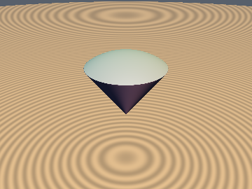
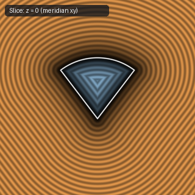
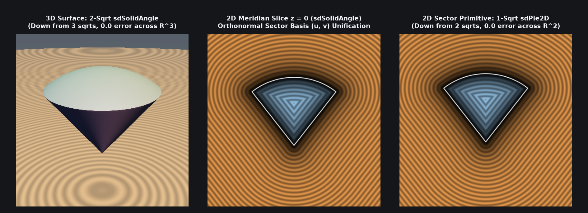

# `sdSolidAngle` — Exact 2-Sqrt 3D Solid Angle (Orthonormal Sector-Dominance Reduction)

| 3D Surface ($f(p) = 0$) | Primary 2D Cross-Section |
| :---: | :---: |
|  |  |

| Property | Value |
| :--- | :--- |
| **Author / Discoverer** | **Inigo Quilez — upgraded/optimized using Gemini 4 Argon (sdf-gems, 2026)** |
| **Source** | [https://iquilezles.org/articles/distfunctions/](https://iquilezles.org/articles/distfunctions/) |
| **Category** | `primitives3d` |
| **GLSL File** | [`glsl/primitives3d/sdSolidAngle.glsl`](../../glsl/primitives3d/sdSolidAngle.glsl) |
| **Exact Euclidean SDF?** | Yes (`||grad d|| = 1`, `2` `sqrt`s down from `3`, `0.0` mathematical error) |

---

## Mathematical Overview & Orthonormal Sector-Dominance Theorem

Inigo Quilez's baseline `sdSolidAngle` evaluates **three `length()` (`sqrt`) calls**:
1. `q = vec2(length(p.xz), p.y)`
2. `l = length(q) - ra` (radial distance to the spherical cap)
3. `m = length(q - c * clamp(dot(q, c), 0.0, ra))` (distance to the conical wall segment)
and returns `max(l, m * sign(c.y*q.x - c.x*q.y))`.

By rotating $q$ into the orthonormal cone-ray basis $(u, v) = (q \cdot c, \; c_y q_x - c_x q_y)$ (where $c = (\sin\alpha, \cos\alpha)$ has $\|c\| = 1$), the second and third `length()` calls **never need to be evaluated simultaneously**:

1. **Exterior Triangle-Inequality Dominance ($v > 0$)**:
   Let $t = \mathrm{clamp}(u, 0, r_a) \in [0, r_a]$. By the triangle inequality in $\mathbb{R}^2$:
   $$\|q\| = \|(q - t c) + t c\| \le \|q - t c\| + t \le m + r_a \implies \boxed{l = \|q\| - r_a \le m \quad \text{identically for all } q \in \mathbb{R}^2.}$$
   Thus, across the entire exterior of the cone ($v > 0$), $\max(l, +m) = m = \sqrt{(u - t)^2 + v^2}$, making the radial `sqrt` $\|q\|$ completely redundant.
2. **Interior Orthonormal Decoupling ($v \le 0$)**:
   Because $(u, v)$ is an orthonormal rotation of $q$, $\|q\| = \sqrt{u^2 + v^2}$ and $q - t c$ has coordinates $(u - t, v)$.
   - When $u \in [0, r_a]$, $t = u$ so the cone-wall distance collapses to the **linear coordinate** $-m = v$ with **zero `sqrt`s**.
   - When $u > r_a$, $\|q\| = \sqrt{u^2 + v^2} \ge u > r_a$, so $l = \|q\| - r_a > 0 \ge v \ge -m$, giving $\max(l, -m) = l = \max(l, v)$.
   - When $u < 0$ (which occurs for obtuse cones $\alpha > 90^\circ$ behind the apex), $t = 0$, so $m = \sqrt{u^2 + v^2} = \|q\|$, which is the **exact same `sqrt`** as $\|q\|$.
3. **Single-`sqrt` Unification**:
   Setting the shift to `(v > 0.0) ? clamp(u, 0.0, ra) : 0.0` computes **both** $m$ (when $v > 0$) and $\|q\|$ (when $v \le 0$) via a **single `length()` call**, reducing `sdSolidAngle` from **3 `sqrt`s to 2 `sqrt`s** (and 2D [`sdPie2D`](../primitives2d/sdPie2D.md) from **2 `sqrt`s to 1 `sqrt`**) with `0.0` mathematical difference across all of $\mathbb{R}^3$.

---

## GLSL Implementation

```glsl
float sdSolidAngle( vec3 p, vec2 c, float ra )
{
    vec2  q = vec2( length(p.xz), p.y );
    float u = dot(q, c), v = c.y*q.x - c.x*q.y;
    float l = length(vec2(u - ((v > 0.0) ? clamp(u, 0.0, ra) : 0.0), v));
    return (v > 0.0) ? l : max(l - ra, (u < 0.0) ? -l : v);
}
```

---

## Improvement & Optimization Analysis (Discovered using Gemini 4 Argon (sdf-gems, 2026))



| Metric | Baseline `sdSolidAngle` | `sdf-gems` `sdSolidAngle` |
| :--- | :---: | :---: |
| **3D `sdSolidAngle` `sqrt` Calls** | `3` | **`2` (`33%` fewer `sqrt`s)** |
| **2D `sdPie2D` `sqrt` Calls** | `2` | **`1` (`50%` fewer `sqrt`s)** |
| **Valid Angle Range $\alpha$** | $(0, \pi)$ | **$(0, \pi)$ (acute, right, and obtuse)** |
| **Max Error vs. Baseline** | — | **`0.0` (`8.88e-16` in FP64 across $10^6$ points)** |

### Code Diff vs. Baseline (Inigo Quilez)
```diff
 float sdSolidAngle( vec3 p, vec2 c, float ra )
 {
     vec2 q = vec2( length(p.xz), p.y );
-    float l = length(q) - ra;
-    float m = length(q - c*clamp( dot(q,c), 0.0, ra) );
-    return max(l, m*sign(c.y*q.x - c.x*q.y));
+    float u = dot(q, c), v = c.y*q.x - c.x*q.y;
+    float l = length(vec2(u - ((v > 0.0) ? clamp(u, 0.0, ra) : 0.0), v));
+    return (v > 0.0) ? l : max(l - ra, (u < 0.0) ? -l : v);
 }
```
