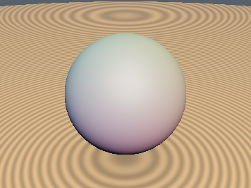
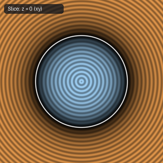

# `sdSphere` — Exact 3D Sphere

| 3D Surface ($f(p) = 0$) | 2D Cross-Section Slice |
| :---: | :---: |
|  |  |

| Property | Value |
| :--- | :--- |
| **Author / Discoverer** | **Inigo Quilez** |
| **Source** | [https://iquilezles.org/articles/distfunctions/](https://iquilezles.org/articles/distfunctions/) |
| **Category** | `primitives3d` |
| **GLSL File** | [`glsl/primitives3d/sdSphere.glsl`](../../glsl/primitives3d/sdSphere.glsl) |
| **Exact Euclidean SDF?** | Yes (`||grad d|| = 1`) |

---

## Mathematical Overview

Computes the exact Euclidean signed distance to a sphere of radius $s$ centered at the origin: $d(p) = \|p\| - s$.

---

## GLSL Implementation

```glsl
float sdSphere( vec3 p, float s )
{
    return length(p) - s;
}
```
