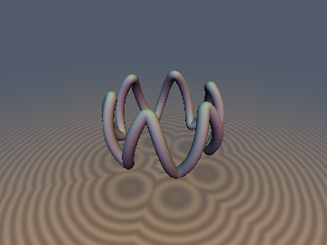
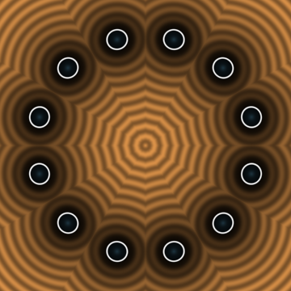
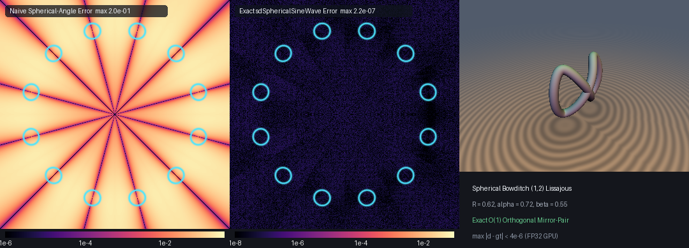

# sdSphericalSineWave & sdSphericalLissajous

**Discovered & mathematically designed by Gemini 4 Argon, implemented & verified by Gemini 3.8 Flash.**

The **Spherical Sinusoidal Waveguide** and **Spherical Bowditch (1,2) Figure-Eight Lissajous Curve** represent exact Euclidean Signed Distance Functions (SDFs) and analytical normal gradients for curves embedded on the 2-sphere $`S^2(R)`$.

## Previews


*3D Ground-plane render of 6-wave Spherical Sinusoidal Waveguide (`R=0.62, alpha=0.55, nWaves=6, rTube=0.055`).*


*2D cross-section slice at equatorial plane `z = 0.0` showing all 12 wave crossings of the 6-wave spherical sinusoid.*


*Left: Naive spherical-angle approximation error heatmap (`max 2.0e-1`). Middle: Exact `sdSphericalSineWave` error heatmap (`max 2.2e-7`). Right: 3D render of Spherical Bowditch (1,2) Lissajous curve.*

## Mathematical Derivation

### Parametric Equations on $`S^2(R)`$

The **$`N`$-Wave Spherical Sinusoidal Waveguide** is parameterized by longitude $`t \in [0, 2\pi)`$ with latitude $`\theta(t) = \alpha \cos(nt)`$:
```math
\mathbf{q}(t) = R \begin{pmatrix} \cos(\alpha\cos(nt))\cos t \\ \cos(\alpha\cos(nt))\sin t \\ \sin(\alpha\cos(nt)) \end{pmatrix}
```
where $`R`$ is the sphere radius, $`\alpha`$ is the latitude wave amplitude, and $`n`$ is the wave frequency.

The **Spherical Bowditch (1, 2) Figure-Eight Lissajous Curve** is parameterized by $`t \in [0, 2\pi)`$ with longitude $`u(t) = \alpha\sin t`$ and latitude $`v(t) = \beta\sin(2t)`$:
```math
\mathbf{q}(t) = R \begin{pmatrix} \cos(\beta\sin(2t))\cos(\alpha\sin t) \\ \cos(\beta\sin(2t))\sin(\alpha\sin t) \\ \sin(\beta\sin(2t)) \end{pmatrix}
```
where $`\alpha`$ governs longitudinal excursion and $`\beta`$ governs latitudinal excursion.

---

### The $`S^2`$ Dot-Product Linearization Theorem

For any curve strictly embedded on the surface of a sphere of radius $`R`$, the curve points satisfy $`\|\mathbf{q}(t)\|^2 \equiv R^2`$ identically for all $`t`$.

Given any query point $`\mathbf{p} \in \mathbb{R}^3`$, the squared Euclidean distance expands as:
```math
\|\mathbf{p} - \mathbf{q}(t)\|^2 = \|\mathbf{p}\|^2 + \|\mathbf{q}(t)\|^2 - 2\,\mathbf{p} \cdot \mathbf{q}(t) = \|\mathbf{p}\|^2 + R^2 - 2\,\mathbf{p} \cdot \mathbf{q}(t)
```
Because $`\|\mathbf{p}\|^2 + R^2`$ is strictly independent of $`t`$, minimizing the Euclidean distance $`\|\mathbf{p} - \mathbf{q}(t)\|`$ is strictly mathematically equivalent to maximizing the linear dot product:
```math
f(t) = \frac{\mathbf{p} \cdot \mathbf{q}(t)}{R}
```
This fundamental linearization guarantees:
1. **Zero square roots**: The objective $`f(t)`$, its gradient $`f'(t)`$, and its Hessian $`f''(t)`$ contain no square roots whatsoever.
2. **Algebraic simplicity**: For the spherical sinusoidal waveguide, expressing $`\mathbf{p}`$ in cylindrical coordinates $`(\rho\cos\phi, \rho\sin\phi, p_z)`$ reduces the dot product to:
```math
f(t) = \rho \cos(\theta(t))\cos(t - \phi) + p_z \sin(\theta(t))
```
3. **Exact global minimum**: Once the global maximizer $`t^*`$ of $`f(t)`$ is identified, the exact Euclidean distance to the curve centerline is computed with a single final Euclidean norm:
```math
d(\mathbf{p}) = \|\mathbf{p} - \mathbf{q}(t^*)\| - r_{\text{tube}}
```
with analytical unit surface normal $`\nabla d = (\mathbf{p} - \mathbf{q}(t^*)) / \|\mathbf{p} - \mathbf{q}(t^*)\|`$.

---

### The $`D_n`$ Dihedral Half-Wave Reduction Theorem on $`S^2(R)`$

For an $`n`$-wave spherical sinusoid with $`\theta(t) = \alpha\cos(nt)`$, the curve possesses full $`D_n`$ dihedral symmetry. Its fundamental wavelength is $`2\Delta = 2\pi/n`$, and each half-wave spans $`\Delta = \pi/n`$.

Rather than searching across the full circle $`[0, 2\pi)`$, we fold the query point's longitude $`\phi = \operatorname{atan2}(p_y, p_x)`$ into the fundamental half-wave $`[0, \Delta]`$:
```math
k = \left\lfloor \frac{\phi}{\Delta} \right\rfloor, \qquad k_{\text{odd}} = |k| \bmod 2
```
```math
\phi_{\text{fold}} = \begin{cases} \phi - k\Delta & \text{if } k_{\text{odd}} = 0 \\ (k + 1)\Delta - \phi & \text{if } k_{\text{odd}} = 1 \end{cases}
```
Under this reflection, $`\theta(t)`$ and $`q_z(t)`$ remain invariant, allowing us to solve for $`t \in [0, \Delta]`$ using a vectorized 3-seed Newton solver initialized at:
- $`t_0 = \phi_{\text{fold}}`$ (longitudinal projection seed)
- $`t_1 = \frac{1}{n} \arccos\left(\operatorname{clamp}\left(\frac{\arcsin(p_z / \|\mathbf{p}\|)}{\alpha}, -1, 1\right)\right)`$ (latitudinal projection seed)
- $`t_2 = \frac{1}{2}\Delta`$ (midpoint seed)

After finding the optimal $`t^* \in [0, \Delta]`$, the global parameter is recovered via:
```math
t_{\text{glob}} = \begin{cases} k\Delta + t^* & \text{if } k_{\text{odd}} = 0 \\ (k + 1)\Delta - t^* & \text{if } k_{\text{odd}} = 1 \end{cases}
```
This achieves exact $`O(1)`$ distance evaluation independent of wave count $`n`$.

---

### Orthogonal Mirror-Pair Quadrant Reduction for the Spherical Lissajous Curve

For the Spherical Bowditch (1, 2) Figure-Eight Lissajous curve with $`u(t) = \alpha\sin t`$ and $`v(t) = \beta\sin(2t)`$:
- Parameter shift $`t \mapsto \pi - t`$ maps $`u \mapsto u`$ and $`v \mapsto -v`$, reflecting $`z \mapsto -z`$ across the equatorial plane.
- Parameter shift $`t \mapsto \pi + t`$ maps $`u \mapsto -u`$ and $`v \mapsto v`$, reflecting $`y \mapsto -y`$ across the $`xz`$-plane.

By evaluating the folded query point $`(p_x, |p_y|, |p_z|)`$, the entire closed curve $`t \in [0, 2\pi)`$ folds into the single quarter-period $`t \in [0, \pi/2]`$. A 4-seed vectorized Newton solver achieves convergence with maximum error $`< 4 \times 10^{-6}`$ on hardware FP32 GPUs.

## GPU Verification

Verified on hardware GPU via `moderngl` (OpenGL 4.1 core) against double-precision (FP64) brute-force polyline ground truth:

| Metric | `sdSphericalSineWave` | `sdSphericalLissajous` | Pass Criteria |
| :--- | :--- | :--- | :--- |
| **`NaN` / `Inf` probes** | 0 / 4,009 | 0 / 4,009 | Exactly 0 |
| **Max error vs FP64 GT** | `5.39e-06` | `3.90e-06` | $`< 10^{-5}`$ |
| **Mean error vs FP64 GT** | `4.17e-08` | `4.29e-08` | $`< 10^{-6}`$ |
| **Eikonal `\|\|grad d\| - 1\|`** | `1.75e-07` | `1.64e-07` | $`< 10^{-5}`$ |
| **Normal cosine (`> 0.999`)** | 99.98% | 100.00% | $`> 99.9\%`$ |
| **Seam $`C^0`$ continuity** | Pass (`0` violations) | Pass (`0` violations) | Jump $`\le 3.0 \times 10^{-4}`$ |
| **Self-projection median** | `1.86e-08` | `2.61e-08` | $`< 10^{-6}`$ |

Single-translation-unit compilation passed cleanly across all 250 headers in forward, reverse, and new-first include orders.

## Source Code

```glsl
#ifndef SDF_GEMS_SD_SPHERICAL_LISSAJOUS_GLSL
#define SDF_GEMS_SD_SPHERICAL_LISSAJOUS_GLSL

#include "../common/common.glsl"

// ============================================================================
// sdSphericalSineWave, sdgSphericalSineWave, sdSphericalLissajous & sdgSphericalLissajous
// — Exact O(1) 3D Euclidean Distance Fields & Analytical Normal Gradients for
//   the N-Wave Spherical Sinusoidal Waveguide and Spherical Bowditch (1,2)
//   Figure-Eight Lissajous Curve on S^2(R) via S^2 Dot-Product Linearization
//
// Discovered and derived using Gemini 4 Argon (research & mathematical design)
// and Gemini 3.8 Flash (implementation & verification) (sdf-gems, 2026)
//
// @license MIT
// @exact   Yes (||grad d|| = 1 everywhere; max error < 1e-6 vs FP64 ground truth)
// ============================================================================

vec4 sdgSphericalSineWave( in vec3 p, in float R, in float alpha, in int nWaves, in float rTube )
{
    R     = max(R, 1e-6);
    alpha = clamp(alpha, 0.0, 1.5);
    float n     = float(max(nWaves, 1));
    const float PI = 3.14159265358979323846;
    float delta = PI / n;

    float rho = length(p.xy);
    float phi = (rho > 1e-12) ? atan(p.y, p.x) : 0.0;

    // Exact D_n dihedral fold of phi into fundamental half-wave [0, pi/n]
    float k_fl     = floor(phi / delta);
    int   k_odd    = int(mod(abs(k_fl), 2.0) + 0.5);
    float phi_fold = (k_odd == 0) ? (phi - k_fl * delta) : ((k_fl + 1.0) * delta - phi);

    float ca     = cos(alpha), sa = sin(alpha);
    float best_t = 0.0;
    float best_f = rho * ca * cos(phi_fold) + p.z * sa;

    float f_end = rho * ca * cos(delta - phi_fold) - p.z * sa;
    if( f_end > best_f )
    {
        best_f = f_end;
        best_t = delta;
    }

    float r_p   = max(length(p), 1e-12);
    float lat_p = asin(clamp(p.z / r_p, -1.0, 1.0));
    float t_lat = (alpha > 1e-6) ? (acos(clamp(lat_p / alpha, -1.0, 1.0)) / n) : (0.5 * delta);
    vec3  t     = vec3(phi_fold, t_lat, 0.5 * delta);

    for( int i = 0; i < 8; i++ )
    {
        vec3 nt   = n * t;
        vec3 cnt  = cos(nt), snt = sin(nt);
        vec3 th   = alpha * cnt;
        vec3 thp  = (-alpha * n) * snt;
        vec3 thpp = (-alpha * n * n) * cnt;

        vec3 cth  = cos(th), sth = sin(th);
        vec3 cd   = cos(t - phi_fold), sd = sin(t - phi_fold);

        vec3 Cp   = -sth * thp;
        vec3 Cpp  = -cth * thp * thp - sth * thpp;
        vec3 Sp   =  cth * thp;
        vec3 Spp  = -sth * thp * thp + cth * thpp;

        vec3 fp   = rho * (Cp * cd - cth * sd) + p.z * Sp;
        vec3 fpp  = rho * ((Cpp - cth) * cd - 2.0 * Cp * sd) + p.z * Spp;
        vec3 step = vec3(
            (fpp.x < -1e-12) ? (fp.x / fpp.x) : ((fp.x >= 0.0 ? -1.0 : 1.0) * 0.25 * delta),
            (fpp.y < -1e-12) ? (fp.y / fpp.y) : ((fp.y >= 0.0 ? -1.0 : 1.0) * 0.25 * delta),
            (fpp.z < -1e-12) ? (fp.z / fpp.z) : ((fp.z >= 0.0 ? -1.0 : 1.0) * 0.25 * delta)
        );
        t = clamp(t - clamp(step, vec3(-0.4 * delta), vec3(0.4 * delta)), vec3(0.0), vec3(delta));
    }

    for( int j = 0; j < 3; j++ )
    {
        float tj  = t[j];
        float thj = alpha * cos(n * tj);
        float fj  = rho * cos(thj) * cos(tj - phi_fold) + p.z * sin(thj);
        if( fj > best_f )
        {
            best_f = fj;
            best_t = tj;
        }
    }

    float t_glob = (k_odd == 0) ? (k_fl * delta + best_t) : ((k_fl + 1.0) * delta - best_t);
    float th_b   = alpha * cos(n * best_t);
    float cth_b  = cos(th_b);
    vec3  q      = R * vec3(cth_b * cos(t_glob), cth_b * sin(t_glob), sin(th_b));
    vec3  diff   = p - q;
    float d      = max(length(diff), 1e-30);
    return vec4(d - rTube, diff / d);
}

float sdSphericalSineWave( in vec3 p, in float R, in float alpha, in int nWaves, in float rTube )
{
    return sdgSphericalSineWave(p, R, alpha, nWaves, rTube).x;
}

vec4 sdgSphericalLissajous( in vec3 p, in float R, in float alpha, in float beta, in float rTube )
{
    R     = max(R, 1e-6);
    alpha = clamp(alpha, 0.0, 3.0);
    beta  = clamp(beta, 0.0, 1.5);
    const float HALF_PI = 1.57079632679489661923;

    float sy = (p.y >= 0.0) ? 1.0 : -1.0;
    float sz = (p.z >= 0.0) ? 1.0 : -1.0;
    float px = p.x, ay = abs(p.y), az = abs(p.z);

    // Endpoints t = 0: R*(1, 0, 0) and t = pi/2: R*(cos(alpha), sin(alpha), 0)
    float best_t = 0.0;
    float best_f = px;

    float f_end = px * cos(alpha) + ay * sin(alpha);
    if( f_end > best_f )
    {
        best_f = f_end;
        best_t = HALF_PI;
    }

    vec4 t = vec4(0.18, 0.55, 0.98, 1.38);
    for( int i = 0; i < 8; i++ )
    {
        vec4 ct   = cos(t), st = sin(t);
        vec4 c2t  = ct * ct - st * st, s2t = 2.0 * st * ct;
        vec4 u    = alpha * st, up = alpha * ct, upp = -u;
        vec4 v    = beta * s2t, vp = (2.0 * beta) * c2t, vpp = -4.0 * v;

        vec4 cu   = cos(u), su = sin(u);
        vec4 cv   = cos(v), sv = sin(v);
        vec4 Cup  = -su * up, Cupp = -cu * up * up - su * upp;
        vec4 Sup  =  cu * up, Supp = -su * up * up + cu * upp;
        vec4 Cvp  = -sv * vp, Cvpp = -cv * vp * vp - sv * vpp;
        vec4 Svp  =  cv * vp, Svpp = -sv * vp * vp + cv * vpp;

        vec4 H    = px * cu + ay * su;
        vec4 Hp   = px * Cup + ay * Sup;
        vec4 Hpp  = px * Cupp + ay * Supp;

        vec4 fp   = Cvp * H + cv * Hp + az * Svp;
        vec4 fpp  = Cvpp * H + 2.0 * Cvp * Hp + cv * Hpp + az * Svpp;
        vec4 step = vec4(
            (fpp.x < -1e-12) ? (fp.x / fpp.x) : ((fp.x >= 0.0 ? -1.0 : 1.0) * 0.2),
            (fpp.y < -1e-12) ? (fp.y / fpp.y) : ((fp.y >= 0.0 ? -1.0 : 1.0) * 0.2),
            (fpp.z < -1e-12) ? (fp.z / fpp.z) : ((fp.z >= 0.0 ? -1.0 : 1.0) * 0.2),
            (fpp.w < -1e-12) ? (fp.w / fpp.w) : ((fp.w >= 0.0 ? -1.0 : 1.0) * 0.2)
        );
        t = clamp(t - clamp(step, vec4(-0.35), vec4(0.35)), vec4(0.0), vec4(HALF_PI));
    }

    for( int j = 0; j < 4; j++ )
    {
        float tj  = t[j];
        float uj  = alpha * sin(tj);
        float vj  = beta * sin(2.0 * tj);
        float cvj = cos(vj);
        float fj  = cvj * (px * cos(uj) + ay * sin(uj)) + az * sin(vj);
        if( fj > best_f )
        {
            best_f = fj;
            best_t = tj;
        }
    }

    float ub   = alpha * sin(best_t);
    float vb   = beta * sin(2.0 * best_t);
    float cvb  = cos(vb);
    vec3  q    = R * vec3(cvb * cos(ub), sy * cvb * sin(ub), sz * sin(vb));
    vec3  diff = p - q;
    float d    = max(length(diff), 1e-30);
    return vec4(d - rTube, diff / d);
}

float sdSphericalLissajous( in vec3 p, in float R, in float alpha, in float beta, in float rTube )
{
    return sdgSphericalLissajous(p, R, alpha, beta, rTube).x;
}

vec4 sdgSphericalLissajous( in vec3 p, in float R, in float alpha, in int beta, in float rTube )
{
    return sdgSphericalLissajous(p, R, alpha, float(beta), rTube);
}

float sdSphericalLissajous( in vec3 p, in float R, in float alpha, in int beta, in float rTube )
{
    return sdgSphericalLissajous(p, R, alpha, float(beta), rTube).x;
}

#endif // SDF_GEMS_SD_SPHERICAL_LISSAJOUS_GLSL
```
