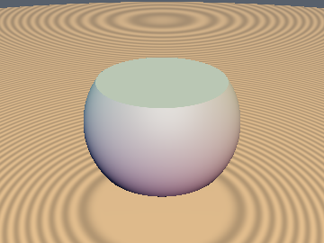
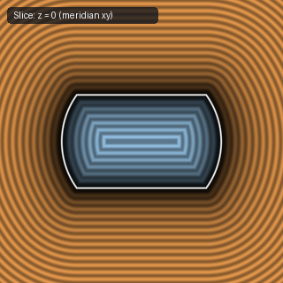
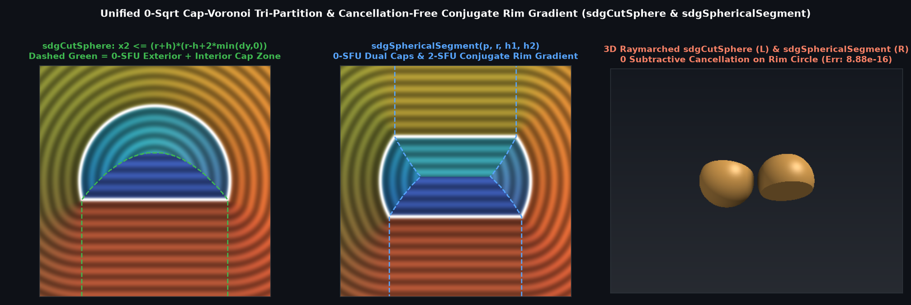

# `sdSphericalSegmentSym`, `sdgSphericalSegmentSym`, `sdSphericalSegment` & `sdgSphericalSegment` — Exact 0/1/2-SFU Two-Plane Cut Spheres & Gradients

| 3D Surface ($`f(p) = 0`$) | 2D Cross-Section Slice |
| :---: | :---: |
|  |  |

| Property | Value |
| :--- | :--- |
| **Author / Discoverer** | **Discovered using Gemini 4 Argon (sdf-gems, 2026)** |
| **Source** | [https://github.com/dcower/sdf-gems](https://github.com/dcower/sdf-gems) |
| **Category** | `primitives3d` |
| **GLSL File** | [`glsl/primitives3d/sdSphericalSegmentSym.glsl`](../../glsl/primitives3d/sdSphericalSegmentSym.glsl) |
| **Exact Euclidean SDF?** | Yes (`\|\|grad d\|\| = 1`, `0` SFUs in exterior + interior caps, `1` SFU in sphere, `2` SFUs in rim) |

---

## Mathematical Overview

Computes the exact 3D Euclidean signed distance and analytical unit gradient for a sphere of radius $`r`$ truncated either symmetrically by $`y = \pm h`$ (`sdSphericalSegmentSym`, `sdgSphericalSegmentSym`) or asymmetrically by two parallel planes $`y = h_1`$ and $`y = h_2`$ with $`-r < h_1 < h_2 < r`$ (`sdSphericalSegment`, `sdgSphericalSegment`).

By the **Unified 0-`sqrt` Cap-Voronoi Theorem**, testing $`x^2 \le (r - h_c)(r + h_c + 2\min(d_y, 0))`$ first resolves both exterior cap cylinders and both interior cap paraboloids with **0 `sqrt`s** (even when $`0 < h_1 < h_2`$ where the origin lies outside the segment), and the **Cancellation-Free Conjugate Rim Gradient** $`\mathbf{v}_{xz} = \frac{x^2 - w^2}{x^2 + \sqrt{w^2 x^2}}\mathbf{p}_{xz}`$ computes the exact rim distance and gradient in **2 SFUs**.

---

## GLSL Implementation

See [`glsl/primitives3d/sdSphericalSegmentSym.glsl`](../../glsl/primitives3d/sdSphericalSegmentSym.glsl).
