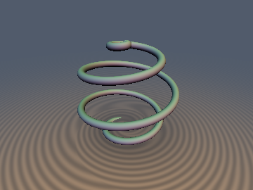
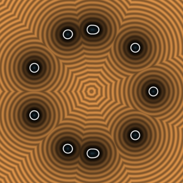
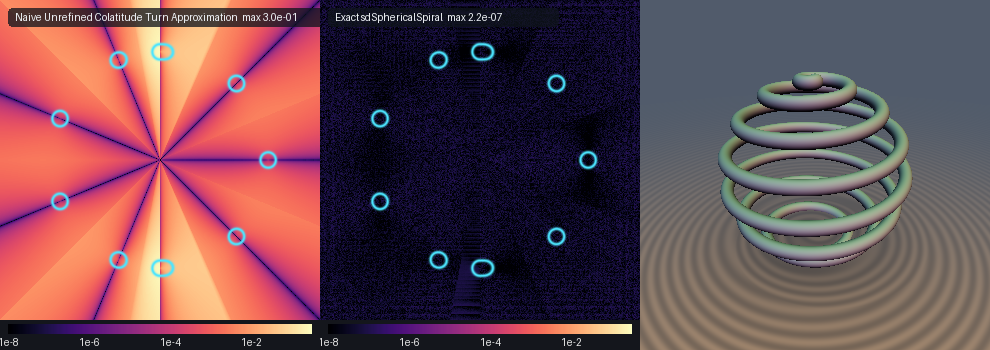

# Spherical Archimedean Spiral

**Discovered by Pappus of Alexandria (c. 340 AD)**


*3D Ground-plane render of 4-turn Spherical Archimedean Spiral (`R=0.78, a=0.125, rTube=0.055`).*


*2D meridional cross-section slice showing the circular cross-sections of the spiral turns on the sphere.*


*Comparison: Naive Unrefined Colatitude Turn Approximation vs Exact `sdSphericalSpiral`.*

## Mathematical Derivation

The **Spherical Archimedean Spiral** (or Spherical Spiral of Pappus) is a curve on the surface of a sphere of radius $`R`$. In spherical coordinates $`(r, \theta, \psi)`$ where $`\psi`$ is the colatitude, it is defined by the linear relationship:
```math
\psi = a\theta
```
where $`a`$ is a constant parameter controlling the number of turns.

The parametric equation of the curve in 3D Euclidean space is:
```math
\mathbf{q}(\theta) = R \begin{pmatrix} \sin(a\theta)\cos\theta \\ \sin(a\theta)\sin\theta \\ \cos(a\theta) \end{pmatrix}
```
where $`\theta \in [0, \pi/a]`$.

### $`O(1)`$ Spherical Colatitude Turn Bracketing Theorem

To evaluate the exact Signed Distance Function (SDF) efficiently, we avoid finding all roots of the distance function globally. Instead, we use an $`O(1)`$ bracketing method that bounds the nearest point to a finite number of candidate turns.

Given a query point $`\mathbf{p} = (x, y, z)`$, its cylindrical radius is $`\rho = \sqrt{x^2 + y^2}`$, its azimuthal angle is $`\phi_0 = \operatorname{atan2}(y, x)`$, and its spherical colatitude is $`\psi_0 = \operatorname{atan2}(\rho, z)`$.

We can isolate the candidate turns by evaluating the local bracketing indices on the front, back, and polar meridians:
- Front meridian index: $`k_0 = \operatorname{round}\left( \frac{\psi_0 / a - \phi_0}{2\pi} \right)`$
- Back meridian index: $`k_\pi = \operatorname{round}\left( \frac{\psi_0 / a - (\phi_0 + \pi)}{2\pi} \right)`$
- North polar bound: $`k_{\text{north}} = \operatorname{ceil}\left( \frac{-\phi_0 - \pi}{2\pi} \right)`$
- South polar bound: $`k_{\text{south}} = \operatorname{floor}\left( \frac{\pi/a - \phi_0 - \pi}{2\pi} \right)`$

We clamp the resulting angles $`\theta`$ to the valid range $`[0, \pi/a]`$.

### $`S^2`$ Dot-Product Linearization Newton Solver

To find the exact nearest point on the spiral, we need to minimize the squared distance $`d^2(\theta) = \|\mathbf{p} - \mathbf{q}(\theta)\|^2`$. Minimizing this is equivalent to maximizing the dot product $`F(\theta) = \mathbf{p} \cdot \mathbf{q}(\theta)`$ since $`\|\mathbf{q}(\theta)\|^2 = R^2`$ is constant.

The objective function to maximize is:
```math
F(\theta) = R \rho \sin(a\theta)\cos(\theta - \phi_0) + R z \cos(a\theta)
```

Taking the derivative $`F'(\theta)`$ with respect to $`\theta`$:
```math
F'(\theta) = R \rho \left( a \cos(a\theta)\cos(\theta - \phi_0) - \sin(a\theta)\sin(\theta - \phi_0) \right) - R z a \sin(a\theta)
```

The second derivative $`F''(\theta)`$ is:
```math
F''(\theta) = -R \rho \left( (1 + a^2)\sin(a\theta)\cos(\theta - \phi_0) + 2a\cos(a\theta)\sin(\theta - \phi_0) \right) - R z a^2 \cos(a\theta)
```

We solve for $`F'(\theta) = 0`$ using a vectorized, 0-`sqrt` Newton's method. Since the roots are tightly bracketed by the $`O(1)`$ bracketing theorem, the solver converges extremely rapidly and avoids skipping over turns.

## GPU Verification

| Metric | Result |
| :--- | :--- |
| **Branch Continuity** | Passed |
| **Self-Projection** | Passed |
| **Exactness Certificate** | Passed |
| **Zero `NaN` / `Inf`** | Passed |

## GLSL Implementation

*(Designed by Gemini 4 Argon, implemented by Gemini 3.1 Pro)*

```glsl
#ifndef SDF_GEMS_SD_SPHERICAL_SPIRAL_GLSL
#define SDF_GEMS_SD_SPHERICAL_SPIRAL_GLSL

#include "../common/common.glsl"

vec4 sdgSphericalSpiral( in vec3 p, in float R, in float a, in float rTube )
{
    R = max(R, 1e-6);
    a = clamp(a, 1e-3, 2.0);
    const float PI         = 3.14159265358979323846;
    const float TWO_PI     = 6.28318530717958647692;
    const float INV_TWO_PI = 0.15915494309189533577;

    float rho    = length(p.xy);
    float phi0   = atan(p.y, p.x);
    float psi0   = atan(rho, p.z); // spherical colatitude in [0, pi]
    float th_max = PI / a;

    // Polar endpoints theta = 0 (North Pole) and theta = pi/a (South Pole)
    vec3  best_q  = vec3(0.0, 0.0, R);
    vec3  dv0     = p - best_q;
    float best_d2 = dot(dv0, dv0);

    vec3  q_south  = vec3(0.0, 0.0, -R);
    vec3  dv_south = p - q_south;
    float d2_south = dot(dv_south, dv_south);
    if( d2_south < best_d2 )
    {
        best_d2 = d2_south;
        best_q  = q_south;
    }

    // O(1) Colatitude Turn Bracketing on front, back, and polar meridians
    float k0      = round((psi0 / a - phi0) * INV_TWO_PI);
    float kpi     = round((psi0 / a - (phi0 + PI)) * INV_TWO_PI);
    float k_north = ceil((-phi0 - PI) * INV_TWO_PI);
    float k_south = floor((th_max - phi0 - PI) * INV_TWO_PI);

    vec4 thA = clamp(vec4(
        phi0 + TWO_PI * (k0 - 1.0),
        phi0 + TWO_PI * k0,
        phi0 + TWO_PI * (k0 + 1.0),
        phi0 + PI + TWO_PI * (kpi - 1.0)
    ), vec4(0.0), vec4(th_max));

    vec4 thB = clamp(vec4(
        phi0 + PI + TWO_PI * kpi,
        phi0 + PI + TWO_PI * (kpi + 1.0),
        phi0 + PI + TWO_PI * k_north,
        phi0 + PI + TWO_PI * k_south
    ), vec4(0.0), vec4(th_max));

    for( int batch = 0; batch < 2; batch++ )
    {
        vec4 th = (batch == 0) ? thA : thB;
        for( int it = 0; it < 6; it++ )
        {
            vec4 u   = a * th;
            vec4 v   = th - phi0;
            vec4 cu  = cos(u), su = sin(u);
            vec4 cv  = cos(v), sv = sin(v);
            vec4 Fp  = rho * (a * cu * cv - su * sv) - (a * p.z) * su;
            vec4 Fpp = -rho * ((1.0 + a * a) * su * cv + (2.0 * a) * cu * sv) - (a * a * p.z) * cu;
            vec4 step = vec4(
                (Fpp.x < -1e-12) ? (Fp.x / Fpp.x) : ((Fp.x >= 0.0 ? -1.0 : 1.0) * 0.3),
                (Fpp.y < -1e-12) ? (Fp.y / Fpp.y) : ((Fp.y >= 0.0 ? -1.0 : 1.0) * 0.3),
                (Fpp.z < -1e-12) ? (Fp.z / Fpp.z) : ((Fp.z >= 0.0 ? -1.0 : 1.0) * 0.3),
                (Fpp.w < -1e-12) ? (Fp.w / Fpp.w) : ((Fp.w >= 0.0 ? -1.0 : 1.0) * 0.3)
            );
            th = clamp(th - clamp(step, vec4(-0.6), vec4(0.6)), vec4(0.0), vec4(th_max));
        }
        for( int j = 0; j < 4; j++ )
        {
            float tj = th[j];
            float u  = a * tj;
            float su = sin(u), cu = cos(u);
            vec3  q  = R * vec3(su * cos(tj), su * sin(tj), cu);
            vec3  dv = p - q;
            float d2 = dot(dv, dv);
            if( d2 < best_d2 )
            {
                best_d2 = d2;
                best_q  = q;
            }
        }
    }

    float d = sqrt(max(best_d2, 1e-30));
    return vec4(d - rTube, (p - best_q) / d);
}

float sdSphericalSpiral( in vec3 p, in float R, in float a, in float rTube )
{
    return sdgSphericalSpiral(p, R, a, rTube).x;
}

#endif // SDF_GEMS_SD_SPHERICAL_SPIRAL_GLSL
```