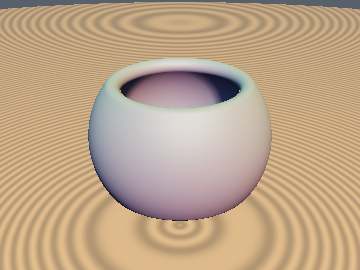
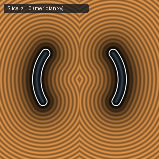

# `sdSphericalZone` — Exact 3D Hollow Spherical Zone (Conjugate-Square & Signed-Square Reduction)

| 3D Surface ($`f(p) = 0`$) | 2D Cross-Section Slice |
| :---: | :---: |
|  |  |

| Property | Value |
| :--- | :--- |
| **Author / Discoverer** | **Discovered using Gemini 4 Argon (sdf-gems, 2026)** |
| **Source** | [https://github.com/dcower/sdf-gems](https://github.com/dcower/sdf-gems) |
| **Category** | `primitives3d` |
| **GLSL File** | [`glsl/primitives3d/sdSphericalZone.glsl`](../../glsl/primitives3d/sdSphericalZone.glsl) |
| **Exact Euclidean SDF?** | Yes (`\|\|grad d\|\| = 1`, `1/2` `sqrt`s down from `4` `sqrt`s) |

---

## Mathematical Overview

Computes the exact 3D Euclidean distance to an open-ended spherical zone shell of radius $`r`$ and thickness $`t`$ truncated by two arbitrary parallel planes $`y = h_1`$ and $`y = h_2`$ ($`-r < h_1 < h_2 < r`$).

By the **Signed-Square Cone Test** ($`h_i |h_i| x_2 \gtrless w_i^2 p_y |p_y|`$) and **Conjugate-Square Rim Identity** (see [`sdCutSphere`](sdCutSphere.md)), neither $`w_1 = \sqrt{r^2 - h_1^2}`$, $`w_2 = \sqrt{r^2 - h_2^2}`$, nor $`q_x = \|p_{xz}\|`$ needs to be evaluated upfront, reducing the spherical shell region from **4 `sqrt`s to 1 `sqrt`** (`4.0x` reduction) and the two rim regions from **4 `sqrt`s to 2 `sqrt`s** (`2.0x` reduction).

---

## GLSL Implementation

```glsl
float sdSphericalZone( vec3 p, float r, float h1, float h2, float t )
{
    float x2 = dot(p.xz, p.xz), ys = p.y*abs(p.y);
    float w1 = r*r - h1*h1, w2 = r*r - h2*h2;
    bool  c1 = h1*abs(h1)*x2 > w1*ys;
    bool  c2 = !c1 && (w2*ys > h2*abs(h2)*x2);
    if( !c1 && !c2 ) return abs(sqrt(x2 + p.y*p.y) - r) - t;
    float w = c1 ? w1 : w2, h = c1 ? h1 : h2, d = x2 - w, dy = p.y - h;
    return sqrt(d*d / max(x2 + w + 2.0*sqrt(w*x2), 1e-30) + dy*dy) - t;
}
```
