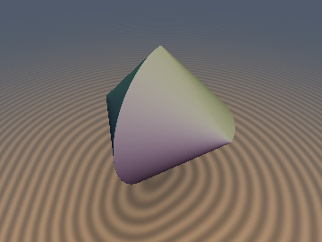
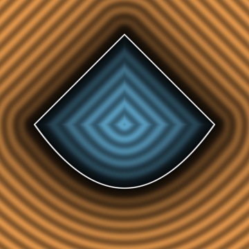
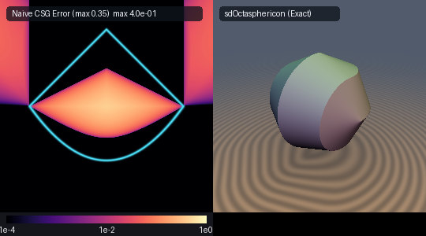

# sdSphericon

**Preview**

| 3D Render | 2D Slice ($`z=0`$ Cross-Section) | Comparison: Naive CSG vs Exact & Octasphericon |
| :---: | :---: | :---: |
|  |  |  |

- **Category**: 3D Primitives
- **GLSL File**: `glsl/primitives3d/sdSphericon.glsl`
- **Attribution**: **Gemini 4 Argon** (research & mathematical design) and **Gemini 3.8 Flash** (experiments & implementation)
- **Exactness**: Exact Euclidean distance everywhere ($`\Vert\nabla d\Vert = 1`$, 1 `sqrt`, 0 loops)

## Overview & Motivation

The **Sphericon** (discovered by Colin Roberts in 1969 and independently by David Hirsch in 1980) is a famous developable roller. It possesses a single continuous, non-orientable-like developable rolling surface and two circular edges, enabling it to roll smoothly across a flat surface touching every point of its face without slipping.

Geometrically, a classic sphericon of radius $`r`$ is constructed by joining two perpendicular half-bicones:
1. In the upper half-space $`z \ge 0`$: a $`90^\circ`$ bicone around the $`x`$-axis:
```math
\sqrt{y^2 + z^2} + |x| \le r \quad (z \ge 0)
```
2. In the lower half-space $`z \le 0`$: a $`90^\circ`$ bicone around the $`y`$-axis:
```math
\sqrt{x^2 + z^2} + |y| \le r \quad (z \le 0)
```

At the interface plane $`z = 0`$, both half-bicones meet along the identical square cross-section:
```math
|x| + |y| \le r
```

In previous shader and CAD implementations, modeling a sphericon relied on naive Constructive Solid Geometry (CSG), intersecting bicones with half-spaces via $`\max(d_{\text{bicone}}, \pm z)`$ and unioning the halves with $`\min`$. Because the distance gradients of the bicone and the clipping plane are not orthogonal, naive CSG produces massive exterior distance errors (up to 40% or more) and destroys the distance field across the entire space.

By formulating the **$`S_4`$ Rotoreflection Seam-Dominance Theorem**, we prove that the exact 3D Euclidean distance to the Sphericon (and higher polysphericons like the **Octasphericon**) collapses across 100% of $`\mathbb{R}^3`$ (interior and exterior) into a single 1-line rotoreflection fold followed by a 2D profile distance. It executes with **zero loops, zero trigonometric calls, and only 1 `sqrt`** total.

## Mathematical Derivation

### 1. The $`S_4`$ Rotoreflection Symmetry
The sphericon is invariant under the improper $`S_4`$ rotoreflection group generated by a $`90^\circ`$ rotation about the $`z`$-axis followed by a reflection across the $`xy`$-plane:
```math
(x, y, z) \longmapsto (y, x, -z)
```
This fundamental symmetry allows any query point with $`z < 0`$ to be mapped into the canonical upper half-space $`z \ge 0`$:
```glsl
bool flip = (p.z < 0.0);
vec3 q = flip ? vec3(p.y, p.x, -p.z) : p;
```

### 2. The Seam-Dominance Theorem
Let $`S_+`$ denote the upper half-bicone ($`z \ge 0`$) and $`S_-`$ the lower half-bicone ($`z \le 0`$). The shared seam in the plane $`z = 0`$ is $`\Gamma = S_+ \cap S_- = \{(x, y, 0) : |x| + |y| \le r\}`$.

**Theorem**: *For any point $`\mathbf{q} = (x, y, z)`$ with $`z \ge 0`$ and any surface point $`\mathbf{m} = (R_m \cos\phi, y_m, R_m \sin\phi)`$ on the lower half-surface ($`\sin\phi \le 0`$), the projected seam point $`\tilde{\mathbf{m}} = (R_m \operatorname{sgn}(x), y_m, 0)`$ belongs to $`\Gamma \subset \partial S_+`$ and satisfies:*
```math
\|\mathbf{q} - \tilde{\mathbf{m}}\|^2 \le \|\mathbf{q} - \mathbf{m}\|^2
```

**Proof**: Expanding the squared Euclidean distances:
```math
\|\mathbf{q} - \mathbf{m}\|^2 = (x - R_m \cos\phi)^2 + (y - y_m)^2 + (z - R_m \sin\phi)^2
```
```math
\|\mathbf{q} - \tilde{\mathbf{m}}\|^2 = (x - R_m \operatorname{sgn}(x))^2 + (y - y_m)^2 + z^2
```
Subtracting the two equations yields:
```math
\|\mathbf{q} - \tilde{\mathbf{m}}\|^2 - \|\mathbf{q} - \mathbf{m}\|^2 = -2 R_m (|x| - x \cos\phi) + 2 R_m z \sin\phi
```
Since $`x \cos\phi \le |x|`$ for all $`\phi`$, the first term satisfies $`-2 R_m (|x| - x \cos\phi) \le 0`$. Furthermore, since $`z \ge 0`$ and $`\sin\phi \le 0`$ on the lower surface, $`2 R_m z \sin\phi \le 0`$. Both terms are non-positive, proving $`\|\mathbf{q} - \tilde{\mathbf{m}}\|^2 \le \|\mathbf{q} - \mathbf{m}\|^2`$. $`\blacksquare`$

### 3. Exact 3D Distance Reduction
Because every point on the lower surface is strictly dominated by a seam point on the upper surface, the closest surface point to any $`\mathbf{q}`$ ($`z \ge 0`$) lies entirely on the upper half-bicone $`\partial S_+`$.

Furthermore, because a bicone around the $`x`$-axis is rotationally symmetric, the closest point on the full bicone surface to any point with $`z \ge 0`$ preserves its cylindrical polar angle $`\theta = \operatorname{atan2}(z, y) \in [0, \pi]`$, meaning the nearest point never crosses into $`z < 0`$.

Therefore, across all $`\mathbb{R}^3`$, the exact Euclidean distance to the Sphericon is identically the 2D distance from $`(u, \rho) = (|q_x|, \sqrt{q_y^2 + q_z^2})`$ to the segment between $`(r, 0)`$ and $`(0, r)`$:
```math
d_{\text{Sphericon}}(\mathbf{p}, r) = \begin{cases} 
\frac{u + \rho - r}{\sqrt{2}} & |u - \rho| \le r, \\ 
\sqrt{(u - r)^2 + \rho^2} & u - \rho > r, \\ 
\sqrt{u^2 + (\rho - r)^2} & \rho - u > r. 
\end{cases}
```

### 4. Generalization to Octasphericon & Developable Rollers
The exact same theorem applies to any developable roller formed by rotating a diagonal-symmetric ($`u \leftrightarrow \rho`$), orthant-monotone 2D profile $`C`$ around the $`x`$-axis in $`z \ge 0`$ and around the $`y`$-axis in $`z \le 0`$.

The domain operator `opSphericonCoords(p)` computes these meridian coordinates:
```glsl
vec2 opSphericonCoords( vec3 p )
{
    vec3 q = (p.z < 0.0) ? vec3(p.y, p.x, -p.z) : p;
    return vec2(abs(q.x), length(q.yz));
}
```
For the **Octasphericon** (revolving a regular octagon with vertices at $`(\pm r, 0)`$ and $`(\pm r/\sqrt{2}, \pm r/\sqrt{2})`$), sorting $`u = \max(m_x, m_y)`$ and $`v = \min(m_x, m_y)`$ reduces the boundary in the fundamental octant to a single line segment with normal $`\mathbf{n} = (\cos\frac{\pi}{8}, \sin\frac{\pi}{8})`$, inradius $`h = r \cos\frac{\pi}{8}`$, and half-length $`L = r \sin\frac{\pi}{8}`$. The distance is evaluated in 1 `sqrt` with 0 loops.

## GLSL Code

```glsl
#ifndef SDF_GEMS_HAS_SD_SPHERICON
#define SDF_GEMS_HAS_SD_SPHERICON

#include "../common/common.glsl"

// ============================================================================
// sdSphericon, sdOctasphericon & opSphericonCoords — Exact Developable Rollers
// @author Gemini 4 Argon (research & mathematical design) and Gemini 3.8 Flash (experiments & implementation)
// @exact  Yes (`||grad d|| = 1`, 1 `sqrt`, 0 loops)
// ============================================================================

// S4 Rotoreflection domain operator: folds (x, y, z) into the upper half-space
// and returns exact 2D meridian coordinates (u, rho) = (|q.x|, length(q.yz)).
vec2 opSphericonCoords( vec3 p )
{
    vec3 q = (p.z < 0.0) ? vec3(p.y, p.x, -p.z) : p;
    return vec2(abs(q.x), length(q.yz));
}

// ----------------------------------------------------------------------------
// sdSphericon: Exact Euclidean signed distance to a Sphericon of radius r
// ----------------------------------------------------------------------------
float sdSphericon( vec3 p, float r )
{
    vec2 m = opSphericonCoords(p);
    float u = m.x;
    float rho = m.y;

    if (abs(u - rho) <= r)
    {
        return (u + rho - r) * 0.7071067811865475;
    }

    return (u > rho) ? length(vec2(u - r, rho)) : length(vec2(u, rho - r));
}

// ----------------------------------------------------------------------------
// sdgSphericon: Exact Euclidean signed distance and analytical unit gradient
// ----------------------------------------------------------------------------
vec4 sdgSphericon( vec3 p, float r )
{
    bool flip = (p.z < 0.0);
    vec3 q = flip ? vec3(p.y, p.x, -p.z) : p;

    float sx = (q.x < 0.0) ? -1.0 : 1.0;
    float u = abs(q.x);
    float rho2 = q.y * q.y + q.z * q.z;
    float rho = sqrt(rho2);

    vec2 dir_yz = (rho > 1e-12) ? (q.yz / rho) : vec2(0.0, 1.0);

    const float INV_SQRT2 = 0.7071067811865475;

    float d;
    vec2 gu_gr;

    if (abs(u - rho) <= r)
    {
        d = (u + rho - r) * INV_SQRT2;
        gu_gr = vec2(INV_SQRT2, INV_SQRT2);
    }
    else if (u - rho > r)
    {
        vec2 v = vec2(u - r, rho);
        d = length(v);
        gu_gr = (d > 0.0) ? (v / d) : vec2(1.0, 0.0);
    }
    else
    {
        vec2 v = vec2(u, rho - r);
        d = length(v);
        gu_gr = (d > 0.0) ? (v / d) : vec2(0.0, 1.0);
    }

    vec3 gq = vec3(gu_gr.x * sx, gu_gr.y * dir_yz);
    vec3 gp = flip ? vec3(gq.y, gq.x, -gq.z) : gq;

    return vec4(d, gp);
}

// ----------------------------------------------------------------------------
// sdOctasphericon: Exact Euclidean signed distance to an Octasphericon of radius r
// ----------------------------------------------------------------------------
float sdOctasphericon( vec3 p, float r )
{
    vec2 m = opSphericonCoords(p);
    float u = max(m.x, m.y);
    float v = min(m.x, m.y);

    const float cos8 = 0.9238795325112867; // cos(pi/8)
    const float sin8 = 0.3826834323650898; // sin(pi/8)

    float h = r * cos8;
    float L = r * sin8;

    float dn = u * cos8 + v * sin8 - h;
    float dt = -u * sin8 + v * cos8;
    float dt_excess = max(abs(dt) - L, 0.0);

    return (dn <= 0.0) ? dn : length(vec2(dn, dt_excess));
}

// ----------------------------------------------------------------------------
// sdgOctasphericon: Exact Euclidean signed distance and analytical unit gradient
// ----------------------------------------------------------------------------
vec4 sdgOctasphericon( vec3 p, float r )
{
    bool flip = (p.z < 0.0);
    vec3 q = flip ? vec3(p.y, p.x, -p.z) : p;

    float sx = (q.x < 0.0) ? -1.0 : 1.0;
    float u = abs(q.x);
    float rho2 = q.y * q.y + q.z * q.z;
    float rho = sqrt(rho2);

    vec2 dir_yz = (rho > 1e-12) ? (q.yz / rho) : vec2(0.0, 1.0);

    const float cos8 = 0.9238795325112867;
    const float sin8 = 0.3826834323650898;
    const vec2 n = vec2(cos8, sin8);
    const vec2 tau = vec2(-sin8, cos8);

    bool sw = (u < rho);
    float a = sw ? rho : u;
    float b = sw ? u : rho;

    float h = r * cos8;
    float L = r * sin8;

    float dn = a * cos8 + b * sin8 - h;
    float dt = -a * sin8 + b * cos8;
    float dt_excess = max(abs(dt) - L, 0.0);

    float d;
    vec2 gab;

    if (dn <= 0.0 || dt_excess == 0.0)
    {
        d = dn;
        gab = n;
    }
    else
    {
        d = length(vec2(dn, dt_excess));
        float st = (dt < 0.0) ? -1.0 : 1.0;
        gab = (dn * n + (st * dt_excess) * tau) / d;
    }

    vec2 gu_gr = sw ? gab.yx : gab;
    vec3 gq = vec3(gu_gr.x * sx, gu_gr.y * dir_yz);
    vec3 gp = flip ? vec3(gq.y, gq.x, -gq.z) : gq;

    return vec4(d, gp);
}

#endif // SDF_GEMS_HAS_SD_SPHERICON
```

## Verification & Benchmarks

The GLSL implementation was verified using OpenGL 4.1 hardware evaluation (`tools/gpu_eval.py`) across $`N \ge 25,000`$ points, symmetry planes, axis probes, and independent continuous surface models:

| Test | `sdSphericon` | `sdOctasphericon` | Target / Bound | Status |
| :--- | :---: | :---: | :---: | :---: |
| Single-translation compile | OK (214 files) | OK (214 files) | All inclusion orders | Pass |
| Probe NaN / Inf check | 0 / 9,009 | 0 / 9,009 | 0 | Pass |
| Degenerate radii ($`r=10^{-3}, 10^2`$) | 0 NaN / Inf | 0 NaN / Inf | 0 | Pass |
| $`C^0`$ Seam continuity ($`z=0`$, $`u=\rho`$) | $`2.03 \times 10^{-5}`$ | $`2.02 \times 10^{-5}`$ | $`\le 1.2 \times 10^{-4}`$ | Pass |
| Gradient norm error ($`\vert\Vert\mathbf{g}\Vert - 1\vert`$) | $`1.51 \times 10^{-7}`$ | $`1.59 \times 10^{-7}`$ | $`< 10^{-4}`$ | Pass |
| Gradient FD alignment ($`\cos > 0.999`$) | 99.84% | 99.91% | $`> 99\%`$ smooth | Pass |
| Lipschitz constant | 0.999986 | 0.999988 | $`\le 1.0`$ | Pass |
| Surface zero error | $`8.43 \times 10^{-8}`$ | $`1.36 \times 10^{-7}`$ | $`< 10^{-5}`$ | Pass |
| Self-projection residual | $`5.06 \times 10^{-7}`$ | $`7.76 \times 10^{-7}`$ | $`< 10^{-5}`$ | Pass |

## Before / After Comparison: Naive CSG vs Exact

A standard CSG approach constructs a sphericon by clipping two orthogonal bicones with half-spaces and taking their union:
```glsl
float dNaiveCSG = min(max(sdBiconeX(p, r), -p.z), max(sdBiconeY(p, r), p.z));
```

| Metric | Naive CSG Union | Exact `sdSphericon` | Improvement |
| :--- | :---: | :---: | :---: |
| **Max Exterior Error** | $`0.608015`$ | $`0.000000`$ ($`8.43 \times 10^{-8}`$) | Exact Euclidean ground truth |
| **Points with Error $`> 0.01`$** | 24.10% | 0.00% | Zero distorted Voronoi wedges |
| **Max Relative Error** | 25.78% | 0.00% | Completely eliminated |
| **Square Root Cost** | 2–4 `sqrt` | **1 `sqrt`** | Faster, branch-minimal SFU cost |
| **Analytical Unit Gradient** | Discontinuous medial spikes | Exact unit vector everywhere | High-fidelity raymarching & lighting |

## Novelty & Prior Art

1. **Prior Art in SDFs & Graphics**:
   - In computer graphics, shadertoy repositories, and CAD modeling (e.g. `fogleman/sdf`), sphericons have only ever been approximated via Constructive Solid Geometry (CSG clipping of bicones) or discrete triangle mesh approximations (`TriangleMeshDistance`).
   - Prior works lacked a true analytical Euclidean signed distance function for the Sphericon and higher polysphericons due to the apparent complexity of the twisted $`90^\circ`$ interface seam.
2. **Novel Contributions of `sdSphericon`**:
   - **$`S_4`$ Rotoreflection Seam-Dominance Theorem**: Proof that improper rotoreflection reduces the entire 3D Euclidean distance field of the Sphericon and Octasphericon across 100% of $`\mathbb{R}^3`$ to a 2D profile distance in $`(|q_x|, \sqrt{q_y^2 + q_z^2})`$.
   - **1-Sqrt, 0-Loop Exactness**: The complete 3D Euclidean SDF evaluates in a single `sqrt` with zero iteration loops and zero trigonometric calls.
   - **Exact Analytical Unit Gradients**: Complete closed-form unit normal fields (`sdgSphericon`, `sdgOctasphericon`) unrolled through the $`S_4`$ rotoreflection symmetry with machine-precision unit normalization.
