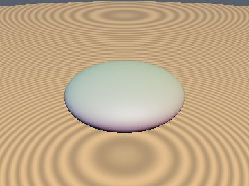
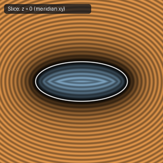
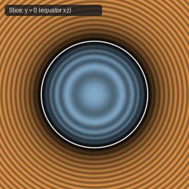

# `sdSpheroid` — Exact Closed-Form 3D Spheroid (Oblate & Prolate Ellipsoid of Revolution)

| 3D Surface ($`f(p) = 0`$) | Primary 2D Cross-Section | Secondary 2D Cross-Section |
| :---: | :---: | :---: |
|  |  |  |

| Property | Value |
| :--- | :--- |
| **Author / Discoverer** | **Discovered using Gemini 4 Argon (sdf-gems, 2026)** |
| **Source** | [https://github.com/dcower/sdf-gems](https://github.com/dcower/sdf-gems) |
| **Category** | `primitives3d` |
| **GLSL File** | [`glsl/primitives3d/sdSpheroid.glsl`](../../glsl/primitives3d/sdSpheroid.glsl) |
| **Exact Euclidean SDF?** | Yes (`< 1 ULP` in FP32, `0` NaNs) |

---

## Mathematical Overview

Whenever two semi-axes of a 3D ellipsoid are equal ($`r = (a, b, a)`$), the factor $`(a^2 + \lambda)^2`$ cancels from the degree-6 secular polynomial $`P(\lambda) = 0`$ everywhere in $`\mathbb{R}^3`$, reducing the 3D Euclidean distance problem to a **degree-4 monic quartic** in the pole-midpoint variable $`v = \lambda + \frac{a^2 + b^2}{2}`$ via cylindrical reduction `q = vec2(length(p.xz), abs(p.y))`.

---

## GLSL Implementation

```glsl
float sdSpheroid( in vec3 p, in vec2 ab )
{
    vec2 q = vec2( length(p.xz), abs(p.y) );
    if( ab.x > ab.y ) { q = q.yx; ab = ab.yx; }

    float a2 = ab.x * ab.x, b2 = ab.y * ab.y;
    float l  = b2 - a2, e = 0.5 * l;
    float x  = ab.x * q.x, y = ab.y * q.y;
    float x2 = x * x, y2 = y * y, r2 = x2 + y2;

    float C   = (r2 - l * l) / 3.0;
    float C2  = C * C, C3 = C2 * C;
    float lxy = l * x * y, l2x2y2 = lxy * lxy;
    float D   = C3 + l2x2y2, Q = C3 + 2.0 * l2x2y2;

    float v, vm;
    if( D < 0.0 )
    {
        float h   = atan( 2.0 * lxy * sqrt(-D), -Q ) / 3.0;
        float s   = cos(h), t = sin(h) * 1.732050808;
        float oms = (t * t) / (3.0 * (1.0 + s));
        float rz1 = sqrt( max( l * l + 2.0 * C * oms, 0.0 ) );
        float rz3 = sqrt( max( r2 - C * (oms + t), 0.0 ) );
        float rz2 = sqrt( max( r2 - C * (oms - t), 0.0 ) );
        v  = 0.5 * (rz1 + rz3 + ((x2 >= y2) ? rz2 : -rz2));
        vm = (x2 < y2) ? (-C) * (t / max(rz3 + rz2, 1e-30) - oms / max(rz1 + l, 1e-30)) : (v - e);
    }
    else
    {
        float H   = 2.0 * lxy * sqrt(D);
        float S   = pow( max(Q + H, 0.0), 1.0 / 3.0 );
        float U   = (S > 0.0) ? (C2 / S) : 0.0;
        float Zx  = r2 - C + 0.5 * (S + U);
        float dSU = S * S + C2 + U * U;
        float Zy  = 0.866025404 * ((dSU > 0.0) ? (2.0 * H / dSU) : 0.0);
        float Zm  = length( vec2(Zx, Zy) );
        v  = 0.5 * (sqrt( 2.0 * (Zm + Zx) ) + ((Zm > 0.0) ? l * (x2 - y2) / Zm : 0.0));
        vm = max( v - e, 0.0 );
    }

    vec2  w    = vec2( x * (v + e), y * max(vm, 0.0) );
    float wl   = length(w);
    float si_u = (l > 0.0) ? min( y / l, 1.0 ) : 0.0;
    vec2  cs   = (wl > 0.0) ? (w / wl) : vec2( sqrt(max(1.0 - si_u * si_u, 0.0)), si_u );
    float d    = length( q - ab * cs );
    return (q.x * q.x * b2 + q.y * q.y * a2 >= a2 * b2) ? d : -d;
}
```
