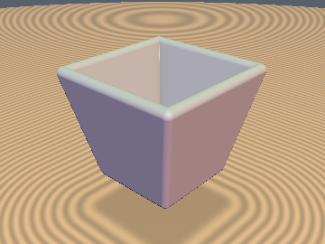
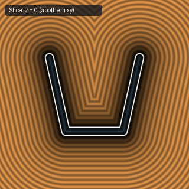
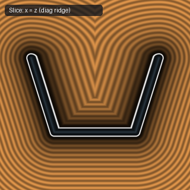

# `sdSquareBucket` — Exact 1-Sqrt 3D Open-Topped Tapered Square Bucket / Hopper

| 3D Surface ($f(p) = 0$) | Primary 2D Cross-Section | Secondary 2D Cross-Section |
| :---: | :---: | :---: |
|  |  |  |

| Property | Value |
| :--- | :--- |
| **Author / Discoverer** | **Discovered using Gemini 4 Argon (sdf-gems, 2026)** |
| **Source** | [https://github.com/dcower/sdf-gems](https://github.com/dcower/sdf-gems) |
| **Category** | `primitives3d` |
| **GLSL File** | [`glsl/primitives3d/sdSquareBucket.glsl`](../../glsl/primitives3d/sdSquareBucket.glsl) |
| **Exact Euclidean SDF?** | Yes (`||grad d|| = 1`) |

---

## Mathematical Overview

Computes the exact 3D Euclidean SDF of a four-walled tapered square bucket with closed bottom cap $y = -h$ and open top $y = +h$ in a **single `sqrt`**.

---

## GLSL Implementation

```glsl
float sdSquareBucket( vec3 p, float b1, float b2, float h, float t )
{
    p.xz = abs(p.xz);
    p.xz = (p.z > p.x) ? p.zx : p.xz;
    float bm = 0.5*(b1 + b2), k = 0.5*(b1 - b2);
    vec3  q  = p - vec3(bm, 0.0, bm);
    float u1 = clamp((h*q.y - k*q.x)/(h*h + k*k), -1.0, 1.0);
    float u2 = clamp((h*q.y - k*(q.x + q.z))/(h*h + 2.0*k*k), -1.0, 1.0);
    float d1 = dot2(vec3(q.x + k*u1, q.y - h*u1, max(q.z + k*u1, 0.0)));
    float d2 = dot2(vec3(q.x + k*u2, q.y - h*u2, q.z + k*u2));
    float d  = min(d1, d2);
    if( p.x < b1 ) d = min(d, (p.y + h)*(p.y + h));
    return sqrt(d) - t;
}
```
