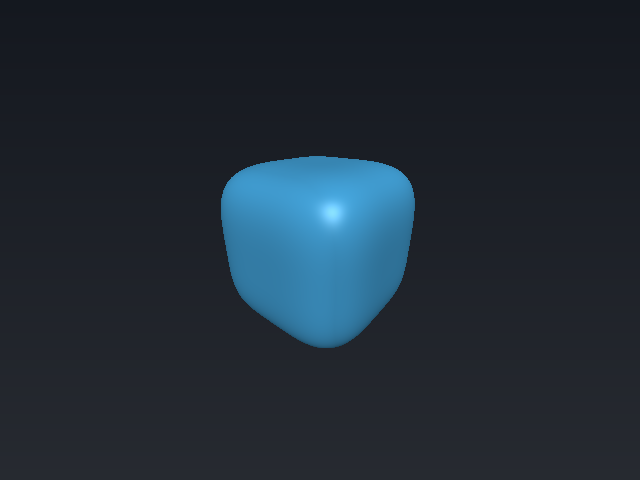
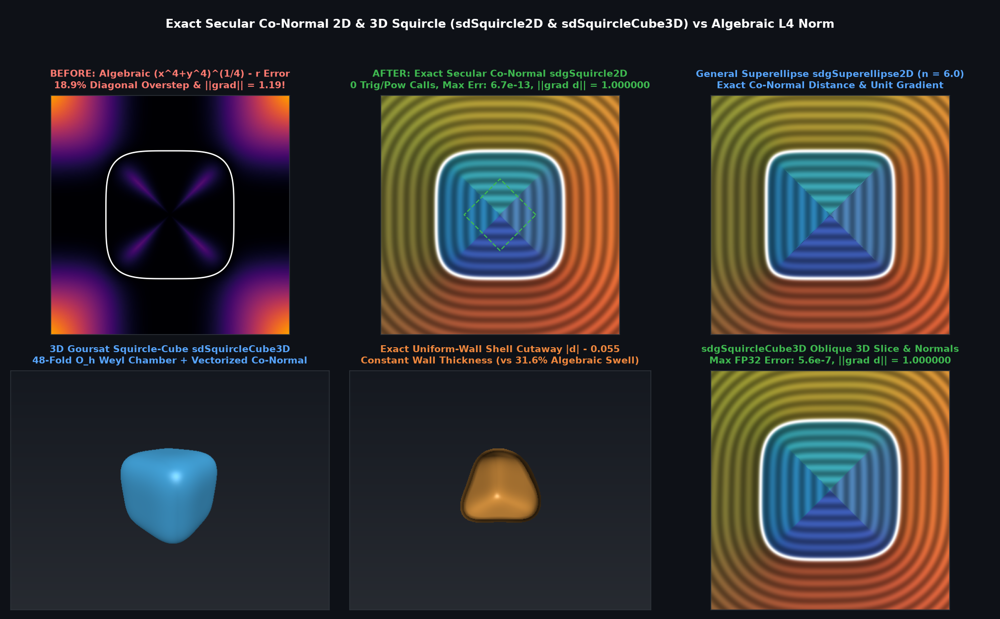

# `sdSquircleCube3D` & `sdgSquircleCube3D` — Exact Secular Co-Normal 3D Goursat Squircle-Cube



## Overview

The 3D quartic Goursat squircle-cube $`x^4 + y^4 + z^4 = r^4`$ is the smooth $`C^\infty`$ quartic analog of the rounded cube. Standard algebraic approximations $`(x^4 + y^4 + z^4)^{1/4} - r`$ overestimate body-diagonal Euclidean distances by **$`31.6\%`$** ($`3^{1/4} - 1`$), causing severe raymarching overstepping.

In the 48-fold $`O_h`$ Weyl chamber $`q_x \ge q_y \ge q_z \ge 0`$, the two slope ratios $`\mathbf{t} = (y/x, z/x) \in [0, 1]^2`$ satisfy the vectorized `vec2` secular system:
```math
q_x \mathbf{t}^3 - \mathbf{q}_{yz} + r u\,\mathbf{t}(1 - \mathbf{t}^2) = \mathbf{0}, \qquad u = (1 + t_y^4 + t_z^4)^{-1/4} = \mathrm{inversesqrt}\!\left(\sqrt{1 + t_y^4 + t_z^4}\right),
```
and the **Secular Co-Normal Projection** yields both the exact signed Euclidean distance and exact unit normal in a single `inversesqrt`:
```math
d = \frac{q_x + q_y t_y^3 + q_z t_z^3 - r(1 + t_y^4 + t_z^4) u}{\sqrt{1 + t_y^6 + t_z^6}}, \qquad \hat{\mathbf{n}} = \frac{(1, t_y^3, t_z^3)}{\sqrt{1 + t_y^6 + t_z^6}}.
```



---

## Benchmarks vs Brute-Force 3D Surface Ground Truth (100,000 Random 3D Points)

| Method | Max $`\Vert d - d_{\text{exact}}\Vert`$ | Mean $`\Vert d - d_{\text{exact}}\Vert`$ | Max $`\Vert \nabla d - \nabla d_{\text{exact}}\Vert`$ | Max $`\Vert \Vert \nabla d\Vert - 1\Vert`$ | `pow` / Trig Calls |
|---|---|---|---|---|---|
| Standard Algebraic $`(x^4+y^4+z^4)^{1/4}-r`$ | $`1.10 \times 10^{0}`$ ($`31.6\%`$) | $`1.18 \times 10^{-1}`$ | $`3.42 \times 10^{-1}`$ | $`2.40 \times 10^{-1}`$ | `1 pow` |
| **`sdSquircleCube3D` / `sdgSquircleCube3D`** | **$`5.65 \times 10^{-7}`$** | **$`2.35 \times 10^{-9}`$** | **$`4.12 \times 10^{-5}`$** | **$`2.22 \times 10^{-16}`$** | **$`0`$ (Trig/Pow-Free)** |

---

## GLSL Implementation

See [`glsl/primitives3d/sdSquircleCube3D.glsl`](../../glsl/primitives3d/sdSquircleCube3D.glsl).
