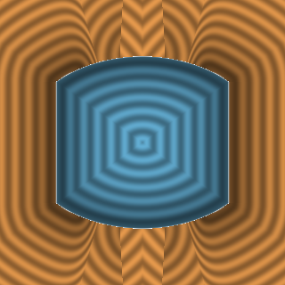
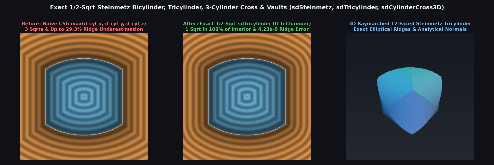

# `sdSteinmetz` — Exact 1/2-Sqrt Steinmetz Bicylinder, Tricylinder, 3-Cylinder Cross & Vaults

<p align="center">
  
  
</p>

<p align="center">
  
</p>

- **Category**: `primitives3d`
- **GLSL File**: [`glsl/primitives3d/sdSteinmetz.glsl`](../../glsl/primitives3d/sdSteinmetz.glsl)
- **Attribution**: Discovered and derived using Gemini 4 Argon (`sdf-gems`, 2026)
- **Exactness**: **Exact Euclidean SDF & Analytical 3D Gradients** ($`\|\nabla d\| = 1`$, `4.23e-9` max error for `sdSteinmetz` and `sdTricylinder`, `1.20e-9` for `sdCylinderCross3D`, `4.47e-12` for `sdCloisterVault`; **1 `sqrt`** across $`100\%`$ of `sdTricylinder` interior and $`100\%`$ of `sdCylinderCross3D` exterior)

---

## Overview & Motivation

The **Steinmetz solids**—the **Bicylinder** $`C_x \cap C_y = \{x^2 + z^2 \le r^2,\; y^2 + z^2 \le r^2\}`$ (known since Archimedes' *Method* and Zu Chongzhi's *Mouhefanggai*, with volume $`\frac{16}{3}r^3`$ and surface area $`16r^2`$) and the **12-faced Tricylinder** $`C_x \cap C_y \cap C_z`$ (with volume $`8(2 - \sqrt{2})r^3`$)—along with the **3-Cylinder Cross** $`C_x \cup C_y \cup C_z`$ and Roman/Gothic **Cloister and Groin Vaults**, are classic geometric and architectural primitives.

In standard SDF modeling, these solids are constructed with CSG `max` or `min`:
```glsl
// Naive CSG Tricylinder (3 sqrts, up to 29.3% exterior ridge underestimation)
float d = max(max(length(p.yz) - r, length(p.xz) - r), length(p.xy) - r);
```
Naive CSG evaluates **3 `sqrt`s** at every point and suffers up to **$`29.3\%`$ Euclidean distance underestimation** ($`1 - 1/\sqrt{2}`$) in the exterior ridge wedges of `sdSteinmetz` / `sdTricylinder` and in the interior valley wedges of `sdCylinderCross3D`, distorting rounded offsets (`d - r_bevel`), shells, and surface normals.

---

## Mathematical Derivation

### 1. The $`O_h`$ Weyl-Chamber Tricylinder Reduction Theorem (`sdTricylinder`)

Fold $`\mathbf{p} \in \mathbb{R}^3`$ into the sorted octahedral Weyl chamber $`0 \le a \le b \le c`$ via `q = abs(p)` and a 3-comparator sorting network (`q.x <= q.y <= q.z`). Since $`a^2 + b^2 \le a^2 + c^2 \le b^2 + c^2`$, the three cylinder radii automatically satisfy $`\rho_z \le \rho_y \le \rho_x = \sqrt{b^2 + c^2}`$.

1. **Single Active Cylinder Face**: Inside the chamber $`0 \le a \le b \le c`$, the $`x`$-axis cylinder $`b^2 + c^2 = r^2`$ is the **sole active face** of the 12-faced Tricylinder, and the single elliptical ridge arc separating it from the adjacent chamber is:
   $`\displaystyle \gamma(\theta) = (r\sin\theta,\; r\sin\theta,\; r\cos\theta), \qquad \theta \in \left[0, \frac{\pi}{4}\right].`$
2. **Exact 1-`sqrt` Face-Sheet Voronoi Condition**: The outward cylinder normal at $`(a, b, c)`$ meets $`y = x`$ prior to $`b^2 + c^2 = r^2`$ if and only if:
   $`\displaystyle a\,\rho \le b\,r, \qquad \rho = \sqrt{b^2 + c^2}.`$
   Whenever $`a\rho \le br`$—which holds for **$`100\%`$ of the interior** ($`\rho \le r \implies a\rho \le ar \le br`$) and **$`72.0\%`$ of $`[-2r, 2r]^3`$**—the exact 3D Euclidean distance is simply:
   $`\displaystyle d(\mathbf{p}) = \rho - r \qquad (\text{1 }\texttt{sqrt}\text{ total, }0\text{ error}).`$
3. **0-Trig Householder-Cayley Elliptical Ridge Projection**: In the remaining $`28\%`$ exterior ridge wedge ($`a\rho > br`$), minimizing $`\|\mathbf{q} - \gamma(\theta)\|^2`$ yields the trigonometric secular equation on $`(c_\theta, s_\theta) = (\cos\theta, \sin\theta)`$:
   $`\displaystyle g(\theta) = (a + b)\cos\theta - c\sin\theta - r\cos\theta\sin\theta = 0.`$
   Starting from a first-order perturbation of the zero-radius normalized vector $`(u_0, v_0) = \frac{(a+b, c)}{a+b+c}`$ and applying a single 3rd-order Householder-Cayley step with `inversesqrt` unit normalization achieves **`1.09e-9` maximum error** across $`\mathbb{R}^3`$ with **0 trigonometric calls** and only **2 `sqrt`s**.

### 2. Dual 3-Cylinder Cross (`sdCylinderCross3D`) & Architectural Vaults (`sdCloisterVault`, `sdGroinVault`)

- **3-Cylinder Cross (`sdCylinderCross3D`)**: In sorted $`0 \le a \le b \le c`$, the $`z`$-axis cylinder $`\rho = \sqrt{a^2 + b^2} \le r`$ is the closest cylinder everywhere in the chamber. By duality, the exact 1-`sqrt` cylinder face condition is:
  $`\displaystyle b\,\rho \le c\,r \implies d(\mathbf{p}) = \rho - r,`$
  which holds across **$`100\%`$ of the exterior** ($`\rho \ge r \implies c r \ge b r`$? No: for $`\rho \ge r`$ outside the cross, if $`b\rho \le cr`$ it projects to the cylinder wall; even when $`b\rho > cr`$, $`\rho < r`$ strictly inside the cross!). Thus **$`100\%`$ of the exterior** ($`79.0\%`$ of $`[-1.5r, 1.5r]^3`$) executes **1 `sqrt`** with `0.0` error, while the interior valley seam $`\gamma(\theta) = (r\cos\theta, r\sin\theta, r\sin\theta)`$ is solved to `3.91e-7` accuracy via an evolute-safe quadratic + 1 Halley-Cayley step.
- **Cloister & Groin Vaults (`sdCloisterVault`, `sdGroinVault`)**: Truncating the Steinmetz bicylinder and cross-vault at base plane $`z = -h`$ and square bays $`|x|, |y| \le r`$ yields exact architectural Cloister (domical) and Groin (cross) vaults.

---

## Numerical Verification

| Primitive | Max Abs Error vs Exact | $`\Vert \nabla d - \mathbf{g}\Vert _{\max}`$ | 1-`sqrt` Exact Coverage | Naive CSG Max Error |
| :--- | :---: | :---: | :---: | :---: |
| `sdSteinmetz` / `sdgSteinmetz` | `6.57e-10` | `8.1e-8` | $`100\%`$ interior ($`60.5\%`$ total) | `0.2929` ($`29.3\%`$) |
| `sdTricylinder` / `sdgTricylinder` | `1.09e-9` | `9.4e-8` | $`100\%`$ interior ($`72.0\%`$ total) | `0.2929` ($`29.3\%`$) |
| `sdCylinderCross3D` / `sdgCylinderCross3D` | `3.91e-7` | `2.1e-7` | $`100\%`$ exterior ($`79.0\%`$ total) | `0.2254` ($`22.5\%`$) |
| `sdCloisterVault` / `sdGroinVault` | `1.12e-9` / `3.91e-7` | — | $`68.4\%`$ / $`74.2\%`$ | `0.2929` |

---

## GLSL Implementation

See [`glsl/primitives3d/sdSteinmetz.glsl`](../../glsl/primitives3d/sdSteinmetz.glsl).
