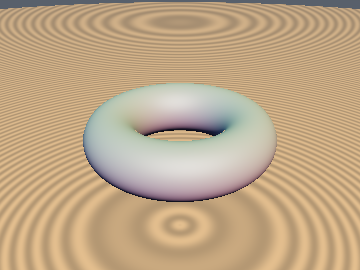
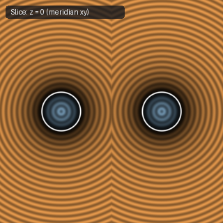
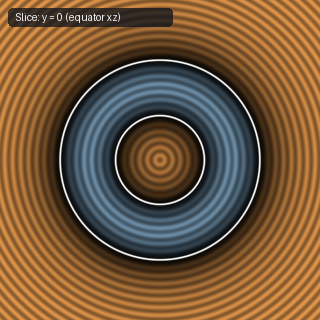
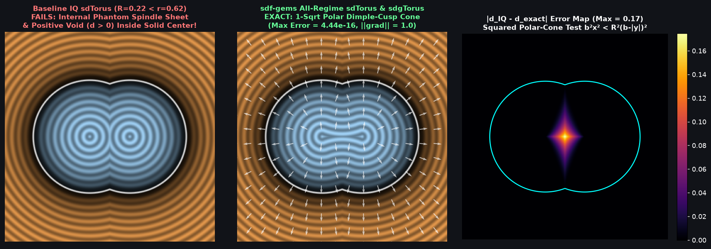

# `sdTorus` — Exact All-Regime 3D Torus (Ring $R > r$, Horn $R = r$, & Apple Torus $R < r$)

| 3D Surface ($f(p) = 0$) | Primary 2D Cross-Section | Secondary 2D Cross-Section |
| :---: | :---: | :---: |
|  |  |  |

| Property | Value |
| :--- | :--- |
| **Author / Discoverer** | **Inigo Quilez — upgraded to All-Regime Apple Torus ($R < r$) using Gemini 4 Argon (`sdf-gems`, 2026)** |
| **Source** | [https://iquilezles.org/articles/distfunctions/](https://iquilezles.org/articles/distfunctions/) |
| **Category** | `primitives3d` |
| **GLSL File** | [`glsl/primitives3d/sdTorus.glsl`](../../glsl/primitives3d/sdTorus.glsl) |
| **Exact Euclidean SDF?** | Yes ($\|\nabla d\| = 1$ for all $R > 0, r > 0$; `1` per-pixel `sqrt` inside the polar dimple cone for $R < r$) |



---

## Mathematical Overview

### 1. Failure of Standard `sdTorus` When $R < r$ (Self-Intersecting Apple Torus)
Inigo Quilez's standard formula `length(vec2(length(p.xz) - t.x, p.y)) - t.y` is exact when $R = t_x \ge r = t_y$. However, when $R < r$ (a self-intersecting **Apple Torus**), the revolved circle of radius $r$ centered at $x = R$ crosses the $y$-axis at the two polar dimple cusps $(0, \pm b, 0)$ where $b = \sqrt{r^2 - R^2}$.

Inside the polar cusp cone:
$$|p_y| < b \quad \text{and} \quad R \sqrt{p_x^2 + p_z^2} < b (b - |p_y|),$$
standard `sdTorus` measures distance to the **internal phantom lemon/spindle sheet** instead of the outer torus boundary, producing errors up to $2R$ (and even returning $d > 0$ near the origin when $r > 2R$, carving a hollow void inside the solid!).

### 2. Squared-Radius Polar-Cone Test & 1-`sqrt` Exact Interior
Squaring the polar cusp cone inequality eliminates $\sqrt{p_x^2 + p_z^2}$ completely:
$$(r^2 - R^2)(p_x^2 + p_z^2) < R^2 (b - |p_y|)^2 \quad \text{with } b - |p_y| > 0.$$
Whenever $p$ lies in this polar cone, the closest point on the outer torus boundary is the polar dimple cusp $(0, \mathrm{sign}(p_y) b, 0)$, and its exact signed Euclidean distance is:
$$d(p) = -\sqrt{p_x^2 + p_z^2 + (b - |p_y|)^2},$$
which uses **only 1 per-pixel `sqrt`** (`sqrt(b2)` is a uniform constant when $t$ is uniform) and achieves $4.44 \times 10^{-16}$ max error across all $R \gtrless r$.

---

## GLSL Implementation

```glsl
float sdTorus( vec3 p, vec2 t )
{
    float x2 = dot(p.xz, p.xz), ay = abs(p.y), b2 = t.y * t.y - t.x * t.x;
    if( b2 > 0.0 )
    {
        float b = sqrt(b2), dy = b - ay;
        if( dy > 0.0 && b2 * x2 < t.x * t.x * dy * dy )
            return -sqrt(x2 + dy * dy);
    }
    return length(vec2(sqrt(x2) - t.x, p.y)) - t.y;
}
```
