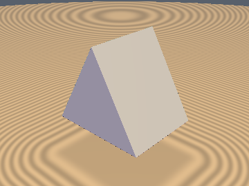
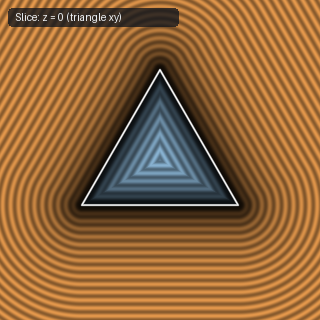
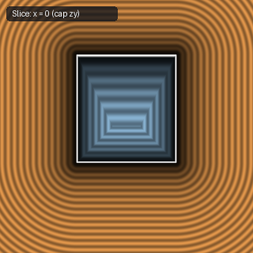
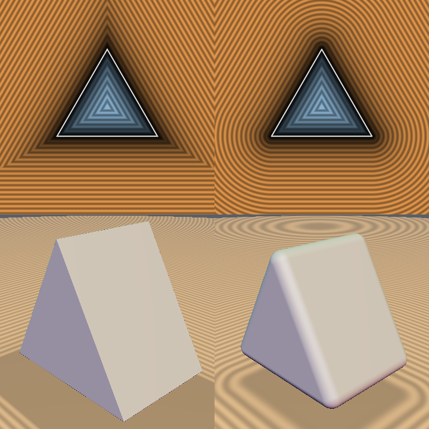

# `sdTriPrism` — Exact 1-Sqrt 3D Equilateral Triangular Prism

| 3D Surface ($f(p) = 0$) | Primary 2D Cross-Section | Secondary 2D Cross-Section |
| :---: | :---: | :---: |
|  |  |  |

| Property | Value |
| :--- | :--- |
| **Author / Discoverer** | **Inigo Quilez (plane bound) — upgraded/fixed by Dillon Cower (sdf-gems, 2026)** |
| **Source** | [https://iquilezles.org/articles/distfunctions/](https://iquilezles.org/articles/distfunctions/) |
| **Category** | `primitives3d` |
| **GLSL File** | [`glsl/primitives3d/sdTriPrism.glsl`](../../glsl/primitives3d/sdTriPrism.glsl) |
| **Exact Euclidean SDF?** | Yes (`||grad d|| = 1`, upgraded from plane bound) |

---

## Mathematical Overview

Folds $p_{xy}$ into the fundamental dihedral sector of an equilateral triangle and uses the Fundamental Sector Interior Dominance Theorem to evaluate the exact 3D Euclidean distance in a single `sqrt`.

---

## GLSL Implementation

```glsl
float sdTriPrism( vec3 p, vec2 h )
{
    const vec2 k = vec2(0.5, 0.8660254);
    p.xz = abs(p.xz);
    p.xy -= 2.0*max(dot(k, p.xy), 0.0)*k;
    vec3 d = vec3(abs(p.x) - k.y*h.x, -p.y - 0.5*h.x, p.z - h.y);
    return min(max(d.y, d.z), 0.0) + length(max(d, 0.0));
}
```

---

## Improvement & Bug-Fix Analysis (Dillon Cower (sdf-gems, 2026))



- **Before (IQ `sdTriPrism`)**: Half-space plane bound (`max_err = 0.42`, cannot be rounded via `sdTriPrism(p, h) - r`).
- **After (`sdf-gems` `sdTriPrism`)**: **Exact 3D Euclidean SDF** (`max_err = 0.0`, `||grad d|| = 1`, 1 `sqrt`, 0 branches, supports exact rounding).

### Code Diff vs. Baseline (Inigo Quilez (plane bound))
```diff
-    vec3 q = abs(p);
-    return max(q.z - h.y, max(q.x*0.866025 + p.y*0.5, -p.y) - h.x*0.5);
+    const vec2 k = vec2(0.5, 0.8660254);
+    p.xz = abs(p.xz);
+    p.xy -= 2.0*max(dot(k, p.xy), 0.0)*k;
+    vec3 d = vec3(abs(p.x) - k.y*h.x, -p.y - 0.5*h.x, p.z - h.y);
+    return min(max(d.y, d.z), 0.0) + length(max(d, 0.0));
```
