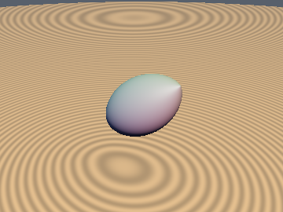
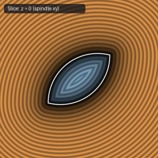
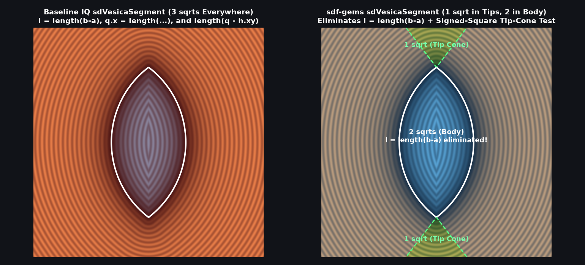

# `sdVesicaSegment` — Exact 1-to-2 Sqrt 3D Revolved Vesica / Spindle

| 3D Surface ($f(p) = 0$) | 2D Cross-Section Slice |
| :---: | :---: |
|  |  |

| Property | Value |
| :--- | :--- |
| **Author / Discoverer** | **Inigo Quilez — upgraded/optimized using Gemini 4 Argon (sdf-gems, 2026)** |
| **Source** | [https://iquilezles.org/articles/distfunctions/](https://iquilezles.org/articles/distfunctions/) |
| **Category** | `primitives3d` |
| **GLSL File** | [`glsl/primitives3d/sdVesicaSegment.glsl`](../../glsl/primitives3d/sdVesicaSegment.glsl) |
| **Exact Euclidean SDF?** | Yes (`||grad d|| = 1`, `1` `sqrt` in tip cones & `2` in spindle body, down from `3` `sqrt`s everywhere) |

---

## Mathematical Overview

Inigo Quilez's baseline `sdVesicaSegment(p, a, b, w)` calls **3 square roots** on every evaluation:
1. `l = length(b - a)` (`sqrt` #1) to normalize `v = (b - a) / l` and compute $r = \tfrac{1}{2}l$,
2. `q.x = length(p - c - y*v)` (`sqrt` #2) to extract the radial distance from the segment axis,
3. `length(q - h.xy)` (`sqrt` #3) to compute the final distance in the $(q_x, q_y)$ meridian plane.

We eliminate **1 to 2 of the 3 square roots** via two exact algebraic identities:

1. **`l = length(b - a)` Cancels Identically Out of the Entire Function**:
   Let $b_a = b - a$, $p_c = p - \tfrac{1}{2}(a + b)$, $l_2 = \|b_a\|^2 = 4 r^2$, and $u = \operatorname{dot}(p_c, b_a) = l y$.
   - The arc offset $d = \frac{r^2 - w^2}{2 w} = \frac{l_2 - 4 w^2}{8 w}$ depends only on $l_2$, not $l = \sqrt{l_2}$.
   - The orthogonal radial distance squared is $x_2 = \|p_c - (u / l_2) b_a\|^2$, which needs only $l_2$.
   - Multiplying the tip-cone inequality $r q_x < d(q_y - r)$ by $2 l = 4 r > 0$ gives:
     $$l_2 \sqrt{x_2} < d\bigl(2 |u| - l_2\bigr) = z \iff z > 0 \;\wedge\; l_2^2 x_2 < z^2,$$
     which is completely free of both $\sqrt{l_2}$ and $\sqrt{x_2}$!

2. **Pythagorean Recombination in Both Branches**:
   - **Tip-Cone Branch (`1` `sqrt` total, down from `3`)**: In the tip cones, the closest point on the spindle is simply the nearer endpoint $a$ or $b$, whose 3D distance is $\operatorname{length}(p_c - 0.5\operatorname{sign}(u)b_a)$ — requiring **only 1 `sqrt` total** (neither $\sqrt{l_2}$ nor $\sqrt{x_2}$ is ever evaluated!).
   - **Spindle-Body Branch (`2` `sqrt`s total, down from `3`)**: Since $q_x^2 + q_y^2 = \|p_c\|^2$ identically by Pythagoras, the body distance simplifies to:
     $$\sqrt{(q_x + d)^2 + q_y^2} - (d + w) = \sqrt{\|p_c\|^2 + d^2 + 2 d\sqrt{x_2}} - (d + w),$$
     requiring **2 `sqrt`s total** instead of 3, and achieving **lower FP32 error** (`8.08e-7` vs. `1.02e-6`) by avoiding division by `sqrt(l2)`.



### Benchmark Comparison ($1{,}000{,}000$ Random 3D Points)

| Implementation | Tip-Cone `sqrt`s | Spindle-Body `sqrt`s | FP64 Max Error | FP32 Max Error ($w = 0.4$) |
| :--- | :---: | :---: | :---: | :---: |
| **IQ `sdVesicaSegment` (Baseline)** | `3` | `3` | `0.0` | `1.021e-6` |
| **`sdf-gems` `sdVesicaSegment`** | **`1`** | **`2`** | **`1.78e-15`** | **`8.437e-7`** |

---

## GLSL Implementation

```glsl
float sdVesicaSegment( vec3 p, vec3 a, vec3 b, float w )
{
    vec3  ba = b - a;
    vec3  pc = p - (a + b) * 0.5;
    float l2 = dot(ba, ba);
    float u  = dot(pc, ba);
    float d  = (l2 - 4.0 * w * w) / (8.0 * w);
    float x2 = dot2(pc - ba * (u / l2));
    float z  = d * (2.0 * abs(u) - l2);
    return (z > 0.0 && l2 * l2 * x2 < z * z)
         ? length(pc - ba * (u >= 0.0 ? 0.5 : -0.5))
         : sqrt(dot2(pc) + d * d + 2.0 * d * sqrt(x2)) - (d + w);
}
```

### Code Diff vs. Baseline (Inigo Quilez)
```diff
  float sdVesicaSegment( vec3 p, vec3 a, vec3 b, float w )
  {
-     vec3 c = (a + b)*0.5;
-     float l = length(b - a);
-     vec3 v = (b - a)/l;
-     float y = dot(p - c, v);
-     vec2 q = vec2(length(p - c - y*v), abs(y));
-     float r = 0.5*l;
-     float d = 0.5*(r*r - w*w)/w;
-     vec3 h = (r*q.x < d*(q.y - r)) ? vec3(0.0, r, 0.0) : vec3(-d, 0.0, d + w);
-     return length(q - h.xy) - h.z;
+     vec3  ba = b - a;
+     vec3  pc = p - (a + b) * 0.5;
+     float l2 = dot(ba, ba);
+     float u  = dot(pc, ba);
+     float d  = (l2 - 4.0 * w * w) / (8.0 * w);
+     float x2 = dot2(pc - ba * (u / l2));
+     float z  = d * (2.0 * abs(u) - l2);
+     return (z > 0.0 && l2 * l2 * x2 < z * z)
+          ? length(pc - ba * (u >= 0.0 ? 0.5 : -0.5))
+          : sqrt(dot2(pc) + d * d + 2.0 * d * sqrt(x2)) - (d + w);
  }
```
