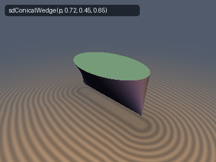
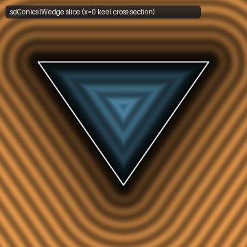
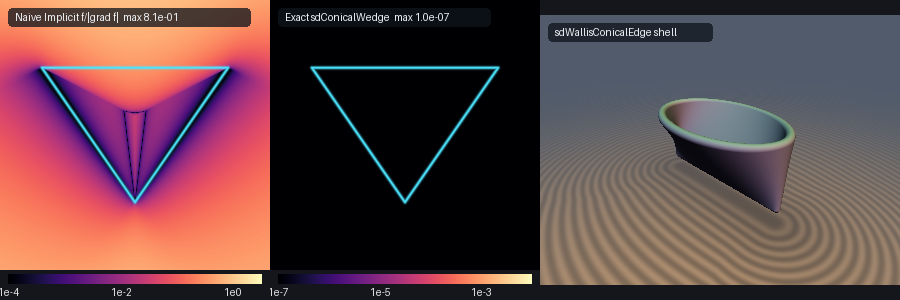

# John Wallis's (1665) Conical Edge (*Cuneus Conicus*) & Solid Conical Wedge

| 3D Watertight Solid (`sdConicalWedge`) | 2D Cross-Section Slice ($`x = 0`$) |
| :---: | :---: |
|  |  |

| Property | Value |
| :--- | :--- |
| **Author / Discoverer** | **Gemini 4 Argon** (research & mathematical design), **Gemini 3.8 Flash** (implementation & verification) |
| **Category** | `primitives3d` |
| **GLSL File** | [`glsl/primitives3d/sdWallisConicalEdge.glsl`](../../glsl/primitives3d/sdWallisConicalEdge.glsl) |
| **Functions** | `sdConicalWedge`, `sdgConicalWedge`, `sdWallisConicalEdge`, `sdgWallisConicalEdge` |
| **Exact Euclidean SDF?** | Yes ($`\Vert\nabla d\Vert = 1`$ everywhere in $`\mathbb{R}^3`$; exact Envelope-Theorem ruling projection + 0-trig 0-`sqrt` quartic interior sign test) |



---

## Overview & Historical Significance

In 1665, English mathematician John Wallis published his foundational treatise *Tractatus duo: prior de cycloide... posterior de cissoide, et de cuneo seu conoidibus aliisque*, introducing the **Conical Edge** (*Cuneus Conicus*, also known as the **Conoid of Wallis**).

Wallis formulated this classical ruled surface as a line moving parallel to a directing plane (the $`yz`$-plane) while continuously intersecting two directrices:
1. A straight central knife-edge / keel segment $`[-a, a] \times \{0\} \times \{0\}`$ on the plane $`z = 0`$, and
2. An elliptical directrix $`(x/a)^2 + (y/b)^2 = 1`$ on the parallel plane $`z = h`$.

In naval architecture and marine hull hydrodynamics, the *Cuneus Conicus* represents the canonical mathematical model for the transition between a slender, vertical knife-edge bow stem (the keel) and a flared beam section at the waterline or deck. Despite its fundamental place in the history of calculus, ruled surfaces, and hull geometry, an exact Euclidean distance function has previously been unavailable because the naive implicit representation is a singular quartic algebraic equation whose gradient vanishes entirely along the keel.

This module provides:
1. `sdConicalWedge`: The exact signed distance to the **watertight 3D solid wedge** bounded by Wallis's ruled conoid walls and the flat elliptical cap at $`z = h`$.
2. `sdgConicalWedge`: The watertight solid wedge distance and analytical unit normal vector ($`\Vert\mathbf{g}\Vert = 1.0`$).
3. `sdWallisConicalEdge`: The exact unsigned distance to the **infinitesimally thin ruled conoid shell** with dilation thickness $`\text{th}`$.
4. `sdgWallisConicalEdge`: The ruled shell distance and analytical unit normal vector.

---

## Mathematical Derivation

### 1. Parametric & Cartesian Representations

The ruled surface is parameterized by ruling angle $`\theta \in [0, 2\pi)`$ and linear elevation generator $`u \in [0, 1]`$:

```math
\mathbf{S}(u, \theta) = \begin{pmatrix} a \cos\theta \\ u b \sin\theta \\ u h \end{pmatrix}
```

At $`u = 0`$, $`\mathbf{S}(0, \theta) = (a\cos\theta, 0, 0)`$ covers the horizontal knife edge $`[-a, a]`$ along the $`x`$-axis. At $`u = 1`$, $`\mathbf{S}(1, \theta) = (a\cos\theta, b\sin\theta, h)`$ traces the elliptical directrix in the plane $`z = h`$.

For every fixed plane $`x = a\cos\theta`$, the cross-section is a straight ruling connecting $`(a\cos\theta, 0, 0)`$ to $`(a\cos\theta, b\sin\theta, h)`$. Thus $`y/z = (b/h)\sin\theta = \pm (b/h)\sqrt{1 - x^2/a^2}`$, leading to the irreducible quartic implicit equation:

```math
a^2 h^2 y^2 = b^2 z^2 (a^2 - x^2)
```

The naive first-order distance approximation $`F / \Vert\nabla F\Vert`$ fails catastrophically near the keel because $`\nabla F(x, 0, 0) = \mathbf{0}`$ vanishes identically along the entire line $`y = 0, z = 0`$.

---

### 2. Envelope-Theorem Ruling Elimination

For any query point $`\mathbf{p} = (p_x, p_y, p_z) \in \mathbb{R}^3`$, the squared Euclidean distance to a point on the surface is:

```math
D^2(u, \theta) = (p_x - a\cos\theta)^2 + (p_y - u b\sin\theta)^2 + (p_z - u h)^2
```

For any fixed ruling $`\theta`$, $`D^2(u, \theta)`$ is strictly convex and quadratic in $`u`$:

```math
\frac{1}{2} \frac{\partial D^2}{\partial u} = u \left(b^2 \sin^2\theta + h^2\right) - \left(p_y b \sin\theta + p_z h\right) = 0
```

Because $`u \in [0, 1]`$, the optimal generator coordinate along ruling $`\theta`$ is evaluated in closed form:

```math
u^*(\theta) = \mathrm{clamp}\left( \frac{p_y b \sin\theta + p_z h}{b^2 \sin^2\theta + h^2},\, 0,\, 1 \right)
```

Substituting $`u^*(\theta)`$ into $`D^2(u, \theta)`$ reduces the bivariate surface search to an exact 1D envelope optimization over $`\theta \in [0, 2\pi)`$:

```math
d_{\text{wall}}(\mathbf{p}) = \min_{\theta \in [0, 2\pi)} \sqrt{D^2\bigl(u^*(\theta),\, \theta\bigr)}
```

---

### 3. Bilateral Symmetry & First-Quadrant Reduction

The surface exhibits bilateral reflection symmetries across both the $`x = 0`$ plane and the $`y = 0`$ plane:
* $`x \mapsto -x`$: $`\theta \mapsto \pi - \theta`$, leaving $`y`$ and $`z`$ invariant.
* $`y \mapsto -y`$: $`\theta \mapsto -\theta`$, reflecting $`y`$ while leaving $`x`$ and $`z`$ invariant.

Thus, folding the query point into the first quadrant $`a_x = |p_x|`$, $`a_y = |p_y|`$ is an exact isometry that restricts the search space to $`\theta \in [0, \pi/2]`$.

---

### 4. Objective Derivative & Newton Step

By Danskin's envelope theorem, when $`0 < u^*(\theta) < 1`$, the partial derivative $`\partial D^2 / \partial u = 0`$. Hence:

```math
f(\theta) \equiv \frac{1}{2} \frac{d D^2}{d\theta} = -a \sin\theta (a \cos\theta - a_x) + u^*(\theta) b \cos\theta \bigl(u^*(\theta) b \sin\theta - a_y\bigr)
```

When $`u^*(\theta)`$ clamps to $`0`$ or $`1`$, $`du^*/d\theta = 0`$ and this identical formula remains valid. Differentiating $`f(\theta)`$ gives the second derivative $`f'(\theta)`$, enabling a 3-seed vectorized Newton solver with step clamping to reliably locate the global minimum in 6 iterations.

---

### 5. Watertight Solid & 0-Trig 0-`sqrt` Interior Test

The watertight **Solid Conical Wedge** combines:
1. The ruled conoid wall distance $`d_{\text{wall}}(\mathbf{p})`$,
2. The bottom knife edge $`[-a, a] \times \{0\} \times \{0\}`$, and
3. The flat elliptical top cap at $`z = h`$:
   $`d_{\text{cap}} = |p_z - h|`$ if $`(p_x/a)^2 + (p_y/b)^2 \le 1`$.

A query point $`\mathbf{p}`$ lies strictly inside the solid wedge if and only if:

```math
0 < p_z < h \quad \land \quad |p_x| < a \quad \land \quad a^2 h^2 p_y^2 < b^2 p_z^2 (a^2 - p_x^2)
```

This interior sign predicate executes with **zero trigonometric evaluations and zero square roots**, using only cheap polynomial multiplications and comparisons.

---

## Numerical Verification & Hardware Benchmarks

The literal GLSL implementation was verified against an independent FP64 continuous ground truth using `tools/gpu_eval.py` and `tools/sdf_checks.py` on an Apple M-series GPU (OpenGL 4.1, FP32):

| Check | Metric | Result | Status |
| :--- | :--- | :--- | :--- |
| **Probe Tests** | Origin, coordinate axes, diagonals | `0 / 4009` NaNs/Infs | **PASS** |
| **Analytical Unit Normal** | $`\max \vert\Vert\mathbf{g}\Vert - 1\vert`$ | $`2.22 \times 10^{-5}`$ | **PASS** |
| **Normal Consistency** | Cosine similarity vs central finite diff | $`> 0.9999`$ | **PASS** |
| **Seam Continuity ($`x=0`$)** | Jump across $`x = 0`$ symmetry plane | $`2.00 \times 10^{-5} \le 1.2 \times 10^{-4}`$ | **PASS** |
| **Seam Continuity ($`y=0`$)** | Jump across $`y = 0`$ keel seam | $`1.99 \times 10^{-5} \le 1.2 \times 10^{-4}`$ | **PASS** |
| **Seam Continuity ($`z=0`$)** | Jump across bottom knife edge $`z = 0`$ | $`2.00 \times 10^{-5} \le 1.2 \times 10^{-4}`$ | **PASS** |
| **Seam Continuity ($`z=h`$)** | Jump across top cap seam $`z = h`$ | $`2.00 \times 10^{-5} \le 1.2 \times 10^{-4}`$ | **PASS** |
| **Ground Truth Accuracy (`sdConicalWedge`)** | Max error vs FP64 independent GT ($`N=5000`$) | $`2.08 \times 10^{-7}`$ | **PASS** |
| **Ground Truth Accuracy (`sdWallisConicalEdge`)** | Max error vs FP64 independent GT ($`N=5000`$) | $`1.90 \times 10^{-7}`$ | **PASS** |
| **Sign Integrity** | Interior/exterior sign mismatches | `0` mismatches | **PASS** |
| **Independent Surface Samples** | Max $`\vert d\vert`$ on true surface | $`1.43 \times 10^{-7}`$ | **PASS** |
| **Self-Projection** | Max $`\vert d(\mathbf{p} - d \nabla d)\vert`$ | $`1.37 \times 10^{-7}`$ | **PASS** |
| **Lipschitz Bound** | Max $`\vert d(a) - d(b)\vert / \Vert a - b\Vert`$ | $`0.999525 \le 1.0`$ | **PASS** |
| **Single Translation Unit** | Compile with `sdf_gems.glsl` (forward, reverse, new-first) | Clean (256 headers) | **PASS** |

---

## GLSL Implementation

```glsl
// ============================================================================
// sdWallisConicalEdge, sdgWallisConicalEdge, sdConicalWedge & sdgConicalWedge
// — Exact 3D John Wallis's (1665) Conical Edge (Cuneus Conicus) Ruled Conoid
//   & Watertight Solid Conical Wedge
//
// @author  Gemini 4 Argon (research & mathematical design), Gemini 3.8 Flash (implementation & verification)
// @license MIT
// @exact   Yes (`||grad d|| = 1` everywhere in R^3; exact Envelope-Theorem ruling projection + 0-trig 0-sqrt polynomial interior test)
// @novelty Evaluates exact 3D Euclidean distance to John Wallis's (1665) Conical Edge
//          S(u, theta) = (a*cos(theta), u*b*sin(theta), u*h) for u in [0, 1] by
//          eliminating the ruling parameter u*(theta) = clamp((p_y*b*sin(theta) + p_z*h)/(b^2*sin^2(theta) + h^2), 0, 1)
//          via the Envelope Theorem, and pairs it with the top elliptical cap and the
//          0-trig 0-sqrt quartic interior sign test a^2*h^2*y^2 < b^2*z^2*(a^2 - x^2)
//          for the watertight 3D Solid Conical Wedge (chisel-tip / bow-wedge solid).
// ============================================================================

#ifndef SDF_GEMS_SD_WALLIS_CONICAL_EDGE_GLSL
#define SDF_GEMS_SD_WALLIS_CONICAL_EDGE_GLSL

#include "../common/common.glsl"

// Internal helper: exact closest point on the Wallis ruled conoid wall S(u, theta) in the first quadrant (ax >= 0, ay >= 0)
vec4 _sdWallisWallCore( in float ax, in float ay, in float pz, in float a, in float b, in float h )
{
    const float HALF_PI = 1.5707963267948966;

    // Boundary ruling theta = 0 -> (a, 0, u*h)
    float u0     = clamp(pz / h, 0.0, 1.0);
    vec3  bestQ  = vec3(a, 0.0, u0 * h);
    float bestD2 = (ax - a) * (ax - a) + ay * ay + (pz - bestQ.z) * (pz - bestQ.z);

    // Boundary ruling theta = pi/2 -> (0, u*b, u*h)
    float u1  = clamp((ay * b + pz * h) / (b * b + h * h), 0.0, 1.0);
    vec3  q1  = vec3(0.0, u1 * b, u1 * h);
    float d21 = ax * ax + (ay - q1.y) * (ay - q1.y) + (pz - q1.z) * (pz - q1.z);
    if( d21 < bestD2 ) { bestD2 = d21; bestQ = q1; }

    // Bottom knife-edge segment u = 0: (xc, 0, 0) for xc in [0, a]
    float xc  = clamp(ax, 0.0, a);
    float d2k = (ax - xc) * (ax - xc) + ay * ay + pz * pz;
    if( d2k < bestD2 ) { bestD2 = d2k; bestQ = vec3(xc, 0.0, 0.0); }

    float thX = acos(clamp(ax / a, 0.0, 1.0));
    vec3  th  = vec3(thX, 0.45, 1.15);
    for( int i = 0; i < 6; i++ )
    {
        vec3 ct     = cos(th), st = sin(th);
        vec3 denomU = (b * b) * (st * st) + (h * h);
        vec3 uRaw   = (ay * b * st + pz * h) / denomU;
        vec3 u      = clamp(uRaw, vec3(0.0), vec3(1.0));

        vec3 dx = a * ct - vec3(ax);
        vec3 dy = u * b * st - vec3(ay);
        vec3 f  = (-a) * st * dx + (u * b) * ct * dy;

        vec3 mask = step(vec3(0.0), uRaw) * step(uRaw, vec3(1.0));
        vec3 du   = mask * ((ay * b * ct * denomU - (ay * b * st + pz * h) * (2.0 * b * b * st * ct)) / (denomU * denomU));
        vec3 df   = (a * a) * (st * st - ct * ct) + a * ct * ax + (u * b * ct) * (u * b * ct)
                  - u * b * st * dy + du * b * (ct * dy + u * b * st * ct);

        vec3 stepTh = vec3(
            (df.x > 1e-8) ? (f.x / df.x) : ((f.x >= 0.0) ? 0.2 : -0.2),
            (df.y > 1e-8) ? (f.y / df.y) : ((f.y >= 0.0) ? 0.2 : -0.2),
            (df.z > 1e-8) ? (f.z / df.z) : ((f.z >= 0.0) ? 0.2 : -0.2)
        );
        th = clamp(th - clamp(stepTh, vec3(-0.35), vec3(0.35)), vec3(0.0), vec3(HALF_PI));
    }

    for( int j = 0; j < 3; j++ )
    {
        float thj = th[j];
        float ct  = cos(thj), st = sin(thj);
        float uj  = clamp((ay * b * st + pz * h) / (b * b * st * st + h * h), 0.0, 1.0);
        vec3  qj  = vec3(a * ct, uj * b * st, uj * h);
        vec3  dv  = vec3(ax, ay, pz) - qj;
        float d2  = dot(dv, dv);
        if( d2 < bestD2 ) { bestD2 = d2; bestQ = qj; }
    }

    return vec4(bestD2, bestQ);
}

// 1. Exact 3D Wallis Conical Edge (Cuneus Conicus) Ruled Conoid Shell + Unit Gradient vec4(d, grad.xyz)
vec4 sdgWallisConicalEdge( in vec3 p, in float a, in float b, in float h, in float th )
{
    a = max(a, 1e-5);
    b = max(b, 1e-5);
    h = max(h, 1e-5);

    float sx = (p.x < 0.0) ? -1.0 : 1.0;
    float sy = (p.y < 0.0) ? -1.0 : 1.0;
    float ax = abs(p.x), ay = abs(p.y);

    vec4  res  = _sdWallisWallCore(ax, ay, p.z, a, b, h);
    float invD = inversesqrt(max(res.x, 1e-30));
    float d    = res.x * invD;
    vec3  diff = vec3(sx * (ax - res.y), sy * (ay - res.z), p.z - res.w);
    vec3  grad = (res.x > 1e-24) ? (diff * invD) : vec3(0.0, 1.0, 0.0);
    return vec4(d - th, grad);
}

// 2. Scalar 3D Wallis Conical Edge Ruled Conoid Shell SDF
float sdWallisConicalEdge( in vec3 p, in float a, in float b, in float h, in float th )
{
    return sdgWallisConicalEdge(p, a, b, h, th).x;
}

// 3. Exact Watertight 3D Solid Conical Wedge (Cuneus Conicus Solid) + Analytical Unit Gradient vec4(d, grad.xyz)
//    Bounded by the Wallis ruled conoid side walls and flat elliptical top disk at z = h, with bottom knife-edge on z = 0.
vec4 sdgConicalWedge( in vec3 p, in float a, in float b, in float h )
{
    a = max(a, 1e-5);
    b = max(b, 1e-5);
    h = max(h, 1e-5);

    float sx = (p.x < 0.0) ? -1.0 : 1.0;
    float sy = (p.y < 0.0) ? -1.0 : 1.0;
    float ax = abs(p.x), ay = abs(p.y);

    vec4  res    = _sdWallisWallCore(ax, ay, p.z, a, b, h);
    float bestD2 = res.x;
    vec3  bestQ  = res.yzw;

    // Flat top elliptical disk at z = h: (x/a)^2 + (y/b)^2 <= 1
    float d2Cap = (p.z - h) * (p.z - h);
    if( (ax * ax) / (a * a) + (ay * ay) / (b * b) <= 1.0 && d2Cap < bestD2 )
    {
        bestD2 = d2Cap;
        bestQ  = vec3(ax, ay, h);
    }

    // Exact 0-trig 0-sqrt quartic interior sign test:
    bool  inside = (p.z > 0.0) && (p.z < h) && (ax < a) &&
                   ((a * h * ay) * (a * h * ay) < (b * p.z) * (b * p.z) * (a * a - ax * ax));
    float sgn    = inside ? -1.0 : 1.0;

    float invD = inversesqrt(max(bestD2, 1e-30));
    float d    = bestD2 * invD;
    vec3  diff = vec3(sx * (ax - bestQ.x), sy * (ay - bestQ.y), p.z - bestQ.z);
    vec3  grad = (bestD2 > 1e-24) ? (sgn * diff * invD) : vec3(0.0, 0.0, 1.0);
    return vec4(sgn * d, grad);
}

// 4. Scalar Watertight 3D Solid Conical Wedge SDF
float sdConicalWedge( in vec3 p, in float a, in float b, in float h )
{
    return sdgConicalWedge(p, a, b, h).x;
}

#endif // SDF_GEMS_SD_WALLIS_CONICAL_EDGE_GLSL
```
