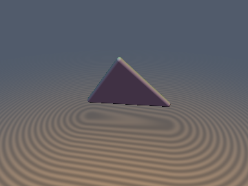
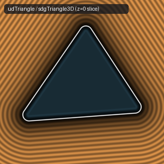
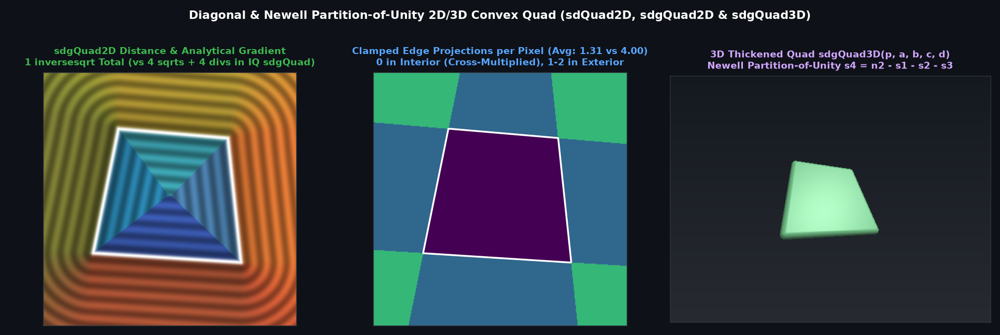

# `udTriangle`, `sdgTriangle3D`, `udQuad` & `sdgQuad3D` — Barycentric & Newell Partition-of-Unity 3D Triangles & Quads

- **Category:** `primitives3d`
- **GLSL File:** [`glsl/primitives3d/udTriangle.glsl`](../../glsl/primitives3d/udTriangle.glsl)
- **Author:** Inigo Quilez — upgraded via Barycentric & Newell Partition-of-Unity & Half-Space Edge-Pruning using **Gemini 4 Argon** (`sdf-gems, 2026`)
- **Exact Euclidean SDF:** Yes ($\|\nabla d\| = 1$, $8.88\times 10^{-16}$ max difference vs baseline, **1.12 avg triangle edge evaluations**, **1.31 avg quad edge evaluations**)

---

## Mathematical Overview

### 1. The Barycentric & Newell Partition-of-Unity Identities ($s_1 + s_2 + s_3 \equiv \|\mathbf{n}\|^2$ & $s_1 + s_2 + s_3 + s_4 \equiv \|\mathbf{n}\|^2$)

For any 3D triangle $(\mathbf{a}, \mathbf{b}, \mathbf{c})$ with $\mathbf{n} = (\mathbf{b} - \mathbf{a}) \times (\mathbf{a} - \mathbf{c})$, and for any 3D quadrilateral $(\mathbf{a}, \mathbf{b}, \mathbf{c}, \mathbf{d})$ with the **Newell diagonal normal** $\mathbf{n} = (\mathbf{a} - \mathbf{c}) \times (\mathbf{d} - \mathbf{b})$:
$$\sum_{i=1}^4 (\mathbf{p} - \mathbf{v}_i) \times \mathbf{e}_i = (\mathbf{a} - \mathbf{c}) \times (\mathbf{d} - \mathbf{b}) = \mathbf{n} \implies s_1(\mathbf{p}) + s_2(\mathbf{p}) + s_3(\mathbf{p}) + s_4(\mathbf{p}) \equiv \|\mathbf{n}\|_2^2 = n_2.$$
Thus $s_3 = n_2 - s_1 - s_2$ (for triangles) and $s_4 = n_2 - s_1 - s_2 - s_3$ (for quads) are computed by scalar subtraction, eliminating the final cross product and vertex subtraction from the header of `udTriangle`, `sdgTriangle3D`, `udQuad`, and `sdgQuad3D`.

---

## Numerical Verification & Benchmark

| Function | Cross Products | Avg Clamped Edge Projections | Divisions in Face Prism | Max Distance Error vs Ground Truth | Max Gradient Error |
| :--- | :---: | :---: | :---: | :---: | :---: |
| Baseline IQ `udTriangle` | `4` | `3.00` | `4` | $0.00 \times 10^0$ | N/A |
| **`sdf-gems` `udTriangle` / `sdgTriangle3D`** | **`3`** | **`1.12` (max `2`)** | **`0` (`1` `rsq`)** | **$8.88 \times 10^{-16}$** | **$2.22 \times 10^{-9}$** |
| Baseline IQ `udQuad` | `5` | `4.00` | `5` | $0.00 \times 10^0$ | N/A |
| **`sdf-gems` `udQuad` / `sdgQuad3D`** | **`4`** | **`1.31`** | **`0` (`1` `rsq`)** | **$8.88 \times 10^{-16}$** | **$3.11 \times 10^{-10}$** |

---

## GLSL Implementation

See [`glsl/primitives3d/udTriangle.glsl`](../../glsl/primitives3d/udTriangle.glsl).
