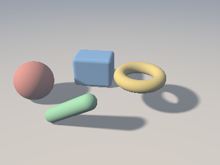
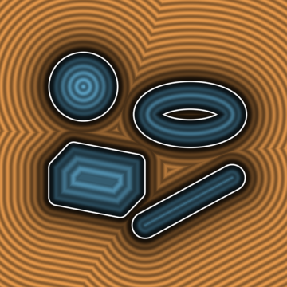
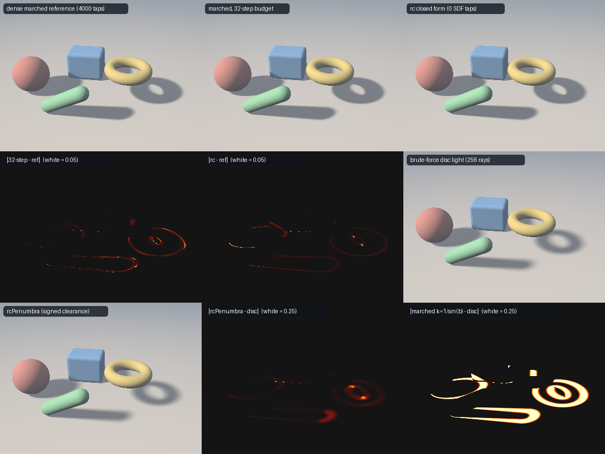

# `rcSphere`, `rcPlane`, `rcCapsule`, `rcBox`, `rcRoundBox`, `rcTorus` & `rcSoftShadow` — Ray-Clearance Fields (an SDF over Ray Space)

| 1-Tap Soft Shadows (0 SDF evaluations) | Clearance Field over Parallel Rays |
| :---: | :---: |
|  |  |

| Property | Value |
| :--- | :--- |
| **Author / Discoverer** | **Claude Fable 5.2** (`sdf-gems`, 2026). The sphere and capsule cases restate known formulas (see [Novelty & Prior Art](#novelty--prior-art)). |
| **Category** | `rayspace` (experimental research category) |
| **GLSL File** | [`glsl/rayspace/rcPrimitives.glsl`](../../glsl/rayspace/rcPrimitives.glsl) |
| **Exactness** | `rcSphere`, `rcPlane`, `rcCapsule`, `rcBox`, `rcRoundBox`: **closed form, verified** against an independent ground truth (max error $`6.5 \times 10^{-7}`$ in FP32). `rcTorus`: **iterative**, one-sided error ($`C \ge C_{\text{true}}`$), $`5.8 \times 10^{-7}`$ on random rays, up to $`4.4 \times 10^{-5}`$ on adversarial tangent rays (FP32). `rcSphereCone`: exact closed form of $`\min_t d/t`$. `rcSoftShadow`, `rcSinClearance`, `rcPenumbra`, `rcCoverage`: **approximations**. |
| **Status** | Research experiment. Several of the brief's claims hold, several only partly. See [Findings](#findings). |

The right image shows $`C`$ for parallel rays as a function of their 2D offset: orange is $`C > 0`$ (miss), blue is $`C < 0`$ (penetration depth), white is the silhouette $`C = 0`$.

---

## Overview & Motivation

A signed distance function answers "how far is this *point* from the surface". Many rendering questions are about *rays*: does it hit, how closely does it graze, how deep does it go. For a ray segment $`\mathbf{x}(t) = \mathbf{o} + t\,\mathbf{d}`$, $`\Vert\mathbf{d}\Vert = 1`$, $`t \in [0, t_{\max}]`$, and an exact SDF $`d`$, define the **signed clearance**

```math
C(\mathbf{o}, \mathbf{d}, t_{\max}) = \min_{t \in [0, t_{\max}]} d(\mathbf{o} + t\,\mathbf{d}), \qquad t^* = \arg\min_t d(\mathbf{o} + t\,\mathbf{d}).
```

- $`C > 0`$: the ray misses and $`C`$ is its closest approach to the surface.
- $`C < 0`$: the ray penetrates and $`-C`$ is the deepest penetration depth reached along it.

$`C`$ is to the 5D space of rays what $`d`$ is to points. Each `rc*` function returns `vec2(C, t*)` without marching and takes the same shape parameters as the matching `sd*` primitive (shape at the origin: transform the ray).

## Mathematical Derivation

### Properties that follow from the definition

1. **Union is exact.** $`\min_t \min(d_A, d_B) = \min(\min_t d_A, \min_t d_B)`$, so $`C_{A \cup B} = \min(C_A, C_B)`$, with the $`t^*`$ of the smaller one.
2. **Offsets are exact.** $`C[d - r] = C[d] - r`$ with the same $`t^*`$ (used by `rcCapsule`, `rcRoundBox`, `rcTorus`).
3. **Intersection is only bounded.** $`\min_t \max(d_A, d_B) \ge \max(C_A, C_B)`$. A ray that passes through $`A`$ and later through $`B`$ has $`\max(C_A, C_B) < 0`$ although it may miss $`A \cap B`$.
4. **Smooth union is bracketed.** A smooth minimum that is monotone in both arguments and satisfies $`\mathrm{smin} \le \min`$ gives $`\mathrm{smin}(C_A, C_B) \le C_{\mathrm{smin}} \le \min(C_A, C_B)`$.
5. **1-Lipschitz under translation.** $`\vert C(\mathbf{o} + \mathbf{v}, \mathbf{d}) - C(\mathbf{o}, \mathbf{d}) \vert \le \Vert\mathbf{v}\Vert`$, because every point of the ray moves by $`\Vert\mathbf{v}\Vert`$ and $`d`$ is 1-Lipschitz.
6. **One-sided bound under rotation about the origin.** Evaluating the rotated ray at the old $`t^*`$ gives $`C(\mathbf{o}, \mathbf{d}') \le C(\mathbf{o}, \mathbf{d}) + t^* \theta`$ for an angle $`\theta`$ between $`\mathbf{d}`$ and $`\mathbf{d}'`$. The two-sided statement needs $`\max(t^*, t^{*\prime})`$; with $`t^*`$ of one ray alone it is false (measured below).
7. **Parallel rays see the silhouette SDF.** For infinite parallel rays, the distance from a line to a set equals the distance from the projected point to the projected set, so for $`C > 0`$ the clearance is the exact 2D SDF of the orthographic silhouette (right image above). For $`C < 0`$ it is the deepest penetration, which is not the 2D interior distance in general.

### Sphere, plane, capsule

- **Sphere**: $`t^* = \mathrm{clamp}(-\mathbf{o} \cdot \mathbf{d}, 0, t_{\max})`$, $`C = \Vert\mathbf{o} + t^*\mathbf{d}\Vert - s`$.
- **Plane** (half-space): $`d`$ is linear in $`t`$, so the minimum is at an end point.
- **Capsule**: clamped segment-to-segment distance minus $`r`$. The interior solution is written with cross products, $`t = -\dfrac{(\mathbf{d} \times \mathbf{ba}) \cdot (\mathbf{oa} \times \mathbf{ba})}{\Vert\mathbf{d} \times \mathbf{ba}\Vert^2}`$, which avoids the cancellation of $`e - g^2`$ for nearly parallel rays in FP32.

### Box (signed)

The SDF of a convex set is convex, so $`d(\mathbf{x}(t))`$ is convex in $`t`$ and has one minimum (possibly a flat interval).

**Penetrating case.** Inside the box $`d = \max_i(\vert p_i \vert - b_i)`$. After mirroring so that $`d_i \ge 0`$, this is the maximum of three rising lines $`u_i(t) = o_i - b_i + t d_i`$ and three falling lines $`f_j(t) = -o_j - b_j - t d_j`$. The minimum of the upper envelope is where the rising envelope overtakes the falling one:

```math
t_\times = \min_i \max_j t_{ij}, \qquad t_{ij} = \frac{(-o_j - b_j) - (o_i - b_i)}{d_i + d_j},
```

clamped to $`[0, t_{\max}]`$. If $`\max_i(\vert p_i(t_\times) \vert - b_i) \le 0`$ the ray penetrates and this value is $`C`$.

**Missing case.** $`D^2(t) = \Vert\mathbf{p} - \mathrm{clamp}(\mathbf{p}, -\mathbf{b}, \mathbf{b})\Vert^2`$ is convex and $`C^1`$, with derivative $`2 g(t)`$,

```math
g(t) = \mathbf{d} \cdot \big(\mathbf{p}(t) - \mathrm{clamp}(\mathbf{p}(t), -\mathbf{b}, \mathbf{b})\big),
```

a non-decreasing piecewise-linear function whose only breakpoints are the six slab crossings. Evaluating $`g`$ at $`0`$, $`t_{\max}`$ and the six crossings brackets the root between two adjacent breakpoints, where $`g`$ is linear, so one linear interpolation gives the exact $`t^*`$. No region classification (faces, edges, vertices) is needed.

`rcRoundBox(b, r)` is `rcBox(b - r) - r` by the offset rule.

### Torus (iterative)

For a ring or horn torus ($`R \ge r`$) $`d = \mathrm{dist}(\mathbf{p}, \text{circle}) - r`$, so the problem is the line-to-circle distance, classically a quartic. This implementation is **not** closed form. With $`a = d_x^2 + d_z^2`$, $`t_c = -\mathbf{o} \cdot \mathbf{d}`$ (closest approach to the centre), $`t_0`$ the closest approach to the axis, $`x = t - t_c`$, $`e = t_0 - t_c`$, $`v = x - e`$, $`\rho = R\sqrt{a}`$ and $`\mu`$ the axis distance divided by $`\sqrt{a}`$:

```math
\tfrac{1}{2} F'(t) = h = x - \frac{\rho\, v}{\sqrt{v^2 + \mu^2}}, \qquad F = \mathrm{dist}^2(\mathbf{x}(t), \text{circle}).
```

$`h`$ is convex for $`v > 0`$ and concave for $`v < 0`$, so each half-line holds at most one local minimum of $`F`$. Per half: the vertex of $`h`$ is closed form, $`v_m^2 = (\rho\mu^2)^{2/3} - \mu^2`$; a local minimum exists iff $`h(v_m) < 0`$; Newton is started from the quadratic / cubic Taylor model of $`h`$ at $`v_m`$ and converges from the convex side. The start matters: for rays tangent to the centre circle the root is double or triple and plain Newton from the far side still has an error of $`2 \times 10^{-4}`$ to $`5 \times 10^{-4}`$ after 8 steps and $`1 \times 10^{-5}`$ to $`2 \times 10^{-5}`$ after 12 (measured, FP64); with the model start, 4 steps reach the floor of the test (the error no longer changes with more steps) and the code uses 5. The result is the best of $`\{0, t_{\max}, t_L, t_R\}`$, each evaluated with the exact distance, so the returned $`C`$ is always the SDF at a real ray point: $`C \ge C_{\text{true}}`$.

### Soft shadows: what the marched estimator really measures

The classic marched penumbra is $`\mathrm{clamp}(k \cdot S)`$ with $`S = \min_{t > 0} d(t)/t`$. A cone of half-angle $`\varphi`$ around the ray is the union of the balls of radius $`t \sin\varphi`$ centred at $`\mathbf{x}(t)`$, so the cone is empty iff $`d(t) \ge t \sin\varphi`$ for all $`t`$:

```math
S = \min_{t > 0} \frac{d(t)}{t} = \sin \varphi^*, \qquad \varphi^* = \text{angular clearance of the ray} \ (\le 90^\circ).
```

$`S`$ is therefore **not** $`C / t^*`$: it is a distance on the sphere of directions, not in space. For the sphere the minimiser has a closed form. With $`\theta`$ the angle between $`\mathbf{d}`$ and the direction to the centre and $`\sin\alpha = s / \Vert\mathbf{o}\Vert`$,

```math
\min_{t>0} \frac{\Vert\mathbf{o} + t\mathbf{d}\Vert - s}{t} = \sin(\theta - \alpha) = \frac{\sqrt{(A - B^2)(A - s^2)} + sB}{A}, \qquad A = \mathbf{o}\cdot\mathbf{o},\ B = \mathbf{o}\cdot\mathbf{d},
```

(and $`1`$ when $`B \ge s`$). This is `rcSphereCone`; it is also signed (negative for hits).

For the other primitives `(C, t*)` gives a bound. At an interior minimum the nearest surface point $`\mathbf{q}`$ is perpendicular to the ray at distance $`C`$, so it is seen from the origin at angle $`\arctan(C/t^*)`$, and

```math
S \;\le\; \frac{C}{\sqrt{t^{*2} + C^2}} \;\le\; \frac{C}{t^*}.
```

`rcSoftShadow(c, k)` uses the middle expression. Because different objects have different $`t^*`$, several objects must be combined with the minimum of the *results*, not by taking the object with the smallest $`C`$.

`rcPenumbra(s, sinBeta)` uses the *signed* sine clearance (`rcSinClearance`): the visible fraction of a disc light of angular radius $`\beta`$ cut by a straight edge at offset $`u = s / \sin\beta`$, $`V = \tfrac12 + \tfrac{1}{\pi}(u\sqrt{1 - u^2} + \arcsin u)`$. Negative clearances give the inner half of the penumbra, which a marched $`\min k\,d/t`$ cannot produce because it stops at the surface.

## GLSL Usage

```glsl
// 1-tap soft shadow of a scene: zero SDF evaluations
float shadow(vec3 ro, vec3 rd, float k)
{
    float s = rcSoftShadow(rcSphere  (ro - S_C, rd, TMAX, S_R), k);
    s = min(s, rcSoftShadow(rcRoundBox(ro - B_C, rd, TMAX, B_B, B_R), k));
    s = min(s, rcSoftShadow(rcTorus  (ro - T_C, rd, TMAX, T_T), k));
    s = min(s, rcSoftShadow(rcCapsule(ro, rd, TMAX, C_A, C_B, C_R), k));
    return s;
}

// exact union clearance
vec2 c = rcSphere(ro - S_C, rd, TMAX, S_R);
vec2 b = rcBox(ro - B_C, rd, TMAX, B_B);
if (b.x < c.x) c = b;

// analytic silhouette anti-aliasing of a ray-traced primitive (pix = pixel size / focal length)
float alpha = rcCoverage(rcTorus(ro, rd, TMAX, T_T), pix);
```

## Verification

Ground truth: FP64 ports of the repo SDFs (each within $`8 \times 10^{-7}`$ of the literal `sdSphere`, `sdCapsule`, `sdBox`, `sdRoundBox`, `sdTorus` GLSL on 100,000 points) sampled at 4,001 points along each ray, then golden-section refinement of up to 6 sampled local minima. Rays: 24,012 per shape (aimed hits / grazes / misses, random, starting inside, axis- and face-parallel with origins snapped to face planes and axes, $`t_{\max} \in \{0, 10^{-4}, 30\}`$). "GPU" is the literal GLSL in FP32; "FP64" is a line-by-line port of the same algorithm.

| Function | Rays | FP64 max $`\vert C - C_{gt} \vert`$ | GPU max $`\vert C - C_{gt} \vert`$ | GPU $`t^*`$ error (max / p99) | NaN/Inf |
| :--- | :---: | :---: | :---: | :---: | :---: |
| `rcSphere` | 24,012 | $`2.7 \times 10^{-15}`$ | $`4.8 \times 10^{-7}`$ | $`4.9 \times 10^{-7}`$ / $`2.4 \times 10^{-7}`$ | 0 |
| `rcCapsule` | 24,012 | $`2.2 \times 10^{-15}`$ | $`5.3 \times 10^{-7}`$ | $`9.1 \times 10^{-7}`$ / $`3.8 \times 10^{-7}`$ | 0 |
| `rcCapsule`, $`a = b`$ | 24,012 | $`1.8 \times 10^{-15}`$ | $`5.1 \times 10^{-7}`$ | $`7.0 \times 10^{-7}`$ / $`2.7 \times 10^{-7}`$ | 0 |
| `rcBox` | 24,012 | $`1.8 \times 10^{-15}`$ | $`6.4 \times 10^{-7}`$ | $`1.0 \times 10^{-4}`$ / $`3.5 \times 10^{-7}`$ | 0 |
| `rcRoundBox` | 24,012 | $`1.8 \times 10^{-15}`$ | $`5.8 \times 10^{-7}`$ | $`1.6 \times 10^{-6}`$ / $`3.4 \times 10^{-7}`$ | 0 |
| `rcPlane` | 24,000 | not ported | $`4.2 \times 10^{-6}`$ | $`4.8 \times 10^{-7}`$ | 0 |
| `rcTorus` $`(0.9, 0.3)`$ | 24,012 | $`4.5 \times 10^{-9}`$ | $`5.8 \times 10^{-7}`$ | $`5.1 \times 10^{-4}`$ / $`5.2 \times 10^{-7}`$ | 0 |
| `rcTorus` $`(0.6, 0.6)`$ horn | 24,012 | $`3.0 \times 10^{-9}`$ | $`5.1 \times 10^{-7}`$ | $`4.3 \times 10^{-4}`$ / $`4.7 \times 10^{-7}`$ | 0 |
| `rcTorus` $`(1.2, 0.05)`$ | 24,012 | $`6.0 \times 10^{-9}`$ | $`5.3 \times 10^{-7}`$ | $`1.7 \times 10^{-4}`$ / $`5.0 \times 10^{-7}`$ | 0 |
| `rcTorus`, adversarial (3 tori) | 3 × 20,000 | $`7.7 \times 10^{-7}`$ | $`4.4 \times 10^{-5}`$ (p99 $`7.2 \times 10^{-6}`$) | $`1.2 \times 10^{-2}`$ / $`1.7 \times 10^{-3}`$ | 0 |

Notes on reading the table:

- $`t^*`$ is compared only where the reference minimum is strict and unique (79% to 98% of rays; decided from the reference alone). The $`10^{-4}`$ entry for `rcBox` is one ray with $`t_{\max} = 10^{-4}`$ lying in a face, where every $`t`$ attains the minimum; the large torus entries are near-flat minima. In every row the SDF evaluated at the returned $`t^*`$ agrees with the returned $`C`$ to $`5.8 \times 10^{-7}`$.
- The adversarial torus set is rays tangent or nearly tangent to the centre circle (multiple-root regime). In FP64 the reference itself is uncertain there by about $`10^{-6}`$ (on some rays the solver found values lower than the reference by up to $`1.4 \times 10^{-6}`$), so the FP64 figure is a bound on the disagreement, not a measured solver error. The FP32 error of $`4.4 \times 10^{-5}`$ is a conditioning limit of the root in single precision, not an iteration-count limit.
- The $`4.2 \times 10^{-6}`$ of `rcPlane` occurs at $`t_{\max} = 30`$ (values near 30, FP32 rounding).
- Degenerate probes: 22,627 axis-aligned, diagonal and almost-axis rays from lattice origins (on faces, edges, axes, the centre) × 5 values of $`t_{\max}`$ ($`0`$ to $`10^4`$) × 13 configurations (zero-radius sphere, zero-length capsule, flat box, point box, round box with $`r = \min b`$, horn torus, $`r = 0`$ torus): 0 non-finite outputs from the primitives and from `rcSoftShadow`, `rcPenumbra`, `rcCoverage`, `rcSphereCone`.

**Ray-space Lipschitz** (200,000 ray pairs per shape, literal GLSL):

| Test | Result |
| :--- | :--- |
| Translation, $`\vert \Delta C \vert \le \Vert\mathbf{v}\Vert`$ | 0 violations; max ratio $`1.00007`$ (FP32 rounding at $`\Vert\mathbf{v}\Vert = 10^{-3}`$) |
| Rotation, one-sided $`C' \le C + t^*\theta`$ | 0 violations |
| Rotation, two-sided with $`t^*`$ of one ray | **fails on 3.3% to 4.3% of pairs** |
| Rotation, two-sided with $`\max(t^*, t^{*\prime})`$ | 0 violations |
| Extending $`t_{\max}`$ by $`\delta`$: $`-\delta \le \Delta C \le 0`$ | 0 violations |

**Combination rules** (40,000 rays, ground truth of the combined SDF):

| Rule | Result |
| :--- | :--- |
| Union of 4 primitives, $`\min_i C_i`$ | max error $`5.6 \times 10^{-7}`$ |
| Intersection, $`\max(C_A, C_B)`$ | lower bound on 100% of rays; exact on 82% to 87%; gap mean $`0.008`$ to $`0.020`$, max $`0.42`$ to $`0.76`$; 17% to 19% of the hits it reports are false for overlapping pairs, 100% for a disjoint pair |
| Smooth union ($`k = 0.1, 0.3`$) | $`\mathrm{smin}(C_A, C_B) \le C \le \min(C_A, C_B)`$ on 100% of rays; both ends are off by up to $`k/4`$ (mean $`0.0004`$ at $`k = 0.1`$, $`0.003`$ to $`0.004`$ at $`k = 0.3`$) |
| Parallel rays vs 2D silhouette SDF (sphere ∪ capsule, 36,622 outside rays) | max difference $`7.7 \times 10^{-7}`$ |

**Soft-shadow functional** $`S = \min_t d/t`$ (20,000 rays per shape from outside, dense + golden-section reference, $`k = 8`$):

| Shape | $`C/\sqrt{t^{*2}+C^2} \ge S`$ | shadow error in penumbra, $`C/t^*`$ (mean) | shadow error in penumbra, $`C/\sqrt{t^{*2}+C^2}`$ (mean / p99 / max) |
| :--- | :---: | :---: | :---: |
| sphere | holds | 0.0066 | 0.0046 / 0.020 / 0.029 |
| capsule | holds | 0.0050 | 0.0029 / 0.032 / 0.21 |
| box | holds | 0.0094 | 0.0076 / 0.18 / 0.50 |
| round box | holds | 0.0083 | 0.0064 / 0.13 / 0.37 |
| torus | holds | 0.0077 | 0.0060 / 0.13 / 0.56 |

The bound held on every ray (most negative difference $`-8 \times 10^{-8}`$ in FP32, $`-6 \times 10^{-16}`$ in FP64). `rcSphereCone` matches $`\sin(\min(\theta - \alpha, 90^\circ))`$ to $`1.1 \times 10^{-5}`$ on all 20,000 rays and the dense minimum to $`8.2 \times 10^{-7}`$ on the missing ones. The hypot form is closer than $`C/t^*`$ on average, but both have a tail: for some rays the object's angular silhouette is set by a point far from the closest approach, and the 1-tap estimate is too bright by up to 0.5.

**Coverage** (`rcCoverage`, 96 × 96 image, reference = 16 × 16 supersampled hit test per pixel, edge pixels only):

| Shape | mean error | max error | 1-sample hard edge, mean error |
| :--- | :---: | :---: | :---: |
| sphere | 0.023 | 0.058 | 0.223 |
| capsule | 0.017 | 0.076 | 0.200 |
| round box | 0.025 | 0.070 | 0.187 |
| box | 0.055 | 0.168 | 0.216 |
| torus | 0.029 | 0.387 | 0.226 |

For the box and the torus the estimate also spills up to 0.10 and 0.18 into pixels that are fully covered or fully empty.

## Application: Soft Shadows Three Ways



Scene: sphere, round box, torus and capsule on a ground plane, 360 × 270, $`k = 12`$, all rendered from the literal GLSL. Shadow factor in $`[0, 1]`$ before the smoothstep.

| Estimator of $`\mathrm{clamp}(k \min_t d/t)`$ | MAE vs dense reference | RMSE | max | pixels off by > 0.05 | scene SDF evaluations per shadow ray |
| :--- | :---: | :---: | :---: | :---: | :---: |
| Dense marched reference | 0 | 0 | 0 | 0 | 4,000 |
| Sphere-traced, 32-step budget | 0.0002 | 0.0023 | 0.49 | 0.01% | 6.1 mean, 32 max |
| `rc` closed form | 0.0001 | 0.0015 | 0.16 | 0.01% | 0 (one `rc*` call per primitive) |
| `rc` closed form + `rcSphereCone` | 0.0001 | 0.0013 | 0.16 | 0.01% | 0 |

Against a **brute-force disc light** (256 hard-visibility rays, angular radius $`\arcsin(1/12) = 4.8^\circ`$):

| Estimator | MAE vs disc light | RMSE | max | pixels off by > 0.05 |
| :--- | :---: | :---: | :---: | :---: |
| `rcPenumbra` (signed clearance, two-sided) | 0.0010 | 0.0066 | 0.25 | 0.43% |
| Marched dense, $`k = 1/\sin\beta`$, linear | 0.0163 | 0.0749 | 0.58 | 5.66% |
| Marched dense, $`k = 1/\sin\beta`$, smoothstep | 0.0162 | 0.0791 | 0.61 | 5.17% |
| Marched dense, $`k = 1/(2\sin\beta)`$, smoothstep | 0.0342 | 0.1294 | 0.70 | 8.68% |
| `rc` one-sided, $`k = 1/\sin\beta`$, smoothstep | 0.0161 | 0.0789 | 0.61 | 5.14% |

Honest reading:

- In this scene the 32-step marcher is **already accurate and cheap**. It needs 6.1 scene evaluations per ray on average because most shadow rays escape quickly. The closed form matches the reference slightly better and has no worst case, but it is not cheaper on average: one pass over the four `rc*` functions was measured at about 12 to 14 evaluations of the scene SDF (GPU timing, 1M rays × 2,048 evaluations; `rcSphere` ≈ 1.6 to 3 × `sdSphere`, `rcCapsule` ≈ 2.3 to 2.7 × `sdCapsule`, `rcBox` / `rcRoundBox` ≈ 16 to 19 ×, `rcTorus` ≈ 23 to 39 ×; the timing is noisy). The win is a fixed cost and no banding or missed thin features, not raw speed.
- The closed form and the marched estimator measure slightly different things (nearest point's angle vs true angular clearance). The closed form is never darker than the reference (100% of ground pixels) and is too bright by up to 0.16 in a few pixels.
- Neither one-sided estimator resembles the disc light: both start the penumbra at the geometric shadow edge, where a real disc light is already half occluded. The two-sided `rcPenumbra`, which uses negative clearances, is about 11 × closer in RMSE. Its remaining error (max 0.25) sits where the deepest penetration is not the angular depth behind the silhouette (thick parts, overlapping occluders) and where the straight-edge assumption fails (the torus hole).

## Findings

### What held

- **Closed forms for sphere, plane, capsule, box and round box** are exact to rounding: $`\le 3 \times 10^{-15}`$ in FP64 and $`\le 6.5 \times 10^{-7}`$ in FP32 on 24,012 rays each ($`4.2 \times 10^{-6}`$ for the plane at $`t_{\max} = 30`$), including the signed penetrating case and all degenerate rays tested. No NaN or Inf.
- **The signed box clearance has a compact solution**: $`t_\times = \min_i \max_j t_{ij}`$ for the interior and one linear interpolation of a monotone piecewise-linear derivative for the exterior, with no Voronoi-region case analysis.
- **Union is exact** ($`5.6 \times 10^{-7}`$) and **offsets are exact**.
- **1-Lipschitz under translation**, and monotone / 1-Lipschitz in $`t_{\max}`$: 0 violations in 200,000 pairs per shape.
- **$`\min_t d/t = \sin(\text{angular clearance})`$**, with the exact closed form $`\sin(\theta - \alpha)`$ for the sphere, and the bound $`S \le C/\sqrt{t^{*2} + C^2} \le C/t^*`$ for everything else.
- **Parallel-ray clearance equals the 2D SDF of the silhouette** outside ($`7.7 \times 10^{-7}`$).
- **Signed clearance gives a two-sided penumbra** that is far closer to a brute-force disc light than any one-sided $`\min k\,d/t`$ estimator in the test scene (RMSE 0.0066 vs 0.075).

### What failed or only partly held

- **`rcTorus` is not closed form.** It is a fixed-iteration solver. It is accurate on random rays ($`5.8 \times 10^{-7}`$ FP32) but reaches only $`4.4 \times 10^{-5}`$ in FP32 on rays tangent to the centre circle. Plain Newton without the Taylor-model start was much worse there (up to $`5 \times 10^{-4}`$ after 8 steps). It supports $`R \ge r`$ only; the self-intersecting torus ($`R < r`$), whose repo SDF has a different interior, is unsupported and untested.
- **The rotation Lipschitz claim "changes by at most $`t^* \times`$ angle" is false as a two-sided statement** (3.3% to 4.3% of random pairs violate it, because the minimum can jump to a far feature). It holds one-sided, or two-sided with $`\max(t^*, t^{*\prime})`$.
- **"Zero-marching soft shadows" is true but not a speed-up in the test scene.** The marched 32-step shadow averaged 6.1 SDF evaluations; the four closed forms cost about as much as 12 to 14.
- **$`C / t^*`$ (and the hypot form) is not the marched estimator.** Mean penumbra error is below 0.01, but individual rays are too bright by up to 0.5 for the box and torus.
- **Shadow rays that start on a surface lose self-shadow penumbrae on non-convex primitives.** The global minimum is then at the origin and hides a later near-miss: for the torus, with origins 0.01 above the surface, the reference is in penumbra on 3.3% of rays and `rcSoftShadow` returns fully lit on 88% of those (mean error 0.39). Convex primitives are unaffected (sphere: error 0). Hits ($`C < 0`$) are still detected.
- **`max()` for intersections** is only a lower bound and reports false hits (17% to 19% of its hits for overlapping pairs). **Smooth unions** are only bracketed, to within $`k/4`$.
- **Negative clearance is not angular depth.** `rcPenumbra` and `rcCoverage` are approximations with local errors up to 0.25 and 0.39.
- **Exact ray culling** (claim d) follows from the sign of $`C`$ for the exact primitives and was tested only through the ground-truth comparison (which includes sign); it was not benchmarked as a culling technique. **Closest-approach glow** (claim c) was not evaluated.

### Open questions

- A true closed form (or a provably convergent solver with a stated FP32 bound) for the torus; the quartic in a better-conditioned variable might fix the tangent case.
- Closed forms of the angular functional $`\min_t d/t`$ for the capsule and box, which would remove the bright tail of `rcSoftShadow`.
- Returning the best *local* minimum beyond a start offset (or all candidates) so that on-surface shadow rays keep self-shadow penumbrae.
- A cheaper `rcBox` (it currently costs roughly 16 to 19 `sdBox` evaluations).
- Clearance under intersection and subtraction: is there an exact rule for convex operands?
- Whether the ray-space Lipschitz bounds can drive adaptive sampling (reusing one clearance for a bundle of nearby rays) was not explored.

## Novelty & Prior Art

Searches covered Inigo Quilez's articles and shaders, Geometric Tools documentation, and general "closest approach / line space / analytic soft shadow" queries.

- **Sphere**: Inigo Quilez's sphere soft shadow (`sphSoftShadow`, in his sphere functions / sphere soft shadow article and Shadertoy examples) already uses the closest-approach distance of the shadow ray divided by distance. `rcSphere` restates it; it is not new.
- **Capsule**: analytic capsule soft shadows from the ray-to-segment distance are established practice (to my knowledge Inigo Quilez has a capsule soft shadow shader of this kind; capsule shadows are also common in game engines). The searches returned descriptions of the technique but no primary source that could be checked line by line. The segment-segment algorithm follows the standard clamped closest-point construction (Ericson, *Real-Time Collision Detection*). Not new; the cross-product form of the interior solution is a minor FP32 robustness choice.
- **Line-to-circle and segment-to-box distance**: Eberly's Geometric Tools documents the line-circle distance as a quartic root-finding problem and implements segment-to-aligned-box distance by region classification. Those are unsigned distances. A search for an analytic box soft shadow by Inigo Quilez did not return a confirmable source, though one may exist.
- **Soft-shadow estimator**: the marched $`\min k\,d/t`$ and its improved variants are from Inigo Quilez and Sebastian Aaltonen; cone tracing uses the same cone-of-empty-space picture. The statement $`\min_t d/t = \sin(\text{angular clearance})`$ is implicit there; no source was found that states it together with the closed form $`\sin(\theta - \alpha)`$ for the sphere, but it is elementary and may well be known.

What appears to be new here, to the extent the searches can show:

1. The unified **signed** formulation `vec2(C, t*)` with exact union and offset rules, treated as a field over ray space.
2. The **signed box / round-box clearance** via $`\min_i \max_j t_{ij}`$ and the piecewise-linear derivative root, including the penetrating case.
3. The measured ray-space properties: translation Lipschitz, the one-sided rotation bound and the failure of the two-sided one, the intersection and smooth-union brackets.
4. Using negative clearance for a two-sided disc-light penumbra, with its measured error.

No claim of novelty is made for the sphere, capsule or plane formulas, or for the torus solver beyond its start heuristic.

## Reproducing the Numbers

All scripts live in the experiment's scratch directory `scratch/rayspace/` (outside the repository) and are run from the repository root with `uv run python <script>`:

| Script | Produces |
| :--- | :--- |
| `verify_gt.py 24000` | ground-truth table (FP64 port and literal GLSL), adversarial torus rows |
| `verify_props.py` | Lipschitz, union / intersection / smooth-min, $`\min_t d/t`$ analysis, on-surface shadow rays |
| `verify_misc.py` | `rcPlane`, degenerate probes, `rcCoverage` |
| `torus_solver2.py` | torus error vs iteration count for plain Newton (mode 0) and the Taylor-model start (mode 2) |
| `torus_iters.py` | final torus solver, error vs iteration count |
| `compare.py` | three-way shadow comparison, disc light, comparison figure |
| `bench.py` | GPU cost of `rc*` relative to `sd*` |
| `preview.py`, `slice.py` | the two images at the top; silhouette-SDF identity |
