# 8. Domain Repetition, Tilings & Fractals

[**← Back to Main `sdf-gems` README**](../../README.md) · **GLSL Headers**: [`glsl/repetition/`](../../glsl/repetition/) (20 headers)

Infinite and finite domain repetition operators across crystallographic lattices (Cartesian, $`A_2`$ hexagonal, BCC, FCC, Diamond, HCP), spherical/icosahedral symmetries, aperiodic cut-and-project quasicrystals, self-similar IFS & $`p`$-adic fractals, and modular horoball packings.

## Contents

- **Periodic Lattices, Foams & Spherical/Polar Tilings** (15)
- **Quasicrystals, Theta Sums, Self-Similar Fractals & Arithmetic Packings** (5)

## Periodic Lattices, Foams & Spherical/Polar Tilings

| Preview | Function | Summary |
| :---: | :--- | :--- |
| 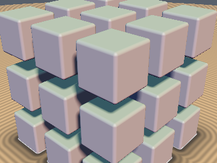&nbsp;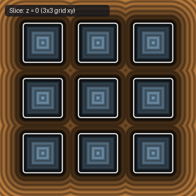 | [**`opRep`**](opRep.md) [`glsl`](../../glsl/repetition/opRep.glsl) · Symmetric | **Also**: `opRepLim`. 1-tap Cartesian repetition, pure-float `opRepMirror`, and clamped-floor `opRepLimBase` |
| 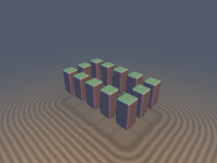&nbsp;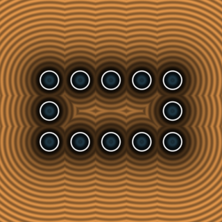 | [**`opRepPerimeter`**](opRepPerimeter.md) [`glsl`](../../glsl/repetition/opRepPerimeter.glsl) · **Exact** | **Also**: `opRepPerimeter2Tap`. 1-tap & corner-aware 2-tap rectangular perimeter repetition (fixes $`200\%`$ non-square $`l_x \ne l_y`$ error in IQ's `sdfrepetition`) |
| 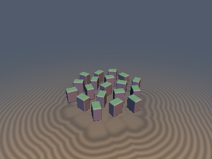&nbsp;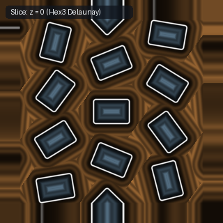 | [**`opRep2D`**](opRep2D.md) [`glsl`](../../glsl/repetition/opRep2D.glsl) · **Exact** | **Also**: `opRepHex3`. 3-tap 1-`round` 2D hexagonal Delaunay repetition (`100%` simplex containment, `0` `dot2`, $`25\%`$ fewer taps) |
| 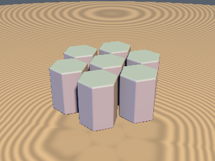&nbsp;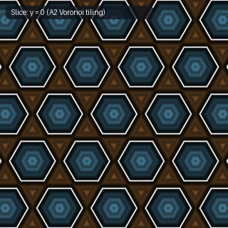 | [**`opRepHex`**](opRepHex.md) [`glsl`](../../glsl/repetition/opRepHex.glsl) · **Symmetric** | 1-tap 2D hexagonal ($`A_2`$) Voronoi folding via linear test $`\Vert d_x\Vert + 3\Vert d_y\Vert > 1`$ (`1` `round`, `0` `dot2`) |
| 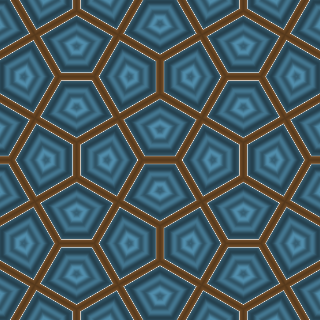&nbsp;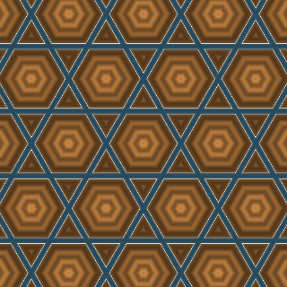 | [**`opRepCairo`**](opRepCairo.md) [`glsl`](../../glsl/repetition/opRepCairo.glsl) · **Exact** | **Also**: `sdCairoCell2D`, `opRepCairo4TapIDs`, `opRepKagome`, `opRepFibonacciSphere`. 0-trig, 0-`sqrt` seamless Cairo pentagonal & Trihexagonal Kagome tilings, plus $`O(1)`$ 0-loop Spherical Fibonacci lattice repetition ($`100\%`$ nearest-point match) |
| &nbsp;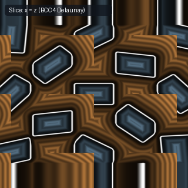 | [**`opRep3D`**](opRep3D.md) [`glsl`](../../glsl/repetition/opRep3D.glsl) · **Exact** | **Also**: `opRepBCC4`. 4-tap 3D BCC Kuhn-simplex Delaunay repetition ($`2\times`$ faster than 8-tap Cartesian) |
| 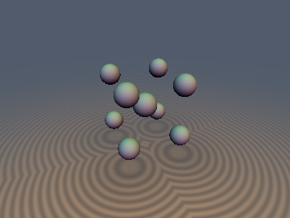&nbsp;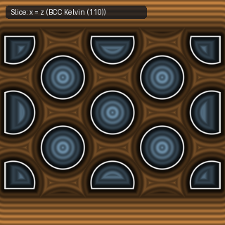 | [**`opRepBCC`**](opRepBCC.md) [`glsl`](../../glsl/repetition/opRepBCC.glsl) · Symmetric | 1-tap 3D BCC Kelvin-cell folding via linear L1 test $`\Vert r_x\Vert +\Vert r_y\Vert +\Vert r_z\Vert > 0.75`$ ($`68.02\%`$ sphere packing) |
| 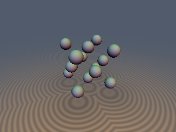&nbsp;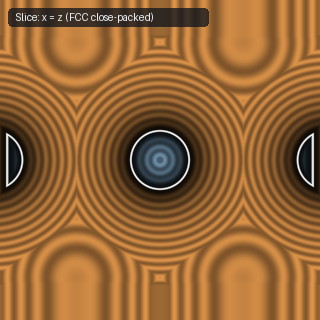 | [**`opRepFCC`**](opRepFCC.md) [`glsl`](../../glsl/repetition/opRepFCC.glsl) · Symmetric | 1-tap 3D FCC Rhombic-Dodecahedron parity folding ($`74.05\%`$ optimal sphere packing) |
| 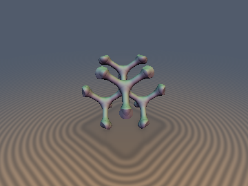&nbsp;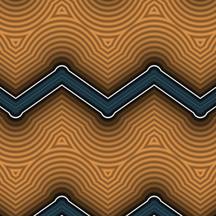 | [**`opRepDiamond`**](opRepDiamond.md) [`glsl`](../../glsl/repetition/opRepDiamond.glsl) · **Exact** | **Also**: `opRepDiamondID`, `sdDiamondVoronoiCell`, `sdDiamondLattice3D`, `sdgDiamondLattice3D`, `opRepHCP`, `opRepHCPID`, `sdHCPVoronoiCell`. 0-loop, 0-`sqrt` Diamond Cubic ($`Fd\bar{3}m`$) & HCP ($`P6_3/mmc`$) Voronoi repetition, exact 1-`sqrt` diamond-strut TPMS lattice, & 16-/12-face Voronoi polyhedra |
| 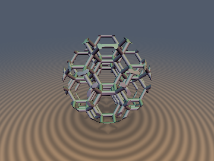 | [**`sdKelvinFoam`**](sdKelvinFoam.md) [`glsl`](../../glsl/repetition/sdKelvinFoam.glsl) · **Exact** | **Also**: `sdgKelvinFoam`, `sdRhombicFoam`, `sdgRhombicFoam`, `sdOctetTruss`, `sdgOctetTruss`, `sdBCCTruss`, `sdgBCCTruss`. 0-loop, 1-`sqrt` exact 3D Euclidean Kelvin BCC tetrakaidecahedral foam (36 struts), FCC rhombic dodecahedral foam (24 struts), and 0-clamp FCC octet truss |
| 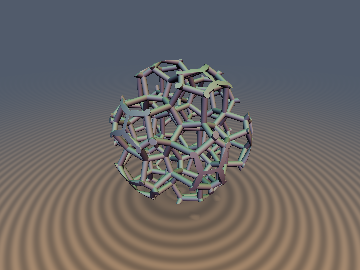 | [**`sdWeairePhelanFoam`**](sdWeairePhelanFoam.md) [`glsl`](../../glsl/repetition/sdWeairePhelanFoam.glsl) · **Exact** | **Also**: `sdgWeairePhelanFoam`, `sdWeairePhelanWalls`, `sdgWeairePhelanWalls`, `opRepA15`. 0-loop Weaire-Phelan A15 ($`Pm\bar{3}n`$, Water Cube) minimal-area foam: 0-`sqrt` 3-site Voronoi/Laguerre cell folding (`100%` ID match vs 216 sites), 0-`sqrt` 54-wall sheet network ($`A/V^{2/3}=5.297`$ vs Kelvin $`5.315`$), & 1-`sqrt` exact Euclidean 92-strut skeleton (`5.1e-8` FP32 err) |
| 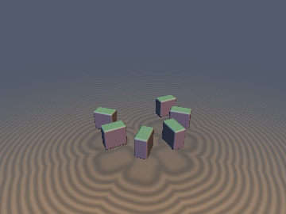&nbsp;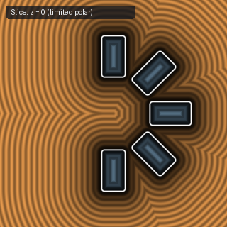 | [**`opRepPolar`**](opRepPolar.md) [`glsl`](../../glsl/repetition/opRepPolar.glsl) · **Exact** | **Also**: `opRepPolarLim`, `opFoldPolar3..12`, `opRepPolar3..12`. 0-`sqrt` direct-rotation polar repetition (`mat2(c,-s,s,c)*p`), 2-tap limited polar, & 0-trig constructible $`D_n`$/$`C_n`$ sector folds |
| 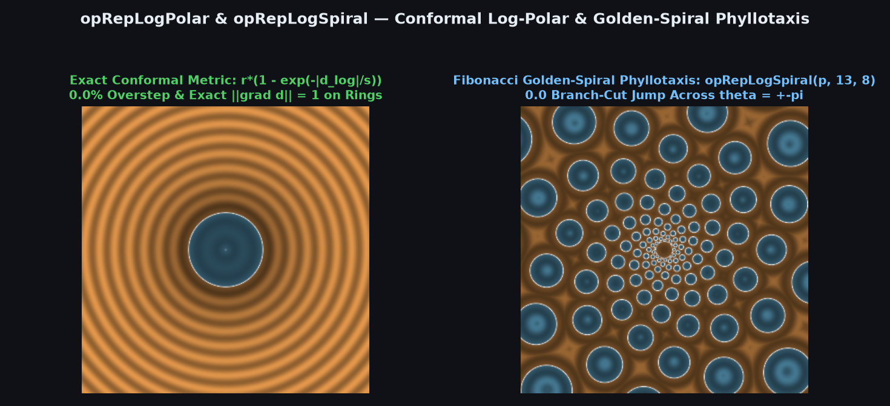 | [**`opRepLogPolar`**](opRepLogPolar.md) [`glsl`](../../glsl/repetition/opRepLogPolar.glsl) · **Exact** | **Also**: `opRepLogPolarLim`, `opRepLogSpiral`, `opRepLogSpiral4Tap`, `sdLogPolarMetric`. Conformal log-polar & branch-cut-free Gaussian-integer golden-spiral / phyllotaxis repetition with exact exponential metric ($`0.0\%`$ overstep) |
| 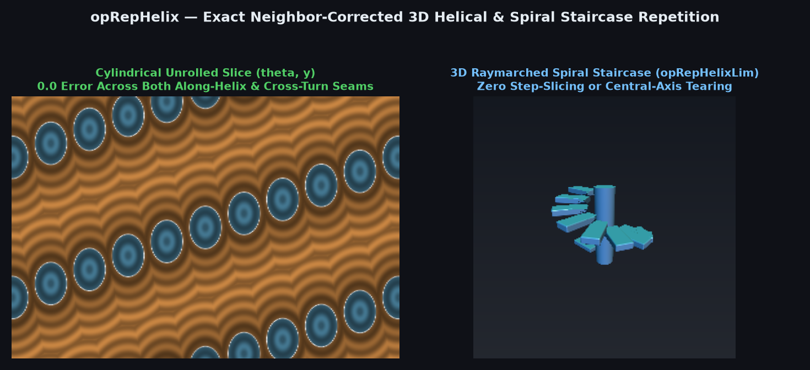 | [**`opRepHelix`**](opRepHelix.md) [`glsl`](../../glsl/repetition/opRepHelix.glsl) · **Exact** | **Also**: `opRepHelixLim`, `opRepHelix2Tap`, `opRepHelix4Tap`. Neighbor-corrected 3D helical & spiral-staircase repetition via parabolic secant-chord projection (`0.0` error across along-helix & cross-turn seams) |
| 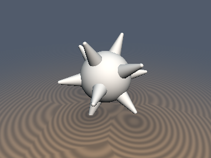&nbsp;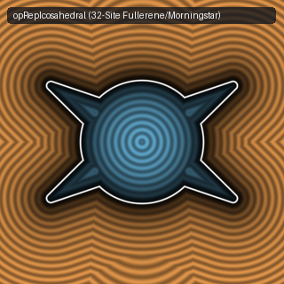 | [**`opRepIcosahedral`**](opRepIcosahedral.md) [`glsl`](../../glsl/repetition/opRepIcosahedral.glsl) · **Exact** | 1-to-3-tap spherical polyhedral ($`I_h`$ order 120 & $`O_h`$ order 48) repetition for 12/20/30/32/62 geodesic instances |

## Quasicrystals, Theta Sums, Self-Similar Fractals & Arithmetic Packings

| Preview | Function | Summary |
| :---: | :--- | :--- |
| 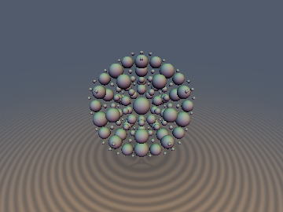 | [**`opRepQuasicrystal`**](opRepQuasicrystal.md) [`glsl`](../../glsl/repetition/opRepQuasicrystal.glsl) · Bound / **Exact** for r ≥ 1/2 (measured) | **Also**: `opRepQuasi6`, `sdQuasicrystalBalls`, `sdQuasicrystalBallsCorners`, `sdQuasicrystalCells`, `opRepPenrose2D`, `opRepAmmannBeenker2D`. Cut-and-project repetition: an irrational 3D slice of $`\mathbb{Z}^6`$ gives seam-free icosahedral quasicrystals; 1-`sqrt` 1-Lipschitz bound, plus a certified 64-corner search that matches brute force for $`r \ge 1/2`$ |
| 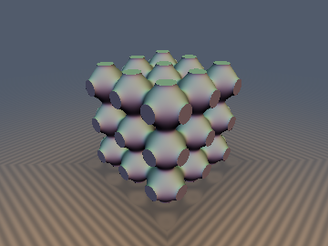 | [**`sdThetaLattice`**](sdThetaLattice.md) [`glsl`](../../glsl/repetition/sdThetaLattice.glsl) · Bound (SC proven, BCC/FCC measured) | **Also**: `sdgThetaLatticeSC`, `sdThetaLatticeBCC`, `sdThetaLatticeFCC`, `thetaLatticeSoftSq1D`. Seamless smooth union of an entire SC / BCC / FCC sphere lattice via Jacobi theta sums with a closed-form Lipschitz normalisation; the softness morphs spheres into the Schwarz-P nodal surface. Conservative and loose on fused surfaces, not an exact SDF |
| 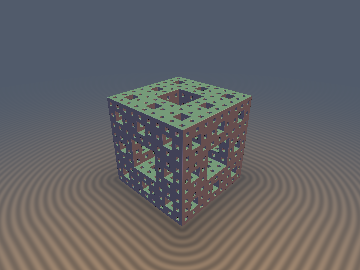 | [**`sdFractalExact`**](sdFractalExact.md) [`glsl`](../../glsl/repetition/sdFractalExact.glsl) · **Exact** (Menger to level 5; bound beyond) | **Also**: `sdSierpinski2D`, `sdSierpinskiTetra`, `sdMengerExact`, `sdMengerGreedy`, `sdMengerExactLod`. Exact level-$`n`$ SDFs of self-similar sets by symmetry-pruned descent of the IFS tree: Sierpinski triangle and tetrahedron on a single path, Menger sponge on a 2-way folded tree with a signed interior; the classic max-of-crosses estimator is off by up to 0.14 |
| 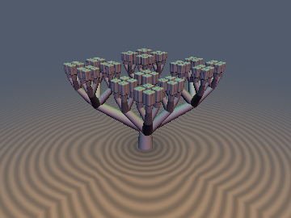 | [**`paUltrametricTree`**](paUltrametricTree.md) [`glsl`](../../glsl/repetition/paUltrametricTree.glsl) · **Exact** (Cantor & $`2\alpha-\alpha^n\le 1`$ trees) | **Also**: `sdCantorDust1D`, `sdgCantorDust1D`, `sdCantorDust3D`, `sdgCantorDust3D`, `sdBruhatTitsTree2D`, `sdBruhatTitsTree3D`, `sdBruhatTitsCanopy3D`, `sdMonnaTerrain3D`. Exact 1-`sqrt` 3D $`p`$-adic Cantor dust ($`8^n`$ cubes with 0 backtracking), Bruhat-Tits tree skeletons with exact Voronoi bisector containment ($`2\alpha-\alpha^n\le 1`$), and 1-Lipschitz Monna wavelet terrains |
| 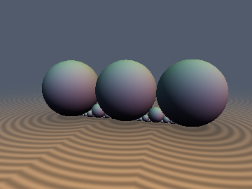 | [**`moFordCircles`**](moFordCircles.md) [`glsl`](../../glsl/repetition/moFordCircles.glsl) · **Exact** | **Also**: `sdFordCircles2D`, `sdgFordCircles2D`, `sdFordHoroballs2D`, `sdFordSpheres3D`, `sdgFordSpheres3D`, `sdFareyArch3D`. Exact Euclidean SDF to $`\mathrm{PSL}(2,\mathbb{Z})`$ Ford circles and 3D horoballs via Stern-Brocot horocycle dominance (`0` off-path misses) and 0-SFU Laguerre-horocycle polynomial pruning |
