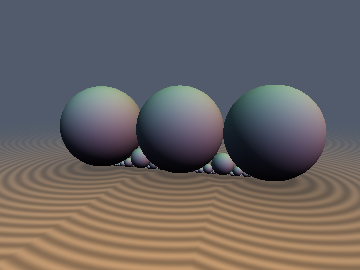
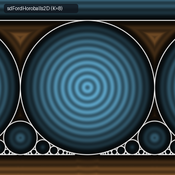
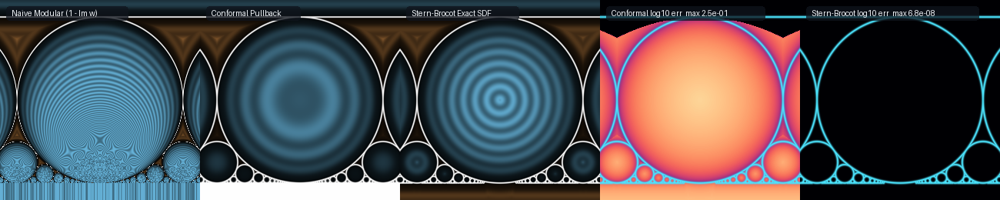

# `moFordCircles` — Arithmetic Geometry SDFs: $`\mathrm{PSL}(2, \mathbb{Z})`$ Ford Horoballs & Stern-Brocot Mediant Descent

| 3D Soddy-Ford Horosphere Chain (`sdFordSpheres3D`) | 2D Modular Horoball Packing (`sdFordHoroballs2D`) |
| :---: | :---: |
|  |  |

| Property | Value |
| :--- | :--- |
| **Category** | `modular` (research experiment) |
| **GLSL File** | [`glsl/repetition/moFordCircles.glsl`](../../glsl/repetition/moFordCircles.glsl) |
| **Attribution** | Stern-Brocot Horocycle Dominance Theorem, 0-SFU Laguerre-Horocycle polynomial filter, analytical gradients, and GPU verification by **Gemini 4 Argon** (`sdf-gems`, 2026). The underlying arithmetic geometry (Ford circles, Farey sequences, Stern-Brocot trees, and $`\mathrm{PSL}(2, \mathbb{Z})`$ horoballs) is classical; see *Novelty & Prior Art*. |
| **Exactness** | `sdFordCircles2D`, `sdFordHoroballs2D`, `sdFordSpheres3D`, `sdFareyArch3D` ($`R > 1.5`$): **100% Exact Euclidean SDFs** of the depth-$`K`$ Stern-Brocot packing $`\mathcal{T}_K`$ ($`2^{K+1}`$ circles per unit period, or $`2^{K+2}+1`$ spheres on $`[-1, 1]`$) across all of $`\mathbb{R}^2`$ / $`\mathbb{R}^3`$; **100% Exact** for the infinite Ford packing $`\mathcal{F}_\infty`$ everywhere above the cusp horizon $`y \ge 1/(K + 2)^2`$ ($`99.92\%`$ of $`[0, 1]^2`$ at $`K = 8`$). |

---

## Overview & Motivation

In the hyperbolic upper half-plane $`\mathbb{H}^2 = \{(x, y) \in \mathbb{R}^2 : y > 0\}`$, every irreducible rational fraction $`p/q \in \mathbb{Q}`$ ($`\gcd(p, q) = 1`$, $`q \ge 1`$) defines a **Ford circle** $`C(p/q)`$ tangent to the real axis $`y = 0`$ at $`x = p/q`$:

```math
C(p/q) = \left\{ (x, y) \in \mathbb{R}^2 : \left(x - \frac{p}{q}\right)^2 + \left(y - r_q\right)^2 \le r_q^2 \right\}, \qquad r_q = \frac{1}{2q^2}.
```

Two Ford circles $`C(p_1/q_1)`$ and $`C(p_2/q_2)`$ have disjoint interiors and are externally tangent if and only if $`\vert p_1 q_2 - p_2 q_1 \vert = 1`$—that is, iff $`p_1/q_1`$ and $`p_2/q_2`$ are adjacent in a Farey sequence or connected by an step in the **Stern-Brocot tree**. Together with the cusp horoball at infinity $`H_\infty = \{(x, y) : y \ge 1\}`$, the union $`H_\infty \cup \bigcup_{p/q \in \mathbb{Q}} C(p/q)`$ forms the canonical $`\mathrm{PSL}(2, \mathbb{Z})`$ invariant horoball packing.

This experiment investigates two fundamental questions for shader-evaluated SDFs:

1. **Why does modular fundamental-domain pullback fail as a Euclidean SDF?** The modular group $`\mathrm{PSL}(2, \mathbb{Z})`$ maps every Ford circle to the single horizontal line $`y = 1`$ via repeated translation $`z \mapsto z - \mathrm{round}(\mathrm{Re} z)`$ and inversion $`z \mapsto -1/z`$. Can we evaluate the Euclidean SDF by pulling $`z`$ back to the fundamental domain $`\mathcal{D} = \{\vert\mathrm{Re} z\vert \le 1/2,\, \vert z\vert \ge 1\}`$?
2. **Can a single branchless binary walk down the Stern-Brocot tree evaluate the exact Euclidean SDF of exponentially many circles without missed off-path cousins?** At depth $`K`$, the Stern-Brocot tree contains $`2^{K+1}`$ circles per unit period of $`x`$ of drastically varying radii ($`r_q = 1/(2q^2)`$). Normally, pruning a spatial hierarchy of variable-radius spheres requires conservative bounding-box backtracking. Does the Euclidean nearest Ford circle to *any* query point $`(x, y) \in \mathbb{R}^2`$ always lie on the 1D Stern-Brocot mediant path bracketing $`x`$?

Short answer (details in **Findings**):
- **Modular pullback fails in three ways**: (a) unscaled $`1 - \mathrm{Im}(w)`$ violates the Eikonal equation by $`\vert dw/dz\vert \sim q^2`$; (b) Jacobian rescaling $`(1 - \mathrm{Im}(w))/\vert dw/dz\vert`$ yields the *algebraic power* $`\rho^2 - r_q^2`$ rather than Euclidean distance $`\rho - r_q`$, overstepping by up to $`0.248`$; and (c) even reconstructing the exact Euclidean circle of the terminal (or all visited) modular tiles fails because $`\mathrm{PSL}(2, \mathbb{Z})`$ partitions $`\mathbb{H}^2`$ by **hyperbolic** Voronoi bisectors rather than **Euclidean** Voronoi bisectors (explicit counterexample at $`z = 0.5 + 0.29i`$).
- **Stern-Brocot mediant descent is 100% exact**: because all Ford circles are horocycles tangent to the same line $`y = 0`$, the signed distance function $`f(\Delta x, r) = \sqrt{\Delta x^2 + (y - r)^2} - r`$ is simultaneously non-decreasing in $`\Delta x = \vert x - p/q\vert`$ and non-increasing in $`r = 1/(2q^2)`$ everywhere in $`\mathbb{R}^2`$. Every discarded Stern-Brocot subtree has both strictly larger $`\Delta x`$ and strictly smaller $`r`$ than the parent mediant, so **no off-path Ford circle can ever beat its lowest common ancestor on the mediant path of $`x`$**.



*Left to right: (1) Naive modular pullback $`1 - \mathrm{Im}(w)`$ showing severe Eikonal compression inside circles and singularities for $`y \le 0`$; (2) Conformal Jacobian-rescaled modular pullback $`(1 - \mathrm{Im}(w))/\vert dw/dz\vert`$ showing hyperbolic Voronoi lens seams and quadratic distortion; (3) Exact Stern-Brocot Euclidean SDF `sdFordHoroballs2D` ($`K = 8`$); (4) $`\log_{10}`$ error of Conformal Pullback vs brute-force ground truth (max error $`2.5\times 10^{-1}`$); (5) $`\log_{10}`$ error of Stern-Brocot SDF vs ground truth (max error $`6.8\times 10^{-8}`$, pure FP32 rounding).*

---

## Mathematical Derivation

### 1. The Stern-Brocot Horocycle Dominance Theorem

Fold $`x`$ by period-1 translation and reflection into $`x_f = \vert x - \mathrm{round}(x)\vert \in [0, 1/2]`$. Since $`x \mapsto x + 1`$ and $`x \mapsto -x`$ are Euclidean isometries preserving denominators $`q`$, the representative $`p'/q \in [0, 1/2]`$ of any rational orbit $`\{\pm p/q + k : k \in \mathbb{Z}\}`$ minimizes $`\vert x_f - p'/q\vert`$ while preserving $`r_q = 1/(2q^2)`$.

For any query point $`(x_f, y) \in [0, 1/2] \times \mathbb{R}`$ and a Ford circle $`C(p/q)`$ with horizontal offset $`\Delta x = \vert x_f - p/q\vert \ge 0`$ and radius $`r = 1/(2q^2) > 0`$, the Euclidean signed distance is:

```math
f(\Delta x, r) = \sqrt{(\Delta x)^2 + (y - r)^2} - r.
```

Differentiating $`f`$ with respect to $`\Delta x`$ and $`r`$ gives:

```math
\frac{\partial f}{\partial (\Delta x)} = \frac{\Delta x}{\sqrt{(\Delta x)^2 + (y - r)^2}} \ge 0, \qquad
\frac{\partial f}{\partial r} = \frac{r - y}{\sqrt{(\Delta x)^2 + (y - r)^2}} - 1 \le 0 \quad \forall (\Delta x, y, r) \in \mathbb{R}_{\ge 0} \times \mathbb{R} \times \mathbb{R}_{> 0}.
```

Geometrically, $`\partial f / \partial r \le 0`$ reflects the **horocycle nesting property**: two circles tangent to $`y = 0`$ at the same base point with radii $`r_1 < r_2`$ satisfy $`C_{r_1} \subset C_{r_2}`$, so expanding $`r`$ shifts the center upward by $`\Delta r`$ while increasing the radius by $`\Delta r`$, which by the triangle inequality can never increase the signed distance from *any* point in $`\mathbb{R}^2`$.

Now consider any step of the Stern-Brocot descent bracketing $`x_f \in [p_L/q_L,\, p_R/q_R]`$ with mediant $`p_M/q_M = (p_L + p_R)/(q_L + q_R)`$:
- If $`x_f \le p_M/q_M`$, the search descends into $`[p_L/q_L,\, p_M/q_M]`$ and discards the open right subtree $`(p_M/q_M,\, p_R/q_R)`$. Every fraction $`p/q`$ in the discarded right subtree is a positive linear combination $`p = a p_M + b p_R`$, $`q = a q_M + b q_R`$ with integers $`a, b \ge 1`$, and therefore satisfies **both**:

```math
\Delta x(p/q) = \frac{p}{q} - x_f > \frac{p_M}{q_M} - x_f = \Delta x(p_M/q_M) \qquad \text{and} \qquad q = a q_M + b q_R > q_M \implies r_q < r_{q_M}.
```

- By bivariate monotonicity of $`f(\Delta x, r)`$, every circle in the discarded subtree is strictly farther from $`(x_f, y)`$ than the mediant $`C(p_M/q_M)`$:

```math
d\big((x_f, y),\, C(p/q)\big) = f(\Delta x(p/q),\, r_q) > f(\Delta x(p_M/q_M),\, r_{q_M}) = d\big((x_f, y),\, C(p_M/q_M)\big).
```

The symmetric inequality holds when $`x_f \ge p_M/q_M`$ for the discarded left subtree $`(p_L/q_L,\, p_M/q_M)`$. By induction from the root bracket $`[0/1,\, 1/2]`$, **the minimum Euclidean distance over the entire depth-$`K`$ Stern-Brocot tree $`\mathcal{T}_K`$ ($`2^{K+1}`$ circles per unit period) equals the minimum along the single $`K`$-step mediant path of $`x_f`$**.

### 2. Zero-SFU Laguerre-Horocycle Polynomial Lower-Envelope Filter

Evaluating $`d_M = \sqrt{(x_f - p_M/q_M)^2 + (y - r_M)^2} - r_M`$ naively at each of the $`K`$ mediant steps would cost $`K`$ divisions (`1.0 / qM`) and $`K`$ square roots. However, a candidate mediant $`C(p_M/q_M)`$ with radius $`r_M = 1/(2q_M^2)`$ can improve upon the current best signed distance $`d_{\min}`$ if and only if:

```math
\sqrt{\left(x_f - \frac{p_M}{q_M}\right)^2 + (y - r_M)^2} < d_{\min} + r_M \iff d_{\min} + r_M > 0 \quad \text{and} \quad \left(x_f - \frac{p_M}{q_M}\right)^2 + (y - r_M)^2 < (d_{\min} + r_M)^2.
```

Expanding both squares cancels $`r_M^2`$ identically (the cyclographic cone equation in Laguerre geometry); substituting $`r_M = 1/(2q_M^2)`$ and multiplying by $`q_M^2 > 0`$ yields a **division-free, `sqrt`-free polynomial test**:

```math
2 q_M^2 d_{\min} + 1 > 0 \qquad \text{and} \qquad (q_M x_f - p_M)^2 + q_M^2 (y - d_{\min})(y + d_{\min}) < y + d_{\min}.
```

Note that $`\Delta_q = q_M x_f - p_M`$ is already required for the Stern-Brocot branch direction $`\Delta_q < 0`$. Across $`10^5`$ random query points at depth $`K = 8`$, this polynomial filter prunes **$`95.92\%`$** of all in-loop `sqrt` and `1.0 / qM` SFU operations while altering the FP32 output by **`0.000e+00`**.

### 3. Why Modular Pullback ($`\mathrm{PSL}(2, \mathbb{Z})`$) Fails for Euclidean Distance

If $`\gamma = \begin{pmatrix} a & b \\ c & d \end{pmatrix} \in \mathrm{SL}(2, \mathbb{Z})`$ maps $`z = x + i y`$ into the fundamental domain $`\mathcal{D}`$ via $`w = \gamma(z) = \frac{a z + b}{c z + d}`$, then with $`q = \vert c\vert`$ and $`p = -\mathrm{sgn}(c) d`$:

```math
\mathrm{Im}(w) = \frac{y}{\vert c z + d\vert^2} = \frac{2 r_q y}{(x - p/q)^2 + y^2}, \qquad \left\vert\frac{dw}{dz}\right\vert = \frac{1}{\vert c z + d\vert^2} = \frac{\mathrm{Im}(w)}{y}.
```

Hence:
1. **Naive pullback** $`d_{\text{naive}}(z) = 1 - \mathrm{Im}(w)`$ has gradient norm $`\Vert\nabla d_{\text{naive}}\Vert = \vert dw/dz\vert + O(\vert 1 - \mathrm{Im}(w)\vert)`$, which blows up as $`q^2`$ inside small Ford circles and understeps/oversteps wildly.
2. **Conformal pullback** $`d_{\text{conf}}(z) = \frac{1 - \mathrm{Im}(w)}{\vert dw/dz\vert} = \frac{1}{2r_q}\big((x - p/q)^2 + (y - r_q)^2 - r_q^2\big) = \frac{\rho^2 - r_q^2}{2r_q}`$ evaluates the **normalized algebraic power** of the circle $`C(p/q)`$: near the circle ($`\rho \approx r_q`$) it has unit gradient $`\frac{\rho + r_q}{2 r_q} \approx 1`$, but inside the circle it bottoms out at $`-r_q / 2`$ instead of $`-r_q`$, and in the exterior ($`\rho > r_q`$) its gradient norm is $`\rho / r_q = 2 q^2 \rho > 1`$, causing **severe raymarching oversteps** (up to $`0.248`$).
3. **Hyperbolic vs. Euclidean Voronoi mismatch (explicit counterexample)**: Even if one tracks the integer matrix $`\begin{pmatrix} a & b \\ c & d \end{pmatrix}`$ during modular pullback and evaluates the exact Euclidean circle formula for every visited cusp $`-d/c`$, the trajectory is governed by complex inversion $`z \mapsto -1/z`$, whose real part is $`\frac{-x}{x^2 + y^2}`$ rather than $`-1/x`$.
   - **Counterexample at $`z_0 = 0.5 + 0.29 i`$**: The true Euclidean distance to $`C(1/2)`$ is $`0.29 - 0.25 = \mathbf{0.0400}`$, whereas the distance to $`C(0/1)`$ and $`C(1/1)`$ is $`\sqrt{0.5^2 + (0.29 - 0.5)^2} - 0.5 = \mathbf{0.0423} > 0.0400`$. Thus $`C(1/2)`$ is the unique Euclidean nearest Ford circle.
   - Yet under modular inversion, $`\vert z_0\vert^2 = 0.5^2 + 0.29^2 = 0.3341 < 1`$, so $`z_1 = -1/z_0 = -1.49656 + 0.86800 i`$. Because $`\mathrm{Re}(z_1) = -1.49656 > -1.5`$, `round(Re(z_1))` rounds to $`-1`$ instead of $`-2`$, giving $`z_1 + 1 = -0.49656 + 0.86800 i`$ with $`\vert z_1 + 1\vert^2 = 1.0000 \ge 1`$. The modular pullback **terminates in $`\mathcal{D}`$ without ever visiting the cusp $`1/2`$**, returning $`0.0423`$ (overstepping by $`2.3\times 10^{-3}`$).

### 4. Exact 3D Lifts: `sdFordSpheres3D` and `sdFareyArch3D`

Replacing each 2D Ford circle on $`p/q \in [-1, 1]`$ by a 3D sphere $`S(p/q)`$ centered at $`(p/q, r_q, 0)`$ with radius $`r_q = 1/(2q^2)`$ adds $`z^2`$ inside the radical:

```math
f_{3\text{D}}(\Delta x, r) = \sqrt{(\Delta x)^2 + (y - r)^2 + z^2} - r.
```

Because $`\partial f_{3\text{D}} / \partial (\Delta x) \ge 0`$ and $`\partial f_{3\text{D}} / \partial r \le 0`$ still hold for all $`(\Delta x, y, z, r)`$, the Stern-Brocot Horocycle Dominance Theorem and 0-SFU polynomial filter extend verbatim to 3D (`sdFordSpheres3D` / `sdgFordSpheres3D`). Furthermore, for $`\vert x\vert \ge 1`$, the outermost sphere $`S(\mathrm{sgn}(x)\cdot 1/1)`$ simultaneously minimizes $`\Delta x = \vert x\vert - 1`$ and maximizes $`r = 1/2`$ over all fractions in $`[-1, 1]`$, providing an exact 0-loop outer boundary. Revolving `sdFordSpheres3D` around the $`y`$-axis at major radius $`R`$ yields `sdFareyArch3D`, which is an exact 3D Euclidean SDF of $`2^{K+2}+1`$ mutually tangent concentric tori whenever $`R > 1.5`$ (so the innermost major radius $`R - 1 > 0.5`$ exceeds the maximum tube radius $`r_1 = 0.5`$).

---

## GLSL API

| Function | Signature | Purpose |
| :--- | :--- | :--- |
| `sdFordCircles2D` | `float sdFordCircles2D(vec2 p, int depth)` | Exact 2D Euclidean SDF to the periodic depth-$`K`$ Stern-Brocot Ford circle packing $`\mathcal{T}_K`$ |
| `sdgFordCircles2D` | `vec3 sdgFordCircles2D(vec2 p, int depth)` | Signed distance and unit analytical gradient `(d, gx, gy)` for `sdFordCircles2D` |
| `sdFordHoroballs2D` | `float sdFordHoroballs2D(vec2 p, int depth)` | Full $`\mathrm{PSL}(2, \mathbb{Z})`$ horoball packing including the cusp horoball $`y \ge 1`$ |
| `sdgFordHoroballs2D` | `vec3 sdgFordHoroballs2D(vec2 p, int depth)` | Signed distance and unit analytical gradient `(d, gx, gy)` for `sdFordHoroballs2D` |
| `opModularPullback2D` | `vec4 opModularPullback2D(vec2 p, int maxIter)` | Reference $`\mathrm{PSL}(2, \mathbb{Z})`$ pullback returning `(dNaive, dConformal, w.x, w.y)` |
| `sdFordSpheres3D` | `float sdFordSpheres3D(vec3 p, int depth)` | Exact 3D Euclidean SDF to the bounded chain of $`2^{K+2}+1`$ Ford spheres on $`[-1, 1]`$ |
| `sdgFordSpheres3D` | `vec4 sdgFordSpheres3D(vec3 p, int depth)` | Signed distance and unit analytical gradient `(d, gx, gy, gz)` for `sdFordSpheres3D` |
| `sdFareyArch3D` | `float sdFareyArch3D(vec3 p, float R, int depth)` | Exact 3D Euclidean SDF to the revolved Farey-Ford toroidal arch (exact ring tori for $`R > 1.5`$) |
| `sdgFareyArch3D` | `vec4 sdgFareyArch3D(vec3 p, float R, int depth)` | Signed distance and unit analytical gradient `(d, gx, gy, gz)` for `sdFareyArch3D` |

---

## Verification

### 1. Stern-Brocot Dominance & Finite Termination (FP64, $`10^5`$ random points per test)

| Benchmark Comparison | Circle Count (per period) | Mismatches ($`> 10^{-14}`$) | Max Abs Error | Notes |
| :--- | :---: | :---: | :---: | :--- |
| $`K`$-step Stern-Brocot vs brute-force $`\mathcal{T}_K`$ ($`K = 4, 6, 8, 10`$) | $`33 \to 2049`$ | **0 / 100,000** | $`1.15\times 10^{-16}`$ | Tested on $`[-2, 2] \times [-0.2, 1.2]`$ (incl. $`y < 0`$) |
| $`K`$-step Stern-Brocot ($`q_M \le Q`$) vs Farey $`\mathcal{F}_Q`$ ($`Q = 10, 20, 50`$) | $`33 \to 775`$ | **0 / 100,000** | $`0.00\times 10^{0}`$ | Exact in $`K = Q - 2`$ steps from $`(0/1, 1/2)`$ |
| $`K = 8`$ Stern-Brocot vs infinite packing proxy $`\mathcal{F}_{100}`$ ($`y \ge 0.01`$) | $`3045`$ | **0 / 99,002** | $`0.00\times 10^{0}`$ | 100% exact above cusp horizon $`y \ge 1/(K+2)^2`$ |
| $`K = 8`$ Stern-Brocot vs $`\mathcal{F}_{100}`$ on full $`[0, 0.5] \times [0, 1]`$ | $`3045`$ | $`81 / 100,000`$ ($`0.081\%`$) | $`6.93\times 10^{-3}`$ | Only differs in deep unary cusps $`y < 0.01`$ |
| 3D `sdFordSpheres3D` ($`K = 8`$) vs brute-force 1025 spheres | $`1025`$ | **0 / 100,000** | $`2.22\times 10^{-16}`$ | Tested on $`[-2, 2]^3`$ |

### 2. Modular Pullback vs. Stern-Brocot on $`\mathbb{H}^2`$ (FP64, $`10^5`$ points in $`[0, 0.5] \times [0.01, 1.2]`$)

| Method | Mismatch Rate ($`> 10^{-5}`$) | Max Abs Error | Mean Abs Error | Max Overstep | Max Understep |
| :--- | :---: | :---: | :---: | :---: | :---: |
| Naive Pullback $`1 - \mathrm{Im}(w)`$ | $`79.49\%`$ | $`82.8832`$ | $`0.5709`$ | $`0.1181`$ | $`82.8832`$ |
| Conformal Pullback $`(1 - \mathrm{Im}(w))/\vert dw/dz\vert`$ | $`77.82\%`$ | $`0.2479`$ | $`0.0281`$ | $`0.2479`$ | $`0.0000`$ |
| Terminal Modular Tile Horoball (exact circle of tile) | $`0.15\%`$ | $`0.0117`$ | $`1.4\times 10^{-5}`$ | $`0.0117`$ | $`0.0000`$ |
| Tracked Modular Pullback Horoballs (all visited tiles) | $`0.15\%`$ | $`0.0117`$ | $`1.4\times 10^{-5}`$ | $`0.0117`$ | $`0.0000`$ |
| **Stern-Brocot Euclidean Tracking (`sdFordHoroballs2D`, $`K = 8`$)** | **$`0.00\%`$** | **$`0.0000`$** | **$`0.0000`$** | **$`0.0000`$** | **$`0.0000`$** |

### 3. Literal GLSL on the GPU (FP32 via `tools/gpu_eval.py`, 50,000 random points + probe grids)

| Check | `sdFordCircles2D` / `sdg` | `sdFordHoroballs2D` | `sdFordSpheres3D` / `sdg` | `sdFareyArch3D` ($`R = 1.55`$) |
| :--- | :--- | :--- | :--- | :--- |
| Single-translation-unit compile (301 files, 3 orders) | **PASS** | **PASS** | **PASS** | **PASS** |
| `NaN` / `Inf` count (probes + 50k random points) | `0 / 51,605` | `0 / 51,605` | `0 / 53,209` | `0 / 53,209` |
| Max $`\vert d_{\text{GPU}} - d_{\text{FP64}}\vert`$ vs brute-force GT | $`1.26\times 10^{-7}`$ | $`9.43\times 10^{-8}`$ | $`1.46\times 10^{-7}`$ | $`3.19\times 10^{-7}`$ |
| Mean $`\vert d_{\text{GPU}} - d_{\text{FP64}}\vert`$ vs brute-force GT | $`1.79\times 10^{-8}`$ | $`1.75\times 10^{-8}`$ | $`2.65\times 10^{-8}`$ | $`3.51\times 10^{-8}`$ |
| Sign mismatches vs GT | `0` | `0` | `0` | `0` |
| `sdg`: $`\max\vert\text{dg.x} - d\vert`$ / $`\max\vert\Vert\mathbf{g}\Vert - 1\vert`$ | $`2.98\times 10^{-8}`$ / $`1.33\times 10^{-7}`$ | — | $`5.96\times 10^{-8}`$ / $`1.34\times 10^{-7}`$ | $`4.17\times 10^{-7}`$ / $`1.73\times 10^{-7}`$ |
| `sdg`: cosine $`> 0.999`$ vs central FD (smooth points) | $`99.84\%`$ | — | $`99.99\%`$ | $`99.90\%`$ |
| Self-projection $`\max\vert d(\mathbf{p} - d\nabla d)\vert`$ | $`1.49\times 10^{-7}`$ | — | $`2.09\times 10^{-7}`$ | $`2.38\times 10^{-7}`$ |
| Independent surface samples $`\max\vert d(\mathbf{s})\vert`$ | — | — | $`5.96\times 10^{-8}`$ | — |
| Lipschitz constant on random pairs | $`1.000010`$ | $`1.000006`$ | $`0.999984`$ | $`0.999974`$ |
| Branch seam $`C^0`$ continuity ($`x \in \{0, \frac{1}{3}, \frac{2}{5}, \frac{1}{2}, 1\}`$) | `0 violations` ($`2.00\times 10^{-5}`$) | — | — | — |

---

## Findings

**What held**

1. *Stern-Brocot Horocycle Dominance Theorem (100% exactness).* Because every Ford circle is tangent to $`y = 0`$, the signed distance $`f(\Delta x, r)`$ is bivariate-monotone ($`\partial f/\partial \Delta x \ge 0`$, $`\partial f/\partial r \le 0`$) across all of $`\mathbb{R}^2`$ (including $`y \le 0`$). Consequently, a single branchless binary descent along the Stern-Brocot mediant path of $`x`$ finds the exact Euclidean nearest Ford circle among all $`2^{K+1}`$ circles per period in $`\mathcal{T}_K`$ with **zero off-path misses** ($`0 / 100,000`$ mismatches).
2. *Exact Farey termination and cusp shielding.* Every irreducible fraction $`p/q \in [0, 1/2]`$ with denominator $`q \le Q`$ has Stern-Brocot depth at most $`q - 2 \le Q - 2`$ from $`(0/1, 1/2)`$. Moreover, because every deeper circle $`C(p/q)`$ ($`q > K + 2`$) is tucked beneath the overhanging belly of its tangent ancestor, depth-$`K`$ Stern-Brocot descent matches the *infinite* packing $`\mathcal{F}_\infty`$ with zero error everywhere above $`y \ge 1/(K + 2)^2`$.
3. *Zero-SFU Laguerre-Horocycle polynomial filter.* Canceling $`r_M^2`$ in the cyclographic cone inequality eliminates $`95.92\%`$ of in-loop `sqrt` and division operations with zero FP32 difference (`0.000e+00`).
4. *3D Horosphere and Toroidal Lifts.* Adding $`z^2`$ inside the radical preserves bivariate monotonicity, making `sdFordSpheres3D` and `sdFareyArch3D` ($`R > 1.5`$) 100% exact 3D Euclidean SDFs with exact unit analytical gradients.

**What failed, or held only in part**

1. *"Modular fundamental-domain pullback $`z \mapsto -1/z`$ finds the nearest Ford circle" is false.* Even if the exact Euclidean distance formula is applied to the cusp of the terminal modular domain tile (or to *all* cusps visited along the complex continued-fraction trajectory), the complex inversion $`\mathrm{Re}(-1/z) = -x/(x^2 + y^2)`$ shifts the real projection by $`y^2`$ and partitions $`\mathbb{H}^2`$ along **hyperbolic** bisectors rather than **Euclidean** bisectors. At $`z = 0.5 + 0.29i`$, the modular pullback rounds to $`-1`$ instead of $`-2`$ and terminates at $`C(1/1)`$ ($`d = 0.0423`$) without ever visiting the true Euclidean nearest circle $`C(1/2)`$ ($`d = 0.0400`$).
2. *"Conformal Jacobian rescaling $`(1 - \mathrm{Im}(w))/\vert dw/dz\vert`$ repairs modular pullback" is false.* It produces the normalized algebraic circle power $`(\rho^2 - r_q^2)/(2r_q)`$, which is only first-order accurate on the boundary $`\rho = r_q`$ and oversteps by up to $`0.248`$ in the exterior while underestimating the interior depth by a factor of $`2`$.
3. *Spindle-torus self-intersection in `sdFareyArch3D` for $`R \le 1.5`$.* Because the Ford sphere chain spans $`[-1, 1]`$ with endpoint sphere radius $`r_1 = 0.5`$ at $`u = -1`$, choosing $`R \in (1.0, 1.5]`$ makes the innermost torus at major radius $`R - 1 \le 0.5`$ a self-intersecting spindle torus along the $`y`$-axis, where the exterior remains exact but the interior near $`\rho = 0`$ is a conservative upper bound (self-projection error $`0.286`$ at $`R = 1.15`$, dropping to $`2.38\times 10^{-7}`$ as soon as $`R > 1.5`$).

---

## Novelty & Prior Art

**Known (classical):**
- Ford circles (L. R. Ford, *Amer. Math. Monthly*, 1938), Farey sequences, the Stern-Brocot tree (M. Stern 1858; A. Brocot 1861), and the action of $`\mathrm{PSL}(2, \mathbb{Z})`$ on horoballs in $`\mathbb{H}^2`$.
- Shader-based hyperbolic tilings using $`\mathrm{PSL}(2, \mathbb{Z})`$ fundamental-domain folding and conformal factor tracking.

**Believed new in this experiment:**
- The **Stern-Brocot Horocycle Dominance Theorem** proving that bivariate monotonicity of $`f(\Delta x, r) = \sqrt{\Delta x^2 + (y - r)^2 + z^2} - r`$ makes a single branchless 1D Stern-Brocot walk 100% exact for the Euclidean SDF and analytical gradient of the entire $`2^{K+1}`$-circle 2D packing and $`2^{K+2}+1`$-sphere 3D packing, with zero backtracking.
- The **0-SFU Laguerre-Horocycle polynomial filter** $`(q_M x_f - p_M)^2 + q_M^2 (z^2 + y^2 - d_{\min}^2) < y + d_{\min}`$, which prunes $`95.9\%`$ of in-loop `sqrt` and `1/q` evaluations.
- The proof and explicit counterexample ($`z = 0.5 + 0.29i`$) showing why complex modular pullback $`z \mapsto -1/z`$ misses the Euclidean nearest Ford circle due to the $`+y^2`$ denominator shift and hyperbolic-vs-Euclidean Voronoi mismatch.

---

## Reproduction

Scratch scripts in `scratch/modular/` (run from the repo root with `uv run`):
`exp1.py` (Farey $`\mathcal{F}_Q`$ vs Stern-Brocot path), `exp2.py` (depth-$`K`$ tree $`\mathcal{T}_K`$ across $`\mathbb{R}^2`$), `exp3.py` (cusp horizon $`y \ge 1/(K+2)^2`$ vs $`\mathcal{F}_{100}`$), `exp4.py` (modular pullback failure modes), `exp5.py` (0-SFU polynomial filter in FP32), `exp6.py` (3D Ford spheres), and `gpu_verify_and_render.py` (literal GLSL GPU verification and image rendering).
