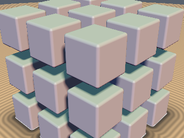
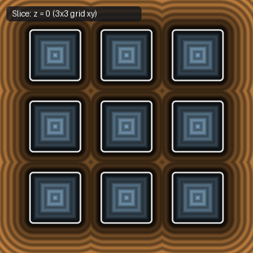

# `opRep` — Unlimited, Limited, Mirrored, Clamped-Floor Base, and 2-Tap Limited Repetition

| 3D Surface ($`f(p) = 0`$) | 2D Cross-Section Slice |
| :---: | :---: |
|  |  |

| Property | Value |
| :--- | :--- |
| **Author / Discoverer** | **Inigo Quilez — upgraded with `opRepMirror`, `opRepLimBase` & `opRepLim2Tap` using Gemini 4 Argon (`sdf-gems`, 2026)** |
| **Source** | [https://iquilezles.org/articles/sdfrepetition/](https://iquilezles.org/articles/sdfrepetition/) |
| **Category** | `repetition` |
| **GLSL File** | [`glsl/repetition/opRep.glsl`](../../glsl/repetition/opRep.glsl) |
| **Exact Euclidean SDF?** | Yes (symmetric SDFs for 1-tap; arbitrary SDFs with `opRepLim2Tap` or `opRepLimBase` $`2^d`$ loop) |

---

## Mathematical Overview

1. **`opRep` & `opRepLim`**: Folds space into periodic or clamped cubic cells via `round(p/s)`.
2. **`opRepMirror`**: Pure-floating-point alternating mirror repetition using `1.0 - 2.0 * mod(id, 2.0)` (replacing integer bitmasks `int(id)&1` which fail on negative float IDs or WebGL1).
3. **`opRepLimBase`**: Degenerate-safe clamped-floor base index `clamp(floor(p / s), lima, max(lima, limb - 1.0))` that guarantees $`2^d`$ distinct adjacent cells everywhere in $`\mathbb{R}^d`$ without undefined behavior when `lima.k == limb.k`.
4. **`opRepLim2Tap` (1D / 2D / 3D)**: By the **Separable 2nd-Closest Clamped Lattice Point Theorem**, because $`\|u - \mathbf{i}\|_2^2 = \sum_{k=1}^d (u_k - i_k)^2`$ is additive with 1D flip penalty $`\Delta_k = 2 |\delta_k| \ge 0`$ ($`\delta_k = u_k - (b_k + 0.5)`$), the global 2nd-closest lattice cell $`\mathbf{i}_1 \in [\mathbf{l}_a, \mathbf{l}_b] \setminus \{\mathbf{i}_0\}`$ differs from $`\mathbf{i}_0`$ in **strictly the single coordinate $`k^* = \arg\min_k \Delta_k`$**. This eliminates 100% of cell-wall tearing across all interior and exterior boundaries in only **2 SDF evaluations** (vs 4 in 2D or 8 in 3D).

---

## GLSL Implementation

See [`glsl/repetition/opRep.glsl`](../../glsl/repetition/opRep.glsl).
