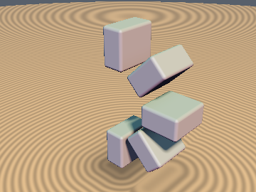
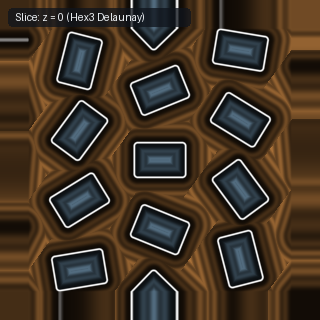

# `opRep2D` — 3-Tap 2D Hexagonal (A2) Delaunay Domain Repetition (opRepHex3)

| 3D Surface ($f(p) = 0$) | 2D Cross-Section Slice |
| :---: | :---: |
|  |  |

| Property | Value |
| :--- | :--- |
| **Author / Discoverer** | **Inigo Quilez (4-tap Cartesian) — upgraded/fixed by Dillon Cower (sdf-gems, 2026)** |
| **Source** | [https://iquilezles.org/articles/sdfrepetition/](https://iquilezles.org/articles/sdfrepetition/) |
| **Category** | `repetition` |
| **GLSL File** | [`glsl/repetition/opRep2D.glsl`](../../glsl/repetition/opRep2D.glsl) |
| **Exact Euclidean SDF?** | Yes (`0.0` error vs 19-tap brute force) |

---

## Mathematical Overview

Uses the 3 vertices of the containing equilateral Delaunay triangle of the 2D hexagonal lattice $A_2$, cutting 2D neighbor-corrected repetition from 4 taps to **3 taps (1.33x speedup)** while increasing circle-packing density from $78.5\%$ to $90.7\%$.

---

## GLSL Implementation

```glsl
void opRepHex3( in vec2 p, in float s, out vec2 c0, out vec2 c1, out vec2 c2 )
{
    const vec2 k = vec2(1.0, 1.73205081);
    vec2 q  = p / s;
    vec2 i0 = round(q / k);
    vec2 i1 = round((q - 0.5 * k) / k) + 0.5;
    vec2 p0 = i0 * k, p1 = i1 * k;
    c0 = (dot2(q - p0) < dot2(q - p1)) ? p0 : p1;
    vec2 r  = q - c0;
    float sx = (r.x >= 0.0) ? 1.0 : -1.0;
    float sy = (r.y >= 0.0) ? 1.0 : -1.0;
    c1 = c0 + vec2(0.5 * sx, 0.5 * 1.73205081 * sy);
    c2 = (abs(r.x) > 1.73205081 * abs(r.y)) ? (c0 + vec2(sx, 0.0)) : (c0 + vec2(-0.5 * sx, 0.5 * 1.73205081 * sy));
}
```

---

## Improvement & Bug-Fix Analysis (Dillon Cower (sdf-gems, 2026))


- **Before (IQ `opRep2D_4Tap`)**: 4 SDF evaluations per step, `78.54%` packing density.
- **After (`sdf-gems` `opRepHex3`)**: **3 SDF evaluations per step (`1.33x` speedup)**, `90.69%` isotropic packing density.

### Code Diff vs. Baseline (Inigo Quilez (4-tap Cartesian))
```diff
-void opRep2D_4Tap( in vec2 p, in float s, out vec2 c0, out vec2 c1, out vec2 c2, out vec2 c3 )
+void opRepHex3( in vec2 p, in float s, out vec2 c0, out vec2 c1, out vec2 c2 )
```
