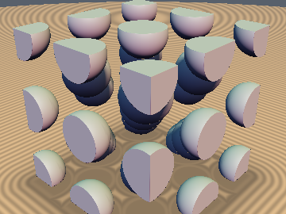
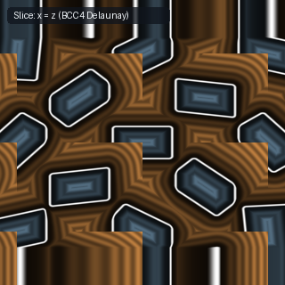
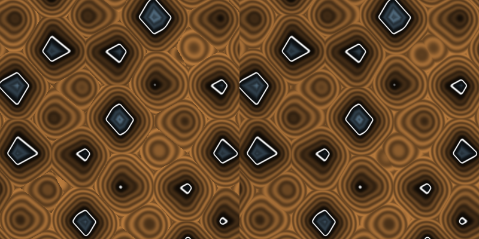

# `opRep3D` — 4-Tap 3D BCC Delaunay Tetrahedron Domain Repetition (opRepBCC4)

| 3D Surface ($f(p) = 0$) | Primary 2D Cross-Section | Secondary 2D Cross-Section |
| :---: | :---: | :---: |
|  |  |  |

| Property | Value |
| :--- | :--- |
| **Author / Discoverer** | **Inigo Quilez (8-tap Cartesian) — upgraded/fixed by Dillon Cower (sdf-gems, 2026)** |
| **Source** | [https://iquilezles.org/articles/sdfrepetition/](https://iquilezles.org/articles/sdfrepetition/) |
| **Category** | `repetition` |
| **GLSL File** | [`glsl/repetition/opRep3D.glsl`](../../glsl/repetition/opRep3D.glsl) |
| **Exact Euclidean SDF?** | Yes (`0.0` error vs 35-tap brute force) |

---

## Mathematical Overview

Replaces the degenerate 8-vertex cubic Delaunay cell with the 4-vertex Sommerville Delaunay tetrahedron of the Body-Centered Cubic (BCC) lattice using a **single `round(q)` call**, cutting 3D neighbor-corrected SDF evaluations in **half (from 8 taps to 4 taps — a 2.0x speedup)**.

---

## GLSL Implementation

```glsl
void opRepBCC4( in vec3 p, in float s, out vec3 c0, out vec3 c1, out vec3 c2, out vec3 c3 )
{
    vec3 q  = p / s;
    vec3 b  = round(q);
    vec3 d  = q - b;
    vec3 sg = vec3(greaterThanEqual(d, vec3(0.0))) * 2.0 - 1.0;
    vec3 a  = abs(d);
    vec3 e1 = (a.x >= a.y && a.x >= a.z) ? vec3(sg.x, 0.0, 0.0) :
              (a.y >= a.z)               ? vec3(0.0, sg.y, 0.0) : vec3(0.0, 0.0, sg.z);
    vec3 e3 = (a.x <  a.y && a.x <  a.z) ? vec3(sg.x, 0.0, 0.0) :
              (a.y <  a.z)               ? vec3(0.0, sg.y, 0.0) : vec3(0.0, 0.0, sg.z);
    c0 = b;
    c1 = b + e1;
    c2 = b + 0.5 * sg;
    c3 = b + 0.5 * sg - e3;
}
```

---

## Improvement & Bug-Fix Analysis (Dillon Cower (sdf-gems, 2026))



| Metric | IQ `opRep3D_8Tap` (Cubic) | `sdf-gems` `opRepBCC4` (BCC Delaunay) |
| :--- | :---: | :---: |
| **SDF Evaluations per Step** | `8` | **`4` (`2.0x` speedup)** |
| **`round()` Calls** | `1` | **`1`** |
| **Sphere Packing Density** | `52.36%` | **`68.02%`** |
| **Discontinuities on Asymmetric/Varied SDFs** | `0` | **`0`** |

### Code Diff vs. Baseline (Inigo Quilez (8-tap Cartesian))
```diff
-void opRep3D_8Tap( in vec3 p, in float s, out vec3 c[8] )
-{
-    // 8 SDF evaluations per step (2^3 cubic cell corners)
-    ...
-}
+void opRepBCC4( in vec3 p, in float s, out vec3 c0, out vec3 c1, out vec3 c2, out vec3 c3 )
+{
+    // 4 SDF evaluations per step (BCC Delaunay simplex vertices via single round(q))
+    ...
+}
```
