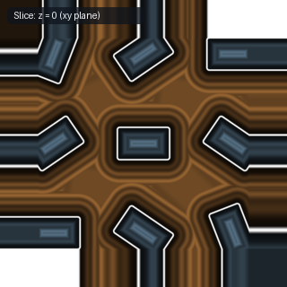

# `opRep3D` — 3D Neighbor-Corrected Domain Repetition (8-Tap Cartesian)

| 3D Surface ($f(p) = 0$) | Primary 2D Cross-Section | Secondary 2D Cross-Section |
| :---: | :---: | :---: |
|  |  |  |

| Property | Value |
| :--- | :--- |
| **Author / Discoverer** | **Inigo Quilez** |
| **Source** | [https://iquilezles.org/articles/sdfrepetition/](https://iquilezles.org/articles/sdfrepetition/) |
| **Category** | `repetition` |
| **GLSL File** | [`glsl/repetition/opRep3D.glsl`](../../glsl/repetition/opRep3D.glsl) |
| **Exact Euclidean SDF?** | Yes |

---

## Mathematical Overview

Evaluates all $2^3 = 8$ cubic lattice cells meeting at the nearest Voronoi corner.

---

## GLSL Implementation

```glsl
void opRep3D_8Tap( in vec3 p, in float s, out vec3 c[8] )
{
    vec3 q = p / s;
    vec3 id = round(q);
    vec3 o = sign(q - id);
    int idx = 0;
    for( int k = 0; k < 2; k++ )
    for( int j = 0; j < 2; j++ )
    for( int i = 0; i < 2; i++ )
        c[idx++] = id + vec3(i, j, k)*o;
}
```
