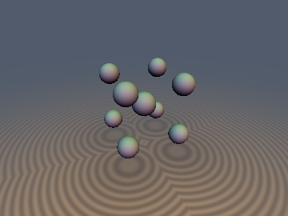
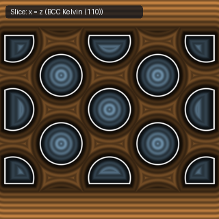
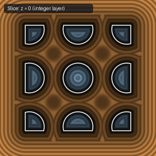

# `opRepBCC` — 1-Tap 3D Body-Centered Cubic (BCC) Kelvin-Cell Repetition

| 3D Surface ($f(p) = 0$) | Primary 2D Cross-Section | Secondary 2D Cross-Section |
| :---: | :---: | :---: |
|  |  |  |

| Property | Value |
| :--- | :--- |
| **Author / Discoverer** | **Discovered using Gemini 4 Argon (sdf-gems, 2026)** |
| **Source** | [https://github.com/dcower/sdf-gems](https://github.com/dcower/sdf-gems) |
| **Category** | `repetition` |
| **GLSL File** | [`glsl/repetition/opRepBCC.glsl`](../../glsl/repetition/opRepBCC.glsl) |
| **Exact Euclidean SDF?** | Yes (symmetric SDFs) |

---

## Mathematical Overview

Folds $\mathbb{R}^3$ into the exact Truncated Octahedron (Kelvin cell) Voronoi region of the BCC lattice using the linear $L_1$ inequality $|r_x| + |r_y| + |r_z| > 0.75$ (3 lines, 0 `sqrt`s, 0 dot products, $68.02\%$ sphere packing density).

---

## GLSL Implementation

```glsl
vec3 opRepBCC( in vec3 p, in float s )
{
    vec3 q  = p / s;
    vec3 p0 = round(q), r = q - p0;
    vec3 c  = (abs(r.x) + abs(r.y) + abs(r.z) > 0.75) ? (round(q - 0.5) + 0.5) : p0;
    return (q - c) * s;
}
```
