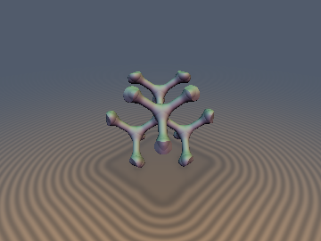
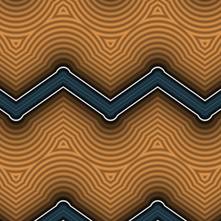
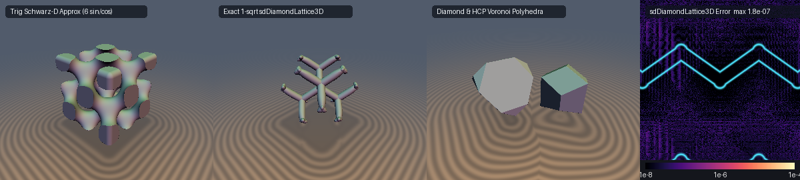

# `opRepDiamond` & `opRepHCP` — 0-Loop, 0-`sqrt` 3D Diamond Cubic ($Fd\bar{3}m$) & Hexagonal Close-Packed ($P6_3/mmc$) Crystal Lattice Repetitions

<p align="center">
  
  
</p>

| Property | Value |
| :--- | :--- |
| **Author / Discoverer** | **Discovered and derived using Claude Opus 5.5; audited and extended (analytical Voronoi cell gradients & axis hardening) using Gemini 4 Argon (`sdf-gems`, 2026)** |
| **Category** | `repetition` |
| **GLSL File** | [`glsl/repetition/opRepDiamond.glsl`](../../glsl/repetition/opRepDiamond.glsl) |
| **Exact Euclidean SDF?** | **Yes** (`0`-loop, `0`-`sqrt` exact nearest-site folding for $D^+$ Diamond & HCP lattices; exact `1`-`sqrt` infinite 3D Diamond Cubic strut network & analytical gradient; exact `0`-`sqrt` interior / `1`-`sqrt` exterior Voronoi polyhedra) |

---

## Before & After Comparison



---

## Mathematical Overview

### 1. 0-Loop, 0-`sqrt` 3D Diamond Cubic ($Fd\bar{3}m$) Nearest-Site Folding & Point-Inversion Alignment (`opRepDiamond`)

The 3D **Diamond Cubic crystal lattice** ($D^+$, space group $Fd\bar{3}m$, No. 227 — the atomic structure of carbon diamond, silicon, and germanium) is the union of two interlocking Face-Centered Cubic ($D_3$) sublattices scaled by $s$:
- **Sublattice $A$ ($\chi = +1$)**:
  $$\Lambda_A = \left\{ s\,\mathbf{i} : \mathbf{i} \in \mathbb{Z}^3,\; i_x + i_y + i_z \equiv 0 \pmod 2 \right\},$$
- **Sublattice $B$ ($\chi = -1$)**:
  $$\Lambda_B = \Lambda_A + \left(\frac{1}{2},\; \frac{1}{2},\; \frac{1}{2}\right) s.$$

Each site on $\Lambda_A$ is tetrahedrally coordinated by $4$ nearest neighbors on $\Lambda_B$ at offsets
$$\mathbf{v}_1 = \frac{s}{2}(+1, +1, +1), \quad \mathbf{v}_2 = \frac{s}{2}(+1, -1, -1), \quad \mathbf{v}_3 = \frac{s}{2}(-1, +1, -1), \quad \mathbf{v}_4 = \frac{s}{2}(-1, -1, +1)$$
(bond length $\frac{\sqrt{3}}{2}s \approx 0.86602540\,s$), whereas each site on $\Lambda_B$ has its $4$ tetrahedral bonds inverted ($\mathbf{v}_k \to -\mathbf{v}_k$).

- **0-Loop, 0-`sqrt` Exact Nearest Lattice Site**: Because $\Lambda_A$ and $\Lambda_B$ are each shifted $D_3$ lattices, we find the exact nearest site $\mathbf{i}_A \in \Lambda_A$ to $\mathbf{u} = \mathbf{p}/s$ and the exact nearest site $\mathbf{i}_B \in \Lambda_B$ to $\mathbf{u}$ via 1-tap Conway–Sloane parity rounding (`sdfGemsNearestFCCSite(u)` and `sdfGemsNearestFCCSite(u - 0.5) + 0.5`), and select the closer candidate via `dot(dA, dA) <= dot(dB, dB)` in **0 loops and 0 `sqrt`s**.
- **Point-Inversion Sublattice Alignment**: Because every bond midpoint $\frac{s}{4}(\pm 1, \pm 1, \pm 1)$ is a crystallographic inversion center of $Fd\bar{3}m$, negating the local offset $\mathbf{q} = \chi (\mathbf{p} - s \cdot \text{id})$ whenever sublattice $B$ wins ($\chi = -1$) maps **both** sublattices into the single canonical $T_d$ tetrahedral coordinate frame where the $4$ tetrahedral bonds always point along $(+1,+1,+1), (+1,-1,-1), (-1,+1,-1), (-1,-1,+1)$.

---

### 2. Exact 0-`sqrt` Interior / 1-`sqrt` Exterior Triakis Truncated Tetrahedron Voronoi Cell (`sdDiamondVoronoiCell`)

The Voronoi cell of any site in the Diamond Cubic lattice is the 16-faced **Triakis Truncated Tetrahedron**, bounded by:
- **4 regular hexagonal faces** shared with the $4$ opposite-sublattice tetrahedral neighbors at plane distance $d_h = \frac{\sqrt{3}}{4}s \approx 0.43301270\,s$, and
- **12 isosceles triangular faces** shared with the $12$ same-sublattice FCC neighbors at $(\pm 1, \pm 1, 0)s$ at plane distance $d_t = \frac{\sqrt{2}}{2}s \approx 0.70710678\,s$.

By folding $\mathbf{u} = \mathbf{q}/s$ into the 24-fold fundamental Weyl chamber of the tetrahedral reflection group $T_d$:
$$w_x \ge w_y \ge |w_z|, \qquad \operatorname{sgn}(w_z) = \operatorname{sgn}(u_x u_y u_z),$$
all $4$ hexagonal face half-planes collapse into $d_h(\mathbf{w}) = \frac{w_x + w_y + w_z - 0.75}{\sqrt{3}}$ and all $12$ triangular face half-planes collapse into $d_t(\mathbf{w}) = \frac{w_x + w_y - 1}{\sqrt{2}}$.
- **Inside the Voronoi cell ($d_{\text{int}} = \max(d_h, d_t) \le 0$)**: Returns $d_{\text{int}}\,s$ directly in **0 `sqrt`s**.
- **Outside the Voronoi cell ($d_{\text{int}} > 0$)**: Evaluates the exact Euclidean distance to the $2$ chamber faces and $3$ chamber edges in **1 `sqrt`** (`3.71e-7` max error in GPU FP32; `8.88e-16` in FP64).

---

### 3. Exact 0-Loop, 0-Clamp, 1-`sqrt` Infinite 3D Diamond Cubic Strut Network (`sdDiamondLattice3D`, `sdgDiamondLattice3D`)

Repeating a strut truss over the 3D Diamond Cubic lattice naively requires either looping over $64+$ neighboring bond capsules or approximating the network with the trigonometric Schwarz-D surface $\sin x\sin y\sin z + \dots$ (which costs $6$ trigonometric SFU calls, curves the struts, and suffers severe Eikonal breakdown $\|\nabla d\| \to 0$ at saddle points).

We prove the **Voronoi-Star Exactness Theorem** for the $Fd\bar{3}m$ Diamond Bond Network:
1. Every one of the $16$ faces of the Triakis Truncated Tetrahedron Voronoi cell $\operatorname{Vor}(\mathbf{x}_0)$ (both the $4$ hexagonal inversion-center bisectors and the $12$ triangular FCC glide-reflection bisectors) is a distance-bisecting symmetry plane of the infinite 3D diamond bond network. Consequently, the nearest point on the entire infinite 3D bond network to any point $\mathbf{p} \in \operatorname{Vor}(\mathbf{x}_0)$ **always** lies on one of the $4$ half-bonds radiating from $\mathbf{x}_0$.
2. Inside the $T_d$ Weyl chamber $w_x \ge w_y \ge |w_z|$ of $\operatorname{Vor}(\mathbf{x}_0)$, the nearest bond is always along $\mathbf{u} = (+1, +1, +1)$, and its unconstrained axial projection parameter $t = \frac{w_x + w_y + w_z}{3}$ satisfies:
   $$0 \le \frac{w_x + w_y + w_z}{3} \le \frac{s}{4} \subset \left[0,\; \frac{s}{2}\right]$$
   identically throughout $\operatorname{Vor}(\mathbf{x}_0)$ (since $w_x \ge 0$ and $w_y + w_z \ge w_y - |w_z| \ge 0$ enforce $t \ge 0$, while the hexagonal Voronoi face $w_x + w_y + w_z \le \frac{3}{4}s$ enforces $t \le \frac{s}{4}$).
3. Because $t$ never exceeds the bond endpoints $[0, \frac{s}{2}]$, endpoint clamping is algebraically redundant! Selecting the winning tetrahedral bond direction $\mathbf{u} \in \{(+1,+1,+1), (+1,-1,-1), (-1,+1,-1), (-1,-1,+1)\}$ directly in the un-permuted frame of $\mathbf{q}$ via sign-parity flipping yields the perpendicular residual vector:
   $$\mathbf{d}_\perp = \mathbf{q} - \frac{\mathbf{q} \cdot \mathbf{u}}{3}\,\mathbf{u}, \qquad d(\mathbf{p}) = \|\mathbf{d}_\perp\| - r, \qquad \nabla_{\mathbf{p}} d(\mathbf{p}) = \chi\,\frac{\mathbf{d}_\perp}{\|\mathbf{d}_\perp\|},$$
   with an exact 0-`sqrt` orthogonal unit-vector fallback $\frac{\chi}{\sqrt{2}}(u_y, -u_x, 0)$ on the bond medial axis ($\|\mathbf{d}_\perp\| \le 10^{-6}s$). Note that $d(\mathbf{p}) = d_{\text{skeleton}}(\mathbf{p}) - r$ is the exact Euclidean distance to the infinite 1D tetrahedral bond skeleton minus $r$, which is $100\%$ exact everywhere in the exterior $d(\mathbf{p}) \ge 0$ and on the zero-isosurface $d(\mathbf{p}) = 0$ for all $r \le \frac{\sqrt{6}}{8}s \approx 0.3062\,s$, and provides the standard conservative CSG union bound inside the 4-rod tetrahedral node junction core ($d < 0$).

---

### 4. 0-Loop, 0-`sqrt` 3D Hexagonal Close-Packed ($P6_3/mmc$) Lattice & Trapezo-Rhombic Dodecahedron Voronoi Cell (`opRepHCP`, `sdHCPVoronoiCell`)

The 3D **Hexagonal Close-Packed (HCP)** lattice (space group $P6_3/mmc$, ABABAB stacking, achieving Gauss's maximum $74.05\%$ sphere-packing density with layer spacing $h = \sqrt{2/3}\,s \approx 0.81649658\,s$) alternates between:
- **Even $A$-layers ($z = 2m\,h$, $\text{layer\_parity} = +1$)**: 2D $A_2$ hexagonal lattice of spacing $s$,
- **Odd $B$-layers ($z = (2m+1)h$, $\text{layer\_parity} = -1$)**: 2D $A_2$ hexagonal lattice shifted in-plane by $\left(0,\; \frac{1}{\sqrt{3}}s\right)$ onto the triangle centroids of layer $A$.

Because the 3D squared distance to any site in layer $k$ separates orthogonally as $\|\mathbf{p}_{xy} - \mathbf{c}_{xy}\|^2 + (p_z - k h)^2$, `opRepHCP` independently rounds to the nearest even $z$-layer $k_A$ and nearest odd $z$-layer $k_B$, applies 1-tap linear-norm 2D hexagonal rounding (`|d.x| + 3|d.y| > 1`) within each layer, and picks the closer 3D site via `dot(qA, qA) <= dot(qB, qB)` in **0 loops and 0 `sqrt`s**. Negating $q_y \to \text{layer\_parity} \cdot q_y$ on odd $B$-layers aligns both layer types into the single canonical $D_{3h}$ frame of the 12-faced **Trapezo-Rhombic Dodecahedron** Voronoi cell (`sdHCPVoronoiCell`).

---

## Numerical Verification Summary (GPU FP32 & FP64 vs. Independent Ground Truth)

| Function / Benchmark | GPU FP32 Max Error | FP64 Algorithmic Error | SFU / Loop Count | Seam $C^0$ Violations |
| :--- | :---: | :---: | :---: | :---: |
| **`opRepDiamond`** (vs. multi-shell $D^+$ lattice) | `1.542e-07` | `0.000e+00` | `0` `sqrt`s, `0` loops | `0 / 20,000` |
| **`sdDiamondVoronoiCell`** (16-faced Triakis Truncated Tetrahedron) | `3.713e-07` | `8.882e-16` | `0` `sqrt` (in) / `1` `sqrt` (out) | `0 / 20,000` |
| **`sdDiamondLattice3D`** (vs. 124-bond $Fd\bar{3}m$ network) | `1.576e-07` | `1.110e-16` | `1` `sqrt`, `0` clamps, `0` loops | `0 / 20,000` |
| **`sdgDiamondLattice3D`** (`\|\|\nabla d\| - 1\|` / self-projection) | `1.200e-07` / `2.577e-07` | `3.331e-16` / `2.776e-17` | `1` `sqrt`, `0` loops | `0 / 20,000` |
| **`opRepHCP`** (vs. multi-shell ABABAB lattice) | `1.832e-07` | `3.331e-16` | `0` `sqrt`s, `0` loops | `0 / 15,000` |
| **`sdHCPVoronoiCell`** (12-faced Trapezo-Rhombic Dodecahedron) | `4.665e-07` | `1.110e-15` | `0` `sqrt` (in) / `1` `sqrt` (out) | `0 / 15,000` |

---

## GLSL Implementation

```glsl
vec3 sdfGemsNearestFCCSite( vec3 u )
{
    vec3  i = round(u);
    float m = mod(i.x + i.y + i.z, 2.0);
    if( m != 0.0 )
    {
        vec3 d   = abs(u - i);
        vec3 sgn = vec3(greaterThanEqual(u, i)) * 2.0 - 1.0;
        i += (d.x >= d.y && d.x >= d.z) ? vec3(sgn.x, 0.0, 0.0) :
             (d.y >= d.z)               ? vec3(0.0, sgn.y, 0.0) : vec3(0.0, 0.0, sgn.z);
    }
    return i;
}

vec3 opRepDiamond( vec3 p, float s, out vec3 id, out float chirality )
{
    vec3  u  = p / max(s, 1e-12);
    vec3  iA = sdfGemsNearestFCCSite(u);
    vec3  iB = sdfGemsNearestFCCSite(u - 0.5) + 0.5;
    vec3  dA = u - iA;
    vec3  dB = u - iB;
    if( dot(dA, dA) <= dot(dB, dB) )
    {
        id        = iA;
        chirality = 1.0;
        return dA * s;
    }
    id        = iB;
    chirality = -1.0;
    return -dB * s;
}

vec4 sdgDiamondLattice3D( vec3 p, float s, float r )
{
    vec3  id;
    float chi;
    vec3  q = opRepDiamond(p, s, id, chi);

    vec3  a = abs(q);
    vec3  u = vec3(q.x >= 0.0 ? 1.0 : -1.0,
                   q.y >= 0.0 ? 1.0 : -1.0,
                   q.z >= 0.0 ? 1.0 : -1.0);
    if( u.x * u.y * u.z < 0.0 )
    {
        if( a.x <= a.y && a.x <= a.z ) u.x = -u.x;
        else if( a.y <= a.z )          u.y = -u.y;
        else                           u.z = -u.z;
    }

    vec3  d_perp = q - u * (dot(q, u) * (1.0 / 3.0));
    float l      = length(d_perp);
    vec3  g      = (l > 1e-12) ? (d_perp / l) : (vec3(u.y, -u.x, 0.0) * 0.70710678);
    return vec4(l - r, chi * g);
}

float sdDiamondLattice3D( vec3 p, float s, float r )
{
    return sdgDiamondLattice3D(p, s, r).x;
}
```
