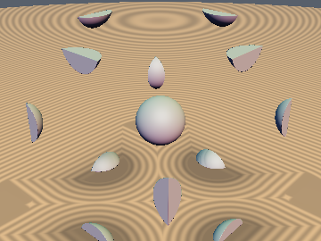
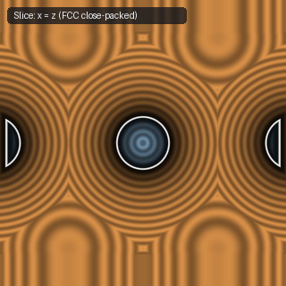
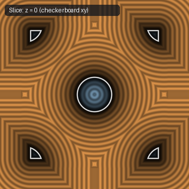

# `opRepFCC` — 1-Tap 3D Face-Centered Cubic (FCC / D3) Rhombic-Dodecahedron Repetition

| 3D Surface ($f(p) = 0$) | Primary 2D Cross-Section | Secondary 2D Cross-Section |
| :---: | :---: | :---: |
|  |  |  |

| Property | Value |
| :--- | :--- |
| **Author / Discoverer** | **Dillon Cower (sdf-gems, 2026)** |
| **Source** | [https://github.com/dcower/sdf-gems](https://github.com/dcower/sdf-gems) |
| **Category** | `repetition` |
| **GLSL File** | [`glsl/repetition/opRepFCC.glsl`](../../glsl/repetition/opRepFCC.glsl) |
| **Exact Euclidean SDF?** | Yes (symmetric SDFs) |

---

## Mathematical Overview

Folds $\mathbb{R}^3$ into the exact Rhombic Dodecahedron Voronoi cell of the FCC ($D_3$) lattice via Conway-Sloane parity rounding, achieving the maximum $74.05\%$ 3D sphere-packing density.

---

## GLSL Implementation

```glsl
vec3 opRepFCC( in vec3 p, in float s )
{
    vec3  q = p / s;
    vec3  r = round(q);
    float m = mod(r.x + r.y + r.z, 2.0);
    if (m != 0.0) {
        vec3 d = abs(q - r);
        vec3 sgn = vec3(greaterThanEqual(q, r)) * 2.0 - 1.0;
        r += (d.x >= d.y && d.x >= d.z) ? vec3(sgn.x, 0.0, 0.0) :
             (d.y >= d.z)               ? vec3(0.0, sgn.y, 0.0) : vec3(0.0, 0.0, sgn.z);
    }
    return (q - r) * s;
}
```
