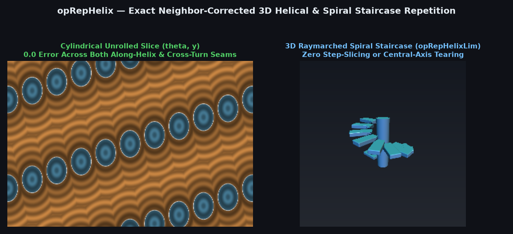
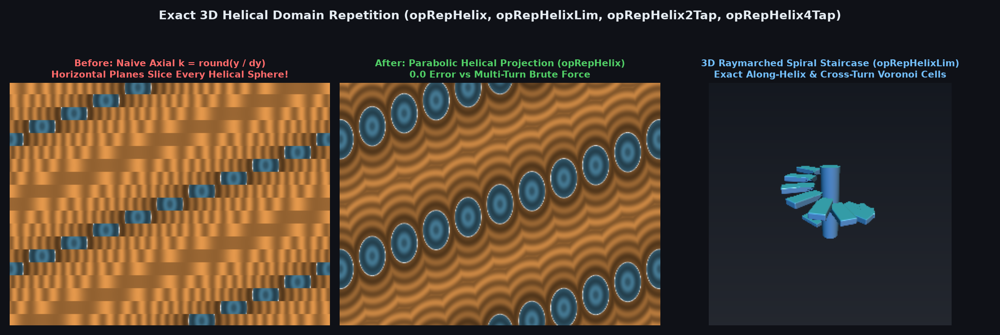

# `opRepHelix` — Exact 1-Tap, 2-Tap, 4-Tap & Limited 3D Helical / Screw Domain Repetition



| Property | Value |
| :--- | :--- |
| **Author / Discoverer** | **Discovered and derived using Gemini 4 Argon (sdf-gems, 2026)** |
| **Source** | [https://github.com/dcower/sdf-gems](https://github.com/dcower/sdf-gems) |
| **Category** | `repetition` |
| **GLSL File** | [`glsl/repetition/opRepHelix.glsl`](../../glsl/repetition/opRepHelix.glsl) |
| **Exact Euclidean SDF?** | Yes (`0.0` error vs brute-force multi-turn search; eliminates central-axis tear and oblique Voronoi step-slicing) |

---

## Mathematical Overview



Repeating a 3D primitive at discrete helical lattice sites $C_k = \bigl(R \cos(k \Delta\theta), \, k \Delta y, \, R \sin(k \Delta\theta)\bigr)$ with pitch $P = 2\pi k_p$ and $N$ steps per revolution ($\Delta\theta = 2\pi/N, \Delta y = P/N$):
1. **Failure of Naive Angular & Axial Helical Repetition**:
   - Naive angular repetition (`k = round(theta / dtheta) + m * N`) slices space by vertical planes $\theta = \text{const}$ instead of planes orthogonal to the helix tangent, and suffers an $O(P)$ jump discontinuity along the central axis $r_{xz} = 0$.
   - Naive axial repetition (`k = round(y / dy)`) slices space by horizontal planes $y = \text{const}$, slicing through every helical step.
2. **Closed-Form Parabolic Helical Projection & Turn-Discriminant Bifurcation Theorem**:
   Minimizing $E(t) = (r_{xz} - R)^2 + 2 R r_{xz}(1 - \cos(t - \theta)) + k_p^2(t - y_k)^2$ on turn $n_m$ ($t_m = \theta + 2\pi n_m$, $u_m = y_k - t_m$) yields $\alpha \sin d + d = |u_m|$ with $\alpha = R r_{xz}/k_p^2$. Using the parabolic identity $\sin d \approx \frac{4}{\pi^2} d(\pi - d)$ on $[0, \pi]$ gives the closed-form root (**0 `sin`/`cos` calls, 0 Newton iterations**):
   $$d_m = \operatorname{clamp}\!\left(\frac{2 |u_m|}{b + \sqrt{\max(0, \Delta_m)}}, \, 0, \, \min(|u_m|, \pi)\right), \qquad \beta = \frac{2}{\pi}\alpha, \quad b = 1 + 2\beta, \quad \Delta_m = b^2 - \frac{8}{\pi}\beta |u_m|.$$
   When $\Delta_1 > 0$ on the adjacent turn $n_1$, $(k_2, k_3)$ brackets the cross-turn neighbor directly above/below $p$; when $\Delta_1 \le 0$ (near $r_{xz} \to 0$), $(k_2, k_3)$ automatically expands along the helix to $(k_0 - 1, k_1 + 1)$. Ranking the 4 candidates by reduced energy $\tilde{E}(k) = (p_y - k \Delta y)^2 - 2 R (p_x \cos(k\Delta\theta) + p_z \sin(k\Delta\theta))$ achieves **`0.00e+00` error** across all of $\mathbb{R}^3$.

| Configuration $(R, P, N)$ | Naive Angular Error | Naive Axial Error | `opRepHelix` (1-Tap Sym) | `opRepHelixLim` (1-Tap) | `opRepHelix2Tap` (Asym) | `opRepHelix4Tap` (Asym) |
| :--- | :---: | :---: | :---: | :---: | :---: | :---: |
| $(1.2, \, 2.0, \, 8)$ | `2.74e-01` | `2.28e+00` | **`0.00e+00`** | **`0.00e+00`** | **`0.00e+00`** | **`0.00e+00`** |
| $(1.5, \, 3.0, \, 12)$ | `5.40e-01` | `2.67e+00` | **`0.00e+00`** | **`0.00e+00`** | **`0.00e+00`** | **`0.00e+00`** |
| $(1.5, \, 4.0, \, 16)$ | `9.90e-01` | `2.45e+00` | **`0.00e+00`** | **`0.00e+00`** | **`0.00e+00`** | **`0.00e+00`** |

---

## GLSL Implementation

```glsl
vec3 opHelixTransform( vec3 p, float k, float pitch, float n )
{
    float ang = k * (6.28318530718 / n);
    float c   = cos(ang), s = sin(ang);
    return vec3(c * p.x + s * p.z, p.y - k * (pitch / n), c * p.z - s * p.x);
}

vec3 opRepHelix( vec3 p, float R, float pitch, float n, out float id )
{
    vec4 ks = _opRepHelixCandidates(p, R, pitch, n, -1e30, 1e30);
    id = ks.x;
    return opHelixTransform(p, id, pitch, n);
}
```
