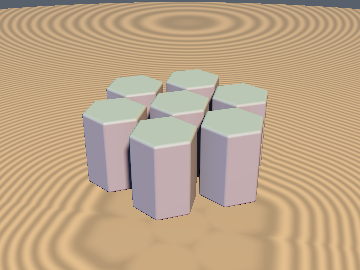
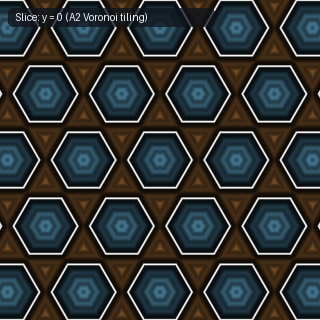

# `opRepHex` — 1-Tap Linear-Norm 2D Hexagonal ($A_2$) Voronoi Domain Repetition

| 3D Surface ($f(p) = 0$) | 2D Cross-Section Slice ($y = 0$) |
| :---: | :---: |
|  |  |

| Property | Value |
| :--- | :--- |
| **Author / Discoverer** | **Discovered using Gemini 4 Argon (sdf-gems, 2026)** |
| **Category** | `repetition` |
| **GLSL File** | [`glsl/repetition/opRepHex.glsl`](../../glsl/repetition/opRepHex.glsl) |
| **Exact Euclidean SDF?** | Yes (for hexagonally/radially symmetric SDFs; `1` `round`, `0` `dot2` calls via $\|d_x\| + 3\|d_y\| > 1$) |

---

## Mathematical Overview

The 2D hexagonal lattice $A_2$ (which achieves the optimal 2D circle packing density of $\frac{\pi}{2\sqrt{3}} \approx 90.69\%$) is the union of two rectangular sublattices $L_0 = \mathbb{Z}^2 \odot k$ and $L_1 = (\mathbb{Z}^2 + \tfrac{1}{2}) \odot k$ with aspect vector $k = (1, \sqrt{3})$.

Standard Shadertoy hexagonal tilings evaluate two `mod`/`round` operations and compare two squared Euclidean distances (`dot(a, a) < dot(b, b)`).

### 1-`round` Linear-Norm Voronoi Theorem
Map $p$ into normalized sublattice coordinates $u = p / (s k)$, snap to the nearest $L_0$ lattice site $i = \mathrm{round}(u)$, and let $d = u - i \in [-\tfrac{1}{2}, \tfrac{1}{2}]^2$:
1. Inside the fundamental rectangle $d \in [-\tfrac{1}{2}, \tfrac{1}{2}]^2$, the nearest $L_1$ site is **always** $i + 0.5\mathrm{sign}(d)$, eliminating the second `round()` call.
2. Expanding the Euclidean Voronoi comparison $\|(d - 0.5\mathrm{sign}(d)) \odot k\|_2^2 < \|d \odot k\|_2^2$ cancels the quadratic terms $d_x^2 + 3 d_y^2$ identically:
   $$\bigl(|d_x| - \tfrac{1}{2}\bigr)^2 + 3\bigl(|d_y| - \tfrac{1}{2}\bigr)^2 < d_x^2 + 3 d_y^2 \iff -|d_x| + \tfrac{1}{4} - 3|d_y| + \tfrac{3}{4} < 0 \iff |d_x| + 3|d_y| > 1.$$
   This replaces both `dot2` calls with the linear inequality $|d_x| + 3|d_y| > 1$ (the 2D $A_2$ counterpart of [`opRepBCC`](opRepBCC.md)'s $|r_x| + |r_y| + |r_z| > 0.75$).

---

## GLSL Implementation

```glsl
vec2 opRepHex( vec2 p, float s )
{
    const vec2 k = vec2(1.0, 1.73205081);
    vec2 u = p / (s * k), i = round(u), d = u - i;
    if( abs(d.x) + 3.0 * abs(d.y) > 1.0 )
        i += vec2(d.x >= 0.0 ? 0.5 : -0.5, d.y >= 0.0 ? 0.5 : -0.5);
    return p - s * i * k;
}
```
