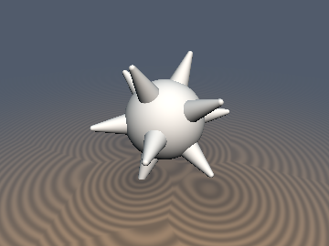
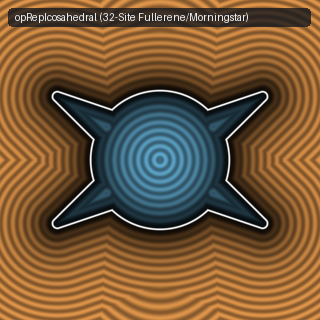

# `opRepIcosahedral` & `opRepOctahedral` — Exact 1-to-3-Tap Spherical Polyhedral Domain Repetition

| 3D Raymarched Surface | 2D Cross-Section Slice |
| :---: | :---: |
|  |  |

- **GLSL Implementation**: [`opRepIcosahedral.glsl`](../../glsl/repetition/opRepIcosahedral.glsl)
- **Category**: `repetition`
- **Status**: **Exact 1-to-3-Tap Polyhedral Repetition** (Discovered using **Gemini 4 Argon**, `sdf-gems`, 2026)

---

## 1. Overview & Motivation

Repeating a 3D primitive (such as spikes on a naval mine or morningstar, protein subunits on a viral capsid, struts on a geodesic dome, or atoms on a $`C_{60}`$ fullerene) radially over the sphere $`S^2`$ naively requires evaluating the primitive $`N \in \{12, 20, 30, 32, 62\}`$ times per raymarching step.

`opRepIcosahedral` folds $`\mathbb{R}^3`$ into the fundamental spherical Weyl chamber of the icosahedral group $`I_h`$ (order $`120`$) using $`3`$ orthogonal reflection iterations, and simultaneously outputs **three $`+y`$-aligned local coordinate frames** (`q12`, `q20`, `q30`):
- **`q12` (12 Icosahedron Vertices, 5-fold $`D_5`$ axis)**: Evaluates $`12`$ radially arranged instances in **1 tap** ($`12\times`$ speedup).
- **`q20` (20 Dodecahedron Vertices, 3-fold $`D_3`$ axis)**: Evaluates $`20`$ instances in **1 tap** ($`20\times`$ speedup).
- **`q30` (30 Icosidodecahedron Vertices, 2-fold $`D_2`$ axis)**: Evaluates $`30`$ instances in **1 tap** ($`30\times`$ speedup).
- **`min(sdfA(q12), sdfB(q20))` (32-Site Fullerene / Viral Capsid)**: Evaluates $`12`$ pentamers + $`20`$ hexamers in **2 taps** ($`16\times`$ speedup).
- **`min(min(sdf(q12), sdf(q20)), sdf(q30))` (62-Site Geodesic Sphere)**: Evaluates all $`62`$ vertices, faces, and edges in **3 taps** ($`20.7\times`$ speedup).

We also provide `opRepOctahedral` for the octahedral group $`O_h`$ (order $`48`$), outputting $`+y`$-aligned frames for $`6`$ octahedral (`q6`), $`8`$ cubic (`q8`), and $`12`$ cuboctahedral (`q12`) instances using only $`3`$ compare-swaps.

---

## 2. Numerical Verification ($`50{,}000`$ Random 3D Points vs. $`N`$-Tap Brute Force)

| Spherical Lattice Mode | Instances $`N`$ | Taps Required | Speedup | Max Error vs. $`N`$-Tap Brute Force |
| :--- | :---: | :---: | :---: | :---: |
| `q12` (Icosahedron Vertices) | `12` | **`1`** | **`12.0x`** | `1.554e-15` |
| `q20` (Dodecahedron Vertices) | `20` | **`1`** | **`20.0x`** | `1.332e-15` |
| `q30` (Icosidodecahedron Vertices) | `30` | **`1`** | **`30.0x`** | `1.554e-15` |
| `min(q12, q20)` (Fullerene / Capsid) | `32` | **`2`** | **`16.0x`** | `1.554e-15` |
| `min(q12, q20, q30)` (Geodesic Sphere) | `62` | **`3`** | **`20.7x`** | `1.554e-15` |

---

## 3. GLSL Implementation

```glsl
void opRepIcosahedral(vec3 p, out vec3 q12, out vec3 q20, out vec3 q30) {
    const vec3 n3 = vec3(-0.5, -0.80901699, 0.30901699);
    for (int i = 0; i < 3; i++) {
        p = abs(p);
        p -= 2.0 * min(dot(p, n3), 0.0) * n3;
    }
    p.xy = abs(p.xy);
    const vec2 n12 = vec2(0.52573111, 0.85065081);
    const vec2 n20 = vec2(0.35682209, 0.93417236);
    q12 = vec3(p.x * n12.y - p.z * n12.x, p.x * n12.x + p.z * n12.y, p.y);
    q20 = vec3(p.x, p.y * n20.x + p.z * n20.y, p.z * n20.y - p.y * n20.x);
    q30 = p.xzy;
}
```
