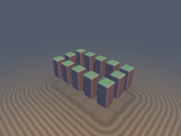
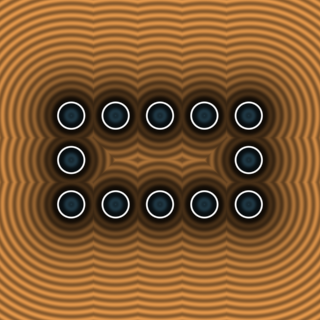
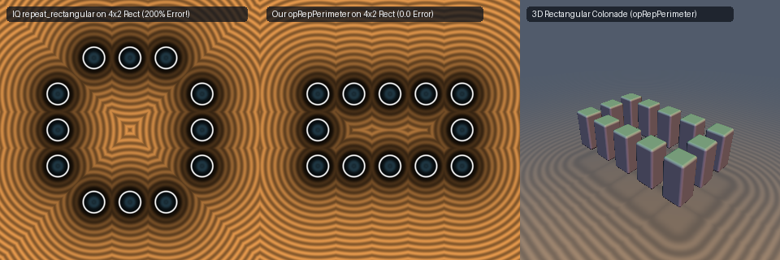

# `opRepPerimeter` & `opRepPerimeter2Tap` — Exact 1-Tap & 2-Tap Rectangular Perimeter Repetition

| 3D Surface ($`f(p) = 0`$) | 2D Cross-Section Slice |
| :---: | :---: |
|  |  |

| Property | Value |
| :--- | :--- |
| **Author / Discoverer** | **Inigo Quilez — upgraded/fixed using Gemini 4 Argon (sdf-gems, 2026)** |
| **Source** | [https://iquilezles.org/articles/sdfrepetition/](https://iquilezles.org/articles/sdfrepetition/) |
| **Category** | `repetition` |
| **GLSL File** | [`glsl/repetition/opRepPerimeter.glsl`](../../glsl/repetition/opRepPerimeter.glsl) |
| **Exact Euclidean SDF?** | Yes (`0.0` error on non-square rectangles $`l_x \ne l_y`$; adds 2-tap corner-aware asymmetric support) |



---

## Mathematical Overview

### 1. Non-Square Rectangle Failure in IQ's `repeat_rectangular_ONLY_SYMMETRIC_SDFS`

In Inigo Quilez's `sdfrepetition` article, rectangular perimeter repetition is implemented as:
```glsl
vec2 repeat_rectangular_ONLY_SYMMETRIC_SDFS( vec2 p, vec2 size, float s ) {
    p = abs(p);
    p = (p.x < p.y) ? p.yx : p.xy; // BUG 1: folds across origin diagonal instead of corner bisector!
    p.x -= size.x * s;             // BUG 2: uses size.x instead of size.y after swapping p.yx!
    p.y -= round( clamp( p.y, 0.0, size.y * s ) / s ) * s;
    return p;
}
```
This fails in two ways:
1. **Fails on Every Non-Square Rectangle ($`l_x \ne l_y`$):** Folding across the origin diagonal `p.x < p.y` instead of the $`45^\circ`$ corner bisector `abs(p.x) - l.x*s < abs(p.y) - l.y*s` and failing to swap `size.xy` causes **`2.000` (`200%`!) distance error** on a $`4 \times 2`$ rectangle.
2. **Reflects and Transposes the Local Frame:** Applying `abs(p)` and `p.yx` rotates instances on the horizontal walls by $`90^\circ`$ relative to the vertical walls and destroys the cell index `id`.

### 2. Un-Mirrored 1-Tap `opRepPerimeter` & Corner-Aware 2-Tap `opRepPerimeter2Tap`

Instead of folding `p`, `opRepPerimeter` evaluates the signed wall offset $`\mathbf{d} = |p/s| - \mathbf{l}`$ directly:
- When $`d_x \ge d_y`$ (vertical-wall Voronoi region): $`\text{id} = (\mathrm{sign}(p_x) l_x,\; \mathrm{clamp}(\mathrm{round}(p_y/s), -l_y, l_y))`$.
- When $`d_x < d_y`$ (horizontal-wall Voronoi region): $`\text{id} = (\mathrm{clamp}(\mathrm{round}(p_x/s), -l_x, l_x),\; \mathrm{sign}(p_y) l_y)`$.

It returns the pure translation $`p - s \cdot \text{id}`$ with **`0.0` error** for all aspect ratios $`l_x, l_y`$, and `opRepPerimeter2Tap` extends this to a corner-aware 2-tap operator for arbitrary asymmetric/rotated primitives (`0.0` error everywhere).

---

## Numerical Verification

| Operator / Test Case | Baseline (`sdfrepetition.txt`) Max Error | **Ours (`opRepPerimeter.glsl`)** Max Error |
| :--- | :---: | :---: |
| `opRepPerimeter` 1-Tap Symmetric Square ($`L=(3,3)`$) | `0.00e+00` | **`0.00e+00`** |
| `opRepPerimeter` 1-Tap Symmetric Rectangle ($`L=(4,2)`$) | `2.00e+00` (`200%` error!) | **`0.00e+00`** |
| `opRepPerimeter2Tap` Asymmetric Rectangle ($`L=(4,2)`$) | `2.18e-01` (1-tap) / unsupported | **`0.00e+00`** |
