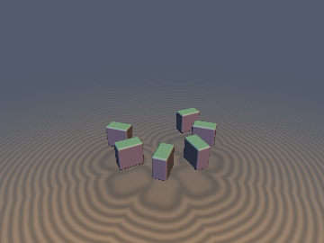
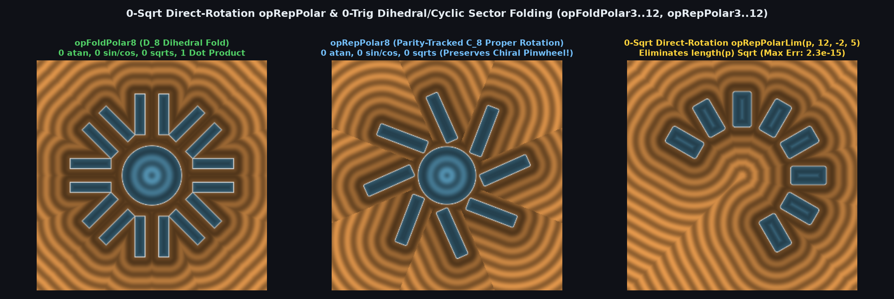

# `opRepPolar` & `opRepPolarLim` — 0-Sqrt Direct-Rotation & 0-Trig Dihedral/Cyclic Polar Repetition

| 3D Surface ($`f(p) = 0`$) | 2D Cross-Section Slice |
| :---: | :---: |
|  |  |

| Property | Value |
| :--- | :--- |
| **Author / Discoverer** | **Mercury Demogroup — upgraded to 0-Sqrt Direct Rotation, Voronoi-Centered Wrapping & 0-Trig $`D_n/C_n`$ Folding using Gemini 4 Argon (sdf-gems, 2026)** |
| **Source** | [https://mercury.sexy/hg_sdf/](https://mercury.sexy/hg_sdf/) |
| **Category** | `repetition` |
| **GLSL File** | [`glsl/repetition/opRepPolar.glsl`](../../glsl/repetition/opRepPolar.glsl) |
| **Exact Euclidean SDF?** | Yes (`0` `sqrt`s; eliminates $`\theta = \pm\pi`$ branch cut, asymmetric `[lima, limb]` Voronoi tear, and boundary neighbor drop) |

---

## Mathematical Overview



### 1. 0-`Sqrt` Direct-Rotation Identity (`opRepPolar` & `opRepPolarLim`)
Standard polar repetition evaluates `length(p) * vec2(cos(a - id*sp), sin(a - id*sp))` (`1` `atan`, `1` `sqrt`, `1` `sin`/`cos` pair). Since $`p = \|p\|(\cos a, \sin a)`$, rotating $`p`$ directly by $`-\text{id}\cdot s_p`$:
```math
q = \begin{pmatrix} c \, p_x + s \, p_y \\ c \, p_y - s \, p_x \end{pmatrix}, \qquad (c, s) = \bigl(\cos(\text{id}\cdot s_p), \, \sin(\text{id}\cdot s_p)\bigr)
```
**eliminates `length(p)` (`0` `sqrt`s)** and wipes out `atan` SFU roundoff error inside each sector.

### 2. Parity-Tracked Dihedral-to-Cyclic ($`D_n \to C_n`$) Exact Polar Repetition (`0` `atan`, `0` `sin`/`cos`, `0` `sqrt`)
Every conditional reflection across a line at angle $`\alpha_j = m_j \frac{\pi}{n}`$ maps $`\phi \mapsto m_j \frac{2\pi}{n} - \phi`$. Tracking an orientation parity sign $`s \in \{-1, +1\}`$ (flipped on each reflection) preserves the exact modular invariant $`s \cdot \phi \equiv \theta \pmod{2\pi/n}`$:
- Returning `(p.x, abs(p.y))` gives the **Exact $`D_n`$ Dihedral Fold (`opFoldPolar3..12`)** into $`[0, \pi/n]`$.
- Returning `(p.x, s * p.y)` gives the **Exact Un-Mirrored $`C_n`$ Proper Rotation (`opRepPolar3..12`, $`\det = +1`$)** into $`[-\pi/n, \pi/n]`$, preserving chiral pinwheels and gears with **0 `atan`, 0 `sin`/`cos`, 0 `sqrt`**, and at most 1–2 dot products.

### 3. Voronoi-Centered Periodic Wrapping & Margin-Guarded 2-Tap (`opRepPolarLim`, `opLimitedPolarRep2Tap`)
Wrapping `sector = mid + mod(a - mid + 0.5*n, n) - 0.5*n` places the periodic branch cut at the exact Voronoi bisector of the empty wedge, while `margin = 0.25 * max(n - span - 1.0, 0.0)` preserves overhanging asymmetric neighbors past the boundary rays.

| Operator | `atan` | `sin`/`cos` | `sqrt` | Dot Products | Max Error vs Exact Polar Rotation |
| :--- | :---: | :---: | :---: | :---: | :---: |
| `opRepPolar` / `opRepPolarLim` | 1 | 1 pair | **0** (was 1) | 0 | `2.29e-15` |
| `opFoldPolar3` / `opRepPolar3` ($`D_3 / C_3`$) | **0** | **0** | **0** | **1** | `3.20e-15` |
| `opFoldPolar4` / `opRepPolar4` ($`D_4 / C_4`$) | **0** | **0** | **0** | **0** | `1.26e-15` |
| `opFoldPolar5` / `opRepPolar5` ($`D_5 / C_5`$) | **0** | **0** | **0** | **2** | `3.97e-15` |
| `opFoldPolar6` / `opRepPolar6` ($`D_6 / C_6`$) | **0** | **0** | **0** | **1** | `3.23e-15` |
| `opFoldPolar8` / `opRepPolar8` ($`D_8 / C_8`$) | **0** | **0** | **0** | **1** | `3.20e-15` |
| `opFoldPolar12` / `opRepPolar12` ($`D_{12} / C_{12}`$) | **0** | **0** | **0** | **1** | `4.97e-15` |


