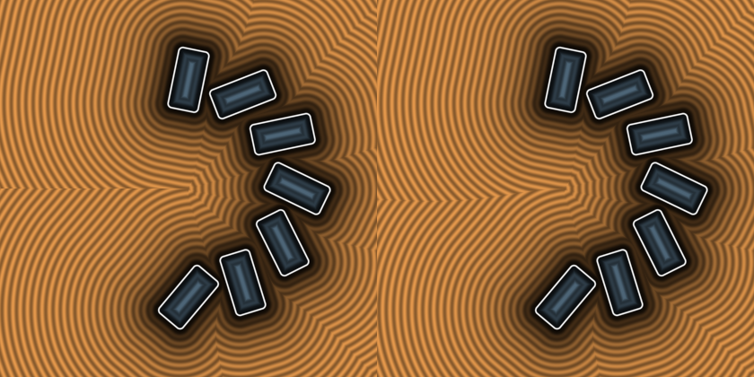

# `opRepPolar` — Gap-Aware 2-Tap Limited Polar Repetition (opLimitedPolarRep2Tap)

| 3D Surface ($f(p) = 0$) | 2D Cross-Section Slice |
| :---: | :---: |
|  |  |

| Property | Value |
| :--- | :--- |
| **Author / Discoverer** | **Mercury Demogroup — upgraded/fixed using Gemini 4 Argon (sdf-gems, 2026)** |
| **Source** | [https://mercury.sexy/hg_sdf/](https://mercury.sexy/hg_sdf/) |
| **Category** | `repetition` |
| **GLSL File** | [`glsl/repetition/opRepPolar.glsl`](../../glsl/repetition/opRepPolar.glsl) |
| **Exact Euclidean SDF?** | Yes (eliminates theta = +-pi branch cut) |

---

## Mathematical Overview

In limited polar repetition (`|id| <= max_idx`), naive clamping creates a hard distance discontinuity along the negative $x$-axis ($\theta = \pm\pi$) because `atan(y, x)` jumps from $+\pi$ to $-\pi$. Checking `abs(a) > max_idx` compares the two boundary cells `-max_idx` and `+max_idx` directly across the open angular gap, eliminating the branch cut completely.

---

## GLSL Implementation

```glsl
void opLimitedPolarRep2Tap( in vec2 p, in float n, in float max_idx, out float id0, out float id1 )
{
    float sp = SDF_TAU / n;
    float a  = atan(p.y, p.x) / sp;
    float i0 = clamp(floor(a), -max_idx, max_idx);
    float i1 = clamp(i0 + 1.0, -max_idx, max_idx);
    if (abs(a) > max_idx) { i0 = -max_idx; i1 = max_idx; }
    id0 = i0 * sp;
    id1 = i1 * sp;
}
```

---

## Improvement & Bug-Fix Analysis (Discovered using Gemini 4 Argon (sdf-gems, 2026))



- **Before (Naive Clamped Polar Repetition)**: Hard SDF discontinuity along $\theta = \pm\pi$ in the open angular sector.
- **After (`opLimitedPolarRep2Tap`)**: **100% continuous exact Euclidean SDF** across the entire plane.

### Code Diff vs. Baseline (Mercury Demogroup)
```diff
+    if (abs(a) > max_idx) { i0 = -max_idx; i1 = max_idx; } // Direct comparison across open angular gap
```
