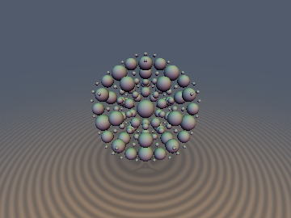
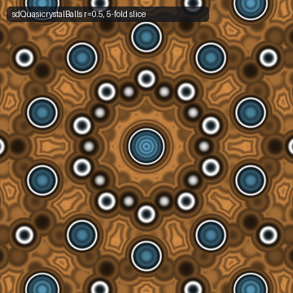
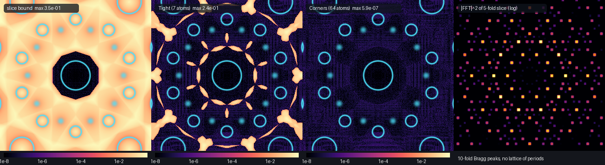
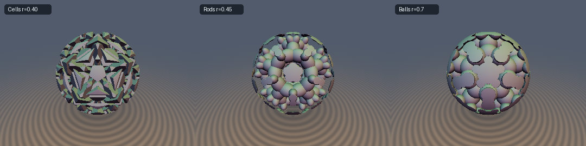

# `opRepQuasi6`, `sdQuasicrystalBalls`, `sdQuasicrystalBallsTight`, `sdQuasicrystalBallsCorners`, `sdQuasicrystalCells`, `sdQuasicrystalRods`, `opRepAmmannBeenker2D` & `opRepPenrose2D` — Cut-and-Project Domain Repetition (Quasicrystals)

| 3D Surface ($`f(\mathbf{p}) = 0`$) | 2D Cross-Section Slice (plane normal to a 5-fold axis) |
| :---: | :---: |
|  |  |

| Property | Value |
| :--- | :--- |
| **Author / Discoverer** | **Claude Fable 5.2** (`sdf-gems`, 2026). Research experiment: see [Findings](#findings) for what held and what did not. |
| **Category** | `repetition` |
| **GLSL File** | [`glsl/repetition/opRepQuasicrystal.glsl`](../../glsl/repetition/opRepQuasicrystal.glsl) |
| **Exact Euclidean SDF?** | `sdQuasicrystalBalls`: **Conservative bound** (1-Lipschitz, exact zero set and sign, mean $`d / d_{\text{exact}} = 0.69`$ at $`r = 0.5`$). `sdQuasicrystalBallsTight`: **Conservative bound** (exact on `73%` of exterior points at $`r = 0.5`$). `sdQuasicrystalBallsCorners`: **Conservative bound for every $`r`$**; for $`r \ge 1/2`$ it equalled the brute-force exterior SDF on every sampled point (max error `6.9e-07`), which is a measurement, not a theorem. `sdQuasicrystalCells`: exact inside a cell, conservative bound outside. `sdQuasicrystalRods`, `sd*Discs2D`: conservative bounds. |

The preview is the literal `sdQuasicrystalBallsCorners(p, 0.215, 0.5)` seen along a 5-fold axis and clipped by a sphere whose radius
(`3.82` lattice units) falls in a gap between atom shells, so it shows exactly `153` whole atoms.

---

## Overview & Motivation

`opRep*` operators in this library fold space onto one cell of a periodic lattice. A quasicrystal has no period, so there is
no cell to fold onto in 3D. The cut-and-project construction supplies one in 6D: an icosahedral quasicrystal is the
restriction of a $`\mathbb{Z}^6`$-periodic object to an irrationally oriented 3D subspace. Folding in 6D is one `floor` per
coordinate.

```math
\mathbf{P} = E\,\mathbf{p} \in \mathbb{R}^6, \qquad \mathbf{N} = \mathrm{round}(\mathbf{P}) \in \mathbb{Z}^6, \qquad \mathbf{Q} = \mathbf{P} - \mathbf{N} \in [-\tfrac12, \tfrac12]^6 .
```

The rows of the $`6 \times 3`$ matrix $`E`$ are the six 5-fold axes of the icosahedron, each scaled by $`1/\sqrt2`$:

```math
E = \frac{1}{\sqrt{2(1+\tau^2)}}
\begin{pmatrix} 0 & 1 & \tau \\ 0 & -1 & \tau \\ 1 & \tau & 0 \\ -1 & \tau & 0 \\ \tau & 0 & 1 \\ \tau & 0 & -1 \end{pmatrix},
\qquad \tau = \frac{1+\sqrt5}{2}, \qquad E^{\mathsf T} E = I_3 .
```

Because $`E`$ is an isometric embedding, **any** 1-Lipschitz function of $`\mathbf{Q}`$ is 1-Lipschitz in $`\mathbf{p}`$.
The result is an infinite, aperiodic, icosahedrally symmetric structure from one closed-form evaluation, with no seams:
$`\mathrm{dist}(\mathbf{P}, \mathbb{Z}^6) = \|\mathbf{Q}\|`$ is continuous across cell faces.

GLSL has no 6-vectors; $`\mathbf{Q}`$ is carried as two `vec3` (`qa` = components 0–2, `qb` = components 3–5) and the cell id as two `ivec3`.

---

## Mathematical Derivation

Write $`\mathbf{c}_n = E^{\mathsf T}\mathbf{n}`$ for the parallel projection of a lattice point and
$`h_n = \|(I - E E^{\mathsf T})\,\mathbf{n}\|`$ for its distance to the slice. For any $`\mathbf{p}`$,
$`\|E\mathbf{p} - \mathbf{n}\|^2 = \|\mathbf{p} - \mathbf{c}_n\|^2 + h_n^2`$.

### 1. Slice of the 6D ball field (`sdQuasicrystalBalls`)

```math
f(\mathbf{p}) = \|\mathbf{Q}\| - r = \min_{\mathbf{n} \in \mathbb{Z}^6} \sqrt{\|\mathbf{p} - \mathbf{c}_n\|^2 + h_n^2} \; - \; r .
```

- **Zero set.** $`f < 0`$ exactly on the union of the balls $`B(\mathbf{c}_n, \rho_n)`$, $`\rho_n = \sqrt{r^2 - h_n^2}`$, over all
  $`\mathbf{n}`$ with $`h_n < r`$. This is the cut-and-project point set with a spherical window of radius $`r`$, decorated with
  balls that shrink to zero at the edge of the window. Its density is the window volume, $`\tfrac43 \pi r^3`$ atoms per unit volume.
- **Two-sided bound.** With $`d = \|\mathbf{p} - \mathbf{c}_n\|`$ and $`g = \sqrt{d^2 + h_n^2} - r`$,
  $`g\,(\sqrt{d^2 + h_n^2} + r) = (d - \rho_n)(d + \rho_n)`$ and $`d + \rho_n \le \sqrt{d^2 + h_n^2} + r`$, so $`g`$ has the sign of
  $`d - \rho_n`$ and $`|g| \le |d - \rho_n|`$. Taking the minimum over $`\mathbf{n}`$: $`|f|`$ never exceeds the true distance, inside or outside.
- **Why it is only a bound.** The ratio is $`(d + \rho_n) / (\sqrt{d^2 + h_n^2} + r)`$. On the surface it equals $`\rho_n / r`$: the
  gradient of $`f`$ at a small atom is small, so sphere tracing slows down next to the smallest atoms.
- **Normal.** $`\nabla f = E^{\mathsf T}\mathbf{Q} / \|\mathbf{Q}\|`$, so `normalize(opQuasi6Project(qa, qb))` is the exact ball normal on the surface.
- **Disjointness.** Two 6D balls of radius $`r`$ at distinct lattice points overlap iff $`r > 1/2`$. For $`r \le 1/2`$ the atoms are
  pairwise disjoint (at $`r = 1/2`$ some pairs touch), and on the surface `na, nb` identify the atom. For $`r > 1/2`$ atoms merge.

### 2. Certified candidate search (`sdQuasicrystalBallsTight`, `sdQuasicrystalBallsCorners`)

The exact exterior distance to the union is $`D(\mathbf{p}) = \min_{h_n < r} (\|\mathbf{p} - \mathbf{c}_n\| - \rho_n)`$, and the
minimiser need not be $`\mathbf{N}`$. For a candidate set $`S \subset \mathbb{Z}^6`$ let
$`R_S = \min_{\mathbf{n} \notin S} \|\mathbf{P} - \mathbf{n}\|`$. By the two-sided bound above every excluded atom satisfies
$`\|\mathbf{p} - \mathbf{c}_n\| - \rho_n \ge \|\mathbf{P} - \mathbf{n}\| - r \ge R_S - r`$ when $`\mathbf{p}`$ is outside it, hence

```math
\min\Big( \min_{\mathbf{n} \in S,\; h_n < r} \big(\|\mathbf{p} - \mathbf{c}_n\| - \rho_n\big),\; \max(R_S - r,\; f) \Big) \;\le\; D(\mathbf{p}),
```

with equality whenever the first term is the smaller one. $`R_S`$ is closed-form in the sorted $`a_1 \ge \dots \ge a_6`$ of $`|Q_i|`$
($`s_i = \mathrm{sign}\,Q_i`$):

| Variant | Candidate set $`S`$ | $`R_S^2 - \Vert\mathbf{Q}\Vert^2`$ |
| :--- | :--- | :--- |
| `Tight` | $`\mathbf{N}`$ and $`\mathbf{N} + s_i \mathbf{e}_i`$ (7 points) | $`\min(2 - 2(a_1 + a_2),\; 1 + 2 a_6)`$ |
| `Corners` | the 64 corners $`\mathbf{N} + \sum_i b_i s_i \mathbf{e}_i`$, $`b_i \in \{0, 1\}`$, of the unit cube containing $`\mathbf{P}`$ | $`1 + 2 a_6`$ |

A lattice point enters or leaves $`S`$ only where its 6D distance equals $`R_S`$, at which moment its ball distance is $`\ge R_S - r`$;
therefore both variants are continuous, and 1-Lipschitz as minima of 1-Lipschitz pieces. `Corners` prunes with the same inequality: a corner
at 6D distance $`\ge c + r`$ cannot beat the current best $`c`$, so on average only `4.9` of the 64 corners are projected at $`r = 0.5`$.

Inside an atom both return $`\min_S (d_n - \rho_n)`$: the exact interior distance for $`r \le 1/2`$ (disjoint balls), and the usual
`min`-union interior bound for $`r > 1/2`$.

### 3. Other 6D cell shapes

- **6D box → `sdQuasicrystalCells`.** $`\max_i |Q_i| - r`$ has gradient norm $`1/\sqrt2`$ (one row of $`E`$), so
  $`\sqrt2\,(\max_i |Q_i| - r)`$ is still 1-Lipschitz. Each cell is the convex polytope $`\{ |E_i \cdot \mathbf{p} - n_i| < r \;\forall i \}`$
  bounded by planes normal to the 5-fold axes: a regular dodecahedron of inradius $`\sqrt2\,r`$ when $`\mathbf{n}`$ lies on the slice, and
  irregular dodecahedron-like pieces otherwise. The cells are the meshes of the icosahedral 6-grid (six families of parallel planes)
  eroded by $`\sqrt2\,(\tfrac12 - r)`$; distinct cells are disjoint for $`r < 1/2`$, so the solid is **never connected**, while its
  complement (six families of plates of thickness $`\sqrt2\,(1 - 2r)`$) always is, and `-sdQuasicrystalCells` is the exact distance to
  those plates from outside them.
- **6D axis lines → `sdQuasicrystalRods`.** $`\sqrt{\|\mathbf{Q}\|^2 - \max_i Q_i^2} - r`$ is the 6D distance to the nearest lattice line
  $`\mathbf{n} + t\,\mathbf{e}_i`$. The slice of such a tube is **not a rod**: it is the quadric
  $`\sum_{j \ne i} (E_j \cdot \mathbf{p} - n_j)^2 < r^2`$, a prolate ellipsoid of aspect $`\sqrt2`$ whose long axis is the 5-fold axis $`i`$
  (the form $`I - E_i^{\mathsf T} E_i`$ has eigenvalues $`1, 1, \tfrac12`$).

### 4. Symmetry and inflation

A rotation $`R`$ of the icosahedral group permutes the six axes up to sign, $`E R = \Pi E`$ with $`\Pi`$ a signed permutation matrix, and
$`\Pi\,\mathbb{Z}^6 = \mathbb{Z}^6`$; so every function above is invariant under the full icosahedral group $`I_h`$ about the origin.
The matrix $`M = \tau^3 E E^{\mathsf T} - \tau^{-3} (I - E E^{\mathsf T})`$ is an integer matrix of determinant $`-1`$, so scaling the atom
centres by $`\tau^3`$ maps the window-$`w`$ point set onto the window-$`w / \tau^3`$ point set. ($`\tau`$ and $`\tau^2`$ do not give integer matrices for this primitive lattice.)

### 5. 2D analogues

- `opRepAmmannBeenker2D`: $`\mathbb{Z}^4 \to \mathbb{R}^2`$, rows $`(\cos\tfrac{k\pi}{4}, \sin\tfrac{k\pi}{4})/\sqrt2`$, 8-fold.
- `opRepPenrose2D`: $`\mathbb{Z}^5 \to \mathbb{R}^2`$, rows $`\sqrt{2/5}\,(\cos\tfrac{2\pi k}{5}, \sin\tfrac{2\pi k}{5})`$, 10-fold, with a common
  phase $`\gamma`$. The integer id is constant on each mesh of de Bruijn's pentagrid $`\{P_k + \gamma \in \mathbb{Z} + \tfrac12\}`$. With
  $`5\gamma \equiv \tfrac12 \pmod 1`$ (e.g. $`\gamma = 0.1`$) the points $`\sum_k n_k \mathbf{e}_k`$ are the vertices of a Penrose rhomb tiling.
- `sd*Discs2D` are the 4D / 5D ball slices. The 5D ball window is **not** the Penrose vertex set (that needs the pentagrid ids and four pentagonal windows); it is a different 10-fold cut-and-project set.

---

## GLSL Usage

See [`glsl/repetition/opRepQuasicrystal.glsl`](../../glsl/repetition/opRepQuasicrystal.glsl). `scale` is the 6D lattice constant in
world units; `r` is in lattice units.

```glsl
float map( vec3 p ) { return sdQuasicrystalBalls(p, 0.3, 0.5); }      // bound: 1 sqrt, safe to sphere-trace

// per-atom colour and exact normal at a hit point (r <= 0.5):
vec3 qa, qb; ivec3 na, nb;
opRepQuasi6(p / 0.3, qa, qb, na, nb);
vec3  nor = normalize(opQuasi6Project(qa, qb));
float id  = hashQuasi6(na, nb);
vec3  ctr = 0.3 * opQuasi6Project(vec3(na), vec3(nb));               // atom centre
```

A constant 6-vector added to $`\mathbf{P}`$ before rounding (a phason shift) moves to another member of the same family and keeps every
guarantee; the 3D API does not expose it.

---

## Numerical Verification

Ground truth is built only from the definition: all $`\mathbf{n} \in \mathbb{Z}^6`$ with $`h_n < r`$ and $`\|\mathbf{c}_n\| \le 7`$ are
enumerated and the union of balls is evaluated by brute force in FP64. GPU rows are the literal GLSL (OpenGL 4.1, FP32).

### 1. Embedding, Lipschitz, symmetry

| Check | Result |
| :--- | :--- |
| $`\max \vert E^{\mathsf T} E - I \vert`$ (FP64) | `1.1e-16`; every row has norm$`^2`$ `0.5` |
| Lipschitz ratio, $`10^6`$ random pairs (FP64) / $`4 \times 10^5`$ pairs (GPU) | `0.99977` / `0.9977` (`Balls`), `1.0000` (`Tight`, `Corners`, `Cells` at $`\sigma = 0.05`$), `0.9966` (`Rods`) |
| NaN / Inf at probe points, $`r \in \{0, 10^{-4}, 0.5, 1.3\}`$, scale $`\in \{10^{-3}, 1, 50\}`$ | `0` |
| $`\max \vert d(R\mathbf{p}) - d(\mathbf{p}) \vert`$, 72° about a 5-fold axis, 120° about a 3-fold axis, 2-fold, inversion | FP64: `2.6e-15`; GPU ($`\Vert\mathbf{p}\Vert_\infty < 8`$): `3.1e-06` |
| $`\tau^3`$ inflation: integer matrix, $`\det = -1`$; $`\tau^3 \Lambda(0.9) = \Lambda(0.9/\tau^3)`$ inside $`\Vert\mathbf{c}\Vert \le 7`$ | 43 atoms on each side, symmetric difference `0` |
| Atom density within $`\Vert\mathbf{c}\Vert \le 7`$ vs window volume $`\tfrac43\pi r^3`$ (FP64) | $`r = 0.35`$: `0.184` vs `0.180`; $`r = 0.5`$: `0.534` vs `0.524`; $`r = 0.75`$: `1.762` vs `1.767` |
| Smallest gap between two atoms (FP64 brute force) | $`r = 0.35`$: `+1.13`; $`r = 0.5`$: `+0.0022` (disjoint); $`r = 0.6`$: `-0.26` (overlapping); minimum centre spacing `0.7071` for $`r \ge 0.5`$ |
| Raymarch overstep pixels (`raymarch_stats`, clipped cluster and infinite scene, three radii, all three ball variants) | `0` |

### 2. Balls vs brute force (GPU, about `123,000` points per radius: uniform in a ball of radius 3, near-surface, on-surface)

| $`r`$ | Variant | Sign mismatches | Max overshoot (ext / int) | Exterior points exact to `1e-5` | Mean $`d / d_{\text{exact}}`$ (ext) | $`\vert d \vert`$ on brute-force surface samples |
| :---: | :--- | :---: | :---: | :---: | :---: | :---: |
| 0.35 | `Balls` | 0 | `7e-08` / `4e-08` | 1.7% | 0.579 | `2.7e-07` |
| 0.35 | `Tight` | 0 | `7e-07` / `2e-07` | 34.6% | 0.817 | `4.7e-07` |
| 0.35 | `Corners` | 0 | `1.1e-06` / `2e-07` | 75.4% | 0.951 | `4.7e-07` |
| 0.5 | `Balls` | 0 | `6e-08` / `7e-08` | 1.4% | 0.687 | `2.4e-07` |
| 0.5 | `Tight` | 0 | `4e-07` / `4e-07` | 73.2% | 0.970 | `4.0e-07` |
| 0.5 | `Corners` | 0 | `5e-07` / `4e-07` | **100%** (max error `5.3e-07`) | 1.000 | `4.3e-07` |
| 0.6 | `Corners` | 0 | `3e-07` / `3e-07` | **100%** (max error `3.5e-07`) | 1.000 | `3.3e-07` |
| 0.75 | `Corners` | 0 | `7e-07` / `6e-07` | **100%** (max error `6.7e-07`) | 1.000 | `7.3e-07` |

The same numbers were reproduced at `scale = 0.37`. Far from the origin ($`\Vert\mathbf{p}\Vert_\infty < 60`$, `200,000` points, second
ground truth below) `Corners` in FP32 stays within `1.4e-04` at $`r = 0.5`$ (`0.001%` of points above `1e-04`): the error is rounding of
$`\mathbf{P}`$, amplified at the smallest atoms.

### 3. Which candidate set is exact? (FP64, `300,000` points with $`\Vert\mathbf{p}\Vert_\infty < 500`$)

The reference here is a second, differently constructed ground truth: all $`3^6 = 729`$ neighbours of $`\mathbf{N}`$ plus the certificate of
§2, which is *provably* exact wherever the certificate passes (share shown in the second column).

| $`r`$ | Reference certified | `Balls` mean ratio | 1 point: exact / ratio | `Tight` (7): exact / ratio | 22 points: exact / ratio | `Corners` (64): exact / ratio |
| :---: | :---: | :---: | :---: | :---: | :---: | :---: |
| 0.30 | 95.25% | 0.551 | 12.6% / 0.657 | 26.8% / 0.781 | 45.7% / 0.888 | 67.4% / 0.942 |
| 0.40 | 99.97% | 0.635 | 22.0% / 0.782 | 51.6% / 0.917 | 84.1% / 0.982 | 96.9% / 0.997 |
| 0.45 | 100% | 0.663 | 27.3% / 0.826 | 62.6% / 0.951 | 92.4% / 0.994 | 99.893% / 1.000 |
| 0.49 | 100% | 0.677 | 31.5% / 0.849 | 69.4% / 0.965 | 95.0% / 0.997 | 99.998% / 1.000 |
| **0.50** | 100% | 0.680 | 32.5% / 0.854 | 70.8% / 0.967 | 95.5% / 0.997 | **100%** / 1.000 |
| 0.65 | 100% | 0.707 | 44.5% / 0.900 | 83.8% / 0.986 | 98.6% / 0.999 | **100%** / 1.000 |
| 0.80 | 100% | 0.718 | 49.8% / 0.913 | 87.8% / 0.990 | 99.2% / 1.000 | **100%** / 1.000 |
| 1.00 | 100% | 0.719 | 49.6% / 0.906 | 87.1% / 0.988 | 99.4% / 1.000 | **100%** / 1.000 |

No variant ever exceeded the reference (max overshoot `0` in FP64). "22 points" is $`\mathbf{N}`$, $`\mathbf{N} + s_i\mathbf{e}_i`$ and
$`\mathbf{N} + s_i\mathbf{e}_i + s_j\mathbf{e}_j`$; it is not in the GLSL file.

### 4. Cost

| Variant | `sqrt` per evaluation | Steps / pixel, clipped 153-atom cluster, lattice constant `0.162` ($`r = 0.5`$) | Steps / pixel, camera inside the infinite structure ($`r = 0.35`$ / $`0.5`$ / $`0.6`$) |
| :--- | :--- | :---: | :---: |
| `Balls` | 1 | 9.08 | 54.3 / 41.2 / 29.4 |
| `Tight` | up to 16 (7 candidates) | 8.22 | 35.4 / 29.1 / 22.0 |
| `Corners` | 2 + two per surviving candidate (mean `1.8` at $`r = 0.5`$); mean `4.9` of 64 corners projected outside atoms, `17.1` at $`r = 0.35`$ | 8.18 | 31.2 / 28.3 / 21.6 |

The transform-feedback harness could not resolve per-evaluation GPU time (all variants within upload/readback noise for $`4 \times 10^6`$
points), so no timing is claimed.

### 5. Aperiodicity and long-range order



*Panels 1–3: $`\log_{10} |d - d_{\text{exact}}|`$ on the 5-fold slice at $`r = 0.5`$ for `Balls`, `Tight`, `Corners` (true surface in cyan).
Panel 4: $`|\mathrm{FFT}|^2`$ of the occupancy of a $`90 \times 90`$ lattice-unit 5-fold slice of the literal GLSL.*

| Check | Result |
| :--- | :--- |
| Correlation of the log diffraction image with its own rotation | 36°: `0.60`, 72°: `0.50`; 20°: `0.03`, 45°: `0.005`, 90°: `0.04` |
| Largest off-centre peak of the normalised autocorrelation of the slice occupancy | `0.724` at $`\Vert\mathbf{t}\Vert = 13.36`$ |
| Fraction of atoms mapped onto atoms by the translation $`E^{\mathsf T}\mathbf{m}`$ ($`r = 0.5`$, 767 atoms) vs the overlap of two $`r`$-balls at distance $`\Vert\mathbf{m}_\perp\Vert`$ | $`\mathbf{e}_0`$: `0.120` vs `0.116`; $`M\mathbf{e}_0`$ ($`\Vert\mathbf{t}\Vert = 3.0`$): `0.763` vs `0.752`; $`M^2\mathbf{e}_0`$ ($`12.7`$): `0.915` vs `0.941`; $`M^3\mathbf{e}_0`$ ($`53.7`$): `0.994` vs `0.986` |

There is no period (the coincidence fraction is $`< 1`$ for every $`\mathbf{m} \ne 0`$ because $`\mathbf{m}_\perp \ne 0`$), but there are
almost-periods of any quality at $`\tau^3`$-spaced distances: the supremum of the autocorrelation is 1 and is not attained.

### 6. Other cells, connectivity, 2D



*Literal GLSL, clipped by a sphere (the cut is the clip, not the structure): `sdQuasicrystalCells` $`r = 0.40`$, `sdQuasicrystalRods` $`r = 0.45`$, `sdQuasicrystalBallsCorners` $`r = 0.7`$.*

| Check | Result |
| :--- | :--- |
| `Cells`, $`r = 0.4`$: sign vs definition (`200,000` pts); inside vs face distance of the convex cell (`52,587` pts) | 0 mismatches; max error `7.1e-07` |
| `Cells` exterior vs boundary point cloud (`1.9M` points) | never above the cloud distance (`-3.9e-08`); mean ratio `0.90` |
| `Rods`, $`r = 0.4`$: sign vs brute-force ellipsoids (`60,000` pts); value inside | 0 mismatches; `2.0e-07` |
| Connectivity on a $`220^3`$ voxel grid over $`[-6, 6]^3`$ (voxel `0.055`, so thresholds are approximate) | `Balls`: largest component `0.4%` of the solid at $`r = 0.5`$, `3.4%` at `0.6`, `80.8%` at `0.65`, `95.8%` at `0.7`. `Rods`: `3.2%` at `0.35`, `43.8%` at `0.4`, `75.5%` at `0.45`, `96.1%` at `0.5`. `Cells`: disconnected for every $`r < 1/2`$ (1,779 components at `0.3`); the void is one component. |
| `sdAmmannBeenkerDiscs2D`, `sdPenroseDiscs2D` vs brute-force discs, $`r \in \{0.3, 0.5, 0.7\}`$, two scales, `117,642` pts each (GPU) | 0 sign mismatches; overshoot $`\le`$ `7e-08`; mean ratio `0.55`–`0.73`; Lipschitz $`\le 1.0000`$ |
| 2D rotation invariance (45° / 36°), GPU | `5.4e-07` |
| `opRepPenrose2D` ids, $`\gamma = 0.1`$, literal GLSL on a $`2001^2`$ grid: 1,846 meshes | index sums $`\sum_k n_k \in \{-1, 0, 1, 2\}`$ (four values); minimum vertex distance `0.618034` $`= 1/\tau`$; only pair distances $`\le 1`$ are $`1/\tau`$ and `1`; mean degree `4.03`, degrees 3–7. With $`5\gamma \not\equiv \tfrac12`$ (FP64 prototype) five index values appear. |
| Pentagrid line distance $`(\tfrac12 - \max_k \vert q_k \vert)\sqrt{5/2}`$, GLSL vs FP64 | `2.2e-06` |

---

## Findings

**What held**

1. $`E^{\mathsf T} E = I_3`$ to rounding, and the 6D ball slice is 1-Lipschitz with zero overstep pixels in every raymarch test.
2. Its zero set and sign match the brute-force union of sliced balls exactly (0 sign mismatches, surface residual `2.7e-07` in FP32).
3. Icosahedral symmetry (5-fold, 3-fold, 2-fold, inversion) holds to rounding, and $`\tau^3`$ inflation holds at the level of point sets.
4. There is no translation period, and the diffraction pattern of a 5-fold slice is 10-fold symmetric with sharp peaks.
5. The candidate certificate works: `Tight` and `Corners` never overestimated in any test, and are continuous.
6. For $`r \ge 1/2`$ the 64 cube corners were sufficient at every sampled point (two ground truths, `300,000` + `123,000` points per radius).
7. The Penrose pentagrid ids satisfy de Bruijn's invariants; the 4D and 5D disc slices match brute force.

**What failed or is weaker than hoped**

1. The slice is **not** the exact SDF: mean $`d / d_{\text{exact}}`$ is `0.55`–`0.72`, with a minimum of `0.04`–`0.28` next to small atoms.
2. Using only the nearest lattice point's ball is not conservative by itself (it overestimated by up to `0.22` at $`r = 0.5`$ and has no ball at all on `41%` of exterior points); it needs the certificate.
3. **No fixed neighbour set is exact for $`r < 1/2`$.** Even all 729 neighbours are certified on only `95.3%` of points at $`r = 0.3`$ (`85.8%` exact against brute force at $`r = 0.2`$): the atoms get sparse like $`r^3`$ and the holes outgrow any fixed neighbourhood.
4. The 12 points $`\mathbf{N} \pm \mathbf{e}_i`$ are no better than the 6 sign-selected ones (identical exactness to three digits), and 42 corners with at most three flips are not enough (`99.81%` at $`r = 0.5`$).
5. The exact variant buys little in a typical outside view: `9.1 → 8.2` steps per pixel on the clipped cluster. It helps more inside the infinite structure (`41 → 28` at $`r = 0.5`$). For plain rendering the 1-`sqrt` bound is the sensible default; `Corners` is for uses that need true distances (offsets, soft shadows, AO).
6. "Rods along the 5-fold axes" do not exist in this construction: the slice of a 6D tube is a prolate ellipsoid of aspect $`\sqrt2`$. The 6D box gives disconnected convex cells for every $`r < 1/2`$.
7. Atom radii are forced to $`\sqrt{r^2 - h_n^2}`$; a smallest atom has radius zero, where FP32 conditioning degrades like $`\varepsilon\,r / \rho_n`$.
8. For $`r > 1/2`$ the interior value is the `min`-union bound, not the exact interior distance of the merged solid.

**Open questions**

1. Is corner-exactness for $`r \ge 1/2`$ a theorem? The drop to `99.998%` at $`r = 0.49`$ suggests a sharp threshold at exactly $`1/2`$, but no proof is given here.
2. Equal-radius atoms (a hard window with constant ball radius) need a different certificate; not attempted.
3. The cells of `sdQuasicrystalCells` should be indexed by the cut-and-project set with a rhombic-triacontahedral window (the vertices of the Ammann–Kramer–Neri tiling at $`r = 1/2`$). That identification was **not** verified here.
4. The share of Shadertoy "quasicrystal" shaders that are plane-wave sums was not measured (see below).

---

## Novelty & Prior Art

- The cut-and-project method and the pentagrid are classical: de Bruijn (1981), Kramer & Neri (1984), Duneau & Katz (1985), Elser (1986). Balls on a spherical-window point set are the textbook "spherical atomic surface" model. None of the geometry is new.
- Rounding to $`\mathbb{Z}^n`$ is the trivial case of the Conway–Sloane lattice decoders (1982).
- Web searches for Shadertoy and GitHub prior art returned summaries, not inspectable shader sources. They consistently describe the common "quasicrystal" shader as a 2D sum of plane waves (not a distance field) and describe pentagrid-based Penrose shaders; one result names a Shadertoy shader titled "Cut n' project" (id `XdtBzH`). None of these could be opened and checked from this environment, so the claim that most such shaders are plane-wave sums is **unverified**, and an existing raymarched 6D slice cannot be ruled out.
- What appears to be new, subject to that caveat: (a) treating the slice as a seam-free domain-repetition operator with a proved 1-Lipschitz, two-sided conservative guarantee; (b) the candidate certificate $`R_S - r`$ that turns a finite neighbour search into a certified bound, exact where it passes; (c) the measured sufficiency of the 64 cube corners for $`r \ge 1/2`$; (d) the $`\sqrt2`$-rescaled 6D box slice as an exact-inside SDF of the eroded 6-grid cells.

---

## Reproduction

Scratch scripts (outside the repository), run from the repository root with `uv run --with scipy --with matplotlib python <script>`:
`t1_proto.py` (claims 1–5 in FP64), `t2_candidates.py` (§3 table), `t3_extras.py` (2D, cells, connectivity),
`t4_gpu.py` (all GPU rows), `t6_render.py` (images, diffraction, raymarch statistics), `t7_aperiodic.py`, `t8_cost.py`, `t9_inflation.py`.
