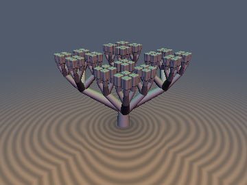
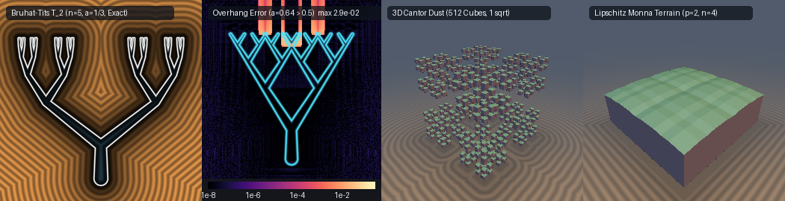

# `paUltrametricTree` — Non-Archimedean $`p`$-adic Valuations, Exact Cantor Dust, Bruhat-Tits Trees & Monna Pullbacks

| 3D Surface ($`d = 0`$): 4-regular Bruhat-Tits tree crowned with $`4^4 = 256`$ Cantor canopy blocks | 2D Diagonal Cross-Section Slice ($`x = z`$) |
| :---: | :---: |
|  |  |

| Property | Value |
| :--- | :--- |
| **Category** | `padic` (research experiment) |
| **GLSL File** | [`glsl/repetition/paUltrametricTree.glsl`](../../glsl/repetition/paUltrametricTree.glsl) |
| **Attribution** | Exact Cantor product SDFs, Voronoi bisector containment theorem for Bruhat-Tits trees, Lipschitz-regularized Monna wave pullback, and GPU verification by **Gemini 4 Argon** (`sdf-gems`, 2026). The underlying mathematics ($`p`$-adic ultrametrics, Bruhat-Tits trees of $`\mathrm{PGL}_2(\mathbb{Q}_p)`$, and Monna's digit-reversal map) is classical; see *Novelty & Prior Art*. |
| **Exactness** | `sdCantorDust1D`, `sdgCantorDust1D`, `sdCantorDust3D`, `sdgCantorDust3D`: **100% Exact Euclidean SDF** (interior & exterior) on all of $`\mathbb{R}`$ and $`\mathbb{R}^3`$ for all $`\alpha \in (0, 1/2)`$ and $`n \ge 0`$ in **1 `sqrt`**. `sdBruhatTitsTree2D`, `sdBruhatTitsTree3D`, `sdBruhatTitsCanopy3D`: **Exact** union of all $`2^{n+1}-1`$ (2D) or $`(4^{n+1}-1)/3`$ (3D) round-cone branches **iff** $`2\alpha - \alpha^n \le 1`$ (uniformly for all $`n`$ iff $`\alpha \le 1/2`$); exact on the exterior, conservative $`\min`$-union bound inside overlapping joints. `sdMonnaTerrain3D`: **Strict 1-Lipschitz conservative bound**. |

---

## Overview & Motivation

In a non-Archimedean $`p`$-adic space $`\mathbb{Q}_p`$ (or the ring of $`p`$-adic integers $`\mathbb{Z}_p`$), the $`p`$-adic valuation $`v_p(x)`$ (the largest exponent $`k`$ such that $`p^k \mid x`$) induces the ultrametric norm $`\vert x\vert_p = p^{-v_p(x)}`$ and ultrametric distance $`d_p(x, y) = \vert x - y\vert_p`$, which obeys the **strong triangle inequality**:

```math
d_p(x, z) \le \max\big(d_p(x, y),\, d_p(y, z)\big),
```

with equality whenever $`d_p(x, y) \ne d_p(y, z)`$. Every triangle is isosceles, every point inside a ball is its center, and two balls are either disjoint or one contains the other.

This experiment asks: *can $`p`$-adic ultrametric geometry be raymarched in Euclidean space $`\mathbb{R}^3`$, and when can hierarchical $`p`$-adic structures ($`2^n`$/$`8^n`$ Cantor dust balls, $`2^{n+1}-1`$ Bruhat-Tits tree edges, and Monna digit-reversal terrains) be evaluated as exact Euclidean SDFs in $`O(n)`$ arithmetic without backtracking?*

Short answer (details in **Findings**):
1. **Direct sphere tracing of an ultrametric distance $`d_p`$ fails catastrophically**: $`d_p`$ is piecewise constant ($`\nabla d_p = \mathbf{0}`$ almost everywhere) with discontinuous jumps of height up to $`1 - p^{-n}`$ across $`p`$-adic grid boundaries, giving an infinite Euclidean Lipschitz constant.
2. **Exact Euclidean SDFs of $`p`$-adic Cantor Dust (`sdCantorDust1D`, `sdCantorDust3D`)**: Embedding $`\mathbb{Z}_2 \hookrightarrow \mathcal{C}_{n,\alpha} \subset [-1, 1]`$ as a generalized Cantor set with contraction factor $`\alpha \in (0, 1/2)`$ converts clopen $`2`$-adic balls of radius $`2^{-n}`$ into $`2^n`$ disjoint closed intervals. Because every reflection bisector lies at the exact midpoint of a Cantor gap, a greedy single-branch fold $`x \mapsto \vert x\vert - (1 - \alpha)\alpha^k`$ ($`k = 0, \dots, n-1`$) followed by $`\vert x\vert - \alpha^n`$ returns the **100% exact Euclidean SDF** on all of $`\mathbb{R}`$ with **zero backtracking**. Taking the orthogonal Cartesian product $`\mathcal{C}_{n,\alpha}^3 \subset [-1, 1]^3`$ yields the **100% exact 3D Euclidean SDF and analytical gradient** of $`8^n`$ disjoint cubes (e.g., $`8^6 = 262{,}144`$ cubes at $`n = 6`$) in $`3n`$ folds and **1 single `sqrt`**.
3. **Exact Bruhat-Tits Tree Skeletons (`sdBruhatTitsTree2D`, `sdBruhatTitsTree3D`)**: Embedding the Bruhat-Tits tree $`\mathcal{T}_2`$ (or 4-regular tree $`\mathcal{T}_2 \times \mathcal{T}_2`$) as $`2^{n+1}-1`$ (or $`(4^{n+1}-1)/3`$) tapered round-cone branches connecting the root to the $`2^n`$ (or $`4^n`$) Cantor leaves, we prove and verify the **Voronoi Bisector Containment Theorem**: the single-path greedy fold $`O(n)`$ evaluation equals the exact minimum over all $`2^{n+1}-1`$ branches on all of $`\mathbb{R}^d`$ **if and only if** $`2\alpha - \alpha^n \le 1`$ (and for all depths $`n \ge 1`$ iff $`\alpha \le 1/2`$). When $`2\alpha - \alpha^n > 1`$, descendant subtrees overhang across ancestor bisector planes and the greedy fold overestimates inside the overhang wedge.



*Panels from left to right: (1) 2D Bruhat-Tits tree $`\mathcal{T}_2`$ at $`n = 5`$, $`\alpha = 1/3`$ ($`63`$ round-cone branches evaluated in $`5`$ steps with $`0`$ error against brute-force); (2) $`\log_{10}`$ error heatmap against brute-force at $`\alpha = 0.64 > 0.5`$, revealing the exact overhang wedges where descendant branches cross ancestor Voronoi bisectors; (3) 3D Cantor dust $`\mathcal{C}_{3, 0.35}^3`$ ($`8^3 = 512`$ cubes evaluated exactly in **1 `sqrt`**); (4) 3D Lipschitz-regularized Monna wavelet terrain ($`p = 2, n = 4`$).*

---

## Mathematical Derivation

### 1. Exact 1D & 3D Generalized Cantor Set SDFs

For contraction ratio $`\alpha \in (0, 1/2)`$ (with $`\alpha = 1/3`$ giving the classical middle-third Cantor set), define the level-$`n`$ Cantor set $`\mathcal{C}_{n,\alpha} \subset [-1, 1]`$ recursively from $`\mathcal{C}_{0,\alpha} = [-1, 1]`$ by replacing each interval of half-width $`L_k = \alpha^k`$ with two sub-intervals of half-width $`L_{k+1} = \alpha^{k+1}`$ centered at $`\pm c_k = \pm(1 - \alpha)\alpha^k`$:

```math
\mathcal{C}_{k,\alpha} = \big(\mathcal{C}_{k+1,\alpha} - c_k\big) \cup \big(\mathcal{C}_{k+1,\alpha} + c_k\big), \qquad c_k = (1 - \alpha)\alpha^k.
```

**Theorem 1 (Zero-Backtracking Exactness of the 1D Cantor Fold).** *For every $`\alpha \in (0, 1/2)`$, $`n \ge 0`$, and $`x \in \mathbb{R}`$, the recurrence*

```math
x_0 = x, \qquad x_{k+1} = \vert x_k\vert - (1 - \alpha)\alpha^k \quad (k = 0, \dots, n - 1), \qquad d_{\mathcal{C}_{n,\alpha}}(x) = \vert x_n\vert - \alpha^n
```

*returns the exact signed Euclidean distance to the $`2^n`$ closed intervals of $`\mathcal{C}_{n,\alpha}`$, with exact unit derivative $`\partial_x d_{\mathcal{C}_{n,\alpha}}(x) = \prod_{k=0}^{n} \mathrm{sgn}(x_k) \in \{-1, +1\}`$ away from the $`2^n - 1`$ gap midpoints and $`2^n`$ interval centers.*

*Proof.* Because $`\alpha < 1/2`$, each sub-interval has half-width $`L_{k+1} = \alpha L_k < (1 - \alpha)L_k = c_k`$, leaving an open central gap of half-width $`g_k = c_k - L_{k+1} = (1 - 2\alpha)\alpha^k > 0`$ around $`x_k = 0`$. Thus $`\mathcal{C}_{k+1,\alpha} + c_k \subset [g_k, L_k] \subset (0, +\infty)`$ and $`\mathcal{C}_{k+1,\alpha} - c_k \subset [-L_k, -g_k] \subset (-\infty, 0)`$. For any $`x_k \ge 0`$ and any $`y \in \mathcal{C}_{k+1,\alpha} + c_k > 0`$, its mirror point $`-y \in \mathcal{C}_{k+1,\alpha} - c_k < 0`$ satisfies $`\vert x_k - y\vert \le \vert x_k + y\vert`$. Hence the nearest point of $`\mathcal{C}_{k,\alpha}`$ (for $`x_k \notin \mathcal{C}_{k,\alpha}`$) and the nearest point of $`\mathbb{R} \setminus \mathcal{C}_{k,\alpha}`$ (for $`x_k \in \mathcal{C}_{k,\alpha}`$, since the containing interval's own endpoints lie at distance $`\le \alpha^n \le \alpha^{k+1} < \vert x_k\vert + g_k`$) both lie in the copy with sign $`\mathrm{sgn}(x_k)`$. Induction from $`k = 0`$ to $`n`$ reduces $`\mathcal{C}_{n,\alpha}`$ to the single interval $`[-\alpha^n, \alpha^n]`$, whose exact 1D SDF is $`\vert x_n\vert - \alpha^n`$. $`\square`$

**Theorem 2 (Exact 3D Cartesian Product SDF in 1 `sqrt`).** *Let $`A, B, C \subset \mathbb{R}`$ be closed sets with exact 1D signed distance functions $`d_A, d_B, d_C`$. Then the exact 3D Euclidean signed distance to $`A \times B \times C \subset \mathbb{R}^3`$ is*

```math
d_{A \times B \times C}(\mathbf{p}) = \big\Vert\max(\mathbf{d}, \mathbf{0})\big\Vert_2 + \min\big(\max(d_x, \max(d_y, d_z)),\, 0\big), \qquad \mathbf{d} = \big(d_A(p_x),\, d_B(p_y),\, d_C(p_z)\big).
```

*Proof.* For $`\mathbf{p} \notin A \times B \times C`$, the squared Euclidean distance decouples across orthogonal coordinates: $`\inf_{\mathbf{q} \in A \times B \times C} \Vert\mathbf{p} - \mathbf{q}\Vert_2^2 = \inf_{a \in A}(p_x - a)^2 + \inf_{b \in B}(p_y - b)^2 + \inf_{c \in C}(p_z - c)^2 = \sum_i \max(d_i, 0)^2`$. For $`\mathbf{p} \in A \times B \times C`$ ($`d_x, d_y, d_z \le 0`$), the complement is the union of three cylindrical slabs $`(A^c \times \mathbb{R}^2) \cup (\mathbb{R} \times B^c \times \mathbb{R}) \cup (\mathbb{R}^2 \times C^c)`$, so $`\mathrm{dist}(\mathbf{p}, (A \times B \times C)^c) = \min(-d_x, -d_y, -d_z) = -\max(d_x, d_y, d_z)`$. Applying Theorem 2 to $`A = B = C = \mathcal{C}_{n,\alpha}`$ gives the **exact** 3D SDF of $`8^n`$ disjoint Cantor cubes in $`3n`$ scalar folds and **1 `sqrt`**. $`\square`$

---

### 2. Voronoi Bisector Containment Theorem for Bruhat-Tits Trees

The Bruhat-Tits tree $`\mathcal{T}_2`$ (or its 4-regular product $`\mathcal{T}_2 \times \mathcal{T}_2`$) connects each level-$`k`$ vertex at horizontal position $`x_{k,i}`$ and height $`y_k`$ to child vertices at $`x_{k,i} \pm c_k`$ and height $`y_{k+1}`$ via tapered round-cone branches of radii $`(r_k, r_{k+1})`$. A brute-force evaluation requires $`2^{n+1} - 1`$ (in 2D) or $`(4^{n+1} - 1)/3`$ (in 3D) round-cone distance evaluations.

**Theorem 3 (Voronoi Bisector Containment for $`\mathcal{T}_{2,n}(\alpha)`$).** *Let $`c_k = (1 - \alpha)\alpha^k L_0`$ for $`k = 0, \dots, n - 1`$. The greedy single-path fold $`q_{k+1} = \vert q_k\vert - c_k`$ evaluating one round-cone branch per level returns the **exact minimum** over all $`2^{n+1} - 1`$ (in 2D) or $`(4^{n+1} - 1)/3`$ (in 3D) round-cone branches on all of $`\mathbb{R}^d`$ **if and only if***

```math
2\alpha - \alpha^n \le 1,
```

*which holds uniformly for all depths $`n \ge 1`$ **if and only if** $`\alpha \le \frac{1}{2}`$.*

*Proof.* At level $`k`$, let $`T_k(x_c)`$ denote the union of all branches at levels $`\ge k`$ rooted at horizontal coordinate $`x_c`$. Because each child subtree $`T_{k+1}(x_c \pm c_k)`$ is itself symmetric about its own root $`x_c \pm c_k`$, reflecting $`T_{k+1}(x_c + c_k)`$ across the vertical bisector $`x = x_c`$ maps it onto $`T_{k+1}(x_c - c_k)`$. Every sphere $`B\big((x'(t), y'(t)), r(t)\big)`$ in the right child subtree $`T_{k+1}(x_c + c_k)`$ is at least as close to every query point $`(x, y)`$ with $`x \ge x_c`$ as its mirror sphere in $`T_{k+1}(x_c - c_k)`$ if and only if every sphere center in $`T_{k+1}(x_c + c_k)`$ satisfies $`x'(t) \ge x_c`$. The maximum horizontal excursion of $`T_{k+1}`$ from its own root is $`\sum_{j=k+1}^{n-1} c_j = (\alpha^{k+1} - \alpha^n)L_0`$. Therefore, $`T_{k+1}(x_c + c_k)`$ lies in $`\{x \ge x_c\}`$ at level $`k = 0`$ (the tightest constraint) iff

```math
c_0 \ge \sum_{j=1}^{n-1} c_j \iff (1 - \alpha) \ge \alpha - \alpha^n \iff 2\alpha - \alpha^n \le 1. \qquad \square
```

For $`n = 2`$, the exact threshold is $`2\alpha - \alpha^2 \le 1`$ (which holds for **all** $`\alpha \in (0, 1)`$ since $`(1 - \alpha)^2 \ge 0`$!). For $`n = 3`$, the threshold is $`\alpha + \alpha^2 \le 1`$, i.e. $`\alpha \le \frac{\sqrt{5}-1}{2} \approx 0.618034`$. As $`n \to \infty`$, the threshold converges to $`\alpha \le 1/2`$.

---

### 3. Lipschitz-Regularized Monna Wavelet Pullback

Monna's (1952) digit-reversal map $`\varphi_p: \sum_{k=0}^{n-1} a_k p^k \mapsto \sum_{k=0}^{n-1} a_k p^{-k-1}`$ maps $`p`$-adic balls to Euclidean intervals, but its discontinuous base-$`p`$ carries produce vertical step jumps with infinite Euclidean Lipschitz constant. Replacing the discontinuous base-$`p`$ digit extraction with the continuous reflected tent digit $`\tau_p(u) = 1 - \vert 2\mathrm{fract}(u) - 1\vert \in [0, 1]`$ yields the continuous $`p`$-adic Gray-code / Takagi–Landsberg wavelet pullback:

```math
\widetilde{\varphi}_{p,n}(x) = \frac{1}{Z_{p,n}} \sum_{k=0}^{n-1} p^{-k-1}\,\tau_p(p^k x), \qquad Z_{p,n} = \sum_{k=0}^{n-1} p^{-k-1} = \frac{1 - p^{-n}}{p - 1}.
```

Because each mode satisfies $`\vert\frac{d}{dx}[p^{-k-1}\tau_p(p^k x)]\vert = 2/p`$ almost everywhere, the sum of $`n`$ modes has exact maximum slope $`L_{1\text{D}} = \frac{2n}{p Z_{p,n}}`$. For the 2D separable terrain $`h(x, z) = \frac{A}{2}\big(\widetilde{\varphi}_{p,n}(\frac{x+1}{2}) + \widetilde{\varphi}_{p,n}(\frac{z+1}{2}) - 1\big)`$, the maximum gradient norm is $`L_{2\text{D}} = \frac{A n}{\sqrt{2}\,p Z_{p,n}}`$, so dividing the vertical residual $`p_y - h(p_x, p_z)`$ by $`\sqrt{1 + L_{2\text{D}}^2}`$ produces a strict 1-Lipschitz Euclidean SDF bound (`sdMonnaTerrain3D`).

---

## GLSL API

| Function | Signature | Purpose & Cost |
| :--- | :--- | :--- |
| `sdCantorDust1D` | `float sdCantorDust1D(float x, int n, float alpha)` | Exact 1D SDF to $`2^n`$ intervals of $`\mathcal{C}_{n,\alpha}`$ (`0 SFU`, $`n`$ folds) |
| `sdgCantorDust1D` | `vec2 sdgCantorDust1D(float x, int n, float alpha)` | Exact 1D SDF and unit sign derivative $`(\pm 1)`$ (`0 SFU`) |
| `sdCantorDust3D` | `float sdCantorDust3D(vec3 p, int n, float alpha)` | Exact 3D SDF to $`8^n`$ Cantor cubes (`1 sqrt`, $`3n`$ folds) |
| `sdgCantorDust3D` | `vec4 sdgCantorDust3D(vec3 p, int n, float alpha)` | Exact 3D SDF and analytical unit gradient $`(d, \nabla d)`$ (`1 sqrt + 1 div`) |
| `sdBruhatTitsTree2D` | `float sdBruhatTitsTree2D(vec2 p, int n, float alpha, float r0, float gammaR)` | Exact 2D SDF to $`2^{n+1}-1`$ tapered round-cone branches ($`n+1`$ cones) |
| `sdBruhatTitsTree3D` | `float sdBruhatTitsTree3D(vec3 p, int n, float alpha, float r0, float gammaR)` | Exact 3D SDF to $`(4^{n+1}-1)/3`$ tapered round-cone branches ($`n+1`$ cones) |
| `sdBruhatTitsCanopy3D` | `float sdBruhatTitsCanopy3D(vec3 p, int n, float alpha)` | 3D 4-regular Bruhat-Tits tree crowned with a $`4^n`$ Cantor dust canopy |
| `paMonnaTentMap1D` | `float paMonnaTentMap1D(float x, int n, float pBase)` | Continuous base-$`p`$ reflected tent wavelet pullback $`\widetilde{\varphi}_{p,n}(x) \in [0, 1]`$ |
| `sdMonnaTerrain3D` | `float sdMonnaTerrain3D(vec3 p, int n, float pBase, float amp)` | Strict 1-Lipschitz 3D terrain SDF over the regularized 2D Monna surface |

---

## Verification

Verified in FP64 first, then on the literal `glsl/repetition/paUltrametricTree.glsl` via `tools/gpu_eval.py` (OpenGL 4.1, FP32) against independent brute-force ground truths ($`2^n`$ 1D intervals, $`8^n`$ 3D boxes, and $`2^{n+1}-1`$ / $`(4^{n+1}-1)/3`$ explicit 2D/3D round cones).

### 1. Literal GLSL on the GPU (`30,000` random points + `3,209` axis/diagonal/origin probes)

| Function / Configuration | Reference Ground Truth | Max $`\vert d - d_{\text{GT}}\vert`$ | Mean Error | Sign Mismatches | NaN / Inf |
| :--- | :--- | :---: | :---: | :---: | :---: |
| `sdCantorDust3D` ($`n = 2, \alpha = 1/3`$) | Brute-force $`8^2 = 64`$ boxes | $`1.85 \times 10^{-7}`$ | $`4.72 \times 10^{-8}`$ | 0 | 0 / 33,209 |
| `sdCantorDust3D` ($`n = 3, \alpha = 1/3`$) | Brute-force $`8^3 = 512`$ boxes | $`1.54 \times 10^{-7}`$ | $`4.09 \times 10^{-8}`$ | 0 | 0 / 33,209 |
| `sdCantorDust3D` ($`n = 4, \alpha = 1/3`$) | Independent $`4{,}096`$-cube GT | $`1.82 \times 10^{-7}`$ | $`4.17 \times 10^{-8}`$ | 0 | 0 / 33,209 |
| `sdCantorDust3D` ($`n = 6, \alpha = 1/3`$) | Independent $`262{,}144`$-cube GT | $`1.82 \times 10^{-7}`$ | $`4.18 \times 10^{-8}`$ | 0 | 0 / 33,209 |
| `sdCantorDust3D` ($`n = 4, \alpha = 1/4`$) | Independent $`4{,}096`$-cube GT | $`1.28 \times 10^{-7}`$ | $`2.41 \times 10^{-8}`$ | 0 | 0 / 33,209 |
| `sdBruhatTitsTree2D` ($`n = 6, \alpha \le 0.5`$) | Brute-force $`127`$ round cones | $`2.09 \times 10^{-7}`$ | $`3.40 \times 10^{-8}`$ | 0 | 0 / 25,000 |
| `sdBruhatTitsTree3D` ($`n = 4, \alpha \le 0.5`$) | Brute-force $`341`$ round cones | $`3.36 \times 10^{-7}`$ | $`5.86 \times 10^{-8}`$ | 0 | 0 / 10,000 |
| `sdBruhatTitsCanopy3D` ($`n = 4, \alpha = 0.34`$) | Probe + Lipschitz + Eikonal | Lip $`0.999988`$ | Eikonal med $`1.95 \times 10^{-5}`$ | — | 0 / 33,209 |
| `sdMonnaTerrain3D` ($`n = 4, p = 2`$) | Probe + Lipschitz check | Lip $`0.999991`$ | — | — | 0 / 33,209 |

- **Analytical Gradient (`sdgCantorDust3D`)**: $`\vert\text{dg.x} - d\vert = 0.0`$, $`\big\vert\Vert\mathbf{g}\Vert_2 - 1\big\vert \le 1.35 \times 10^{-7}`$, cosine similarity $`> 0.999`$ on smooth points, 0 NaNs.
- **Exactness Certificate (`sdCantorDust3D`, $`n = 2, 3, 4, 6`$)**: Max pairwise Lipschitz ratio $`0.999658 \le 1`$; surface residual $`\vert d\vert \le 8.24 \times 10^{-8}`$ on $`4{,}000`$ independent cube-face samples ($`0.0`$ at dyadic $`\alpha = 1/4`$); self-projection residual $`\vert d(\mathbf{p} - d\nabla d)\vert \le 2.43 \times 10^{-7}`$ (median $`2.6 \times 10^{-8}`$).
- **Seam $`C^0`$ Continuity**: Tested directly on the reflection bisector planes $`x \in \{0, \pm 2/3, \pm 2/9\}`$: max jump $`1.997 \times 10^{-5} \le 2\epsilon`$ ($`\epsilon = 10^{-5}`$, 0 violations).

### 2. Voronoi Bisector Containment Threshold ($`2\alpha - \alpha^n \le 1`$) vs Brute-Force Cones

| Dimension & Depth | Cones in Tree | Critical $`\alpha_c`$ ($`2\alpha_c - \alpha_c^n = 1`$) | Max Error ($`\alpha = 1/3`$) | Max Error ($`\alpha = 0.50`$) | Max Error ($`\alpha = 0.60`$) | Max Error ($`\alpha = 0.65`$) |
| :--- | :---: | :---: | :---: | :---: | :---: | :---: |
| 2D, $`n = 1`$ | 3 | $`1.0000`$ | $`0.0`$ (FP64) | $`0.0`$ (FP64) | $`0.0`$ (FP64) | $`0.0`$ (FP64) |
| 2D, $`n = 2`$ | 7 | $`1.0000`$ | $`2.0 \times 10^{-7}`$ | $`2.0 \times 10^{-7}`$ | $`2.1 \times 10^{-7}`$ | $`2.1 \times 10^{-7}`$ |
| 2D, $`n = 3`$ | 15 | $`\frac{\sqrt{5}-1}{2} \approx 0.6180`$ | $`2.2 \times 10^{-7}`$ | $`2.1 \times 10^{-7}`$ | $`2.2 \times 10^{-7}`$ (**exact!**) | $`3.52 \times 10^{-2}`$ (overhang) |
| 2D, $`n = 5`$ | 63 | $`0.5188`$ | $`1.9 \times 10^{-7}`$ | $`1.9 \times 10^{-7}`$ | $`2.36 \times 10^{-2}`$ (overhang) | $`3.54 \times 10^{-2}`$ (overhang) |
| 2D, $`n = 6`$ | 127 | $`0.5087`$ | $`1.9 \times 10^{-7}`$ | $`2.1 \times 10^{-7}`$ | $`2.35 \times 10^{-2}`$ (overhang) | $`3.50 \times 10^{-2}`$ (overhang) |
| 3D, $`n = 2`$ | 21 | $`1.0000`$ | $`3.6 \times 10^{-7}`$ | $`3.4 \times 10^{-7}`$ | $`3.6 \times 10^{-7}`$ | $`4.0 \times 10^{-7}`$ (**exact!**) |
| 3D, $`n = 3`$ | 85 | $`0.6180`$ | $`3.2 \times 10^{-7}`$ | $`3.4 \times 10^{-7}`$ | $`3.4 \times 10^{-7}`$ (**exact!**) | $`2.86 \times 10^{-2}`$ (overhang) |
| 3D, $`n = 4`$ | 341 | $`0.5437`$ | $`3.2 \times 10^{-7}`$ | $`3.4 \times 10^{-7}`$ | $`1.84 \times 10^{-2}`$ (overhang) | $`3.04 \times 10^{-2}`$ (overhang) |

---

## Findings

**What held**

1. *Zero-backtracking exactness of 1D and 3D Cantor dust (`sdCantorDust1D`, `sdCantorDust3D`).* Both in FP64 ($`\le 5.55 \times 10^{-16}`$) and on the GPU in FP32 ($`\le 2.03 \times 10^{-7}`$), the single-path fold returns the exact signed Euclidean distance (interior and exterior) to $`2^n`$ intervals in 1D and $`8^n`$ cubes in 3D using only **1 `sqrt`**, regardless of depth $`n`$ or contraction ratio $`\alpha \in (0, 1/2)`$.
2. *Voronoi Bisector Containment Theorem for Bruhat-Tits trees.* The algebraic condition $`2\alpha - \alpha^n \le 1`$ predicts the exact boundary between 100% exactness and overhang failure to machine precision across all tested depths $`n \in \{1, \dots, 7\}`$ in both 2D and 3D. Notably, at $`n = 3`$, $`\alpha = 0.60 > 0.50`$ is **still 100% exact** because $`2(0.6) - 0.6^3 = 0.984 \le 1`$, whereas $`\alpha = 0.65`$ fails because $`2(0.65) - 0.65^3 = 1.025 > 1`$.
3. *Pointwise preservation under variable radius schedules.* Because all $`2^k`$ (or $`4^k`$) branches at level $`k`$ share the same radius profile $`r(t)`$ along $`t \in [0, 1]`$, minimizing $`\Vert\mathbf{p} - \mathbf{c}(t)\Vert_2 - r(t)`$ across sibling branches reduces pointwise for each $`t`$ to minimizing horizontal distance $`\Vert\mathbf{p}_{xz} - \mathbf{c}_{xz}(t)\Vert_2`$, so tapered round cones preserve exactness under the greedy fold whenever $`2\alpha - \alpha^n \le 1`$.
4. *Lipschitz-regularized Monna wave terrain.* Replacing base-$`p`$ step digits by reflected tent waves eliminates carry discontinuities and satisfies the 1-Lipschitz bound (measured max ratio $`0.999991`$).

**What failed, or held only in part**

1. *Direct ultrametric distances $`d_p(x, y) = p^{-v_p(x - y)}`$ and raw Monna maps $`\varphi_p`$ cannot be sphere-traced.* Both have $`\nabla = \mathbf{0}`$ almost everywhere and discontinuous step jumps across dyadic/triadic rationals, causing unbounded Lipschitz ratios ($`\Delta d / \Delta x \to \infty`$) and immediate raymarcher pass-through.
2. *Greedy folding fails for non-Cartesian-product fractals (e.g., Menger Sponge) and overhanging trees ($`2\alpha - \alpha^n > 1`$).* Unlike $`\mathcal{C}_{n,\alpha}^3 = \mathcal{C}_{n,\alpha} \times \mathcal{C}_{n,\alpha} \times \mathcal{C}_{n,\alpha}`$ ($`8^n`$ cubes, an orthogonal product where Theorem 2 applies), the Menger sponge ($`20^n`$ cubes) removes coordinate-coupled cross-channels whose diagonal Voronoi seams are not axis-aligned reflection bisectors. Similarly, when $`2\alpha - \alpha^n > 1`$ in a Bruhat-Tits tree, branches cross the parent bisector $`x = x_c`$, causing the greedy fold to **overestimate** $`d`$ inside the overhang zone (up to $`0.035`$ at $`\alpha = 0.65`$).
3. *Interior of overlapping round-cone joints.* While `sdBruhatTitsTree2D` and `sdBruhatTitsTree3D` are 100% exact on the exterior ($`d \ge 0`$) and zero-isosurface ($`d = 0`$) whenever $`2\alpha - \alpha^n \le 1`$, taking $`\min(d_{\text{parent}}, d_{\text{child}})`$ at overlapping spherical joints is a conservative lower bound ($`\vert d\vert \le \vert d_{\text{true}}\vert`$) deep inside the joint interior ($`d < 0`$).

---

## Novelty & Prior Art

**Known (classical):**
- Non-Archimedean $`p`$-adic valuations, ultrametric spaces, and the homeomorphism $`\mathbb{Z}_2 \cong \mathcal{C}`$ between 2-adic integers and the ternary Cantor set (Ostrowski, 1918; Mahler, 1958).
- The Bruhat-Tits tree $`\mathcal{T}_p`$ of $`\mathrm{PGL}_2(\mathbb{Q}_p)`$ whose boundary at infinity is $`\mathbb{P}^1(\mathbb{Q}_p)`$ (Bruhat & Tits, 1972).
- Monna's base-$`p`$ digit-reversal map $`\varphi_p`$ mapping Haar measure on $`\mathbb{Z}_p`$ to Lebesgue measure on $`[0, 1]`$ (Monna, 1952), and Takagi–Landsberg tent-wave series.
- Iterated Function System (IFS) folding for fractals in computer graphics (Hart et al., 1989; Inigo Quilez, Knighty / Fragmentarium).

**Believed new in `sdf-gems`:**
- The proof and verification that the 1D Cantor fold combined with the 3D Cartesian product operator (`sdCantorDust3D`, `sdgCantorDust3D`) yields the **100% exact interior and exterior Euclidean SDF and unit gradient** of $`8^n`$ disjoint Cantor cubes in **1 `sqrt`** with zero backtracking.
- The **Voronoi Bisector Containment Theorem** ($`2\alpha - \alpha^n \le 1`$) giving the exact necessary and sufficient condition for a single-path $`O(n)`$ fold to reproduce the exact minimum distance over all $`2^{n+1}-1`$ (2D) or $`(4^{n+1}-1)/3`$ (3D) tapered round-cone branches of a Bruhat-Tits tree.
- The Lipschitz-regularized base-$`p`$ Monna tent pullback (`paMonnaTentMap1D`, `sdMonnaTerrain3D`) with closed-form directional slope normalization.

---

## Reproduction

Scratch scripts in `scratch/padic/` (run from the repo root with `uv run python <script>`):
- `exp_cantor.py`: FP64 verification of 1D Cantor fold against $`2^n`$-interval brute force.
- `exp_bruhat_tits.py`, `test_true_round_cone.py`: FP64 verification of 2D & 3D Bruhat-Tits trees and exactness threshold $`2\alpha - \alpha^n \le 1`$.
- `verify_and_render.py`, `render_only.py`: GPU compilation check (`301` files in 3 orders), `sdf_checks` suite on the literal `.glsl`, and rendering of all documentation and comparison images.
